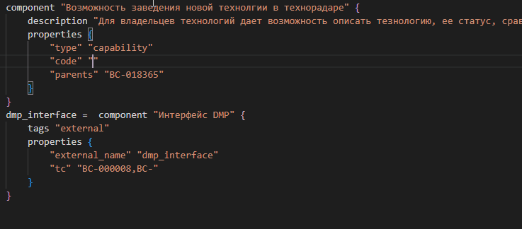
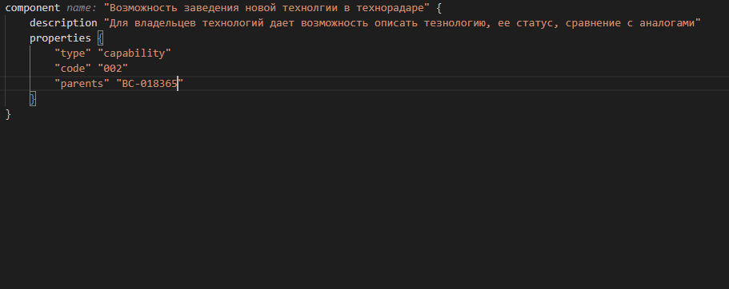
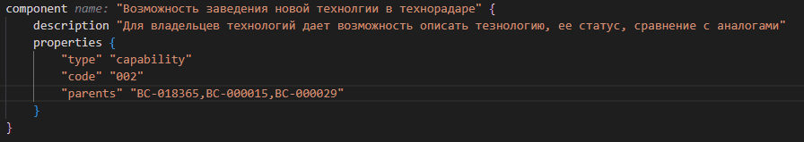

### Назначение

Цель архитектуры, ориентированной на возможности, заключается в том, чтобы обеспечить соответствие возможностей и бизнес-процессов организации ее технологической инфраструктуре. Такое согласование обеспечивает эффективное и результативное выполнение бизнес-стратегии и достижение поставленных целей, а так же позволяет оптимизировать ресурсы организации и повысить ее общую эффективность. Кроме того, архитектура, ориентированная на возможности, помогает снизить сложность и повысить гибкость, позволяя организации быстро реагировать на изменение рыночных условий и потребностей клиентов.

### На какие вопросы должна отвечать

* Какие технические возможности реализует приложение?
* Какую ценность для организации несут возможности моего приложения?
* Как он декомпозируется на технические возможности?
* Через какие интерфейсы и сервисы доступна техническая возможность?


### Инструкции

#### 1. Правила именования возможностей

**Краткое наименование:**
```
<Действие - отглагольное существительное> <Объект действия - существительное> + <Характеристика объекта/ уточнение>
```

*Пример: Управление клиентами, Выставление разовых счетов, Прием безналичных платежей.*

**Полное определение:**
```
Возможность <Действие – инфинитив глагол> <Объект действия - существительное> <Характеристика объекта / уточнение> <<Бизнес-результат> ИЛИ <Мотивация/конечная цель>
```

##### Действие

Деятельность/область деятельности направленная на достижение определенного значимого с точки зрения компании результата. В качестве основы для описания действий могут использоваться: процессы eTOM, бизнес-взаимодействия (Business Interaction), этапы E2E-потоков, элементы Value Chain - цепочки создания ценности.

##### Объект действия

Агрегированная сущность предметной области (ABE), либо конкретная сущность предметной области (Business Entity). В качестве объектов действия могут использоваться объекты КМД. 

##### Цель и бизнес-результат

Значимая ценность с точки зрения компании/ ее клиентов/ сотрудников.

#### 2. Процесс описания возможностей

Технические возможности приложения описываются в нотации Structurizr DSL в виде компонент, имеющих property type *capability*. Например:
```js
container "Facade API" {
    component "Получение информации о балансе клиента" {
                description "Возможность получать информацию о балансе клиента c целью использования в процессе тарификации, продажи услуг и информирования клиента в личном кабинете"
                properties {
                    type        capability
                    code        001
                    parents     "BC-011590"
                    version     "1.1"
                    goal_from   2025Q1
                    goal_to     2025Q3
                }
            }
}
```

где в properties указываются следующие значения:

* компонент должен размещаться в контейнере, через который доступно потребление технической возможности (веб-сервер фронтенда, api-gateway ...)
* компонент имеет **type**  равный **capability**
* **code** - уникальный номер tc (technical capability) внутри приложения (например. 001, 002, 003 ...). При публикации данных технических возможностей в корпоративный репозиторий к коду возможности будет добавлена мнемоника приложения (например, LCR.001, LCR.002, LCR.003). Это сделано, что бы исключить дублирование кодов TC опубликованных архитекторами разных систем.
* **Важно** Если вы поменяете код capability, то в центральной системе создастся capability с новым кодом, а со старым не удалится. Удаление требует ручной проверки на то что capability не используется в e2e процессах.
* **parents** - коды business capability которые реализует данная tc. Могут указываться через запятую.
* **version** состоит из мажорной и минорной части. Изменение мажорной версии происходит при реализации новых ФТ/НФТ. Указывается опционально.
* Опционально указываются квартал с которых tc становится целевой (goal_from) или по какой квартал он целевой (goal_to)

##### При использовании корпоративного плагина доступна функция автоподстановки кодов


##### Автокомплит кодов технической и бизнес возможностей

При нажатии комбинации клавиш вызова функции автокомплита Ctrl+Space и при условии если курсор находится в позиции, подразумевающей ввод кода технической или бизнес возможности, происходит отображение списка справочка возможностей, с возможностью поиска по коду


##### Всплывающая подсказка с названием технической или бизнес возможности

При наведении курсора мыши на код технической или бизнес возможности, появляется всплывающая подсказка с названием возможности, имеющей данный код.


#### Чек-лист самопроверки

* Модель должна быть загружена в центральный репозиторий 
* Каждая техническая возможность содержит название соответствующая шаблону
* Каждая техническая возможность содержит расширенное описание в description соответствующая шаблону
* Для каждой функциональности системы доступной через внешний API заведены технические возможности