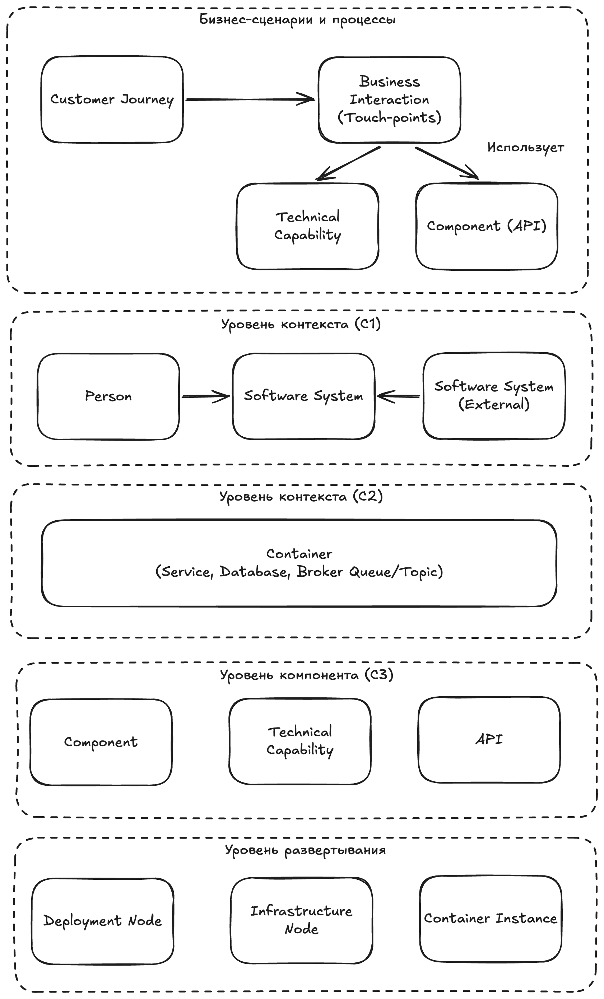

# Метамодель ПТР

Метамодель описывает типы сущностей (Fact Sheet Types), их атрибуты и связи, используемые при проектировании технического решения в методологии ПТР. 

## Обзор метамодели

Бизнес-сценарии CJ (Customer Journey) и BI (Business Interaction) из [BeeAtlas CX](beeatlas-docs/cx.md) связывают сквозные процессы с технической реализацией: для каждого вызова в BI указываются приложение, техническая возможность (TC), интерфейс (API) и endpoint. Это обеспечивает трассировку от бизнес-процесса до конкретных операций системы.

---

## Типы сущностей

### Software System (Приложение)

| Атрибут | Обязательный | Описание |
|---------|---------------|----------|
| name | да | Наименование программной системы |
| description | нет | Описание назначения системы |
| cmdb | да | Мнемоника системы в CMDB |

**Источник:** [3.1 Контекстная диаграмма](3.1%20Контекстная%20диаграмма.md), [3.2 Контейнерная диаграмма](3.2%20Контейнерная%20диаграмма.md)

**Связи:**
- Содержит → Container
- Взаимодействует с → Person, Software System (внешние)
- Реализует → Technical Capability

---

### Person (Пользователь / Роль)

| Атрибут | Обязательный | Описание |
|---------|---------------|----------|
| name | да | Наименование роли или типа пользователя |
| description | нет | Описание роли |

**Источник:** [3.1 Контекстная диаграмма](3.1%20Контекстная%20диаграмма.md)

**Связи:**
- Использует → Software System

---

### Container (Контейнер)

Абстракция уровня «приложения» или «под-системы». Независимая единица развертывания, ориентированная на bounded context.

| Атрибут | Обязательный | Описание |
|---------|---------------|----------|
| name | да | Имя контейнера (совпадает с именем сервиса/БД/топика) |
| description | нет | Описание назначения |
| tags | нет | Тег для отображения иконки технологии |
| technology | да | Технология из техрадара компании |
| url | да | URL репозитория исходного кода на GitLab |
| external_name | нет | Внешнее имя для landscape (не должно совпадать с именем переменной) |
| entity | нет | Бизнес-сущности в БД (для container базы данных) |

**Подтипы:** Сервис, База данных, Брокер сообщений (Kafka/RabbitMQ), Веб-сервер

**Источник:** [3.2 Контейнерная диаграмма](3.2%20Контейнерная%20диаграмма.md), [3.8 Логическая модель данных](3.8%20Логическая%20модель%20данных.md)

**Связи:**
- Принадлежит → Software System
- Содержит → Component
- Взаимодействует с → Container (протокол и порт в Description)
- Развернут на → Container Instance

---

### Component (Компонент)

Строительный блок контейнера. Выполняет определённые функции в рамках контейнера.

| Атрибут | Обязательный | Описание |
|---------|---------------|----------|
| name | да | Наименование компонента |
| description | нет | Описание назначения |
| type | нет | Тип: `capability`, `api` или не указан (обычный компонент) |

**Источник:** [4.1 Компонентная диаграмма](4.1%20Компонентная%20диаграмма.md)

**Связи:**
- Принадлежит → Container
- Взаимодействует с → Component

---

### Technical Capability (Техническая возможность)

Компонент с `type: capability`. Описывает техническую возможность приложения.

| Атрибут | Обязательный | Описание |
|---------|---------------|----------|
| type | да | `capability` |
| code | да | Уникальный номер TC внутри приложения (001, 002, …) |
| parents | да | Коды business capability (BC-xxxxx) |
| version | нет | Мажорная.минорная версия |
| goal_from | нет | Квартал с которого TC целевой |
| goal_to | нет | Квартал по который TC целевой |

**Источник:** [2 Определение перечня ТС](2%20Определение%20перечня%20ТС.md)

**Связи:**
- Реализуется в → Container
- Связь с → Business Capability (parents)
- Описывается в → Сценарий использования (Dynamic View)

---

### API Component (Компонент API)

Компонент с `type: api`. Спецификация внешнего интерфейса и нефункциональных требований.

| Атрибут | Обязательный | Описание |
|---------|---------------|----------|
| type | да | `api` |
| api_url | да | URL спецификации (yaml/json/proto/wsdl) |
| protocol | да | `rest` \| `soap` \| `grpc` |
| tc | нет | Код technical capability |
| version | нет | Версия протокола |
| external_name | нет | Внешнее имя для ссылки из других проектов |
| end-point properties | да | RPS, latency, error_rate для каждой операции |

**Источник:** [3.6 Нефункциональные требования](3.6%20Нефункциональные%20требования.md)

**Связи:**
- Принадлежит → Container
- Реализует → Technical Capability (tc)

---

### Relationship (Связь)

Связь между сущностями с направлением вызова.

| Атрибут | Обязательный | Описание |
|---------|---------------|----------|
| description | да | Описание вызова (end-point, протокол:порт) |
| send | нет | Бизнес-сущности, передаваемые в вызове |
| return | нет | Бизнес-сущности, возвращаемые в ответе |

**Источник:** [3.2 Контейнерная диаграмма](3.2%20Контейнерная%20диаграмма.md), [3.8 Логическая модель данных](3.8%20Логическая%20модель%20данных.md)

---

### Deployment Node (Узел развертывания)

Физический или логический узел инфраструктуры.

| Атрибут | Обязательный | Описание |
|---------|---------------|----------|
| name | да | Имя узла (сегмент, namespace, pod, VM, кластер) |
| type | да* | `vm`, `k8s-ns`, `k8s-cluster`, `k8s-ingress`, `s3-region`, `bare-metal` |
| host | нет | FQDN узла |
| ip | нет | IP-адрес или подсеть |
| external_ip | нет | Внешний IP (для доступа из Интернета) |
| flavour | нет | Конфигурация CPU/RAM (например, `cpu2ram8`) |
| volume_size | нет | Объём диска в ГБ |

*Для сегмента не указывается

**Источник:** [4.2 Диаграмма развертывания](4.2%20Диаграмма%20развертывания.md)

**Связи:**
- Содержит → Deployment Node, Container Instance, Infrastructure Node
- Принадлежит → Deployment Environment

---

### Container Instance (Экземпляр контейнера)

Экземпляр контейнера, развернутый на узле развертывания.

**Источник:** [4.2 Диаграмма развертывания](4.2%20Диаграмма%20развертывания.md)

**Связи:**
- Экземпляр → Container
- Развернут на → Deployment Node

---

### Infrastructure Node (Узел инфраструктуры)

Элемент инфраструктуры (load balancer, WAF и т.п.), не являющийся deployment node.

**Источник:** [4.2 Диаграмма развертывания](4.2%20Диаграмма%20развертывания.md)

---

### Scenario (Сценарий использования)

Dynamic View — описание алгоритма реализации технической возможности.

| Атрибут | Обязательный | Описание |
|---------|---------------|----------|
| key | да | Код технической возможности (BC-012345 или 0023) |
| description | да | Последовательность вызовов с end-point |

**Источник:** [3.5 Сценарии использования](3.5%20Сценарии%20использования.md)

**Связи:**
- Описывает → Technical Capability
- Участники → Person, Software System, Container

---

### ADR (Architecture Decision Record)

Запись об архитектурном решении.

| Атрибут | Обязательный | Описание |
|---------|---------------|----------|
| title | да | Решение + кратко проблема |
| status | да | Принято / Отклонено / Устарело |
| context | да | Контекст и проблема |
| decision | да | Принятое решение |
| consequences | да | Последствия и ограничения |

**Источник:** [5 Реестр архитектурных решений (ADR)](<5 Реестр архитектурных решений (ADR).md>)

---

### Entity (Бизнес-сущность)

Сущность из бизнес-глоссария для разметки данных.

**Источник:** [3.8 Логическая модель данных](3.8%20Логическая%20модель%20данных.md)

---

## Матрица связей (Relation Matrix)

| От \ К | Software System | Person | Container | Component | Tech Capability | API | Deployment Node | ADR |
|--------|-----------------|--------|-----------|-----------|-----------------|-----|-----------------|-----|
| **Software System** | взаимодействует | — | содержит | — | реализует | — | — | — |
| **Person** | использует | — | — | — | — | — | — | — |
| **Container** | — | — | вызывает | содержит | — | — | развернут на | — |
| **Component** | — | — | — | вызывает | — | — | — | — |
| **Tech Capability** | — | — | в контейнере | — | — | — | — | — |
| **API** | — | — | в контейнере | — | реализует TC | — | — | — |
| **Scenario** | участник | участник | участник | — | описывает | — | — | — |

---

## Ссылки на артефакты

| Артефакт | Документ | Элементы метамодели |
|----------|----------|---------------------|
| Контекстная диаграмма | [3.1](3.1%20Контекстная%20диаграмма.md) | Person, Software System, Relationship |
| Контейнерная диаграмма | [3.2](3.2%20Контейнерная%20диаграмма.md) | Container, Relationship |
| Сценарии использования | [3.5](3.5%20Сценарии%20использования.md) | Scenario, Dynamic View |
| API и НФТ | [3.6](3.6%20Нефункциональные%20требования.md) | API Component |
| Логическая модель данных | [3.8](3.8%20Логическая%20модель%20данных.md) | Entity, send, return |
| Компонентная диаграмма | [4.1](4.1%20Компонентная%20диаграмма.md) | Component |
| Диаграмма развертывания | [4.2](4.2%20Диаграмма%20развертывания.md) | Deployment Node, Container Instance, Infrastructure Node |
| Реестр ADR | [5](<5 Реестр архитектурных решений (ADR).md>) | ADR |
| Определение ТС | [2](2%20Определение%20перечня%20ТС.md) | Technical Capability |
