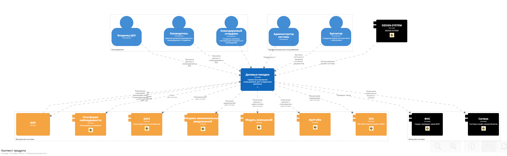

#### Назначение

* Предназначена для описания общего контекста приложения и его окружения.
* На диаграмме показываются внешние взаимодействия приложения как с системами, так и с пользователями.
* Диаграмма не показывает детали реализации приложения и концентрируется только на его внешнем окружении.

#### На какие вопросы должна отвечать

* Какую систему создаем?
* Кто является пользователем приложения?
* Какие системы зависят от сервисов, предоставляемых приложением?
* От каких систем зависит функционирование приложения?
* Какие производственные платформы используются для обеспечения наблюдаемости, отказоустойчивости и безопасности приложения?

!!! info "Чек-лист самопроверки"

    - [ ] Диаграмма должна быть выполнена в нотации C4 уровня C1 [SystemContext](https://docs.structurizr.com/dsl/language#systemcontext-view)
    - [ ] Диаграмма должна быть загружена в центральный репозиторий 
    - [ ] На диаграмме должны быть изображены все системы взаимодействующие с данным приложением
    - [ ] На диаграмме должны быть изображены все пользователи (роли) взаимодействующие с приложением
    - [ ] Все системы должны иметь входящие или исходящие связи с приложением
    - [ ] Все системы должны иметь property с мнемоникой CMDB
    - [ ] Все связи должны быть подписаны
    - [ ] Связи должны идти в направлении вызова

#### Шаблоны

[Шаблон проекта](templates/workspace.dsl)

