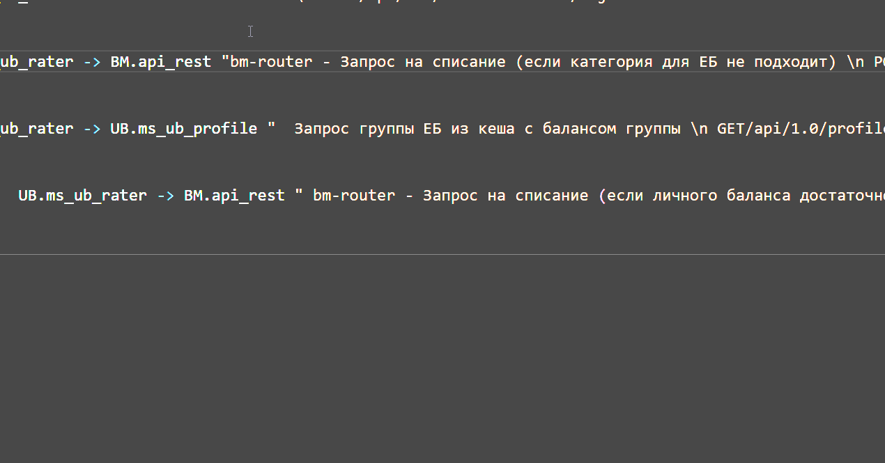
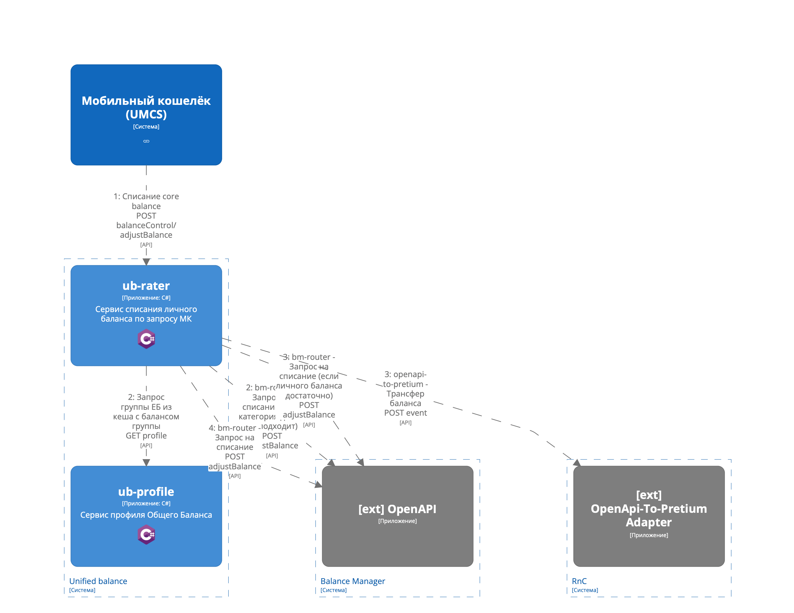

#### Назначение

* Динамическая диаграмма — способ описания алгоритма реализации технической возможности приложения.

#### На какие вопросы должна отвечать

* Понять как реализуются технические возможности системы.
* Какие взаимодействия происходят между контейнерами системы в процессе реализации технической возможности?
* Какие интерфейсы самого приложения и внешних приложений используются при реализации технической возможности?

#### Артефакт и инструменты

* Диаграммы для иллюстрации вариантов использования создаются в [C4 Dynamic](https://c4model.com/#DynamicDiagram)
* Диаграммы должны строится на уровне контейнеров систем (C2)
* Ключ диаграммы должен совпадать с технической возможностью. Например, "BC-012345" при описании возможности через Sparx EA или "0023" при описании возможности в Structurizr

#### Инструкция

* Выберете одну из технических возможностей системы
* Создайте dynamic view c ключем, соответствующим технической возможности
* Опишите сценарий взаимодействия начинающийся с внешней системы/пользователя
* На вызовах между системами/контейнерами указывайте в теле описания реальные end-point, например, "GET profile"
* При вызове внешней системы желательно указывать используемую TC, например, "BC-012345"

**Пример диаграммы:**

```java
    dynamic my_system "0001" {
        autoLayout
        user -> my_system.container_1 "Показ личного кабинета пользователя\n GET /index.html"
        my_system.container_1 -> my_system.container_2 "Получение данных профиля пользователя\n GET /users/{id}/profile"
        my_system.container_1 -> my_system.container_3 "Создание заказа\n POST /order/{id}"
        my_system -> external_system "Отправление уведомления во внешнюю систему\n BC-012345\n POST /notify"
    }
```

**Пример подстановки API с помощью корпоративного плагина:**


#### Шаблоны

[Шаблон проекта](templates/workspace.dsl)



