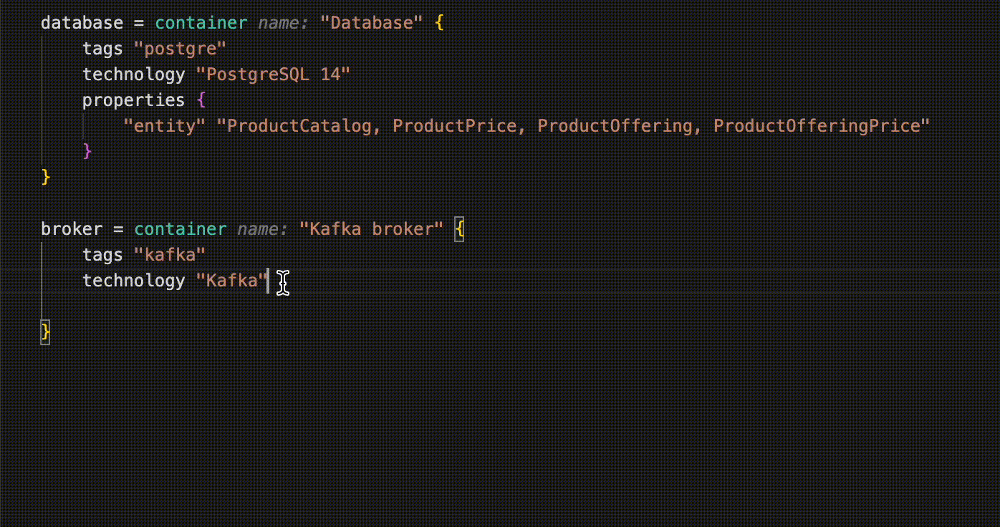

#### Назначение

* Цель создания логической модели данных — обеспечить высокоуровневое представление требований к данным и их взаимосвязи.
* Эта модель служит основой для проектирования физической базы данных.
* Логическая модель данных помогает улучшить взаимодействие между заинтересованными сторонами, обеспечивая общее понимание данных и их взаимосвязей.

#### На какие вопросы должна отвечать

* Каковы основные сущности (объекты), используемые в приложении?
* Каковы взаимоотношения между этими сущностями?
* Каковы атрибуты или свойства каждой сущности?
* Каковы кардинальность и ограничения участия для каждого отношения?
* Каковы требования к доступу и безопасности данных?
* Каковы требования к производительности и масштабируемости базы данных?

#### Артефакт и инструменты

##### Разметка схем, очередей и потоков данных бизнес-терминами

Для автоматизации контроля архитектуры с точки зрения безопасности и качества данных используется разметка элементов архитектуры бизнес-терминами из единого глоссария DMP.

***Для разметки обязательно используется [плагин](Настройка%20plugin.md), который обеспечивает подстановку терминов из глоссария***.



|Элемент архитектуры|название properties|
|-------------------|----------------|
|container базы данных|**entity** - бизнес сущности, хранимые в базе данных|
|container топика kafka/rabbit|**entity** - бизнес сущности, передаваемые через брокер сообщений|
|связи между контейнерами|**send** - бизнес сущности, передаваемые в вызове <br>**return** - бизнес сущности, возвращаемые в ответ на вызов|

***Пример разметки схемы базы данных***
```js
database = container "Database" {
                tags "postgre"
                technology "PostgreSQL 14"
                properties {
                    "entity" "ProductCatalog, ProductPrice, ProductOffering, ProductOfferingPrice"
                }
            }
```

***Пример разметки вызова***

```js
LCR.container_backend -> LCR.broker "Нотификация о изменении тарифов" "TCP:9092" {
                properties {
                    "send" "ProductPrice, ProductSpecification"
                    "return" "ProductSpecification"
                } 
            }
```

##### Описание логической модели данных в DBML

* Диаграммы [DBML](https://dbml.dbdiagram.io/home) создаются в файлах с расширением dbml
* Для отображения диаграмм используется kroki сервер
  
Настройка сервера производится в workspace проекта. В разделе views необходимо написать следующий код:

```js
properties { 
    kroki.url "https://kroki.example.ru"
    kroki.format "svg"
}
```

Для отображения DBML файла в виде диаграммы используется Image View,  например

```js
image MySystem "domain" {
    kroki "dbml" "./datamodel.dbml"
}
```

* ***MySystem*** - имя softwareSystem проекта
* ***./datamodel.dbml*** - относительный путь до файла с моделью от директории с workspace.dsl

#### Шаблоны

[Шаблон проекта](templates/workspace.dsl)