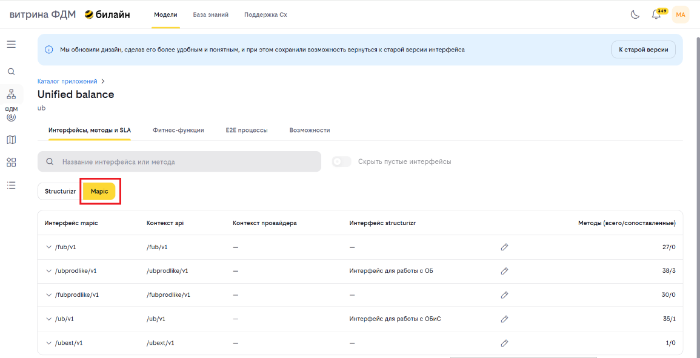
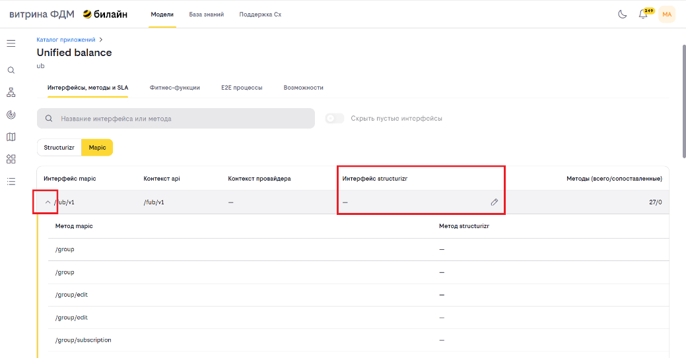
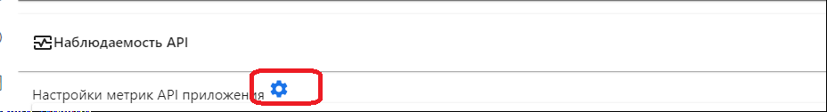
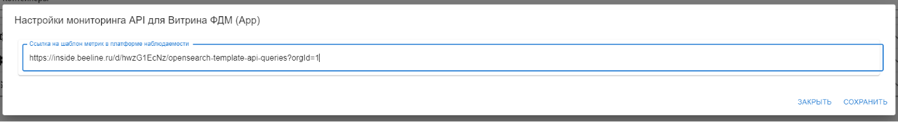
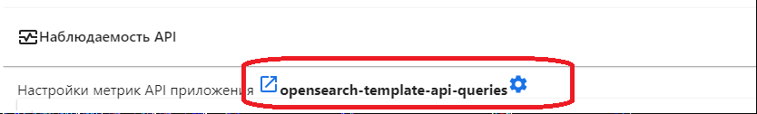
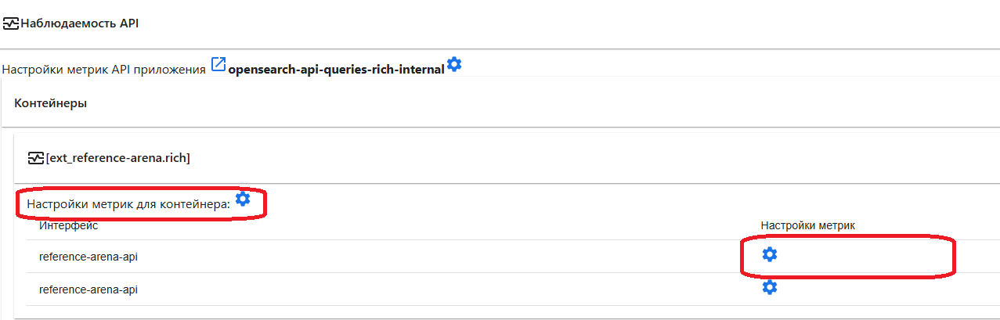
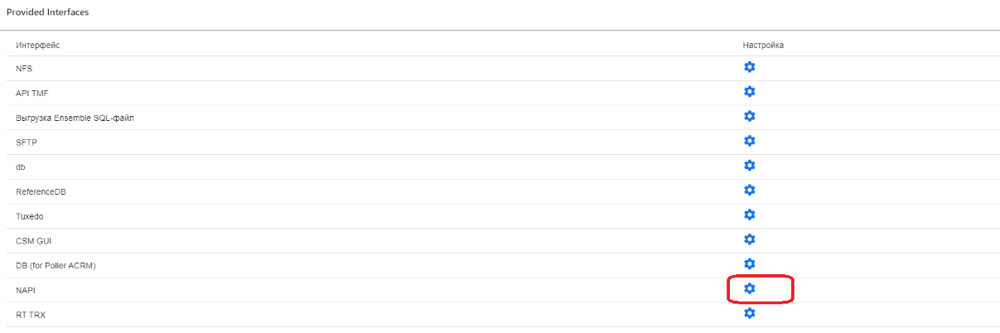

# Методология сопоставления интерфейсов в MAPIC
**Важно:** Функционал интеграции с MAPIC доступен только при наличии активной интеграции с "Интеграционной платформой MAPIC". Без этой интеграции функции сопоставления интерфейсов и E2E-наблюдаемости будут недоступны.

Цель: Обеспечить единую, корректную публикацию архитектурных спецификаций (MAPIC и Structurizr) для их автоматического сопоставления и корректной работы сквозной (E2E) наблюдаемости.

Инструкция состоит из двух частей:
1. Создание дашборда в системе мониторинга (Grafana)
2. Настройка шаблонов получения метрик по методам

## Часть 1: Шаблон получения метрик по API

Перед началом работы необходимо создать целевой дашборд на основе шаблона.

**Важные правила:**
Variables в настройках дашборда не менять — это критически важно для корректной работы автоматического сопоставления и отображения данных.
Если метод опубликован на MAPIC и потребляется только через MAPIC — дашборд делать не нужно. В этом случае наблюдаемость будет обеспечиваться автоматически через систему сопоставления.

**Шаги по созданию дашборда:**

1. Откройте систему мониторинга (Grafana). Перейдите в раздел Dashboard.

2. Выберите шаблонный дашборд.
   **Важно:** приведённые ниже ссылки — **примеры шаблонов**. В зависимости от источника метрик выберите:
   * Для OpenSearch — используйте: https://inside.beeline.ru/d/hwzG1EcNz/opensearch-template-api-queries?orgId=1
   * Для Prometheus — используйте: https://inside.beeline.ru/d/56_72PcHk/prometheus-template-api-queries?orgId=1

3. Создайте копию шаблона

4. В настройках дашборда: Dashboard settings → Save As → Укажите понятное имя (например, E2E-Process-Order-Service).

5. Укажите источник данных (Datasource). В переменной DATASOURCE выберите нужный источник:
   * opensearch-prod — для данных из логов
   * prometheus-prod — для телеметрических метрик
   
   **Важно:** При сохранении обязательно выберите опцию "Save current variable values as dashboard default", чтобы источник данных сохранился корректно.

6. Откройте панель настройки наблюдаемости
   Перейдите в редактирование панели, где настраиваются метрики.

7. Настройте запросы для метрик. Чтобы подставить значения путей и методов в запрос при формировании панелей, используйте следующие правила:
   * Название метода будет использоваться вместо переменной $METHOD
   * Относительный путь будет использоваться вместо переменной $URI
   * Шаблон относительно пути будет использоваться вместо переменной $REGEX_URI. (Или, что удобно для отладки запросов, вместо #{REGEX_URI:raw}

   **Примеры:**

   1. **Общее количество вызовов за 5 минут.** Отражает полное число запросов к API за последние 5 минут.
   
      **Opensearch**
      Query=Запрос для получения всех записей, например:
      * `json.host.keyword:/.*dashboard-prod-eafdmmart.apps.yd-m3-k21.vimpelcom.ru/`
      * `json.request_uri.keyword: ${REGEX_URI:raw}`
      * `AND json.request_method: "$METHOD"`
      
      **Prometheus**
      `sum (delta (<NUM_COUNTER>{<TOTAL_FILTER>}[5m]))`, где
      * **<NUM_COUNTER>** - счетчик количества запросов. Пример для Spring: `http_server_requests_seconds_count`
      * **<TOTAL_FILTER>** - фильтр для всех запросов по методу, например, `uri="$URI" method="$METHOD"`
      
      Пример: `sum (delta (http_server_requests_seconds_count{uri="$URI", method="$METHOD"}[5m]))`

   2. Настройка количества вызовов за 5 минут с ошибкой. Заполняется по аналогии с общим количеством, только в фильтре/запросе участвуют только ошибочные запросы.
   
      **Opensearch**
      Query=Запрос для получения записей с ошибкой выполнения, например:
      * `json.host.keyword:/.*dashboard-prod-eafdmmart.apps.yd-m3-k21.vimpelcom.ru/`
      * `json.request_uri.keyword: ${REGEX_URI:raw} AND json.request_method: "$METHOD" AND NOT(json.status: 200 422)"`
      
      **Prometheus**
      `sum (delta (<NUM_COUNTER>{<ERROR_FILTER>}[5m]))`, где
      * **<NUM_COUNTER>** - счетчик количества запросов. Пример для Spring: `http_server_requests_seconds_count`
      * **<ERROR_FILTER>** - фильтр для запросов с ошибкой выполнения по методу, например, `uri="$URI" method="$METHOD", status !="200"`
      
      Пример: `sum (delta (http_server_requests_seconds_count{uri="$URI", method="$METHOD", status !="200"}[5m]))`

8. Проверьте запросы. Закройте и снова откройте дашборд, чтобы убедиться, что настройки сохранились корректно (Grafana иногда не отображает изменения после редактирования).

9. Сохраните изменения. Убедитесь, что выбрана опция: "Save current variable values as dashboard default".

10. Скопируйте ссылку на дашборд. Используйте её для привязки к интерфейсам в карточке приложения.

## Часть 2: Сопоставление интерфейсов в MAPIC

Для корректной работы E2E-наблюдаемости необходимо сопоставить интерфейсы из MAPIC с соответствующими интерфейсами в Structurizr.

### Шаги по сопоставлению:

1. **Выберите приложение.** В поиске введите название приложения → выберите из списка → откройте карточку.

2. **Перейдите к интерфейсам.** В карточке приложения:  
   → Интерфейсы, методы и SLA → вкладка MAPIC.
   

   > 
   *Рисунок 2 - Вкладка MAPIC в карточке приложения*

3. **Выберите интерфейс для сопоставления.** Раскройте нужный интерфейс → нажмите кнопку «Редактировать».
   
   > 
   *Рисунок 3 - Выбор интерфейса для сопоставления*

4. **Выберите интерфейс из Structurizr.** В выпадающем списке:
   * Используйте поиск по названию.
   * Выберите соответствующий интерфейс из Structurizr.

5. **Сохраните изменения.** Связь установится автоматически. Среднее время ожидания составляет ~2 минуты. 

Для автоматического сопоставления данных в методах необходимо, чтобы они соответствовали хотя бы одному из трёх правил, описанных ниже. Если ни одно из правил не выполняется — методы не будут сопоставлены, и связь не установится.

### Результат сопоставления
Если все методы интерфейса из MAPIC сопоставлены с методами одного и того же интерфейса в Structurizr — система считает их успешно сопоставленными, и данные начнут поступать в ваш дашборд.

### Ключевые правила для корректного автоматического сопоставления

Чтобы система могла автоматически сопоставить методы между MAPIC и Structurizr, обязательно соблюдайте следующие правила именования

Система пытается сопоставить методы по трём последовательным этапам. Если на предыдущем этапе совпадение найдено — дальнейшие этапы не выполняются.

#### Порядок сопоставления (этапы):

**Этап 1: Прямое сравнение по `type` и `path`**  
Система ищет в **Structurizr** метод с идентичными:

* `type` (HTTP-метод: GET, POST и т.д.)
* `path` (полный путь, например: `/api/v1/users`)

Если такой метод найден — происходит автоматическое сопоставление.  
**Пример:**

| Система | type | path |
| :--- | :--- | :--- |
| MAPIC | GET | /api/v1/users |
| Structurizr | GET | /api/v1/users |

`/api/v1/users` == `/api/v1/users` → Методы сопоставлены.

**Этап 2: Сравнение по `type`, `contextProvider` и `path`**  
Если на первом этапе совпадений не найдено, система проверяет:

* Совпадает ли `type`
* Равен ли path в Structurizr результату: `contextProvider` + `path` (из MAPIC)

**Пример:**

| Система | type | path | contextProvider |
| :--- | :--- | :--- | :--- |
| MAPIC | POST | /v1/create | /orders |
| Structurizr | POST | /orders/v1/create | — |

**Проверка:**  
`contextProvider` + `path` (из MAPIC) = `/orders` + `/v1/create` = `/orders/v1/create`  
Сравнение: `/orders/v1/create` == `/orders/v1/create` (path в Structurizr) → Методы сопоставлены

**Этап 3: Сравнение по `type`, `contextApi` и `path`**  
Если и на втором этапе совпадение не найдено, система проверяет:

* Совпадает ли `type`
* Равен ли path в Structurizr результату: `contextApi` + `path` (MAPIC)

**Пример:**

| Система | type | path | contextApi |
| :--- | :--- | :--- | :--- |
| MAPIC | DELETE | /v1/logs | /audit |
| Structurizr | DELETE | /audit/v1/logs | - |

**Проверка:**  
`/audit` + `/v1/logs` = `/audit/v1/logs`  
Сравнение: `/audit/v1/logs` == `/audit/v1/logs` (path в Structurizr) → Методы сопоставлены

> **Важно:** При нарушении этих правил сопоставление не произойдет, и E2E-наблюдаемость работать не будет.

### Частые ошибки при публикации архитектурных спецификаций

Ниже перечислены наиболее распространённые проблемы, из-за которых нарушается сопоставление между **MAPIC** и **Structurizr** и, как следствие, ломается E2E-наблюдаемость.

1. **Несоответствие пути (`path`)**  
   Разные формы одного endpoint в разных системах:  
   `MAPIC: /v1/users` ↔ `Structurizr: /api/v1/users`  
   **Решение**: Используйте единый стандарт формирования `path` во всех системах.

2. **Различие в HTTP-методе (`type`)**  
   В MAPIC указан `POST`, а в Structurizr — `PUT` или `GET`.  
   **Решение:** Всегда сверяйте типы методов при обновлении спецификаций.
   ## Привязка шаблона получения метрик приложению (в BeeAtlas)

1. **Перейдите в карточку приложения:**  
   🔗 [https://beeatlas.vimpelcom.ru/models/apps](https://beeatlas.vimpelcom.ru/models/apps)

2. **В разделе «Наблюдаемость API: Для всего приложения»:**  
   Нажмите кнопку **«Настроить»** → вставьте ссылку на настроенный дашборд → сохраните. После этого имя дашборда появится в списке.
   

   > *Рисунок 4 - Карточка приложения. Наблюдаемость API*

   >  *Рисунок 5 - Ссылка на настроенный дашборд*

   > 
   *Рисунок 6 - Результат настройки*

3. **На уровне контейнера.**  
   Если приложение включает несколько контейнеров, наблюдаемость можно настроить для каждого контейнера отдельно. В блоке **Контейнеры** выберите нужный контейнер → нажмите **«Настроить»** → вставьте ссылку на дашборд, предназначенный для этого контейнера → сохраните изменения.
   
   Настройка шаблона метрик для выбранного интерфейса или контейнера производится по аналогии с настройкой шаблона для приложения.
   
   > 
   *Рисунок 7 - Настройка на уровне контейнера*

4. **Для отдельного интерфейса:**  
   В блоке **Provided Interfaces** выберите нужный интерфейс → нажмите **«Настроить»** → вставьте ссылку на дашборд → сохраните изменения.
   
   > 
   *Рисунок 8 – Блок Provided Interfaces для отдельного интерфейса*

## Глоссарий

| Термин | Описание |
| :--- | :--- |
| **MAPIC** | Централизованный каталог API. Содержит полные сведения об API: путь, метод, провайдер, источники метрик. Используется для E2E-наблюдаемости. |
| **Structurizr** | Инструмент архитектурного моделирования (на основе C4). Описывает системы, контейнеры и взаимодействия. API-методы могут импортироваться из OpenAPI. |
| **ProvidedInterface** | Интерфейс, который сервис предоставляет другим системам. Описан в Sparx EA. |
| **E2E-наблюдаемость** (End-to-End Observability) | Возможность отслеживать сквозной жизненный цикл запроса через несколько сервисов, включая метрики, логи и трассировки. |
| **Dashboard (Grafana)** | Визуализация метрик, собранная на основе шаблонов. Используется для отображения состояния API-методов. |