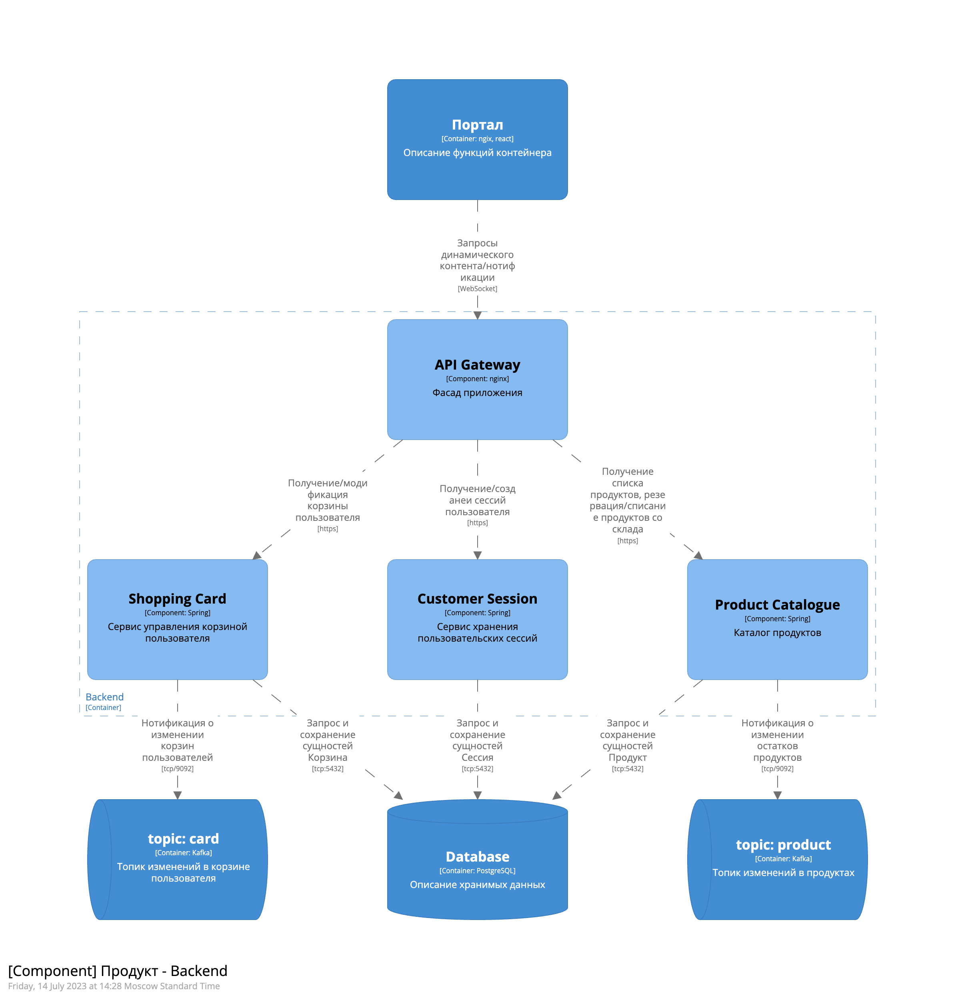

#### Назначение

Диаграмма компонентов показывает, как контейнер состоит из ряда "компонентов", что представляет собой каждый из этих компонентов, каковы их обязанности и детали технологии/реализации.

Компонентная диаграмма создается для каждого контейнера с [контейнерной диаграммы](3.2%20Контейнерная%20диаграмма.md)

#### На какие вопросы должна отвечать

* Из каких компонент состоит система?
* Каково назначение компонент?
* На каких технологиях реализованы компоненты?
* По каким технологиям происходит взаимодействие между компонентами?
* Какие компоненты отвечают за взаимодействие с внешними системами?
* Какие данные передаются между компонентами?
* Все ли компоненты имеют связи с другими компонентами или внешними системами?
* Все ли компоненты имеют привязку к контейнерам?

  
!!! info "Чек-лист самопроверки"

    - [ ] Определите основные компоненты подсистемы
    - [ ] Определите связи между этими компонентами и внешними компонентами, такими как хранилища данных, 3rd party сервисы
    - [ ] Топики Kafka/RabbitMQ указывайте в виде отдельных компонент
    - [ ] СУБД Указывайте в виде отдельных компонент, в качестве технологии указывайте тип СУБД

#### Отличие контейнеров и компонент

1. **Контейнеры** - это среды выполнения, в которых размещаются компоненты. Они представляют собой более крупные элементы, такие как веб-серверы, базы данных или мобильные приложения. Контейнеры инкапсулируют и обеспечивают контекст для работы компонентов и их взаимодействия друг с другом.

2. **Компоненты**, с другой стороны, являются строительными блоками системы. Они представляют собой более мелкие элементы, выполняющие определенные функции в рамках контейнера. Компоненты могут быть отдельными классами, модулями или даже микросервисами. Компоненты имеют четко определенные границы и интерфейсы, через которые они взаимодействуют с другими компонентами.

Таким образом, в модели C4 контейнеры и компоненты имеют разные уровни детализации. Контейнеры представляют собой более крупные среды выполнения, в которых размещаются компоненты, а компоненты - более мелкие строительные блоки, выполняющие определенные функции внутри контейнера. Контейнеры предоставляют контекст и инфраструктуру для работы компонентов, а компоненты инкапсулируют функциональность и взаимодействуют друг с другом внутри контейнера.

#### Шаблоны

[Шаблон проекта](templates/workspace.dsl)

