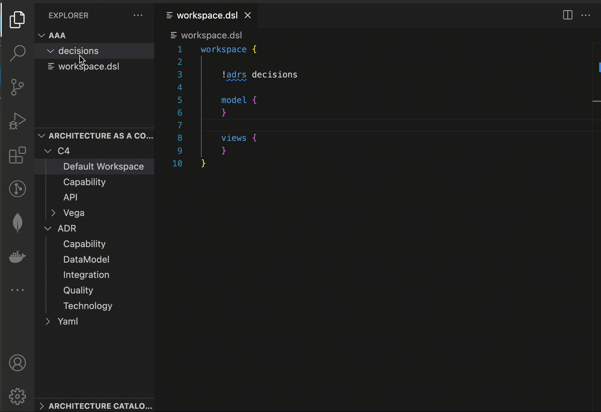

### Подготовка описаний для реестра архитектурных решений ADR

#### Назначение

С помощью Architecture Decision Record (ADR) решаются следующие проблемы:

* Сложно отслеживать мотивы принятых архитектурных решений
* Без понимания обоснования и последствий ранее принятые решения:
    * либо слепо принимаются на веру
    * либо слепо отвергаются.
    * Отсутствие понимания контекста снижает качество новых решений

С помощью ADR команда:

* контролирует процесс принятия решений,
* предотвращает дискуссии на одни и те же темы,
* эффективно информирует о принятых решениях как участников команды так и смежные подразделения.

#### Инструкции

**1 Когда обязательно нужен ADR?**

Данный список содержит критерии определения необходимости формировать ADR при изменениях в архитектуре приложения. Формировать ADR необходимо, если рассматриваемые альтернативы решения изменяют:

* **Функциональную ответственность ИТ-системы** В качестве примера могут быть такие изменения: Рассматривается решение, что система, управляющая отношениями с клиентами-ФЛ, будет теперь отвечать за отношения с клиентами-ЮЛ. Решение о создании новой ИТ-системы / ИТ-платформы для реализации функции управления клиентскими данными. Решение об отказе использования ИТ-системы для автоматизации функционала управления платежами
* **Используемые технологии** Планируются изменения технологического стека приложения (язык программирования, база данных, операционная система,...).
* **Модель данных системы** Изменяется модель данных системы. Например, добавляются новые логические сущности или добавляются/изменяются атрибуты сущности.
* **Способ интеграции с внешними системами** Изменение в способе интеграции (протоколах транспортного и прикладного уровня) и потоках данных между системой и окружением
* **Нефункциональные/качественные характеристики системы** Меняются нефункциональные требования и способы их достижения (безопасности, отказоустойчивости, масштабируемости, производительности,...)  Например, Внедрение шифрования в местах хранения, включение во взаимодействие посредников для авторизации вызовов и т.д.

**2. Как правильно делать ADR?**

1. Создано по шаблону. Заголовок сформулирован по правилам (см. ниже).
2. ADR сохранен в централизированном Structurizr OnPremise 
3. Описывает только одно решение, а не множество решений.
4. Решение сформулировано чётко ("Мы используем...", "Мы не используем", а не "Желательно.." или "Предлагается...").
5. Понятна связь между решением и проблемой.
6. Описаны минимум 2 варианта решения с плюсами и минусами.
7. Перечислены критерии сравнения альтернатив.
8. Понятно, почему принято решение. Понятно, как критерии сравнения связаны с бизнес-приоритетами из контекста и и драйверами.
9. В последствиях:
      * перечислены те арх решения, которые потребуется принять как следствие принятого решения;
      * явно указаны любые известные ограничения текущего решения (trade-offs) ;
      * если решение содержит риски, то описано, как с ними планируют поступить (за счет чего снижать, почему принять).
10. Упоминаемые технологии представлены ссылками на [Технический радар компании](beeatlas-docs/models/tech-radar.md).

**3. Как правильно именовать ADR?**

Заголовок должен описывать, какое решение или выбранную для решения проблемы технологию мы предлагаем, а также кратко обозначать проблему, которую мы решаем в данном ADR.
Примеры хороших:

* Redis для хранения пользовательских сессий;
* Kafka для нотификации внешних сервисов о новом событии в системе;
* Микросервисная архитектура для реализации Capability Marketplace.

#### Регистрируем ADR в Structurizr

1. Cоздаем в проекте директорию, в которую будут помещаться файлы с ADR. Например:
   ```
   decisions
   ```
2. Указываем в workspace.dsl путь к директории с ADR с помощью команды !adrs. Например:
   ```
   workspace {
     !adrs decisions
     model {

     }
     views {

     }
   }
   ```
3. Создаем в директории для ADr (например, decisions) файлы с архитектурными решениями. Имена файлов должны иметь формат xxxx-name.md Где xxxx - число в диапазоне от 0000 до 0001. Например:
   ```
   0001-Выбор базы данных PostgreSQL.md
   ```
4. Для формирования структуры ADR можно воспользоваться плагином:
   
5. После публикации в BeeAtlas (и на портал Structurizr On Premises) они будут доступны в рабочем пространстве продукта

#### Шаблоны

[Шаблон MarkDown](templates/5_adr.md)
