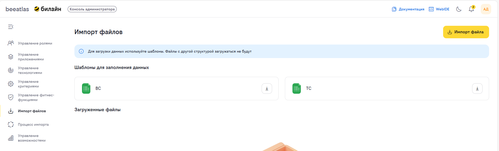

# Раздел администратора

Раздел администратора доступен только пользователям с правами администратора. Здесь сосредоточены функции управления системой: пользователями и ролями, приложениями, технологиями, критериями, фитнес-функциями, возможностями, импортом данных, Cypher-запросами и наблюдаемостью staging.

## Содержание

- [Управление ролями](#управление-ролями)
  - [Пользователи](#пользователи)
  - [Роли](#роли)
- [Импорт файлов](#импорт-файлов)
- [Процесс импорта](#процесс-импорта)
- [Управление технологиями](#управление-технологиями)
- [Управление возможностями](#управление-возможностями)
- [Управление фитнес-функциями](#управление-фитнес-функциями)
- [Управление приложениями](#управление-приложениями)
- [Управление критериями](#управление-критериями)
- [Cypher-запросы](#cypher-запросы)
- [Staging](#staging)
  - [Наблюдаемость запусков pipeline](#наблюдаемость-запусков-pipeline)
  - [Поиск по сущностям staging](#поиск-по-сущностям-staging)

---

## Управление ролями

**Назначение**: Управление пользователями, ролями и правами доступа.

### Пользователи

**Назначение**: Управление пользователями системы.

#### Возможности

- Просмотр списка всех пользователей
- Поиск пользователей по ФИО, роли, e-mail или логину
- Просмотр информации о пользователях
- Изменение ролей пользователей

#### Как использовать

1. Перейдите в раздел "Админка" → "Управление ролями"
2. Используйте поиск для нахождения нужного пользователя
3. Просмотрите информацию о пользователе
4. При необходимости измените роли пользователя

### Роли

**Назначение**: Управление ролями и правами доступа в системе.

Роль определяет набор прав доступа пользователя в системе. Каждый пользователь может иметь одну или несколько ролей.

#### Возможности

- Просмотр списка всех ролей
- Создание новых ролей
- Редактирование существующих ролей
- Настройка прав на создание, редактирование и удаление артефактов

#### Просмотр ролей

1. Перейдите в раздел "Админка" → "Управление ролями"
2. Нажмите на шестерёнку "Настройки ролей"
3. Просмотрите список всех ролей в системе

#### Создание новой роли

1. Перейдите в раздел "Админка" → "Управление ролями" → "Настройки ролей"
2. Нажмите кнопку "Создать роль"
3. Заполните форму:
   - Название
   - Создание артефактов
   - Редактирование артефактов
   - Удаление артефактов
4. Нажмите кнопку "Сохранить"

#### Редактирование роли

1. На странице "Настройки ролей" нажмите на нужную роль
2. Измените название или права на артефакты
3. Нажмите кнопку "Сохранить"

#### Стандартные роли

В системе могут быть предопределены следующие роли:

- **ADMINISTRATOR** — полный доступ ко всем функциям системы
- И другие роли в зависимости от конфигурации системы

---

## Импорт файлов

**Назначение**: Загрузка данных в систему с использованием подготовленных шаблонов.

### Возможности

- Загрузка файлов `.xlsx` по шаблону
- Выбор типа файла: BC или TC
- Скачивание шаблонов для заполнения
- Просмотр загруженных файлов и их статусов

### Поддерживаемый формат

Импорт выполняется только из файлов `.xlsx` размером до 100 МБ. Файлы с другой структурой не загружаются.

### Типы данных для импорта

- **BC** — бизнес-возможности;
- **TC** — технические возможности.

### Как использовать

1. Перейдите в раздел "Админка" → "Импорт файлов"
2. В блоке «Шаблоны для заполнения данных» скачайте нужный шаблон и заполните его
3. Нажмите кнопку "Импорт файла"
4. Выберите тип файла: BC или TC
5. Выберите файл `.xlsx` размером до 100 МБ — загрузка начинается сразу после выбора файла
6. Нажмите «Готово», чтобы закрыть боковую панель
7. Статус обработки файла смотрите в блоке «Загруженные файлы»

### Блок «Загруженные файлы»

| Колонка | Описание |
|---------|----------|
| **Название** | Имя загруженного файла |
| **Формат** | Расширение файла |
| **Дата** | Дата загрузки |
| **Статус** | «Загрузка», «Успешно», «Ошибка», «Проблемный» или «Ошибка валидации» |

---

## Процесс импорта

**Назначение**: Просмотр хода и результатов импортирования данных.

### Возможности

- Просмотр списка пакетов импорта
- Фильтрация пакетов по статусу
- Просмотр частей пакета
- Просмотр содержимого части пакета в формате JSON

### Таблица пакетов

| Колонка | Описание |
|---------|----------|
| **Идентификатор** | Идентификатор пакета; ссылка на страницу частей пакета |
| **Операция** | Обновление бизнес-возможностей, технических возможностей или приложений |
| **Дата загрузки** | Дата создания пакета |
| **Обработанные/Все** | Количество успешно обработанных частей и общее количество частей пакета |
| **С ошибкой** | Количество частей, обработанных с ошибкой |
| **В обработке** | Количество частей, обработка которых ещё идёт |
| **Статус** | «Успешно», «В обработке», «С ошибкой» или «Проблемный» |

### Как использовать

1. Перейдите в раздел "Админка" → "Процесс импорта"
2. При необходимости выберите статус в фильтре «Статусы»
3. Нажмите на идентификатор пакета, чтобы открыть страницу «Части пакета»
4. Изучите таблицу частей пакета и разверните нужную часть стрелкой, чтобы посмотреть её содержимое в формате JSON

### Части пакета

На странице «Части пакета» отображаются идентификатор пакета, его статус и таблица с колонками «№ части пакета», «Идентификатор» и «Статус». Строку части можно развернуть, чтобы посмотреть её содержимое в формате JSON.

---

## Управление технологиями

**Назначение**: Управление технологиями в системе.

### Возможности

- Просмотр списка всех технологий
- Поиск и фильтрация технологий по сектору, статусу и группе
- Создание новых технологий
- Редактирование существующих технологий
- Управление версиями технологий
- Управление группами технологий

### Как использовать

#### Просмотр технологий

1. Перейдите в раздел "Админка" → "Управление технологиями"
2. Используйте поиск и фильтры «Секторы», «Статусы» и «Группы»
3. Переключитесь между вкладками «Технологии» и «Группы»

#### Создание новой технологии

1. Перейдите в раздел "Админка" → "Управление технологиями"
2. Нажмите кнопку "Добавить технологию"
3. Заполните форму:

   | Поле | Описание |
   |------|----------|
   | **Название\*** | Название технологии; должно быть уникальным |
   | **Группа** | Одна или несколько групп технологии |
   | **Сектор\*** | «Фреймворки и инструменты», «Платформа и инфраструктура», «Управление данными» или «Языки» |
   | **Статус\*** | Adopt, Trial, Assess или Hold |
   | **Короткое описание** | Описание до 255 символов |
   | **Технология допустима для использования в объекте критической инфраструктуры** | Переключатель «Да» / «Нет» |
   | **Вложенный файл** | Документация в формате Markdown до 100 МБ; можно скачать шаблон `tech_doc_template.md` |

4. Нажмите кнопку "Добавить технологию"

#### Добавление версии технологии

1. Разверните строку технологии стрелкой в колонке названия
2. Нажмите «Создать версию»
3. Заполните поля версии:

   | Поле | Описание |
   |------|----------|
   | **Начало диапазона\*** | Начало диапазона действия версии |
   | **Конец диапазона** | Конец диапазона действия версии |
   | **Статус\*** | Adopt, Trial, Assess или Hold; статус технологии в списке не предлагается |

4. При необходимости нажмите «Добавить версию», чтобы создать несколько версий сразу
5. Нажмите кнопку "Сохранить"

#### Управление группами

1. Перейдите на вкладку «Группы»
2. Нажмите «Создать группу» и укажите название группы
3. Чтобы объединить группы, отметьте не менее двух групп и нажмите «Объединить в группу», затем укажите название и сохраните изменения

---

## Управление возможностями

**Назначение**: Создание бизнес-возможностей в системе.

### Возможности

- Создание бизнес-возможности
- Выбор родительской возможности: бизнес-возможности, домена или группы
- Указание владельца и ссылки на страницу с описанием

На странице нет списка возможностей и фильтров: доступны заголовок «Управление возможностями» и кнопка «Создать бизнес-возможность».

### Типы возможностей

В системе существуют два типа возможностей:

- **Бизнес-возможности (BC)** — возможности бизнес-уровня
- **Технические возможности (TC)** — возможности технического уровня

### Удаление возможностей (TC и BC)

Удаление возможностей доступно **только из дерева ФДМ** (раздел «Модели» → «ФДМ»). Удалять могут **только пользователи с ролью администратор**.

**Ограничения при удалении BC (бизнес-возможности):**
- BC можно удалить только если у него **нет дочерних BC или TC**
- Сначала необходимо удалить или переместить все дочерние возможности

**TC (технические возможности)** удаляются из дерева ФДМ при выборе соответствующей TC.

### Как использовать

#### Создание бизнес-возможности

1. Перейдите в раздел "Админка" → "Управление возможностями"
2. Нажмите кнопку "Создать бизнес-возможность"
3. Заполните форму:

   - **Родительская возможность\*** — начните вводить название и выберите бизнес-возможность, домен или группу
   - **Краткое наименование\*** — до 255 символов
   - **Полное определение**
   - **ФИО владельца возможности** — до 255 символов
   - **Ссылка на страницу с описанием** — до 255 символов

4. Нажмите кнопку "Создать бизнес-возможность"

После создания происходит возврат на страницу «Управление возможностями».

---

## Управление фитнес-функциями

**Назначение**: просмотр, поиск и управление кастомными фитнес-функциями системы.

Подробное описание экрана, создания функции и правил смены статуса — в разделе [Управление фитнес-функциями](admin/fitness_functions.md). Инструкция по созданию — [Правила создания кастомной фитнес-функции](instruction/FF/custom_fitness_function.md).

Каталог делится на **проверки** (проверяют соответствие правилу; результат «Успешно» / «Ошибка») и **триггеры** (контекстная оценка свойств приложения; результат «Обнаружено» / «Не обнаружено»). Перечень функций — в разделе [Описание проверок архитектуры](../11%20Описание%20проверок%20архитектуры.md).

### Основные элементы экрана

- **Поиск** — по названию или коду фитнес-функции.
- **Фильтры** — «Тип» (Script, Синхронный метод, Асинхронный метод), «Статус» (Test, Trial, Adopt), переключатель «Триггеры» и кнопка «Сбросить».
- **Кнопка «Создать фитнес-функции»** — открывает трёхшаговую форму создания.

### Таблица фитнес-функций

| Колонка | Описание |
|---------|----------|
| **Код** | Уникальный идентификатор функции, не редактируется |
| **Название** | Описание функции |
| **Тип** | Script, Синхронный метод, Асинхронный метод |
| **Триггер** | «Да» — триггер, «Нет» — проверка |
| **Статус** | Test, Trial, Adopt. У функции в статусе Trial или Adopt статус меняется из таблицы |
| **Применимость** | Функции, которые должны быть пройдены у продукта, или «—» |
| **Действия** | Редактирование |

### Статусы

| Статус | Описание |
|--------|----------|
| **Test** | Функция в разработке, результаты не учитываются в аналитическом отчёте |
| **Trial** | Опытная эксплуатация |
| **Adopt** | Функция принята, результаты учитываются в отчёте |

Статус меняется из таблицы у функций в статусе Trial или Adopt: нажмите на бейдж, выберите другой статус (включая Test) и подтвердите смену в диалоге «Смена статуса» кнопкой «Сменить». Переключение Trial ↔ Adopt не требует повторного тестирования, а переход Test → Trial выполняется только после тестирования на шаге «Тестирование» (кнопка «Сохранить как Trial»). У функции в статусе Test статус из таблицы не меняется.

### Действия

1. **Редактирование** — иконка в строке функции открывает трёхшаговую форму (код и тип изменить нельзя).

Удаление фитнес-функций на странице не предусмотрено.

## Управление приложениями

**Назначение**: Управление приложениями (продуктами) в системе.

### Возможности

- Просмотр списка всех приложений
- Создание новых приложений
- Редактирование существующих приложений
- Удаление приложений

### Удаление приложения

1. Перейдите в раздел "Админка" → "Управление приложениями"
2. Найдите приложение в таблице
3. Нажмите кнопку удаления (иконка корзины) в строке приложения
4. Подтвердите удаление в диалоговом окне
5. Приложение будет удалено из системы

> **Примечание:** Перед удалением приложения убедитесь, что оно не используется в E2E сценариях и не связано с активными техническими возможностями. Удаление приложения может повлиять на отображение данных в каталоге приложений, ФДМ и других разделах системы.

---

## Управление критериями

**Назначение**: Создание и редактирование критериев оценки возможностей.

На странице доступны поиск, кнопки «Шаблон», «Импорт значений критериев» и «Создать критерий», таблица «Критерий / Код» с иконкой редактирования. Критерии отображаются плоским списком: иерархии критериев нет.

Подробное описание — на странице [Управление критериями](admin/criteria.md).

---

## Cypher-запросы

**Назначение**: Выполнение Cypher-запросов к архитектурному графу.

Страница содержит поле «Запрос», примеры запросов, список успешных запросов и кнопку «Выполнить». Результат отображается на вкладках «Граф» и «Таблица».

---

## Staging

**Назначение**: Мониторинг и диагностика процесса загрузки данных из внешних систем в BeeAtlas, а также поиск артефактов и анализ содержимого выгрузок.

### Возможности

- Просмотр запусков pre-adapter (сканов) с фильтрами по дате, статусу, типу и источнику
- Детализация запусков до уровня pipeline и отдельных стадий обработки
- Просмотр хронологии выполнения и деталей стадий
- Просмотр сырых данных (JSON) и копирование их в буфер обмена
- Поиск артефактов по названию и типу
- Поиск по содержимому выгрузок артефакта с указанием фрагментов и позиций вхождений
- Просмотр аннотаций (инфо, предупреждения, ошибки) по запускам

### Наблюдаемость запусков pipeline

Мониторинг запусков pre-adapter (сканов): фильтры по дате, статусу, типу и источнику, детализация до дочерних pipeline и отдельных стадий, просмотр хронологии, сырых данных в формате JSON и аннотаций.

### Поиск по сущностям staging

Поиск артефактов по названию и типу, поиск по содержимому выгрузок артефакта с указанием фрагментов и позиций вхождений, просмотр аннотаций.

Подробное описание — на странице [Staging (наблюдаемость и поиск)](admin/staging.md).

