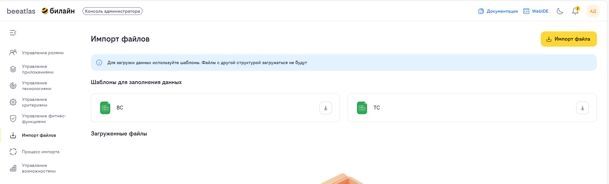

# Раздел администратора

Раздел администратора доступен только пользователям с правами администратора. Здесь сосредоточены функции управления системой: пользователями, ролями, импортом данных, технологиями и возможностями.

## Содержание

- [Пользователи](#пользователи)
- [Роли](#роли)
- [Импорт файлов](#импорт-файлов)
- [Импортированные данные](#импортированные-данные)
- [Технологии](#технологии)
- [Возможности](#возможности)
- [Кастомные фитнес-функции](#кастомные-фитнес-функции)
- [Управление приложениями (продуктами)](#управление-приложениями-продуктами)

---

## Пользователи

**Назначение**: Управление пользователями системы.

### Возможности

- Просмотр списка всех пользователей
- Поиск пользователей
- Просмотр информации о пользователях
- Управление правами доступа пользователей

### Как использовать

1. Перейдите в раздел "Админка" → "Пользователи"
2. Используйте поиск для нахождения нужного пользователя
3. Просмотрите информацию о пользователе
4. При необходимости измените права доступа

---

## Роли

**Назначение**: Управление ролями и правами доступа в системе.

### Что такое роль

Роль определяет набор прав доступа пользователя в системе. Каждый пользователь может иметь одну или несколько ролей.

### Возможности

- Просмотр списка всех ролей
- Создание новых ролей
- Редактирование существующих ролей
- Просмотр информации о ролях и правах доступа

### Как использовать

#### Просмотр ролей

1. Перейдите в раздел "Админка" → "Пользователи" → "Роли"
2. Просмотрите список всех ролей в системе

#### Создание новой роли

1. Перейдите в раздел "Админка" → "Пользователи" → "Роли"
2. Нажмите кнопку "Добавить роль"
3. Заполните форму:
   - Название роли
   - Алиас роли
   - Описание
   - Права доступа
4. Сохраните роль

#### Редактирование роли

1. Найдите нужную роль в списке
2. Откройте форму редактирования
3. Внесите необходимые изменения
4. Сохраните изменения

### Стандартные роли

В системе могут быть предопределены следующие роли:

- **ADMINISTRATOR** — полный доступ ко всем функциям системы
- И другие роли в зависимости от конфигурации системы

---

## Импорт файлов

**Назначение**: Импорт данных в систему из файлов различных форматов.

### Возможности

- Загрузка файлов для импорта
- Выбор типа импортируемых данных
- Настройка параметров импорта
- Просмотр статуса импорта
- Просмотр истории импортов

### Поддерживаемые форматы

Система поддерживает импорт данных из следующих форматов:

- Excel (.xlsx, .xls)
- CSV
- JSON
- И другие форматы (в зависимости от типа данных)

### Типы данных для импорта

Можно импортировать следующие типы данных:

- Бизнес-возможности
- Технические возможности
- Технологии
- Приложения
- И другие данные

### Как использовать

1. Перейдите в раздел "Админка" → "Импорт файлов"
2. Выберите тип данных для импорта
3. Загрузите файл с данными
4. Настройте параметры импорта (если необходимо)
5. Запустите импорт
6. Дождитесь завершения импорта
7. Проверьте результаты импорта

### Шаблоны файлов

Для некоторых типов данных доступны шаблоны файлов:

1. Скачайте шаблон файла
2. Заполните шаблон данными
3. Загрузите заполненный файл для импорта

### Обработка ошибок

При импорте могут возникнуть ошибки:

- Неверный формат файла
- Ошибки в данных
- Дублирование записей

Система предоставит информацию об ошибках для их исправления.

---

## Импортированные данные

**Назначение**: Просмотр и управление данными, импортированными в систему.

### Возможности

- Просмотр списка всех импортированных пакетов данных
- Просмотр детальной информации об импортированных данных
- Просмотр истории импортов
- Управление импортированными данными

### Как использовать

#### Просмотр импортированных данных

1. Перейдите в раздел "Админка" → "Импортированные данные"
2. Просмотрите список всех импортированных пакетов
3. Используйте фильтры для поиска нужных данных

#### Просмотр детальной информации

1. Кликните на интересующий пакет данных
2. Изучите детальную информацию:
   
   - Дата импорта
   - Тип данных
   - Количество записей
   - Статус импорта
   - Ошибки (если есть)

#### Просмотр пакета данных

1. Откройте детальную информацию о пакете
2. Перейдите к просмотру содержимого пакета
3. Изучите импортированные записи

---

## Технологии

**Назначение**: Управление технологиями в системе.

### Возможности

- Просмотр списка всех технологий
- Создание новых технологий
- Редактирование существующих технологий
- Управление версиями технологий
- Просмотр детальной информации о технологиях

### Как использовать

#### Просмотр технологий

1. Перейдите в раздел "Админка" → "Технологии"
2. Используйте поиск и фильтры для нахождения нужных технологий
3. Просмотрите список технологий

#### Создание новой технологии

1. Перейдите в раздел "Админка" → "Технологии"
2. Нажмите кнопку "Добавить технологию"
3. Заполните форму:
   
   - Название
   - Описание
   - Категория
   - Дополнительные атрибуты
   - Файл с подробным описанием технологии в формате MarkDown
  
4. Сохраните технологию

#### Добавление версии технологии

1. Откройте детальную информацию о технологии
2. Перейдите к управлению версиями
3. Нажмите "Добавить версию"
4. Заполните информацию о версии:
   
   - Номер версии
   - Описание изменений
   - Дата релиза
  
5. Сохраните версию

---

## Возможности

**Назначение**: Управление бизнес и техническими возможностями в системе.

### Возможности

- Просмотр списка всех возможностей
- Создание новых возможностей
- Редактирование существующих возможностей
- Управление иерархией возможностей
- Просмотр детальной информации о возможностях

### Типы возможностей

В системе существуют два типа возможностей:

- **Бизнес-возможности (BC)** — возможности бизнес-уровня
- **Технические возможности (TC)** — возможности технического уровня

### Удаление возможностей (TC и BC)

Удаление возможностей доступно **только из дерева ФДМ** (раздел «Модели» → «ФДМ»). Удалять могут **только пользователи с ролью администратор**.

**Ограничения при удалении BC (бизнес-возможности):**
- BC можно удалить только если у него **нет дочерних BC или TC**
- Сначала необходимо удалить или переместить все дочерние возможности

**TC (технические возможности)** удаляются из дерева ФДМ при выборе соответствующей TC.

### Как использовать

#### Просмотр возможностей

1. Перейдите в раздел "Админка" → "Возможности"
2. Используйте фильтры для просмотра возможностей определенного типа
3. Просмотрите список возможностей

#### Создание новой возможности

1. Перейдите в раздел "Админка" → "Возможности"
2. Нажмите кнопку "Добавить возможность"
3. Заполните форму:
   
   - Название
   - Тип возможности (бизнес или техническая)
   - Описание
   - Родительская возможность (если есть)
   - Дополнительные атрибуты
  
4. Сохраните возможность

#### Управление иерархией

Возможности организованы в иерархическую структуру:
- Каждая возможность может иметь родительскую возможность
- Каждая возможность может иметь дочерние возможности
- Используйте интерфейс для управления иерархией

---

## Кастомные фитнес-функции

**Назначение**: Просмотр, фильтрация и управление кастомными фитнес-функциями системы.

Кастомные фитнес-функции позволяют определять собственные проверки качества архитектуры приложений, дополняя стандартный набор системных метрик. Подробная инструкция по созданию — [Правила создания кастомной фитнес-функции](instruction/FF/custom_fitness_function.md).

### Основные элементы экрана

#### Поиск

Строка поиска с плейсхолдером «Название или код фитнес-функции» позволяет находить функции по имени или уникальному коду.

#### Фильтры

| Фильтр | Описание |
|--------|----------|
| **Тип фитнес-функции** | Фильтрация по способу выполнения (Script, Синхронный метод, Асинхронный метод) |
| **Статус фитнес-функции** | Фильтрация по текущему статусу (Test, Trial, Adopt) |
| **Триггеры** | Переключатель для отображения только функций с активными триггерами |
| **Кнопка «Сбросить»** | Очищает все применённые фильтры |

#### Кнопка действия

- **«Создать фитнес-функцию»** — добавление новой кастомной фитнес-функции

### Таблица фитнес-функций

Таблица содержит следующие колонки:

| Колонка | Описание |
|---------|----------|
| **Код** | Уникальный идентификатор фитнес-функции (например, `MY_CUST_01`) |
| **Название** | Наименование фитнес-функции |
| **Тип** | Способ выполнения: «Script», «Синхронный метод», «Асинхронный метод» |
| **Триггер** | Наличие активного триггера («Да» / «Нет») |
| **Статус** | Текущий статус функции |
| **Применимость** | Условия запуска или «—», если функция универсальна |
| **Действия** | Иконки для редактирования и удаления функции |

### Статусы фитнес-функций

| Статус | Описание |
|--------|----------|
| **Test** | Функция находится на стадии тестирования, результаты не учитываются в аналитическом отчёте |
| **Trial** | Функция проходит опытную эксплуатацию |
| **Adopt** | Функция принята в продакшен, результаты учитываются в аналитическом отчёте |

### Действия с фитнес-функциями

#### Редактирование

1. Нажмите иконку редактирования в строке фитнес-функции
2. Откроется модальное окно с формой для изменения параметров (код фитнес-функции не редактируется)
3. Внесите изменения и сохраните

#### Удаление

1. Нажмите иконку удаления в строке фитнес-функции
2. Подтвердите удаление в диалоговом окне
3. Фитнес-функция будет удалена из системы

> **Примечание:** Удаление фитнес-функции может повлиять на результаты аналитического отчёта и проверки приложений, которые используют данную функцию.

---

## Управление приложениями (продуктами)

**Назначение**: Управление приложениями (продуктами) в системе.

### Возможности

- Просмотр списка всех приложений
- Создание новых приложений
- Редактирование существующих приложений
- Удаление приложений

### Удаление приложения

1. Перейдите в раздел "Админка" → "Управление приложениями"
2. Найдите приложение в таблице
3. Нажмите кнопку удаления (иконка корзины) в строке приложения
4. Подтвердите удаление в диалоговом окне
5. Приложение будет удалено из системы

> **Примечание:** Перед удалением приложения убедитесь, что оно не используется в E2E сценариях и не связано с активными техническими возможностями. Удаление приложения может повлиять на отображение данных в каталоге приложений, ФДМ и других разделах системы.

