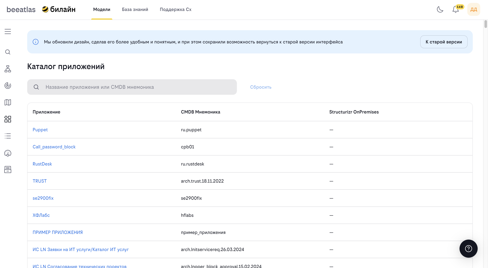

# Управление фитнес-функциями

**Назначение**: Настройка функций, связанных с фитнесом.
<!-- -->
## Возможности

- Просмотр, фильтрация и управление кастомными фитнес-функциями системы
- Создание новых кастомных фитнес-функций
- Редактирование существующих фитнес-функций
- Удаление фитнес-функций

## Кастомные фитнес-функции

Кастомные фитнес-функции позволяют определять собственные проверки качества архитектуры приложений, дополняя стандартный набор системных метрик. Подробная инструкция по созданию — [Правила создания кастомной фитнес-функции](../instruction/FF/custom_fitness_function.md).

## Основные элементы экрана

### Поиск

Строка поиска с плейсхолдером "Название или код фитнес-функции" позволяет находить функции по имени или уникальному коду.

### Фильтры

| Фильтр | Описание |
|--------|----------|
| **Тип фитнес-функции** | Фильтрация по способу выполнения (Script, Синхронный метод, Асинхронный метод) |
| **Статус фитнес-функции** | Фильтрация по текущему статусу (Test, Trial, Adopt) |
| **Триггеры** | Переключатель для отображения только функций с активными триггерами |
| **Кнопка «Сбросить»** | Очищает все применённые фильтры |

### Кнопка действия

- **«Создать фитнес-функцию»** — добавление новой кастомной фитнес-функции

## Таблица фитнес-функций

Таблица содержит следующие колонки:

| Колонка | Описание |
|---------|----------|
| **Код** | Уникальный идентификатор фитнес-функции (например, `MY_CUST_01`) |
| **Название** | Наименование фитнес-функции |
| **Тип** | Способ выполнения: "Script", "Синхронный метод", "Асинхронный метод" |
| **Триггер** | Наличие активного триггера ("Да" / "Нет") |
| **Статус** | Текущий статус функции |
| **Применимость** | Условия запуска или "—", если функция универсальна |
| **Действия** | Иконки для редактирования и удаления функции |

## Статусы фитнес-функций

| Статус | Описание |
|--------|----------|
| **Test** | Функция находится на стадии тестирования, результаты не учитываются в аналитическом отчёте |
| **Trial** | Функция проходит опытную эксплуатацию |
| **Adopt** | Функция принята в продакшен, результаты учитываются в аналитическом отчёте |

## Действия с фитнес-функциями

### Редактирование

1. Нажмите иконку редактирования в строке фитнес-функции
2. Откроется модальное окно с формой для изменения параметров (код фитнес-функции не редактируется)
3. Внесите изменения и сохраните

### Удаление

1. Нажмите иконку удаления в строке фитнес-функции
2. Подтвердите удаление в диалоговом окне
3. Фитнес-функция будет удалена из системы

> **Примечание:** Удаление фитнес-функции может повлиять на результаты аналитического отчёта и проверки приложений, которые используют данную функцию.