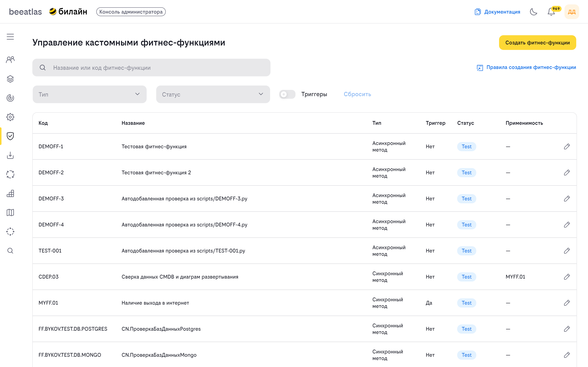
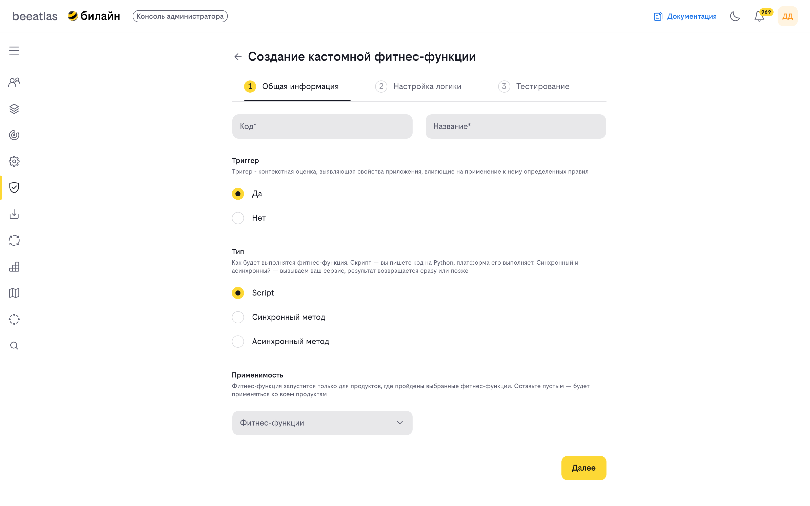

# Управление фитнес-функциями

**Назначение:** просмотр каталога фитнес-функций и управление кастомными проверками архитектуры приложений.

## Что такое фитнес-функция

**Фитнес-функция (FF)** — автоматическая проверка архитектуры приложения: она запускается для продукта и возвращает результат «пройдена / не пройдена» с детализацией.

Каталог делится на два вида функций:

| Вид | Признак в карточке | Что делает | Результат на карточке приложения |
|-----|--------------------|------------|----------------------------------|
| **Проверка** | Триггер = Нет | Проверяет соответствие архитектуры правилу | «Успешно» / «Ошибка» |
| **Триггер** | Триггер = Да | Контекстная оценка: выявляет свойства приложения, влияющие на применение к нему определённых правил | «Обнаружено» / «Не обнаружено» |

Триггер сам по себе не является нарушением — он определяет контекст приложения (например, использует ли оно PostgreSQL, Kafka или Redis, есть ли у него пользовательские интерфейсы). От результата триггера зависит, какие проверки к приложению применимы.

Полный перечень функций и их описание — в разделе [Описание проверок архитектуры](../../11%20Описание%20проверок%20архитектуры.md).

## Возможности

- Просмотр, поиск и фильтрация фитнес-функций
- Создание кастомных фитнес-функций (скрипт или внешний метод)
- Редактирование функции и её тестирование на конкретном приложении
- Изменение статуса функции

## Основные элементы экрана

### Поиск

Строка поиска с плейсхолдером «Название или код фитнес-функции». При вводе появляется список совпадений; выбор строки фильтрует таблицу по этой функции.

Справа от поиска — ссылка «Правила создания фитнес-функции» на инструкцию.

### Фильтры

| Фильтр | Описание |
|--------|----------|
| **Тип** | Способ выполнения: Script, Синхронный метод, Асинхронный метод |
| **Статус** | Test, Trial, Adopt |
| **Триггеры** | Переключатель: показывает только функции-триггеры |
| **Сбросить** | Очищает поиск и все фильтры |

### Кнопка действия

- **«Создать фитнес-функции»** — открывает форму создания новой кастомной функции.

## Таблица фитнес-функций

| Колонка | Описание |
|---------|----------|
| **Код** | Уникальный идентификатор функции (например, `MY_CUST_01`); после создания не редактируется |
| **Название** | Описание функции в каталоге |
| **Тип** | Script, Синхронный метод или Асинхронный метод |
| **Триггер** | «Да» — это триггер, «Нет» — проверка |
| **Статус** | Test, Trial, Adopt — бейдж. У функции в статусе Trial или Adopt статус меняется из таблицы |
| **Применимость** | Коды функций, которые должны быть пройдены у продукта, или «—» |
| **Действия** | Иконка редактирования |

## Статусы фитнес-функций

| Статус | Описание |
|--------|----------|
| **Test** | Функция в разработке. Результаты не учитываются в аналитическом отчёте |
| **Trial** | Опытная эксплуатация. Результаты учитываются, функция проверяется на реальных приложениях |
| **Adopt** | Функция принята. Результаты учитываются в аналитическом отчёте |

### Правила изменения статуса

- **Trial ↔ Adopt** — переключаются прямо в таблице: нажмите на бейдж статуса, выберите новый статус в выпадающем списке и подтвердите смену в диалоге «Смена статуса» кнопкой «Сменить». Повторное тестирование не требуется.
- **Смена на Test** — из Trial или Adopt в выпадающем списке доступен статус Test. После подтверждения результаты функции перестают учитываться в аналитическом отчёте.
- **Test нельзя сменить из таблицы** — у этого статуса нет иконки редактирования. Переход Test → Trial выполняется только через тестирование: функцию нужно проверить на приложении и нажать «Сохранить как Trial» на шаге «Тестирование».
- **После изменения триггера, типа или применимости** функцию можно либо повторно протестировать и сохранить как Trial, либо сохранить в статусе Test. Об этом предупреждает баннер на странице редактирования.

> **Порядок работы:** создайте функцию → протестируйте на приложении → сохраните как Trial → после опытной эксплуатации переведите в Adopt.

## Создание фитнес-функции

Форма создания состоит из трёх шагов: **1. Общая информация → 2. Настройка логики → 3. Тестирование**.

### Шаг 1. Общая информация

| Поле | Описание |
|------|----------|
| **Код\*** | Уникальный код функции. Вручную не редактируется после создания |
| **Название\*** | Понятное описание проверки |
| **Триггер** | «Да» — контекстная оценка, «Нет» — проверка. Под переключателем показано пояснение, что триггер выявляет свойства приложения, влияющие на применение правил |
| **Тип** | **Script** — код на Python выполняет платформа; **Синхронный метод** — платформа вызывает ваш сервис и сразу получает результат; **Асинхронный метод** — результат приходит позже |
| **Применимость** | Выбор фитнес-функций, которые должны быть пройдены у продукта. Пустое значение — функция запускается для всех продуктов |

После заполнения нажмите «Далее».

### Шаг 2. Настройка логики

Содержимое шага зависит от выбранного типа:

- **Script** — редактор кода или загрузка `.py`-файла (до 100 МБ). Напишите Python-скрипт, выполняющий логику проверки.
- **Синхронный метод** — поле **Endpoint**: полный путь к эндпоинту, начиная с `http://` или `https://`.
- **Асинхронный метод** — поле **Endpoint** с тем же форматом.

При сохранении шага функция сохраняется в статусе **Test**.

### Шаг 3. Тестирование

1. Выберите **мнемонику приложения**, на котором нужно проверить функцию.
2. При необходимости включите «Использует данные workspace.json от Structurizr» — тогда в проверку передаётся `docId` последнего процесса приложения.
3. Нажмите **«Проверить»** и посмотрите таблицу результатов.
4. Для асинхронного метода сначала появится **Caller ID** со статусом «В процессе» — результат подгрузится после ответа сервиса.
5. Нажмите **«Сохранить как Trial»**, чтобы перевести функцию в опытную эксплуатацию.

Для типа Script на этом шаге доступна кнопка сохранения в Test: любые изменения в редакторе кода требуют повторного сохранения функции в статусе Test — независимо от того, пройдена проверка или нет.

Если проверка не запускается, причина ошибки от сервиса отображается под полем «Мнемоника приложения».

## Действия с фитнес-функциями

### Редактирование

1. Нажмите иконку редактирования в строке функции.
2. Откроется та же трёхшаговая форма. Код функции изменить нельзя, тип — тоже.
3. После изменений функцию можно сохранить в Test или повторно протестировать и сохранить как Trial.
