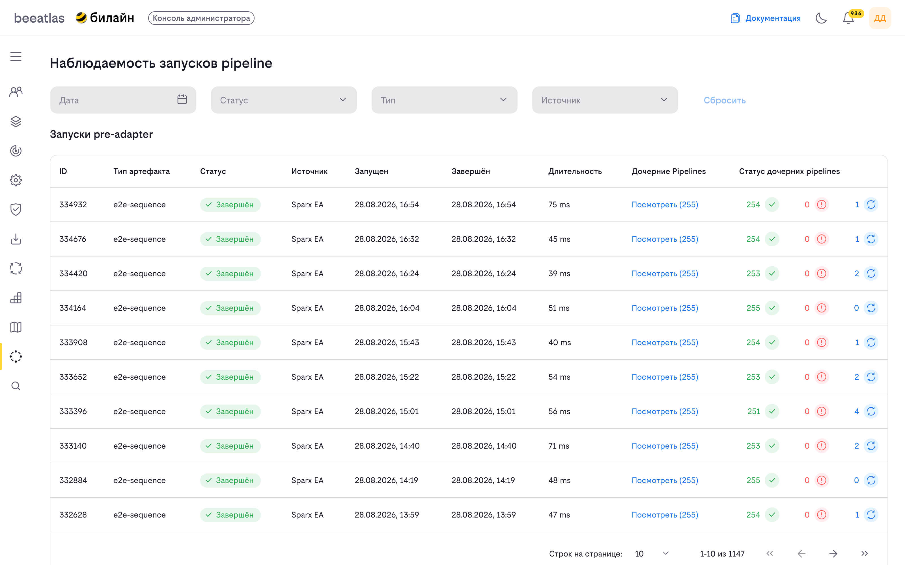
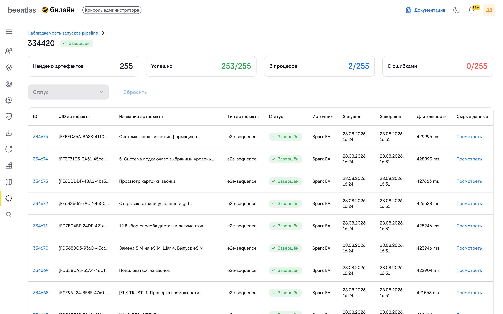
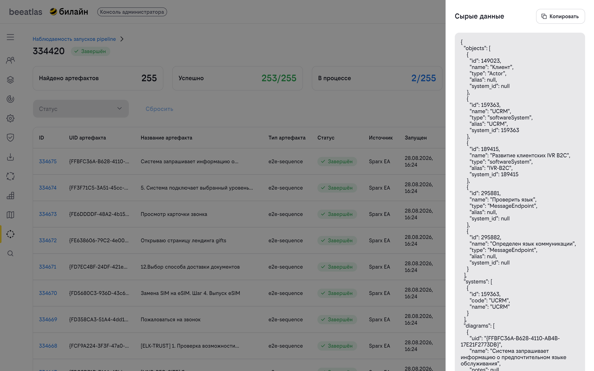
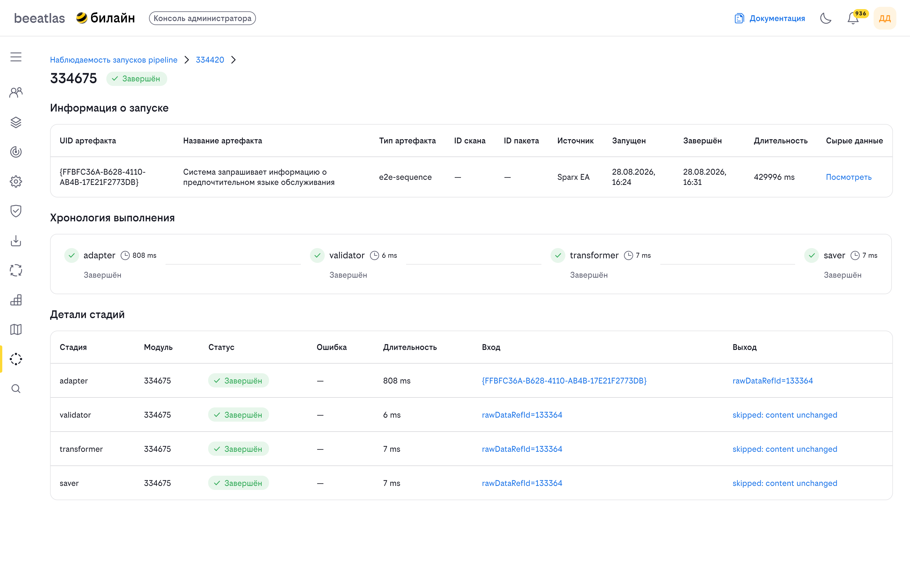
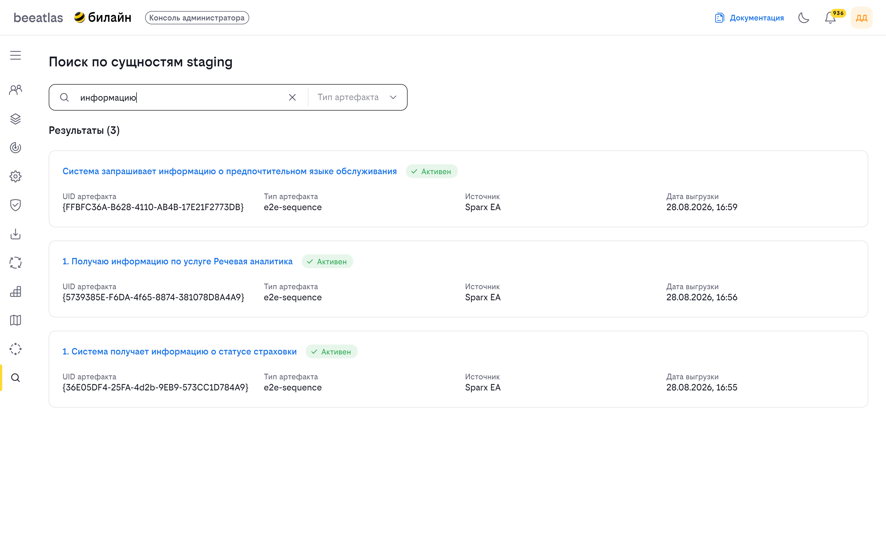
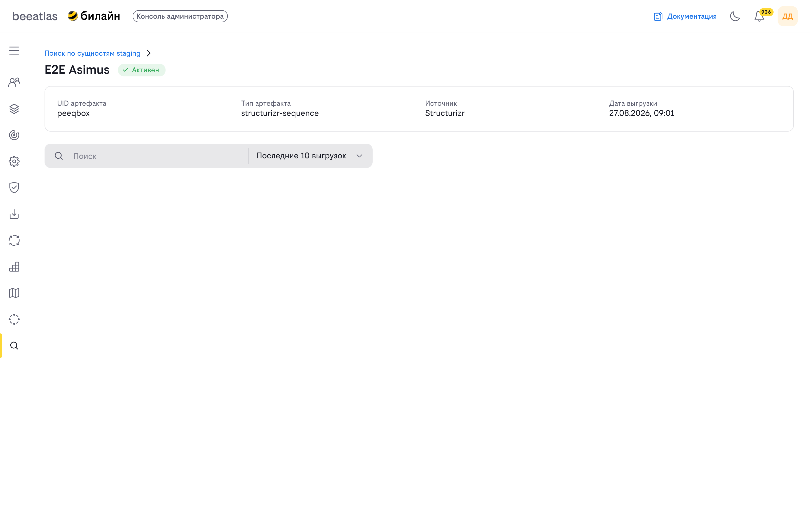
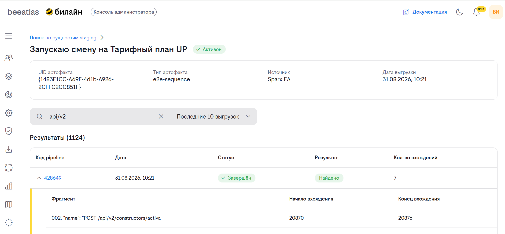
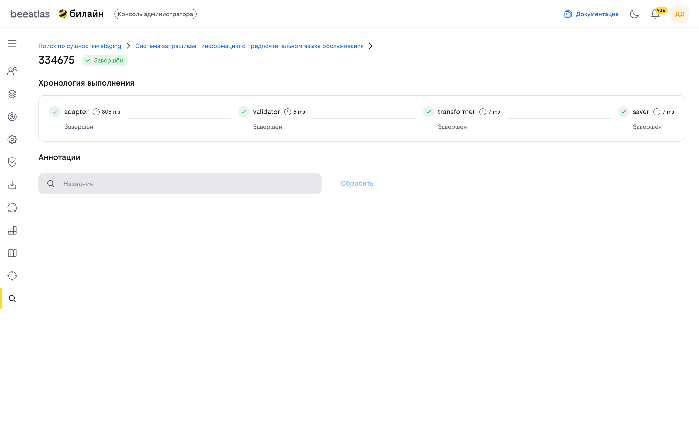

# Staging (Наблюдаемость загрузки данных)

**Назначение**: рабочее место администратора для мониторинга и диагностики процесса переноса данных (загрузки артефактов) из внешних систем в BeeAtlas, а также для поиска артефактов и анализа содержимого выгрузок.

Раздел доступен только пользователям с правами администратора.

## Как попасть

Раздел администратора (консоль администратора) → два пункта меню:

- **«Наблюдаемость запусков pipeline»** — мониторинг запусков загрузки данных (pre-adapter);
- **«Поиск по сущностям staging»** — поиск артефактов и содержимого выгрузок.

> **Связь с E2E.** Здесь отображается процесс загрузки данных, результат которой вы видите в модели [E2E сценарии](../models/e2e.md). Если сценарий не появился в E2E — причину следует искать на этом рабочем месте.

## Основные понятия

- **Артефакт** — сущность, переносимая в BeeAtlas (например, CJ, BI, шаг процесса и другие типы данных).
- **Pre-adapter (скан)** — процесс выгрузки и загрузки артефактов из источника данных.
- **Pipeline (запуск)** — отдельный запуск обработки одного артефакта внутри скана. Состоит из последовательных стадий.
- **Стадия** — этап обработки артефакта (загрузка, валидация, трансформация, сохранение, публикация и т. д.).
- **Сырые данные** — необработанные данные запуска в формате JSON.
- **Аннотации** — замечания, предупреждения и ошибки, зафиксированные при обработке артефакта.

## Статусы pipeline

| Код | Название | Значение |
|-----|----------|----------|
| `pending` | Ожидание | Запуск создан и ожидает начала обработки |
| `loading` | Загрузка | Идёт загрузка данных |
| `validating` | Валидация | Идёт проверка корректности данных |
| `transforming` | Трансформация | Идёт преобразование данных |
| `saving` | Сохранение | Идёт сохранение данных |
| `publishing` | Публикация | Идёт публикация данных в систему |
| `completed` | Завершён | Запуск успешно завершён |
| `failed` | Ошибка | Запуск завершился с ошибкой |

---

## Наблюдаемость запусков pipeline

Страница **«Наблюдаемость запусков pipeline»** (`/admin/staging`) показывает запуски pre-adapter — сканы, которые переносят артефакты из источников в BeeAtlas.

### Фильтры

Над таблицей доступны фильтры:

| Фильтр | Описание |
|--------|----------|
| **Дата** | Выбор диапазона дат по времени запуска |
| **Статус** | Фильтрация по статусу запуска (см. [Статусы pipeline](#статусы-pipeline)) |
| **Тип** | Фильтрация по типу артефакта |
| **Источник** | Фильтрация по источнику данных |
| **Сбросить** | Очищает все применённые фильтры (активна, если задан хотя бы один фильтр) |

### Таблица «Запуски pre-adapter»

Таблица содержит следующие колонки:

| Колонка | Описание |
|---------|----------|
| **ID** | Идентификатор скана |
| **Тип артефакта** | Тип переносимых данных |
| **Статус** | Бейдж текущего статуса запуска |
| **Источник** | Источник данных (полное название видно в подсказке) |
| **Запущен** | Дата и время начала запуска |
| **Завершён** | Дата и время завершения запуска |
| **Длительность** | Время выполнения в миллисекундах |
| **Дочерние Pipelines** | Ссылка «Посмотреть (N)», где N — количество дочерних запусков. Переход к [детализации скана](#детали-запуска-pre-adapter) |
| **Статус дочерних pipelines** | Сводка по дочерним запускам: количество успешных (✓), с ошибками (⚠), в процессе (⟳) |

### Пагинация

Внизу таблицы доступна пагинация: 10, 25, 50 или 100 записей на страницу.

### Пустые состояния

Если по заданным фильтрам запусков не найдено, отображается сообщение «Нет результатов, подходящих под параметры поиска».

---

## Детали запуска pre-adapter

Страница открывается по ссылке «Посмотреть (N)» из таблицы запусков (`/admin/staging/pre-adapter?id=<ID скана>`).

### Сводные карточки

В верхней части страницы отображаются сводные показатели по дочерним запускам:

- **Найдено артефактов** — общее количество обработанных артефактов;
- **Успешно** — доля успешно обработанных артефактов;
- **В процессе** — доля артефактов, обработка которых ещё идёт;
- **С ошибками** — доля артефактов, обработка которых завершилась ошибкой.

### Таблица «Дочерние pipelines»

| Колонка | Описание |
|---------|----------|
| **ID** | Идентификатор запуска (ссылка на [детали pipeline](#детали-pipeline)) |
| **UID артефакта** | Уникальный идентификатор артефакта |
| **Название артефакта** | Наименование артефакта |
| **Тип артефакта** | Тип данных |
| **Статус** | Бейдж статуса запуска |
| **Источник** | Источник данных |
| **Запущен** | Дата и время начала |
| **Завершён** | Дата и время завершения |
| **Длительность** | Время выполнения в миллисекундах |
| **Сырые данные** | Ссылка «Посмотреть» — открывает панель с необработанными данными (JSON) |

### Просмотр сырых данных

Нажмите «Посмотреть» в колонке **Сырые данные** — откроется боковая панель с содержимым данных в формате JSON. Кнопка **«Копировать»** копирует содержимое в буфер обмена.

Если сырые данные отсутствуют, в колонке отображается прочерк.

---

## Детали pipeline

Страница открывается по ссылке из колонки **ID** таблицы дочерних pipelines (`/admin/staging/pre-adapter/pipeline?id=<ID>&preAdapterRunId=<ID скана>`). 

Страница содержит три блока.

### Информация о запуске

| Поле | Описание |
|------|----------|
| **UID артефакта** | Уникальный идентификатор артефакта |
| **Название артефакта** | Наименование артефакта |
| **Тип артефакта** | Тип данных |
| **ID скана** | Идентификатор скана pre-adapter |
| **ID пакета** | Идентификатор пакета данных |
| **Источник** | Источник данных |
| **Запущен** | Дата и время начала |
| **Завершён** | Дата и время завершения |
| **Длительность** | Время выполнения в миллисекундах |
| **Сырые данные** | Ссылка «Посмотреть» на панель с сырыми данными (JSON) |

### Хронология выполнения

Визуальная последовательность стадий обработки артефакта. Для каждой стадии показаны:

- иконка статуса (завершена / ошибка / в процессе / пропущена);
- название стадии;
- длительность выполнения в миллисекундах.

### Детали стадий

Таблица со всеми стадиями запуска:

| Колонка | Описание |
|---------|----------|
| **Стадия** | Название стадии |
| **Модуль** | Идентификатор модуля, выполнявшего стадию |
| **Статус** | Бейдж статуса стадии |
| **Ошибка** | Текст причины ошибки (если стадия завершилась ошибкой) |
| **Длительность** | Время выполнения в миллисекундах |
| **Вход** | Входные данные стадии (JSON) — клик открывает панель просмотра |
| **Выход** | Выходные данные стадии (JSON) — клик открывает панель просмотра |

---

## Поиск по сущностям staging

Страница **«Поиск по сущностям staging»** (`/admin/staging-search`) позволяет найти артефакт по названию и типу и перейти к его выгрузкам.

### Поиск

- Поле поиска — ввод названия артефакта (результаты обновляются по мере ввода);
- Фильтр **«Тип артефакта»** — ограничивает поиск определённым типом данных.

### Результаты

Под строкой поиска отображается количество найденных результатов и список карточек. Карточка содержит:

- **Название** — ссылка на [страницу артефакта](#страница-артефакта);
- **Статус** — бейдж состояния артефакта;
- **UID артефакта**;
- **Тип артефакта**;
- **Источник**;
- **Дата выгрузки**.

---

## Страница артефакта

Страница открывается по ссылке из карточки результата поиска (`/admin/staging-search/artifact?uid=<UID>&type=<тип>`).

### Общая информация

- **UID артефакта**;
- **Тип артефакта**;
- **Источник**;
- **Дата выгрузки**.

### Поиск по выгрузкам

- Поле поиска — поиск по содержимому выгрузок артефакта;
- Фильтр **«Глубина поиска»** — «Последние 10 / 25 / 50 / 100 выгрузок».

### Таблица результатов

Таблица содержит выгрузки артефакта, в которых найден текст запроса:

| Колонка | Описание |
|---------|----------|
| **Код pipeline** | Идентификатор выгрузки (ссылка на [pipeline из поиска](#pipeline-из-поиска-и-аннотации)) |
| **Дата** | Дата и время выгрузки |
| **Статус** | Бейдж статуса выгрузки |
| **Результат** | Бейдж «Найдено» / «Не найдено» |
| **Кол-во вхождений** | Количество совпадений текста запроса в выгрузке |

Строки с найденными совпадениями можно развернуть — откроется таблица вхождений:

| Колонка | Описание |
|---------|----------|
| **Фрагмент** | Фрагмент текста, где найдено совпадение |
| **Начало вхождения** | Позиция начала совпадения |
| **Конец вхождения** | Позиция конца совпадения |

---

## Pipeline из поиска и аннотации

Страница открывается по ссылке из таблицы результатов на странице артефакта (`/admin/staging-search/artifact/pipeline?id=<ID>`).

В верхней части страницы — [хронология выполнения](#хронология-выполнения) запуска.

Ниже — блок **«Аннотации»** со списком замечаний, выявленных при обработке артефакта.

### Фильтры

- Поле поиска «Название» — фильтрация аннотаций по тексту;
- Кнопка **«Сбросить»** — очищает поиск.

### Таблица аннотаций

| Колонка | Описание |
|---------|----------|
| **Уровень** | Бейдж уровня: «Инфо», «Ошибка», «Предупреждение» |
| **Код** | Код аннотации |
| **Сырые данные** | Ссылка «Посмотреть» — открывает панель с сырыми данными (JSON) |
| **Детали** | Текст деталей аннотации |

### Уровни аннотаций

| Код | Название |
|-----|----------|
| `info` | Инфо |
| `error` | Ошибка |
| `warning` | Предупреждение |

---

## Навигация

- [Вернуться к разделу администратора](../admin.md)
- [E2E сценарии](../models/e2e.md) — результат загрузки данных, наблюдаемой на этом рабочем месте
