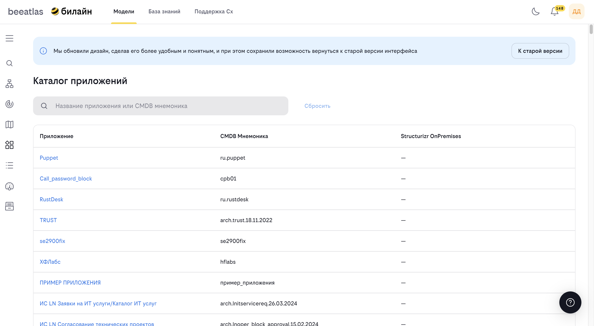

# Управление технологиями

**Назначение**: Работа с технологическими настройками системы.

<!-- -->

## Возможности

- Просмотр списка всех технологий
- Создание новых технологий
- Редактирование существующих технологий
- Управление версиями технологий
- Просмотр детальной информации о технологиях

## Как использовать

### Просмотр технологий

1. Перейдите в раздел "Консоль администратора " → "Технологии"
2. Используйте поиск и фильтры для нахождения нужных технологий
3. Просмотрите список технологий

### Создание новой технологии

1. Перейдите в раздел "Консоль администратора " → "Технологии"
2. Нажмите кнопку "Добавить технологию"
3. Заполните форму:
   - Название
   - Описание
   - Категория
   - Дополнительные атрибуты
   - Файл с подробным описанием технологии в формате MarkDown
4. Сохраните технологию

### Добавление версии технологии

1. Откройте детальную информацию о технологии
2. Перейдите к управлению версиями
3. Нажмите "Добавить версию"
4. Заполните информацию о версии:
   - Номер версии
   - Описание изменений
   - Дата релиза
5. Сохраните версию