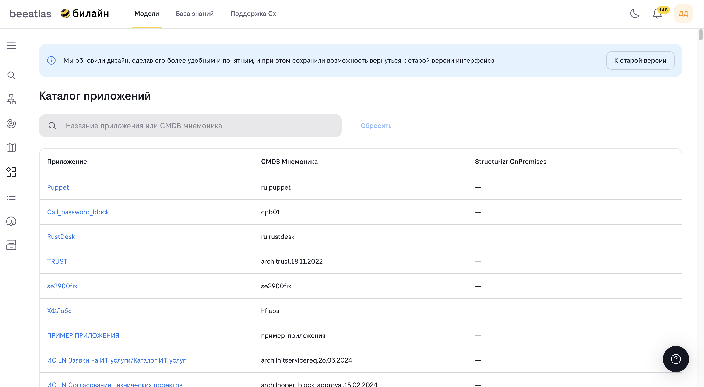

# Управление технологиями

**Назначение**: Работа с технологическими настройками системы.

<!-- -->

## Возможности

- Просмотр списка всех технологий
- Поиск и фильтрация технологий по сектору, статусу и группе
- Создание новых технологий
- Редактирование существующих технологий
- Управление версиями технологий
- Управление группами технологий

## Как использовать

### Просмотр технологий

1. Перейдите в раздел "Консоль администратора" → "Управление технологиями".
2. Используйте поиск и фильтры «Секторы», «Статусы» и «Группы».
3. Переключитесь между вкладками «Технологии» и «Группы».

### Создание новой технологии

1. Перейдите в раздел "Консоль администратора" → "Управление технологиями".
2. Нажмите кнопку "Добавить технологию".
3. Заполните форму:

   | Поле | Описание |
   |------|----------|
   | **Название\*** | Название технологии; должно быть уникальным |
   | **Группа** | Одна или несколько групп технологии |
   | **Сектор\*** | «Фреймворки и инструменты», «Платформа и инфраструктура», «Управление данными» или «Языки» |
   | **Статус\*** | Adopt, Trial, Assess или Hold |
   | **Короткое описание** | Описание до 255 символов |
   | **Технология допустима для использования в объекте критической инфраструктуры** | Переключатель «Да» / «Нет» |
   | **Вложенный файл** | Документация в формате Markdown до 100 МБ; можно скачать шаблон `tech_doc_template.md` |

4. Нажмите кнопку "Добавить технологию".

### Добавление версии технологии

1. Разверните строку технологии стрелкой в колонке названия.
2. Нажмите «Создать версию».
3. Заполните поля версии:

   | Поле | Описание |
   |------|----------|
   | **Начало диапазона\*** | Начало диапазона действия версии |
   | **Конец диапазона** | Конец диапазона действия версии |
   | **Статус\*** | Adopt, Trial, Assess или Hold; статус технологии в списке не предлагается |

4. При необходимости нажмите «Добавить версию», чтобы создать несколько версий сразу.
5. Нажмите кнопку "Сохранить".

### Управление группами

1. Перейдите на вкладку «Группы».
2. Нажмите «Создать группу» и укажите название группы.
3. Чтобы объединить группы, отметьте не менее двух групп и нажмите «Объединить в группу», затем укажите название и сохраните изменения.
