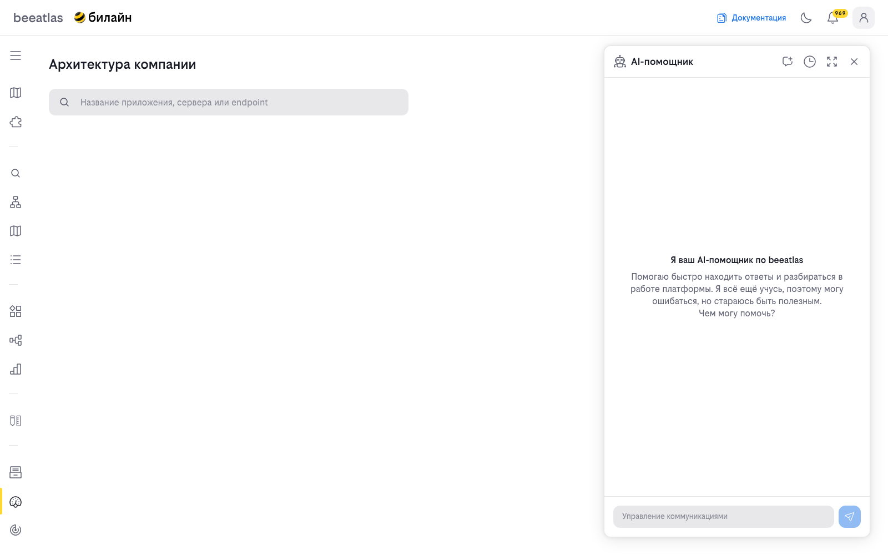

# AI-помощник

AI-помощник — встроенный в портал чат, который отвечает на вопросы о платформе BeeAtlas и о данных, открытых на текущей странице. Помощник не нужно настраивать: он доступен из любого раздела портала, где показывается кнопка обратной связи.

## Как открыть

В правом нижнем углу страницы расположена плавающая кнопка с иконкой AI-помощника. По нажатию она раскрывает два действия:

- **AI-помощник** — открывает окно чата;
- **Пожаловаться на данные** — открывает форму обратной связи по данным (см. [Обратная связь по данным](#обратная-связь-по-данным)).

Повторное нажатие на плавающую кнопку сворачивает список действий. Кнопка скрывается, когда окно чата открыто, — чтобы не перекрывать переписку.

Кнопка есть не на всех страницах: она не показывается в консоли администратора, в формах создания и редактирования заявок и сущностей, в импорте E2E, в мастере оценки проекта и на странице аналитического отчёта.

На главной странице портала есть отдельное поле с подсказкой «Введите запрос»: введите вопрос и нажмите «Отправить» (или Enter) — чат откроется сразу в полноэкранном режиме с подставленным вопросом. Под полем показаны чипы с последними диалогами: нажатие открывает выбранный диалог.

## Окно чата

Чат работает в двух режимах:

**Компактный** — панель в правом нижнем углу. В шапке:

- **Новый чат** — начать диалог с чистого листа;
- **История** — выпадающий список прошлых диалогов;
- **Развернуть** — перейти в полноэкранный режим;
- **Закрыть** — свернуть чат.

**Полноэкранный** — панель на весь экран. Слева расположена колонка с историей диалогов и кнопкой **Новый чат**, справа — переписка. В шапке доступны **Свернуть** (возврат в компактный режим) и **Закрыть**.

Пока помощник готовит ответ, в переписке отображается сообщение в обработке. Если ответ не удалось получить, в чате появляется ошибка «Ошибка обработки ответа» или «Не удалось отправить сообщение» — вопрос можно задать повторно.

У каждого ответа есть действия **Копировать** (скопировать текст) и **Повторить** (переотправить вопрос).

## Контекст страницы

Вместе с вопросом помощник получает контекст открытой страницы: какие элементы, фильтры и данные на ней выбраны. Поэтому вопросы вида «что означает этот блок», «почему здесь такой статус», «что можно сделать с этой картой» получают ответ по текущему экрану, без ручного описания.

Контекст передаётся на страницах:

| Страница | Что попадает в контекст |
|---|---|
| Поиск по ФДМ | поисковый запрос и результаты |
| ФДМ | открытая возможность и её окружение |
| Карты возможностей, Персональная карта | выбранная карта, критерий и легенда |
| Технорадар, Технология | выбранная технология и её положение на радаре |
| Каталог приложений, Приложение | открытое приложение и его вкладки |
| Паттерны, Паттерн | выбранный паттерн или антипаттерн |
| Библиотека CJ, CJ | открытый CJ и его этапы |
| Библиотека BI, BI | открытый BI и его шаги |
| E2E сценарии | открытый E2E-сценарий |
| Жизненные ситуации | открытая ситуация или НФТ |
| Архитектура компании | выбранный элемент и его связи |

В шапке сообщения с ответом указано, по какой странице собран контекст, — например «AI помощник, контекст по странице Технорадар».

## История диалогов

Диалоги сохраняются автоматически и доступны в любое время. В полноэкранном режиме история сгруппирована:

- **Закреплено** — диалоги, которые вы закрепили;
- **Сегодня**;
- **Последние 7 дней**;
- **Ранее**.

Названием диалога служит его тема (первый вопрос). В строке диалога доступны действия **Закрепить** / **Открепить** и **Удалить**. Закреплённые диалоги остаются наверху списка. В компактном режиме те же диалоги открываются через кнопку **История**.

## Обратная связь по данным

Действие **Пожаловаться на данные** открывает боковую панель с полем **Описание проблемы**. Опишите, что не так с данными на странице (неверная связь, устаревший статус, опечатка в названии), и отправьте описание — страница, с которой отправлена жалоба, прикладывается автоматически.

После отправки панель показывает подтверждение «Описание проблемы отправлено». Жалоба не создаёт заявку и не меняет данные — она фиксируется как обратная связь вместе с адресом страницы.

## Ограничения

- Помощник отвечает по данным портала и документации, но может ошибаться — ответы стоит проверять по самой карточке или разделу документации.
- Помощник не изменяет данные: через чат нельзя создать, отредактировать или удалить сущность. Для изменений используйте обычные формы портала или заявки.
- Если кнопка AI-помощника не отображается, значит в вашем окружении он отключён администратором — остальные функции портала при этом работают как обычно.

## Навигация

- [О системе](./README.md)
- [Модели](./models.md)
- [Профиль](./profile.md)
