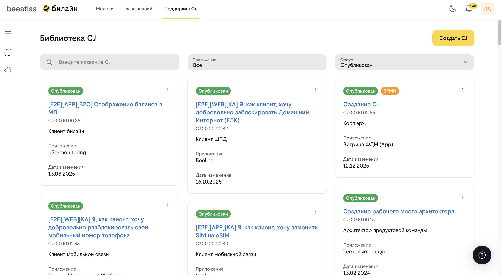

# Раздел "CX (Customer Experience)"

Раздел "CX" предназначен для работы с артефактами, связанными с клиентским опытом. Здесь собраны все опубликованные артефакты всех команд, а также артефакты, созданные членами вашей команды.

## Правила проектирование CJ

Для подготовки корректного CJ рекомендуется следовать [методологии этапа проектирования CX](https://bwiki.beeline.ru/spaces/UDC/pages/626452028/%D0%9C%D0%B5%D1%82%D0%BE%D0%B4%D0%B8%D0%BA%D0%B0+%D0%9F%D1%80%D0%BE%D0%B5%D0%BA%D1%82%D0%B8%D1%80%D0%BE%D0%B2%D0%B0%D0%BD%D0%B8%D1%8F+CX) (корпоративная методология доступна только для внутренних пользователей Beeline)

## Содержание

- [Библиотека CJ (Customer Journey)](#библиотека-cj-customer-journey)
- [Библиотека BI (Business Interaction)](#библиотека-bi-business-interaction)

## Библиотека CJ (Customer Journey)

**Назначение**: CJ — это конечный набор взаимодействий человека с компанией, реализация которого приводит к достижению целей как клиента, так и компании.

### Что такое Customer Journey

Customer Journey (CJ) представляет собой полный путь клиента от первого контакта с компанией до достижения его цели. Каждый CJ состоит из набора **шагов (этапов)**, на каждом из которых может быть размещён один или несколько **BI (Business Interaction)**. Структура CJ визуализируется в виде таблицы, где столбцы — шаги, а строки — атрибуты привязанных BI.

### Форматы CJ

CJ может быть создан в одном из двух форматов:

| Формат | Описание | Ограничения |
|---|---|---|
| **BEEATLAS** | Ручное создание и редактирование структуры CJ через интерфейс | Нельзя импортировать BPMN в ранее собранный CJ. Чтобы импортировать BPMN, нужно сначала удалить все этапы и очистить последний оставшийся этап от BI |
| **BPMN** | Структура CJ формируется на основе загруженного BPMN-файла. | Нельзя менять структуру CJ (добавлять/удалять шаги). Доступно редактирование только распознанных атрибутов BI и этапов |

Формат CJ отображается в верхней панели детальной страницы. При наведении показывается описание ограничений текущего формата.

### Возможности

- Просмотр библиотеки всех CJ (в виде сетки или таблицы)
- Поиск по названию или уникальному идентификатору
- Фильтрация по продукту, статусу, формату, наличию Grafana-дашборда (Доступно не на всех стендах)
- Просмотр детальной информации о CJ
- Создание новых CJ (с указанием бизнес-ответственного и технических ответственных)
- Редактирование CJ в статусе черновика (с возможностью изменения ответственных)
- Импорт CJ из BPMN-файла
- Просмотр и переключение между версиями BPMN-файла
- Просмотр BPMN-диаграмм CJ
- Привязка элементов ландшафта (TC/методы) к шагам сценария BI
- Публикация / перевод в черновик

### Управление ответственными за CJ

В системе реализован функционал управления ответственными за CJ.

- **Владелец сценария**: один обязательный ответственный
- **Технические ответственные**: несколько необязательных ответственных

>**При увольнении ответственного он автоматически заменяется на своего функционального руководителя.**

### Описание парсера BPMN

Парсер BeeAtlas предназначен для автоматического преобразования BPMN-файлов в структуру Customer Journey. Он анализирует BPMN-диаграмму и распознаёт элементы в соответствии с заданной методологией.

[Подробная инструкция по работе с BPMN файлами описана здесь](instruction%2Fcj_bpmn.md)

## Связь между CJ и BI

CJ и BI тесно связаны между собой:

- **CJ** состоит из нескольких **BI**
- Один **BI** может быть частью нескольких **CJ**
- При просмотре CJ можно увидеть все связанные BI
- При просмотре BI можно увидеть все связанные CJ

## Заполнение CJ через интерфейс BeeAtlas

### Редактирование общей информации о CJ

Для того чтобы внести изменения в общую информацию, выполните следующие действия:

1. Нажмите на кнопку **«Редактировать»** в шапке страницы
2. При нажатии на кнопку автоматически откроется меню в правой части страницы с полями, доступными для редактирования 
3. Внесите необходимые изменения и нажмите кнопку **«Сохранить»**
4. Автоматически в шапке будут отображены корректные значения

## Сохранение и публикация CJ

### Автосохранение

Все внесённые изменения в ходе работы над CJ сохраняются автоматически, и по умолчанию CJ присваивается статус **«Черновик»**. При каждом действии появляется уведомление о том, что изменения сохранены.

### Сохранение как черновик

Для того чтобы продолжить работу над CJ, нажмите кнопку **«Закрыть»** или **«Назад»**. При нажатии на кнопку все внесённые изменения сохраняются, в библиотеке появляется карточка с вашим CJ.

CJ в статусе «Черновик» доступен для просмотра только продуктовой команде, в рамках которой происходит создание, а также он доступен для дальнейшего редактирования.

### Публикация

Для того чтобы сохранить внесённые изменения и сделать CJ доступным на просмотр другим командам, нажмите на кнопку **«Опубликовать»**.

CJ в статусе «Опубликован» доступен для просмотра всем авторизованным пользователям витрины ФДМ.

### Редактирование CJ в статусе «Черновик»

1. В библиотеке CJ выберите артефакт в статусе «Черновик» — автоматически откроется страница артефакта
2. Внесите необходимые изменения

### Редактирование CJ в статусе «Опубликован»

1. В библиотеке CJ выберите артефакт в статусе «Опубликован» — автоматически откроется страница артефакта
2. Нажмите на кнопку **«Сделать черновиком»** — автоматически меняется статус на «Черновик», и CJ становится доступным для редактирования
3. Внесите необходимые изменения — автоматически все внесённые изменения сохраняются

## Библиотека BI

### Что такое Business Interaction

Business Interaction (BI) представляет собой отдельный этап или взаимодействие в рамках Customer Journey. Каждый BI имеет четко определенный результат и может быть частью нескольких CJ.

**Назначение**: BI — выделяемые в составе CJ наборы действий, итогом которых является законченный промежуточный результат, значимый с точки зрения решаемой клиентом задачи.

Для перехода к подразделу **«Библиотека BI»** нажмите на соответствующую карточку — автоматически в том же окне/вкладке браузера осуществится переход на страницу библиотеки артефактов команды.

### Возможности

- Просмотр библиотеки всех BI
- Поиск и фильтрация BI
- Просмотр детальной информации о BI
- Создание новых BI (для авторизованных пользователей)

### Создание нового BI

Для того чтобы создать новый BI, нажмите на кнопку **«Создать BI»** — автоматически откроется страница создания BI.

Форма представлена полями для ввода и полями, позволяющими сделать выбор из списка.

### Сохранение BI в статусе «Черновик»

Для сохранения BI в статусе «Черновик» нажмите на кнопку **«Сохранить как черновик»** — BI автоматически сохранится в статусе «Черновик» и появится в списке артефактов в библиотеке. BI в статусе «Черновик» доступен для редактирования и дальнейшей публикации.

### Сохранение BI в статусе «Опубликован»

Для публикации BI нажмите на кнопку **«Опубликовать»** — автоматически осуществится проверка на заполнение обязательных полей, и BI сохранится в статусе «Опубликован», а также появится в списке артефактов в библиотеке. Иначе появится уведомление о том, что обязательные поля не заполнены. BI в статусе «Опубликован» доступен для просмотра.

### Редактирование BI

Редактировать можно артефакты, находящиеся в статусе «Черновик», а также те, что находятся в статусе «Опубликован», но не задействованы в опубликованных CJ.

#### Редактирование BI в статусе «Черновик»

1. Вызовите контекстное меню, нажав на кнопку **«Настройки»**, или откройте детальную страницу артефакта и нажмите на кнопку **«Редактировать»** — автоматически откроется страница редактирования BI
2. Внесите необходимые изменения

#### Редактирование BI в статусе «Опубликован»

1. Откройте детальную страницу артефакта и нажмите на кнопку **«Сделать черновиком»** — автоматически артефакт сменит статус на черновик
2. Если артефакт использован в других CJ, появится уведомление о том, где он используется
3. Нажмите на кнопку **«Редактировать»** — автоматически откроется страница редактирования
4. Внесите необходимые изменения

### Удаление BI

1. В библиотеке выберите необходимый артефакт и нажмите на кнопку **«Настройки»** — автоматически отобразится контекстное меню
2. Нажмите на кнопку **«Удалить»** — автоматически артефакт удалится

## Работа с артефактами

### Публикация артефактов

Созданные вами CJ и BI могут быть опубликованы и станут доступны всем пользователям системы.

### Поиск артефактов

Используйте поиск для быстрого нахождения нужных артефактов:

- Поиск по названию
- Поиск по описанию
- Фильтрация по различным критериям

### Фильтрация

В библиотеках доступны различные фильтры:

- По команде/автору
- По дате создания
- По статусу
- По связанным сущностям
