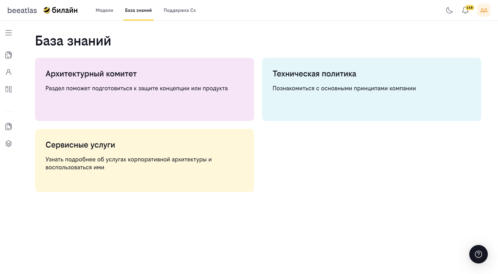

# Раздел "База знаний"

Раздел "База знаний" содержит справочную информацию, необходимую для работы архитекторов и разработчиков: материалы архитектурного комитета, техническую политику компании и информацию о сервисных услугах.

## Содержание

- [Архитектурный комитет](#архитектурный-комитет)
- [Техническая политика](#техническая-политика)
- [Сервисные услуги](#сервисные-услуги)

---

## Архитектурный комитет

**Назначение**: Раздел поможет подготовиться к защите концепции или продукта.

### Возможности

- Информация о процессе защиты в архитектурном комитете
- Руководства и инструкции (How To)
- Шаблоны документов
- Информация о членах комитета

### Подразделы

#### Как подготовиться (How To)

Содержит пошаговые инструкции и рекомендации по подготовке к защите в архитектурном комитете.

**Как использовать**:
1. Перейдите в раздел "База знаний" → "Архитектурный комитет"
2. Выберите "Как подготовиться"
3. Изучите инструкции и рекомендации

#### Шаблоны

Содержит готовые шаблоны документов для использования при подготовке к защите.

**Как использовать**:
1. Перейдите в раздел "База знаний" → "Архитектурный комитет" → "Шаблоны"
2. Выберите нужный шаблон
3. Скачайте шаблон для использования

### Как использовать

1. Перейдите в раздел "База знаний" → "Архитектурный комитет"
2. Изучите представленную информацию
3. Используйте разделы "Как подготовиться" и "Шаблоны" для подготовки к защите

---

## Техническая политика

**Назначение**: Познакомиться с основными принципами компании.

### Возможности

- Просмотр технической политики компании
- Изучение принципов разработки и архитектуры
- Понимание стандартов и требований

### Как использовать

1. Перейдите в раздел "База знаний" → "Техническая политика"
2. Изучите представленные материалы
3. Используйте информацию при принятии технических решений

### Содержание раздела

Раздел содержит:
- Основные принципы технической политики
- Стандарты разработки
- Требования к архитектуре
- Рекомендации по выбору технологий

---

## Сервисные услуги

**Назначение**: Узнать подробнее об услугах корпоративной архитектуры и воспользоваться ими.

### Возможности

- Просмотр доступных сервисных услуг
- Информация о консультациях
- Подача заявки на консультацию

### Подразделы

#### Консультации

Раздел для получения консультаций от специалистов корпоративной архитектуры.

**Как использовать**:
1. Перейдите в раздел "База знаний" → "Сервисные услуги" → "Консультации"
2. Изучите доступные типы консультаций
3. Подайте заявку на консультацию при необходимости

### Как использовать

1. Перейдите в раздел "База знаний" → "Сервисные услуги"
2. Изучите доступные услуги
3. При необходимости перейдите в раздел "Консультации" для подачи заявки

### Типы услуг

Раздел может содержать информацию о следующих типах услуг:
- Консультации по архитектуре
- Экспертиза решений
- Помощь в выборе технологий
- Другие сервисные услуги

