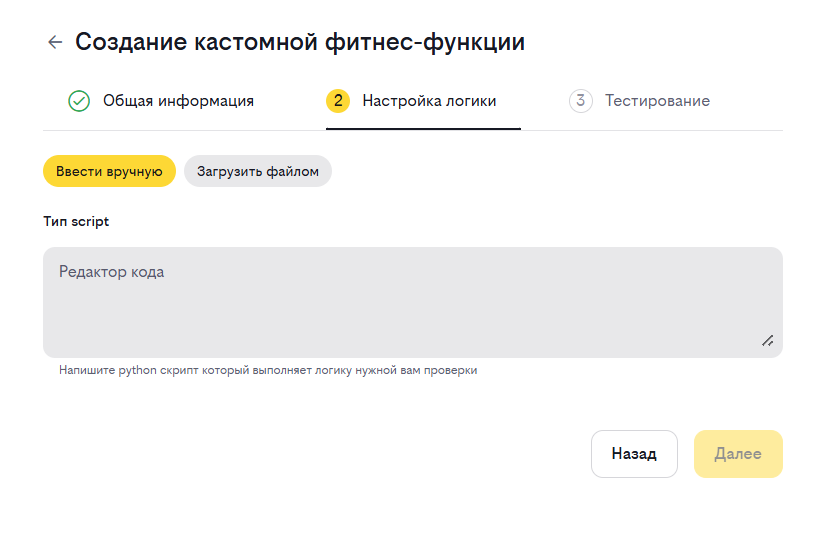
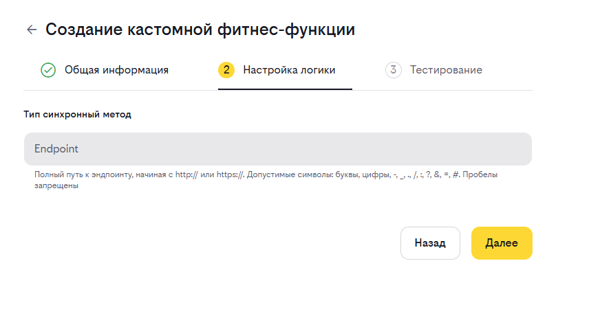
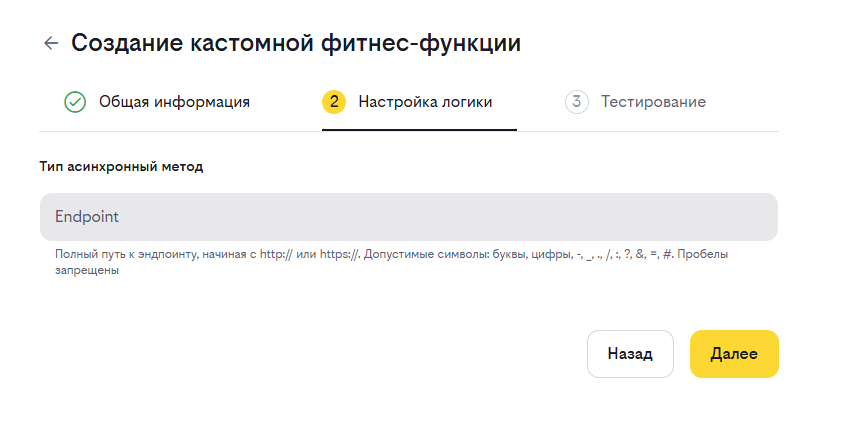

# Инструкция по созданию кастомных фитнес-функций

## Пошаговая инструкция по созданию КФФ

1. Перейдите в раздел управления кастомными фитнес-функциями
2. На экране вы увидите таблицу существующих функций и кнопку "Создать фитнес-функцию"

### Шаг 2: Создание новой фитнес-функции

1. Нажмите кнопку "Создать фитнес-функцию"
2. Заполните обязательные поля:
   - **Код**: Уникальный идентификатор функции
   - **Название**: Понятное имя функции
   - **Описание**: Краткое описание назначения
3. Укажите тип функции:
   - **Скрипт**: Для выполнения Python-скрипта
   - **Синхронный метод**: Для обращения платформой к внешнему сервису череp http метод и получения ответа в том же сообщении. Удобно, когда проверка быстрая
   - **Асинхронный метод**: Для обращения платформой к внешнему сервису череp http метод. Ответ приходит ассинхронно
5. Укажите применимость к другим фитнес-функциям при необходимости
6. Нажмите "Далее" для продолжения

### Шаг 3: Настройка логики выполнения

#### Для типа "Скрипт":

[Подробное описание этого типа ФФ](CUSTOM_SCRIPT_GUIDE.md)

1. Выберите способ предоставления скрипта: загрузка файла или ручной ввод
2. Убедитесь, что скрипт содержит функцию `execute()` с правильной сигнатурой
3. Введите или загрузите код скрипта
4. Фитнесс-функция сохранится со статусом TEST

#### Для типа "Синхронный метод":

[Подробное описание этого типа ФФ](http-check-sync.md)

1. Укажите Endpoint URL внешнего API
2. Убедитесь, что метод возвращает результат в правильном формате
3. Фитнесс-функция сохранится со статусом TEST

#### Для типа "Асинхронный метод":

[Подробное описание этого типа ФФ](http-check-async.md)

1. Укажите Endpoint URL внешнего API
2. Убедитесь, что метод возвращает результат в правильном формате
3. Фитнесс-функция сохранится со статусом TEST

### Шаг 4: Тестирование функции

1. Активируйте чекбокс "Использует данные workspace.json от Structurizer"
2. Выберите мнемонику приложения для тестирования
3. Нажмите кнопку "Проверить"
4. Проверьте результат выполнения в области отображения результата
5. При успешном тестировании нажмите "Перевести в TRIAL"

## Важные моменты

- Убедитесь, что код функции уникален
- Для скриптов обязательно наличие функции `execute()`
- При использовании API убедитесь в правильности формата запросов и ответов
- Тестируйте функцию перед переводом в статус TRIAL