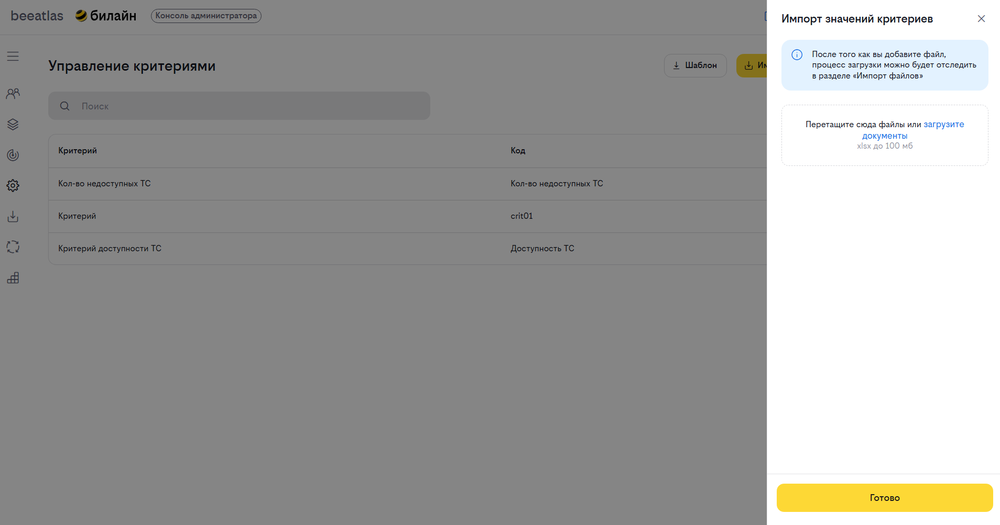
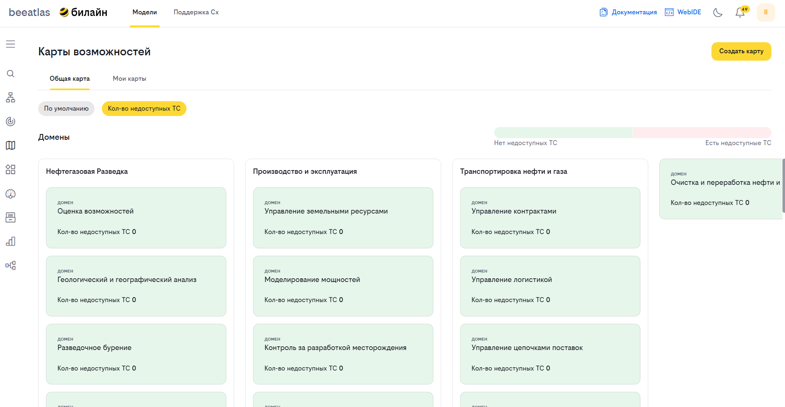

# Инструкция по созданию критериев карты возможностей и публикации результатов расчетов

## Обзор

**Критерий** — это показатель, который оценивает состояние бизнес-возможностей (BC) и технических возможностей (TC). Результаты расчёта критериев отображаются на картах возможностей в виде тепловой карты: карточки окрашиваются от красного до зелёного в зависимости от значения показателя.

Данный раздел описывает, как администратор управляет критериями: создаёт, редактирует, удаляет, а также импортирует результаты расчётов.

## Типы метрик расчёта

Каждый критерий имеет один из трёх типов метрики. Тип определяет, как значение критерия соотносится с оценкой и какие поля обязательны для заполнения.

### Непрерывный

Значение критерия — это числовая величина (сумма, процент, количество и т.д.), а оценка определяется тем, в какой интервал, заданный шагом, попадает это значение.

**Обязательные поля:**

- **Порог** — максимальное значение для оценки. Всё, что выше порога, получает высшую оценку. Пример: если порог для критерия 500, то критерий может варьироваться от 0 до 500, а всё что выше автоматически получает высшую оценку.
- **Шаг** — шкала оценки разбивается на отрезки этой длины (от 0 до порога). Пример: если порог для критерия 500 и шаг 100, то для критерия шкала оценки от 1 до 5. Если для TC/BC значение критерия >500, оно автоматически получает высшую оценку (5) по этому критерию.

**Пример:** критерий «Количество TC» — порог = 500, шаг = 100. Значение 350 попадает в 4-й интервал (300–400), оценка = 4. Значение 600 — выше порога, оценка = 5.

### Оценочный

Значение отражает измеримый показатель (количество, доля и т.д.), а оценка — качественный уровень, который присваивается по заданному правилу.

**Обязательные поля:** Интервал. Количество уровней оценки критерия. Определяет, на сколько градаций разбита шкала оценки — от минимальной до максимальной.

**Пример:** критерий «Качество описания» — значение = доля заполненных полей, оценка = качественный уровень (низкий/средний/высокий), определяемый по правилу.

### Дискретный

Критерий оценивается по фиксированной балльной шкале, и набранный балл одновременно является и значением, и оценкой.

**Обязательные поля:** Интервал. Количество уровней оценки критерия. Определяет, на сколько градаций разбита шкала оценки — от минимальной до максимальной.

**Пример:** критерий «Уровень зрелости» — оценка от 1 до 5 баллов, где набранный балл и есть итоговое значение.

### Обратная ось

Флаг **«Обратная ось»** доступен для любого типа метрики и меняет логику оценки на противоположную: **чем меньше значение, тем выше оценка**.

Используйте обратную ось для критериев, где низкое значение — это хорошо (например, «количество инцидентов», «число критических уязвимостей»).

## Раздел «Управление критериями»

Для перехода к управлению критериями откройте раздел **«Управление критериями»** через панель администратора.

На странице управления критериями доступны:

| Элемент | Описание |
|---------|----------|
| **Кнопка «Создать критерий»** | Открывает форму создания нового критерия |
| **Кнопка «Импорт значений критериев»** | Открывает диалог загрузки файла с результатами расчётов критериев |
| **Кнопка «Скачать шаблон»** | Позволяет скачать шаблон для заполнения значений расчётов критериев |
| **Список критериев** | Таблица существующих критериев с возможностью редактирования |

## Создание критерия

### Шаг 1. Нажмите кнопку «Создать критерий»
### Шаг 2. Заполните форму

#### Основные поля

| Поле | Обязательное | Описание |
|------|-------------|----------|
| **Название** | Да | Наименование критерия (например, «Качество описания», «Количество TC») |
| **Код** | Да | Уникальный идентификатор критерия. Может состоять только из строчных латинских букв, цифр и символов (например, `quality_description`, `tc_count_1`) |
| **Обратная ось** | Нет | Меняет логику оценки на противоположную: чем меньше значение, тем выше оценка |
| **Минимальное значение** | Да | Текстовая подпись для левого края шкалы |
| **Максимальное значение** | Да | Текстовая подпись для правого края шкалы |

#### Метрики расчёта

| Поле | Обязательное | Описание |
|------|-------------|----------|
| **Тип метрики** | Да | Тип измерения: **непрерывный**, **дискретный** или **оценочный** |
| **Интервал** | Для оценочного и дискретного | Количество уровней оценки критерия. Определяет, на сколько градаций разбита шкала оценки — от минимальной до максимальной. Интервал всегда является целым числом и задаётся для каждого критерия независимо от его типа. Если критерий имеет 3 уровня оценки («низкий», «средний», «высокий») — интервал = 3 |
| **Порог** | Для непрерывного | Максимальное значение для оценки. Всё, что выше порога, получает высшую оценку |
| **Шаг** | Для непрерывного | Шкала оценки разбивается на отрезки этой длины (от 0 до порога) |

### Шаг 3. Сохранение

- Нажмите кнопку **«Создать»**.
- Отобразится уведомление: **«Критерий создан»**.
- Новый критерий появится в списке и станет доступен для выбора на всех картах возможностей.

## Редактирование критерия

1. В списке критериев нажмите на нужный критерий или кнопку **«Редактировать»**.
2. Откроется форма с предзаполненными данными.

> При изменении параметров оси критерия (интервал, шаг) существующая визуализации карты возможностей будет перестроена в соответствии с новыми параметрами под уже загруженные результаты расчёта

3. Внесите необходимые изменения.
4. Нажмите кнопку **«Сохранить изменения»**.
5. Отобразится уведомление: **«Изменения сохранены»**.

## Импорт результатов расчётов критериев

Импорт позволяет массово загрузить рассчитанные значения критериев для возможностей из файла по шаблону.

### Шаблон для импорта

Шаблон представляет собой файл со следующими столбцами:

| Столбец | Описание |
|---------|----------|
| **type** | Тип возможности: `BC` (бизнес-возможность) или `TC` (техническая возможность) |
| **code** | Код возможности (например, `BC-001`, `TC-012`) |
| **criterionName** | Название критерия (должно совпадать с существующим критерием в системе) |
| **value** | Числовое значение критерия для данной возможности |
| **grade** | Итоговая оценка (балл), определяющая цвет на тепловой карте. Заполняется **только для дискретного типа метрики** — для непрерывного и оценочного типов оценка вычисляется на основе значения |
| **comment** | Текстовый комментарий к оценке (может быть пустым) |

### Шаг 1. Скачайте шаблон

1. Нажмите кнопку **«Скачать шаблон»** на странице управления критериями.
2. Заполните шаблон значениями расчётов критериев.

### Шаг 2. Загрузите заполненный файл

1. Нажмите кнопку **«Импорт значений критериев»**.
2. В открывшемся диалоге нажмите **«Загрузить файл»** и выберите заполненный файл.
3. Начнётся процесс загрузки и обработки.

### Шаг 3. Проверьте статус импорта

| Статус         | Описание |
|----------------|----------|
| **Загрузка**   | Файл загружен, данные обрабатываются |
| **Успешно**    | Все данные импортированы без ошибок |
| **Проблемный** | Часть данных не импортирована — скачайте отчёт об ошибках |

> При наличии ошибок. Исправьте данные и загрузите файл повторно.

## Как критерии отображаются на карте

После создания критерия и загрузки результатов расчётов, критерий становится доступен для выбора на картах возможностей.

### Выбор критерия на карте

1. Откройте карту возможностей.
2. Над списком возможностей нажмите на фильтр с нужным критерием.
3. Карточки окрасятся в цвета градиента от красного до зелёного.

### Цветовая шкала (легенда)

При выборе критерия под заголовком раздела появляется цветовая легенда:

- **Левый край** (красный) — минимальное значение показателя.
- **Правый край** (зелёный) — максимальное значение показателя.
- Под шкалой отображаются текстовые описания границ (из полей «Минимальное значение» и «Максимальное значение»).

> Для критериев с включённым флагом **«Обратная ось»** шкала инвертирована: зелёный означает минимальное (лучшее) значение, красный — максимальное (худшее).

### Информация на карточке

Когда критерий активен, на каждой карточке отображается:

| Элемент | Описание |
|---------|----------|
| **Цвет фона** | Определяется значением критерия по цветовой шкале |
| **Описание критерия** | Краткое название показателя оценки |
| **Числовое значение** | Количественное значение критерия для данной возможности |
| **Комментарий** (если есть) | При наведении отображается текстовый комментарий к оценке |

### Как посмотреть комментарий

1. На карточке с комментарием найдите иконку комментария.
2. Наведите курсор на иконку — появится всплывающая подсказка с текстом комментария.

## Ограничения

- Набор критериев зависит от типа возможностей: для BC и TC доступны разные наборы.
- При переходе к дочерним элементам тип критериев может измениться автоматически.
