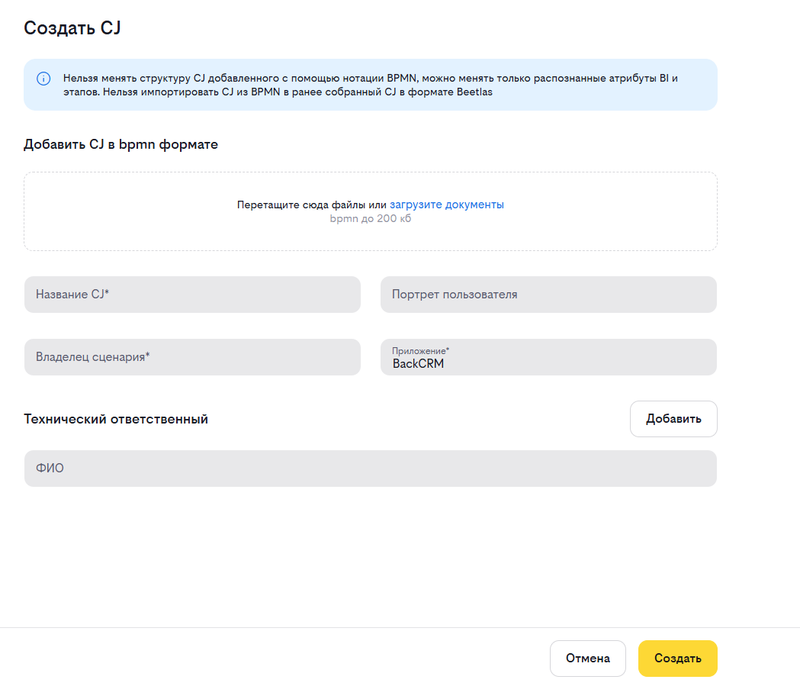
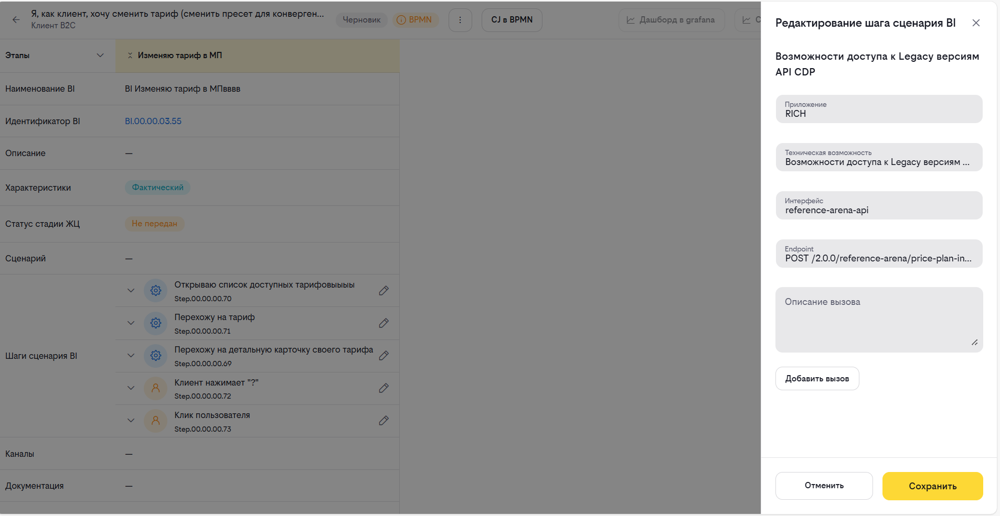

# Инструкция по работе с Customer Journey (CJ) в BPMN

### Описание парсера и подготовка BPMN файла

Парсер BeeAtlas предназначен для автоматического преобразования BPMN-файлов в структуру Customer Journey. Он анализирует BPMN-диаграмму и распознаёт элементы в соответствии с заданной методологией.

#### Поддерживаемые версии BPMN

Парсер поддерживает BPMN-файлы, созданные в **версии 8.x** BPMN-редакторов (например, Camunda Modeler 8.x). Файлы, созданные в версии 7.x, **не распознаются** парсером из-за различий в структуре XML.

#### Маппинг элементов BPMN на модель данных BeeAtlas

| BeeAtlas | BPMN-элемент | Условия |
|----------|--------------|---------|
| **Этап** | Collapsed Sub Process | Вложенный в верхнеуровневый process |
| **BI** | Expanded Sub Process | Вложенный в «этап» подпроцесс. Название должно начинаться с `BI` |
| **BI** | Call Activity | Вложенный в «этап» элемент. Название должно начинаться с `BI`. В поле *Called Element* указан идентификатор существующего в BeeAtlas BI (например, `BI.00.00.01.08`) |
| **Шаг сценария BI** | Service Task / User Task | Вложенный в BI элемент |

#### Иерархия структуры

```
Process (верхнеуровневый)
└── Этап = Collapsed Sub Process
    └── BI = Expanded Sub Process или Call Activity
        └── Шаг сценария = Service Task / User Task
```

## Создание нового CJ

Для создания нового CJ нажмите на кнопку **«Создать CJ»** — автоматически откроется меню справа для внесения общей информации об артефакте.

1. Выберите **приложение**, реализующее CJ
2. Введите **название** CJ
3. Введите **портрет пользователя**
4. Если для поддержки CJ подготовлен BPMN-файл, загрузите файл для автоматического распознавания элементов CJ
5. Укажите **Владельца сценария**
6. При необходимости укажите **Технических ответственных**



>**При увольнении ответственного он автоматически заменяется на своего функционального руководителя.**
### Продолжение работы с CJ

Для продолжения создания нового CJ нажмите на кнопку **«Создать»** — при её нажатии автоматически в том же окне/вкладке браузера осуществится переход на страницу внесения данных в CJ.

### Прекращение работы

Для отмены действий нажмите кнопку **«Отменить»** — при нажатии на неё осуществляется возврат к странице библиотеки артефактов. Все данные, указанные пользователем, не будут сохранены.

## Заполнение CJ через BPMN-файл

### Импорт CJ из BPMN

Импорт BPMN-файла доступен через меню действий → «Импортировать CJ».

**Процесс импорта:**

1. Выберите `.bpmn`-файл через файловый загрузчик
2. Файл будет загружен и валидирован на сервере
3. При успешной валидации CJ будет обновлён из BPMN — структура шагов и BI будет сформирована автоматически
4. После успешного импорта станет доступна привязка элементов ландшафта (TC/методы) к шагам сценария BI через иконку карандаша
5. При ошибке валидации отобразится уведомление «Ошибка валидации файла»

#### Результат разбора BPMN-файла

После успешного разбора BPMN-файла CJ помечается **флагом BPMN**. Это означает, что структура CJ сформирована автоматически на основе BPMN-диаграммы. В дальнейшем структуру таких CJ можно редактировать только с поддержкой новых версий BPMN-файлов.


### Обновление CJ новой версией BPMN-файла

Для структурного обновления элементов CJ опубликуйте новую версию BPMN-файла, нажав кнопку **«Импортировать CJ»**. Выберите файл и нажмите кнопку **«Сохранить»**.

### Просмотр версий CJ

Для просмотра версий CJ нажмите кнопку **«Показать версии»**, выберите интересующую версию CJ. Доступно скачивание версии, а также просмотр в редакторе BPMN.

## Редактирование CJ

### Редактирование вызовов шага сценария BI

Для добавления вызова нажмите кнопку **«Редактировать»**. Определите количество необходимых вызовов — если требуется добавить новый вызов, нажмите кнопку **«Добавить»**.

1. Выберите **приложение** из выпадающего списка (доступен поиск)
2. После выбора приложения доступен выбор **TC или интерфейса**
    - Если TC для данного вызова уже определено — выберите TC
    - Выберите **интерфейс и метод**, реализующий данный шаг
5. Добавьте **описание** вызова
6. Если требуется добавить в шаг несколько методов — создайте **новый вызов**




### Редактирование значений SLA-метрик шага сценария

Для редактирования значений нажмите кнопку **«Редактировать»**, заполните или скорректируйте значения метрик и нажмите кнопку **«Сохранить»**.

- **RPS** — запросов в секунду
- **Latency, ms** — задержка в миллисекундах
- **Error Rate, %** — допустимый процент ошибок

