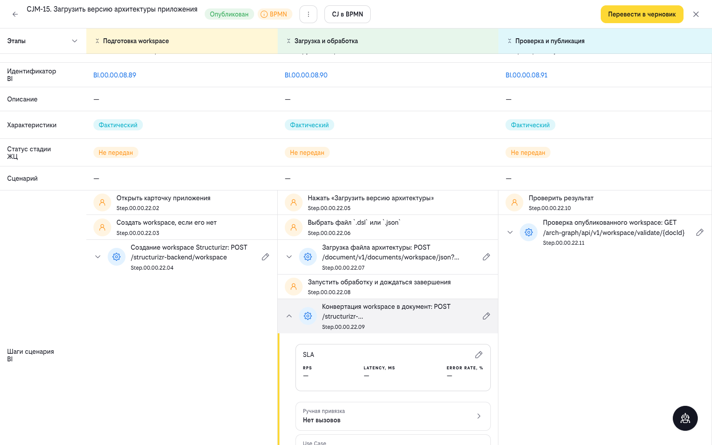
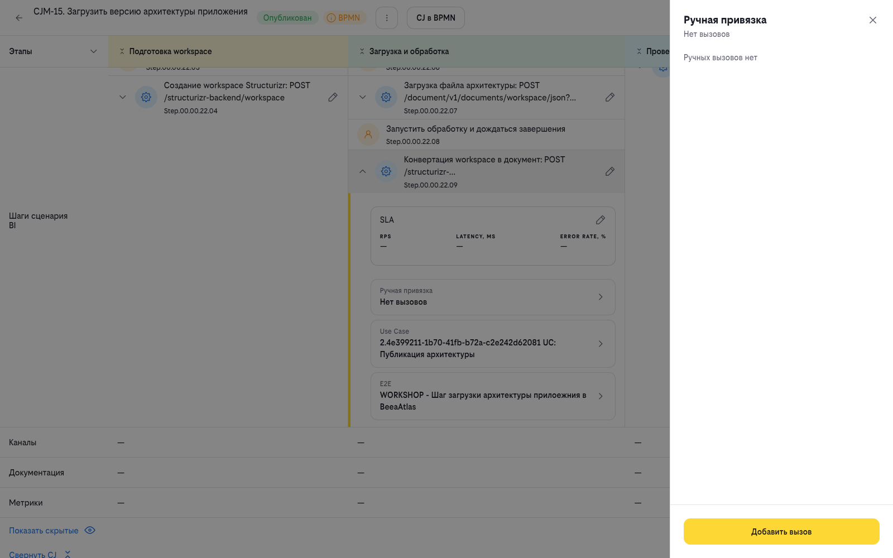
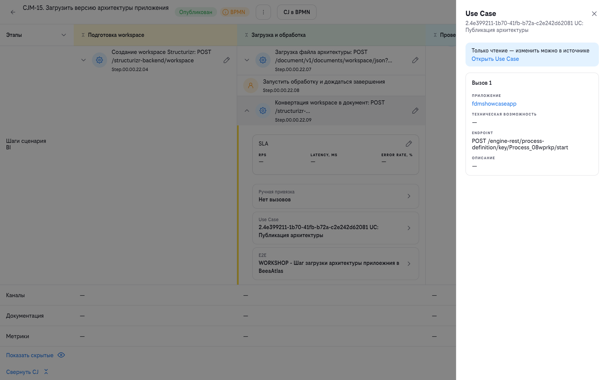
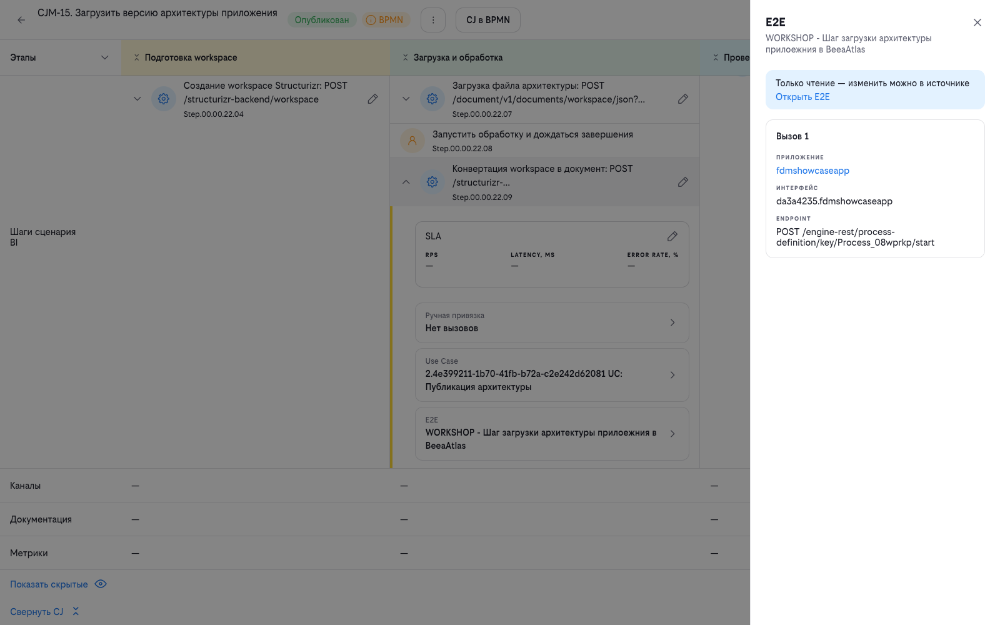

# Работа с Customer Journey (CJ) в BPMN

Customer Journey (CJ) в BeeAtlas описывает путь пользователя по этапам и взаимодействиям, а BPMN-файл — это способ задать структуру CJ в привычном редакторе и загрузить её в систему одним файлом.

Инструкция покрывает весь цикл: подготовку BPMN-файла, создание CJ, импорт и обновление структуры, а также заполнение реализаций и SLA у шагов сценария BI.


## Модель CJ: этапы, BI и шаги сценария

CJ состоит из трёх уровней:

```
CJ
└── Этап
    └── BI (Business Interaction)
        └── Шаг сценария BI
```

| Уровень | Что это | Пример |
|---------|---------|--------|
| **CJ** | Customer Journey целиком — один пользовательский путь | `CJ.00.00.05.32` |
| **Этап** | Крупная фаза пути — «Подготовка workspace», «Загрузка и обработка», «Проверка и публикация» | — |
| **BI** | Взаимодействие внутри этапа, например «Загрузить версию архитектуры приложения» | `BI.00.00.08.90` |
| **Шаг сценария BI** | Атомарное действие: вызов интерфейса (`ServiceTask`) или действие пользователя (`UserTask`) | `Step.00.00.22.09` |

Каждый шаг сценария BI описывается вызовами (приложение → интерфейс → метод) и значениями SLA. Привязка шага к E2E-сценарию и Use Case показывается в блоке «Источники реализации» — см. [«Источники реализации шага BI»](#источники-реализации-шага-bi).



## Подготовка BPMN-файла

### Поддерживаемые версии BPMN

Парсер BeeAtlas предназначен для автоматического преобразования BPMN-файлов в структуру Customer Journey. Он анализирует BPMN-диаграмму и распознаёт элементы в соответствии с заданной методологией.

Парсер поддерживает BPMN-файлы, созданные в **версии 8.x** BPMN-редакторов (например, Camunda Modeler 8.x). Файлы, созданные в версии 7.x, **не распознаются** парсером из-за различий в структуре XML.

### Маппинг элементов BPMN на модель BeeAtlas

| BeeAtlas | BPMN-элемент | Условия |
|----------|--------------|---------|
| **Этап** | Collapsed Sub Process | Вложенный в верхнеуровневый process |
| **BI** | Expanded Sub Process | Вложенный в «этап» подпроцесс. Название должно начинаться с `BI` |
| **BI** | Call Activity | Вложенный в «этап» элемент. Название должно начинаться с `BI`. В поле *Called Element* указан идентификатор существующего в BeeAtlas BI (например, `BI.00.00.01.08`) |
| **Шаг сценария BI** | Service Task / User Task | Вложенный в BI элемент |

### Границы уровней: что не должно попадать в этап и BI

Границы уровней жёсткие — от них зависит распознавание шагов:

- **Внутри этапа** — только BI (вложенные подпроцессы) и потоки между ними.
- **Внутри BI** — только шаги сценария (`Service Task` / `User Task`) и потоки между ними.
- **События (`Start Event`, `End Event`) допустимы только на верхнем уровне процесса** —
  по одному началу и одному завершению. Внутри этапов и BI событий быть не должно.

> **Почему это важно.** Если внутри BI оставить `Start Event` и `End Event`, импорт завершится
> **без ошибки**, но структура получится неполной: этап и BI создадутся, а **шаги сценария — нет**.
> Ошибка выглядит как успешная загрузка, поэтому проверять нужно все три уровня —
> этапы, BI **и шаги** внутри них.

### Иерархия структуры

```
Process (верхнеуровневый)
└── Этап = Collapsed Sub Process
    └── BI = Expanded Sub Process или Call Activity
        └── Шаг сценария = Service Task / User Task
```

## Создание CJ

Для создания нового CJ нажмите кнопку **«Создать CJ»** — автоматически откроется меню справа для внесения общей информации об артефакте.

1. Выберите **приложение**, реализующее CJ
2. Введите **название** CJ
3. Введите **портрет пользователя**
4. Если для поддержки CJ подготовлен BPMN-файл, загрузите файл для автоматического распознавания элементов CJ
5. Укажите **Владельца сценария**
6. При необходимости укажите **Технических ответственных**


> **При увольнении ответственного он автоматически заменяется на своего функционального руководителя.**

### Продолжение работы с CJ

Для продолжения создания нового CJ нажмите на кнопку **«Создать»** — при её нажатии автоматически в том же окне/вкладке браузера осуществится переход на страницу внесения данных в CJ.

### Прекращение работы

Для отмены действий нажмите кнопку **«Отменить»** — при нажатии на неё осуществляется возврат к странице библиотеки артефактов. Все данные, указанные пользователем, не будут сохранены.

## Импорт CJ из BPMN

### Загрузка BPMN-файла

Импорт BPMN-файла доступен через меню действий (⋮) → **«Импортировать CJ»**. Пункт доступен только у CJ в статусе **черновика**: у опубликованного CJ в меню остаются «Данные CJ» и «Показать версии».

В боковой панели «Импортировать CJ» есть подсказка **«Загрузка нового файла обновит предыдущие данные»**, а загрузчик принимает файлы `.bpmn` размером до 200 КБ.

**Процесс импорта:**

1. Выберите `.bpmn`-файл через файловый загрузчик
2. Файл будет загружен и валидирован на сервере
3. При успешной валидации CJ будет обновлён из BPMN — структура шагов и BI будет сформирована автоматически
4. После успешного импорта станет доступна привязка элементов ландшафта (TC/методы) к шагам сценария BI через иконку карандаша
5. При ошибке валидации отобразится уведомление «Ошибка валидации файла»

### Результат разбора BPMN-файла

После успешного разбора BPMN-файла CJ помечается **флагом BPMN**. Это означает, что структура CJ сформирована автоматически на основе BPMN-диаграммы. В дальнейшем структуру таких CJ можно редактировать только с поддержкой новых версий BPMN-файлов.

Для шагов BI, распознанных как `serviceAction`, при разборе автоматически проставляются привязки к E2E-сценарию и Use Case — см. [«Источники реализации шага BI»](#источники-реализации-шага-bi).

### Обновление CJ новой версией BPMN-файла

Для структурного обновления элементов CJ опубликуйте новую версию BPMN-файла, нажав кнопку **«Импортировать CJ»**. Выберите файл и нажмите кнопку **«Сохранить»**.

### Просмотр версий CJ

Для просмотра версий CJ нажмите кнопку **«Показать версии»**, выберите интересующую версию CJ. Доступно скачивание версии, а также просмотр в редакторе BPMN.

## Страница CJ: навигация и чтение

### Шапка страницы

В шапке `/cx/cj/view` доступны:

- возврат к библиотеке CJ;
- название и код CJ, статус (**«Опубликован»** или черновик) и **флаг BPMN**;
- меню действий (⋮): **«Данные CJ»**, **«Показать версии»**, а для черновика — ещё **«Редактировать данные CJ»** и **«Импортировать CJ»**;
- кнопка **«CJ в BPMN»** (только у CJ с флагом BPMN) — открывает диаграмму;
- кнопка смены статуса — **«Опубликовать»** или **«Перевести в черновик»**.

### Таблица этапов, BI и шагов

Структура CJ выводится таблицей: слева этапы и входящие в них BI, справа — шаги сценария BI выбранного BI. Над таблицей доступны переключатели **«Показать скрытые»** / **«Скрыть»** и **«Развернуть CJ»** / **«Свернуть CJ»**, внутри — **«Добавить BI»** и **«Добавить шаг сценария BI»**.

### Раскрытие шага сценария BI

Стрелка у строки шага раскрывает его карточку: блок **SLA** и список **«Источники реализации»**.

> **Шаги типа `UserTask` заблокированы.** В CJ с флагом BPMN у таких шагов нет ни стрелки раскрытия, ни карандаша редактирования: их поведение целиком задаётся BPMN-файлом. Редактировать в интерфейсе можно только шаги `ServiceTask`.

## Реализация шага сценария BI

### Источники реализации шага BI

Все привязки шага сценария BI собраны в его боковой панели в блоке **«Источники реализации»**. Каждая строка помечена типом источника:

| Источник | Что показывает | Что можно сделать |
|----------|----------------|-------------------|
| **Ручная привязка** | Вызовы, заведённые пользователем: **«Вызовов: N»** либо **«Нет вызовов»** | Кнопка **«Редактировать»** (если вызовы есть) или **«Добавить вызов»** — открывает форму редактирования вызовов шага |
| **Use Case** | Код и название связанного Use Case | Открывает панель вызовов Use Case с заметкой **«Только чтение — изменить можно в источнике»** и ссылкой **«Открыть Use Case»** |
| **E2E** | Название связанного шага E2E-сценария | Открывает панель вызовов шага E2E-сценария с той же заметкой и ссылкой **«Открыть E2E»** |

Если у шага BI нет ни одной реализации, вместо списка выводится сообщение **«У шага сценария BI нет реализаций»**.

**Автоматически** — при импорте CJ из BPMN для шагов, распознанных как **`serviceAction`**, BeeAtlas сам проставляет связанный шаг E2E-сценария и Use Case. Обе привязки отображаются в блоке «Источники реализации» и работают как ссылки — по ним можно сразу перейти в карточку E2E-сценария или Use Case.

**Вручную** — вызовы шага сценария BI (приложение, TC, интерфейс и метод) из BPMN не выводятся: их заполняет пользователь, как описано в разделе [«Ручные вызовы шага сценария BI»](#ручные-вызовы-шага-сценария-bi).

Привязки Use Case и E2E-сценария доступны только для чтения — изменить их можно только в источнике: Use Case — в карточке проекта, шаг E2E-сценария — в каталоге E2E-сценариев. Ручная привязка редактируется прямо из панели шага BI.

#### Ручная привязка

Строка **«Ручная привязка»** показывает, сколько вызовов заведено вручную. Если вызовов нет — в панели выводится **«Ручных вызовов нет»** и кнопка **«Добавить вызов»**; если вызовы есть — кнопка **«Редактировать»**.



#### Use Case

Строка **«Use Case»** показывает код и название связанного Use Case. Панель работает только на чтение: она выводит карточки **«Вызов N»** с полями **ПРИЛОЖЕНИЕ**, **ТЕХНИЧЕСКАЯ ВОЗМОЖНОСТЬ**, **ENDPOINT** и **ОПИСАНИЕ**, а изменить состав вызовов можно только в самом Use Case.



#### E2E

Строка **«E2E»** показывает название связанного шага E2E-сценария. Панель также работает только на чтение: карточки **«Вызов N»** содержат поля **ПРИЛОЖЕНИЕ**, **ИНТЕРФЕЙС** и **ENDPOINT**, а правка доступна только в источнике.



### Ручные вызовы шага сценария BI

Для добавления вызова нажмите **«Добавить вызов»** (или **«Редактировать»**, если вызовы уже есть). Определите количество необходимых вызовов — если требуется добавить новый вызов, нажмите кнопку **«Добавить»**.

1. Выберите **приложение** из выпадающего списка (доступен поиск)
2. После выбора приложения доступен выбор **TC или интерфейса**
    - Если TC для данного вызова уже определено — выберите TC
    - Выберите **интерфейс и метод**, реализующий данный шаг
3. Добавьте **описание** вызова
4. Если требуется добавить в шаг несколько методов — создайте **новый вызов**


### SLA шага сценария

Блок **SLA** в раскрытой карточке шага показывает значения метрик. Для редактирования нажмите иконку карандаша, заполните или скорректируйте значения и нажмите **«Сохранить»** (отмена — **«Отменить»**).

- **RPS** — запросов в секунду
- **Latency, ms** — задержка в миллисекундах
- **Error Rate, %** — допустимый процент ошибок

## Частые ошибки при импорте

| Симптом | Причина | Что делать |
|---------|---------|------------|
| Импорт завершился без ошибки, но шагов сценария нет | Внутри BI остались `Start Event` / `End Event` | Убрать события из этапов и BI, оставить их только на верхнем уровне процесса |
| Файл не распознаётся парсером | BPMN сохранён в версии 7.x | Пересохранить диаграмму в редакторе версии 8.x |
| BI не создался | Название подпроцесса или Call Activity не начинается с `BI`; в поле *Called Element* указан несуществующий BI | Исправить название и идентификатор, повторить импорт |
| «Ошибка валидации файла» | Файл не прошёл серверную валидацию | Проверить структуру по разделу [«Границы уровней»](#границы-уровней-что-не-должно-попадать-в-этап-и-bi) и загрузить исправленный файл |
| Пункт «Импортировать CJ» не виден в меню | CJ опубликован | Перевести CJ в черновик и повторить импорт |
