# Инструкция по асинхронной интеграции через RabbitMQ

## Обзор архитектуры

Асинхронная интеграция строится на паттерне **Event-Driven** с использованием двух компонентов:

1. **events-history** — сервис-опрашиватель, который каждые 2 минуты сканирует таблицы БД и публикует события об изменениях сущностей в RabbitMQ
2. **fdm-gateway** — API-шлюз, через который клиент может дозапросить полные данные по сущности по ID из события

```mermaid
flowchart LR
    A[Таблица БД] -->|сканирование каждые 2 мин| B[events-history]
    B -->|публикация события| C[RabbitMQ Exchange]
    C -->|привязка очереди| D[Очередь клиента]
    D -->|consumer| E[Ваш сервис]
    E -->|HMAC-запрос по ID| F[fdm-gateway]
    F -->|проксирование| G[Бэкенд-сервис]
```



---

## Шаг 1. Настройка наблюдения за сущностью в events-history

### Таблица конфигурации

События генерируются на основе записей в таблице `entity_events.config`. Каждая строка — одна наблюдаемая таблица.

### Поля конфигурации

| Поле | Обязательность | Описание |
|------|:-:|---------|
| `schema_name` | ✅ | Схема БД, в которой находится наблюдаемая таблица |
| `table_name` | ✅ | Имя наблюдаемой таблицы |
| `entity_type` | ✅ | Тип сущности — **он же имя Exchange в RabbitMQ**, в который публикуются события |
| `id_alias` | ❌ | Имя колонки-идентификатора. По умолчанию `id` |
| `created_date_alias` | ✅ | Имя колонки даты создания |
| `updated_date_alias` | ❌ | Имя колонки даты изменения. Если не заполнено — события UPDATE не генерируются |
| `deleted_date_alias` | ❌ | Имя колонки даты удаления. Если не заполнено — события DELETE не генерируются |
| `generate_update_event` | ❌ | `true`/`false` — генерировать ли события UPDATE. По умолчанию `false` |
| `generate_delete_event` | ❌ | `true`/`false` — генерировать ли события DELETE. По умолчанию `false` |
| `name_alias` | ❌ | Имя колонки с человекочитаемым названием сущности |
| `get_name` | ❌ | `true` — подтягивать ли название в событие |
| `source` | ❌ | Имя колонки источника |
| `get_source` | ❌ | `true` — подтягивать ли источник в событие |
| `children_id_alias` | ❌ | Имя колонки идентификатора дочерней связи |
| `notification_required` | ❌ | `true` — дублировать событие в очередь уведомлений `queue.notification.name` |
| `clarification_event` | ❌ | Суффикс, дополняющий тип изменения в нотификации |
| `target_key` | ❌ | Колонка для фильтрации строк |
| `target_value` | ❌ | Значение фильтра |
| `target_key_type` | ❌ | Тип ключа фильтра: целое или текст |
| `last_scan_date` | ❌ | **Оставить NULL!** — сервис проставит текущее время и начнёт сбор со следующего цикла |

### Как это работает

1. При `last_scan_date = NULL` сервис в первом проходе **не сканирует** таблицу, а только проставляет текущее время. Это предотвращает лавину событий за всю историю
2. Начиная со второго прохода — каждые 2 минуты сервис сканирует таблицу и определяет изменения по датам
3. Используется полуоткрытое окно: `[last_scan_date − зазор, startScanTime − зазор]`
4. События сортируются по `lastUpdateDate` перед отправкой

### Примеры SQL-вставок

#### Наблюдение за продуктами

```sql
INSERT INTO entity_events.config (
    schema_name,
    table_name,
    entity_type,
    id_alias,
    created_date_alias,
    updated_date_alias,
    deleted_date_alias,
    generate_update_event,
    generate_delete_event,
    name_alias,
    get_name,
    notification_required
) VALUES (
    'product',
    'product',
    'product',
    'id',
    'created_date',
    'last_modified_date',
    'deleted_date',
    true,
    true,
    'name',
    true,
    false
);
-- last_scan_date не указываем — останется NULL
```

#### Наблюдение за техническими возможностями

```sql
INSERT INTO entity_events.config (
    schema_name,
    table_name,
    entity_type,
    id_alias,
    created_date_alias,
    updated_date_alias,
    deleted_date_alias,
    generate_update_event,
    generate_delete_event,
    name_alias,
    get_name
) VALUES (
    'capability',
    'tech_capability',
    'tech_capability',
    'id',
    'created_date',
    'updated_date',
    'deleted_date',
    true,
    true,
    'name',
    true
);
```

#### Наблюдение за бизнес-возможностями

```sql
INSERT INTO entity_events.config (
    schema_name,
    table_name,
    entity_type,
    id_alias,
    created_date_alias,
    updated_date_alias,
    deleted_date_alias,
    generate_update_event,
    generate_delete_event,
    name_alias,
    get_name
) VALUES (
    'capability',
    'business_capability',
    'business_capability',
    'id',
    'created_date',
    'updated_date',
    'deleted_date',
    true,
    true,
    'name',
    true
);
```

#### Наблюдение за технологиями

```sql
INSERT INTO entity_events.config (
    schema_name,
    table_name,
    entity_type,
    id_alias,
    created_date_alias,
    updated_date_alias,
    deleted_date_alias,
    generate_update_event,
    generate_delete_event,
    name_alias,
    get_name
) VALUES (
    'techradar',
    'tech',
    'tech',
    'id',
    'created_date',
    'last_modified_date',
    'deleted_date',
    true,
    true,
    'label',
    true
);
```

#### Наблюдение за связями продукт-технология

```sql
INSERT INTO entity_events.config (
    schema_name,
    table_name,
    entity_type,
    id_alias,
    created_date_alias,
    updated_date_alias,
    deleted_date_alias,
    generate_update_event,
    generate_delete_event,
    children_id_alias
) VALUES (
    'product',
    'tech_product',
    'tech_product_relation',
    'id',
    'created_date',
    'last_modified_date',
    'deleted_date',
    false,
    true,
    'tech_id'
);
```

---

## Шаг 2. Подписка на события в RabbitMQ

### Механика публикации

events-history публикует события через `convertAndSend`:
- **Exchange** = значение `entity_type` из конфигурации
- **Routing key** = пустой
- **Delivery mode** = персистентный

### Формат сообщения

```json
{
  "id": 42,
  "changeType": "CREATE",
  "lastUpdateDate": "2025-04-21T10:30:00",
  "name": "Название сущности",
  "source": "Sparx",
  "childrenId": 7
}
```

| Поле | Описание | Обязательность |
|------|----------|:-:|
| `id` | Идентификатор сущности | ✅ |
| `changeType` | Тип изменения: `CREATE`, `UPDATE`, `DELETE` | ✅ |
| `lastUpdateDate` | Время изменения | ✅ |
| `name` | Человекочитаемое название (если `get_name = true`) | ❌ |
| `source` | Источник (если `get_source = true`) | ❌ |
| `childrenId` | ID дочерней связи (если `children_id_alias` задан) | ❌ |

### Настройка привязки очереди клиента

В RabbitMQ необходимо:

1. **Создать Exchange** с именем = `entity_type` (тип `fanout`)
2. **Создать очередь клиента** с уникальным именем, например `my-service.product.events`
3. **Привязать очередь к Exchange**

Пример через RabbitMQ Management API:

```bash
# Создать exchange
curl -u guest:guest -X PUT \
  'http://rabbitmq:15672/api/exchanges/%2F/product' \
  -H 'Content-Type: application/json' \
  -d '{"type":"direct","durable":true}'

# Создать очередь клиента
curl -u guest:guest -X PUT \
  'http://rabbitmq:15672/api/queues/%2F/my-service.product.events' \
  -H 'Content-Type: application/json' \
  -d '{"durable":true,"arguments":{}}'

# Привязать очередь к exchange
curl -u guest:guest -X POST \
  'http://rabbitmq:15672/api/bindings/%2F/e/product/q/my-service.product.events' \
  -H 'Content-Type: application/json' \
  -d '{"routing_key":""}'
```

### Схема подписок по типам сущностей

| entity_type | Exchange | Что отслеживается |
|-------------|----------|-------------------|
| `product` | `product` | Создание/изменение/удаление продуктов |
| `tech_capability` | `tech_capability` | Создание/изменение/удаление TC |
| `business_capability` | `business_capability` | Создание/изменение/удаление BC |
| `tech` | `tech` | Создание/изменение/удаление технологий |
| `tech_product_relation` | `tech_product_relation` | Связи продукт-технология |

---

## Шаг 3. Обработка событий и дозапрос данных через Gateway

Получив событие, клиент может:
- Использовать данные из самого события (id, changeType, name) — для простых сценариев
- Дозапросить полные данные через fdm-gateway по ID — если нужны все атрибуты сущности

### HMAC-аутентификация через Gateway

Для дозапроса используется заголовок `X-Authorization` с HMAC-подписью.

**Формат:** `X-Authorization: {apiKey}:{base64Signature}`

**Каноническая строка для подписи:**

```
{HTTP_METHOD}\n{PATH}\n{MD5_BODY}\n{CONTENT_TYPE}\n{NONCE}
```

**Обязательные заголовки:**

| Заголовок | Описание |
|-----------|----------|
| `X-Authorization` | `{apiKey}:{base64Signature}` |
| `Nonce` | Уникальное значение для каждого запроса |

### Типовые сценарии дозапроса

#### Получить полные данные продукта по ID из события

Событие: `{"id": 123, "changeType": "CREATE", "entity_type": "product"}`

```bash
API_KEY="your-api-key"
API_SECRET="your-api-secret"
GATEWAY="https://fdm-gateway.example.com"
METHOD="GET"
PATH="/product/api/v1/product/MY-PRODUCT/info"
NONCE="$(uuidgen 2>/dev/null || echo "$(date +%s%N)")"

MD5_BODY=$(echo -n "" | md5 | awk '{print $1}')

CANONICAL="${METHOD}
${PATH}
${MD5_BODY}

${NONCE}"

SIGNATURE=$(printf "%s" "$CANONICAL" | openssl dgst -sha256 -hmac "$API_SECRET" -binary | base64)

curl -X GET "${GATEWAY}${PATH}" \
  -H "X-Authorization: ${API_KEY}:${SIGNATURE}" \
  -H "Nonce: ${NONCE}"
```

> Если в событии есть `name` — это alias продукта. Используйте `GET /product/api/v1/product/{alias}/info`.

#### Получить полные данные технической возможности по ID

Событие: `{"id": 456, "changeType": "UPDATE", "entity_type": "tech_capability"}`

```bash
API_KEY="your-api-key"
API_SECRET="your-api-secret"
GATEWAY="https://fdm-gateway.example.com"
METHOD="GET"
PATH="/capability/api/v1/tech-capabilities/456"
NONCE="$(uuidgen 2>/dev/null || echo "$(date +%s%N)")"

MD5_BODY=$(echo -n "" | md5 | awk '{print $1}')

CANONICAL="${METHOD}
${PATH}
${MD5_BODY}

${NONCE}"

SIGNATURE=$(printf "%s" "$CANONICAL" | openssl dgst -sha256 -hmac "$API_SECRET" -binary | base64)

curl -X GET "${GATEWAY}${PATH}" \
  -H "X-Authorization: ${API_KEY}:${SIGNATURE}" \
  -H "Nonce: ${NONCE}"
```

#### Получить полные данные бизнес-возможности по ID

Событие: `{"id": 789, "changeType": "UPDATE", "entity_type": "business_capability"}`

```bash
API_KEY="your-api-key"
API_SECRET="your-api-secret"
GATEWAY="https://fdm-gateway.example.com"
METHOD="GET"
PATH="/capability/api/v1/business-capability/789"
NONCE="$(uuidgen 2>/dev/null || echo "$(date +%s%N)")"

MD5_BODY=$(echo -n "" | md5 | awk '{print $1}')

CANONICAL="${METHOD}
${PATH}
${MD5_BODY}

${NONCE}"

SIGNATURE=$(printf "%s" "$CANONICAL" | openssl dgst -sha256 -hmac "$API_SECRET" -binary | base64)

curl -X GET "${GATEWAY}${PATH}" \
  -H "X-Authorization: ${API_KEY}:${SIGNATURE}" \
  -H "Nonce: ${NONCE}"
```

#### Получить полные данные технологии по ID

Событие: `{"id": 42, "changeType": "CREATE", "entity_type": "tech"}`

```bash
API_KEY="your-api-key"
API_SECRET="your-api-secret"
GATEWAY="https://fdm-gateway.example.com"
METHOD="GET"
PATH="/techradar/api/v1/tech/42"
NONCE="$(uuidgen 2>/dev/null || echo "$(date +%s%N)")"

MD5_BODY=$(echo -n "" | md5 | awk '{print $1}')

CANONICAL="${METHOD}
${PATH}
${MD5_BODY}

${NONCE}"

SIGNATURE=$(printf "%s" "$CANONICAL" | openssl dgst -sha256 -hmac "$API_SECRET" -binary | base64)

curl -X GET "${GATEWAY}${PATH}" \
  -H "X-Authorization: ${API_KEY}:${SIGNATURE}" \
  -H "Nonce: ${NONCE}"
```

---

## Шаг 4. Пример полной реализации consumer

### Java (Spring Boot + Spring AMQP)

```java
@Component
public class ProductEventConsumer {

    private final RestTemplate restTemplate;
    private final String gatewayUrl;
    private final String apiKey;
    private final String apiSecret;

    @RabbitListener(queues = "my-service.product.events")
    public void handleProductEvent(Message message) {
        String body = new String(message.getBody());
        EntityEvent event = parseEvent(body);

        switch (event.getChangeType()) {
            case "CREATE":
                // Новый продукт — дозапросим полные данные
                ProductInfoDTO product = fetchProductViaGateway(event.getId());
                handleNewProduct(product);
                break;
            case "UPDATE":
                // Продукт изменён — обновим кэш
                ProductInfoDTO updated = fetchProductViaGateway(event.getId());
                updateProductCache(updated);
                break;
            case "DELETE":
                // Продукт удалён — очистим кэш
                removeProductFromCache(event.getId());
                break;
        }
    }

    private ProductInfoDTO fetchProductViaGateway(Long productId) {
        // 1. Сформировать каноническую строку
        // 2. Вычислить HMAC-SHA256 подпись
        // 3. Выполнить GET-запрос через gateway
        // ...
    }
}
```

### Python (pika)

```python
import hmac
import hashlib
import base64
import json
import requests
import pika

API_KEY = "your-api-key"
API_SECRET = "your-api-secret"
GATEWAY_URL = "https://fdm-gateway.example.com"

def sign_request(method, path, body="", content_type="", nonce=""):
    """Формирование HMAC-подписи для X-Authorization"""
    md5_body = hashlib.md5(body.encode()).hexdigest() if body else hashlib.md5(b"").hexdigest()
    canonical = f"{method}\n{path}\n{md5_body}\n{content_type}\n{nonce}"
    signature = base64.b64encode(
        hmac.new(API_SECRET.encode(), canonical.encode(), hashlib.sha256).digest()
    ).decode()
    return f"{API_KEY}:{signature}"

def fetch_product_via_gateway(product_alias):
    """Дозапрос данных продукта через gateway"""
    path = f"/product/api/v1/product/{product_alias}/info"
    nonce = "unique-nonce-value"
    x_auth = sign_request("GET", path, nonce=nonce)

    response = requests.get(
        f"{GATEWAY_URL}{path}",
        headers={
            "X-Authorization": x_auth,
            "Nonce": nonce
        }
    )
    return response.json()

def callback(ch, method, properties, body):
    """Обработка события из RabbitMQ"""
    event = json.loads(body)
    change_type = event["changeType"]
    entity_id = event["id"]
    entity_name = event.get("name", "")

    if change_type == "CREATE":
        # Дозапрос полных данных
        product = fetch_product_via_gateway(entity_name or entity_id)
        print(f"Новый продукт: {product}")
    elif change_type == "UPDATE":
        product = fetch_product_via_gateway(entity_name or entity_id)
        print(f"Обновлён продукт: {product}")
    elif change_type == "DELETE":
        print(f"Удалён продукт ID={entity_id}")

# Подключение к RabbitMQ
connection = pika.BlockingConnection(pika.ConnectionParameters("rabbitmq-host"))
channel = connection.channel()

# Привязка к exchange
channel.exchange_declare(exchange="product", exchange_type="direct", durable=True)
channel.queue_declare(queue="my-service.product.events", durable=True)
channel.queue_bind(queue="my-service.product.events", exchange="product", routing_key="")

channel.basic_consume(queue="my-service.product.events", on_message_callback=callback, auto_ack=True)
channel.start_consuming()
```

---

## Сводная таблица: сущность → событие → дозапрос

| Сущность | entity_type | Exchange | API дозапроса через Gateway |
|----------|-------------|----------|---------------------------|
| Продукт | `product` | `product` | `GET /product/api/v1/product/{alias}/info` |
| Техническая возможность | `tech_capability` | `tech_capability` | `GET /capability/api/v1/tech-capabilities/{id}` |
| Бизнес-возможность | `business_capability` | `business_capability` | `GET /capability/api/v1/business-capability/{id}` |
| Технология | `tech` | `tech` | `GET /techradar/api/v1/tech/{id}` |
| Связь продукт-технология | `tech_product_relation` | `tech_product_relation` | `GET /product/api/v1/product-tech-relation` (список) |

---

## Важные замечания

1. **Первый запуск без лавины событий** — при `last_scan_date = NULL` сервис не сканирует таблицу в первом проходе, а только фиксирует точку отсчёта. События начнут поступать со второго цикла (~4 минуты после вставки конфигурации)

2. **Зазор по времени** — сервис использует буфер в несколько секунд на границах окна сканирования, чтобы исключить потерю событий на стыке интервалов

3. **Ошибки SQL** — при синтаксической ошибке в конфигурации (несуществующая таблица/колонка) сервис логирует ошибку и возвращает пустой список событий. Остальные конфигурации не блокируются

4. **Дедупликация** — за один проход для одной строки может быть сгенерировано не более одного события каждого типа. Приоритет: CREATE > UPDATE. DELETE проверяется отдельно

5. **Порядок событий** — перед отправкой события сортируются по `lastUpdateDate`

6. **Уведомления** — если `notification_required = true`, событие дублируется в очередь `queue.notification.name` с расширенным форматом (добавляется `clarification_event` как суффикс к типу изменения)

7. **Ручной запуск** — для отладки можно вызвать `GET /test-send-events` на сервисе events-history, чтобы запустить пайплайн без ожидания расписания
