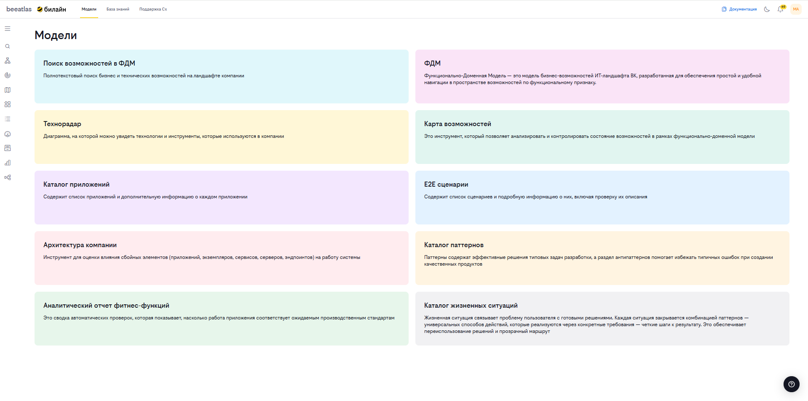

# Раздел "Модели"

## Обзор

Раздел "Модели" — это главная страница BeeAtlas. Здесь представлены карточки для перехода к инструментам моделирования, а также ссылки на дополнительные ресурсы.

## Ссылки с главной страницы

С главной страницы (раздел «Модели») доступны ссылки на:

- **Портал документации** — методология ПТР и пользовательская документация BeeAtlas
- **WebIDE** — Visual Studio Code с плагином VARP (C4 Architecture As A Code) для редактирования архитектурных моделей

Подробнее см. в разделе [Ссылки с главной страницы](../README.md#ссылки-с-главной-страницы).

## Содержание раздела

Раздел "Модели" включает следующие инструменты:

1. **[Поиск возможностей в ФДМ](./models/search.md)** — полнотекстовый поиск бизнес и технических возможностей
2. **[ФДМ (Функционально-Доменная Модель)](./models/fdm.md)** — модель бизнес-возможностей ИТ-ландшафта
3. **[Технорадар](./models/tech-radar.md)** — визуализация технологий и инструментов компании
4. **[Карта возможностей](./models/map.md)** — анализ и контроль состояния возможностей
5. **[Каталог приложений](./models/apps.md)** — информация о всех приложениях компании
6. **[E2E сценарии](./models/e2e.md)** — сквозные бизнес-процессы
7. **[Архитектура компании](./models/impact.md)** — анализ влияния сбоев на систему
8. **[Каталог паттернов](./models/patterns.md)** — решения типовых задач и антипаттерны
9. **[Аналитический отчет фитнес-функций](./models/analytical_report.md)** - сводка автоматических проверок соответствия приложений производственным стандартам
10. **[Каталог жизненных ситуаций](./models/life-situations)** - жизненная ситуация связывает проблему пользователя с готовыми решениями. Каждая ситуация закрывается комбинацией паттернов — универсальных способов действий, которые реализуются через конкретные требования — четкие шаги к результату.

## Быстрый доступ

### Для поиска информации
- **[Поиск возможностей в ФДМ](./models/search.md)** — быстрый поиск по всем возможностям

### Для работы с возможностями
- **[ФДМ](./models/fdm.md)** — навигация по функционально-доменной модели
- **[Карта возможностей](./models/map.md)** — визуальный анализ состояния возможностей

### Для работы с технологиями
- **[Технорадар](./models/tech-radar.md)** — обзор технологий компании
- **[Каталог паттернов](./models/patterns.md)** — решения и рекомендации

### Для работы с приложениями
- **[Каталог приложений](./models/apps.md)** — информация о приложениях
- **[E2E сценарии](./models/e2e.md)** — сквозные процессы
- **[Архитектура компании](./models/impact.md)** — анализ зависимостей
### Для контроля качества
- **[Аналитический отчет фитнес-функций](./models/analytical_report.md)** — мониторинг соответствия приложений стандартам
