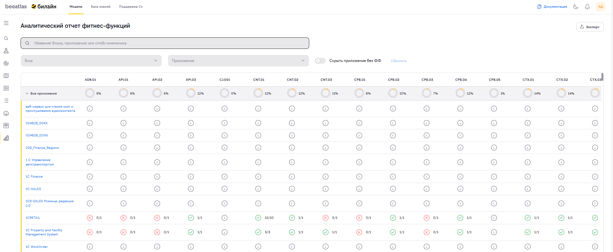
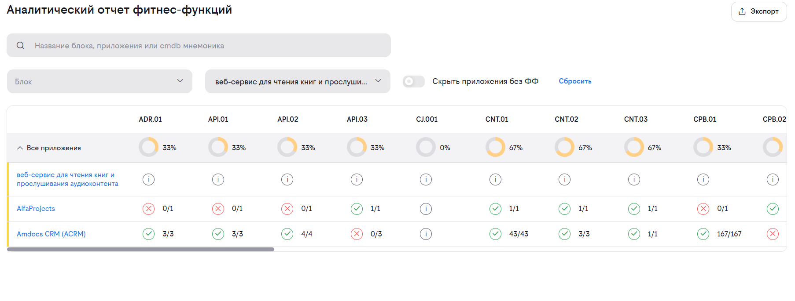

# Аналитический отчет фитнес-функций

**Назначение**: Сводка результатов прохождения приложениями автоматических проверок (фитнес-функций), показывающих качества описания архитектуры приложения.
Инструмент предназначен для мониторинга качества, выявления отклонений и контроля внедрения архитектурных стандартов в компании.

## Обзор

Аналитический отчет фитнес-функций — это интерактивная таблица, предоставляющая матрицу соответствия приложений (продуктов) и бизнес-блоков (доменов) набору предопределенных метрик качества (фитнес-функций). 

Отчет позволяет:

* Оценить общий уровень зрелости приложений в разрезе бизнес-доменов.
* Выявить конкретные приложения, отстающие по тем или иным стандартам.
* Быстро перейти к детальной информации в проблемных приложениях.

## Основные возможности

*   **Иерархическое представление**: Группировка данных по бизнес-доменам (блокам) с возможностью сворачивания и разворачивания списков приложений.
*   **Агрегированные метрики**: Автоматический расчет процента выполнения фитнес-функций.
*   **Детализация до статуса проверки**: Отображение конкретного результата (успех/провал/статус) для каждого приложения.
*   **Умный поиск**: Поиск по названиям блоков, приложений и их CMDB-мнемоникам с подсказками.
*   **Гибкая фильтрация**: Множественный выбор блоков и приложений с каскадной логикой.
*   **Контекстные подсказки**: Расшифровка кодов фитнес-функций при наведении курсора.
*   **Экспорт в Excel**: Выгрузка текущего представления отчета (с учетом фильтров) для внешней аналитики.
*   **Навигация**: Прямой переход из отчета в карточку приложения.

## Интерфейс отчета

### Панель фильтров и поиска

Расположена в верхней части страницы и содержит следующие элементы:

1.  **Поле умного поиска**:
    *   **Плейсхолдер**: «Название блока, приложения или cmdb мнемоника».
    *   **Логика работы**: Поиск активируется при вводе **3-х и более символов**.
    *   **Результаты**: Выпадающий список с найденными совпадениями, разделенными на типы:
        *   `Блок: <Название>`
        *   `Продукт: <Название>`
    *   **Действие**: Клик по результату мгновенно применяет фильтр по выбранному элементу.

2.  **Фильтр «Блок»**:
    *   Выпадающий список с возможностью множественного выбора (`Multiselect`).
    *   Позволяет отфильтровать отчет по конкретным бизнес-доменам.
    *   Поддерживает внутренний поиск по названию блока.

3.  **Фильтр «Приложение»**:
    *   Выпадающий список с возможностью множественного выбора.
    *   **Важно**: Список доступных приложений зависит от выбранных блоков. Если блоки не выбраны, показываются все приложения.
    *   Поддерживает поиск по названию приложения и его CMDB-мнемонике.

4.  **Переключатель «Скрыть приложения без ФФ»**:
    *   Скрывает из таблицы приложения и домены, у которых отсутствуют данные о фитнес-функциях (например, проверки еще не проводились).

5.  **Кнопка «Сбросить»**:
    *   Активна только при наличии примененных фильтров.
    *   Очищает поиск, снимает выделение со всех блоков и приложений, отключает переключатель скрытия пустых значений.

### Таблица результатов

Основной элемент отчета, представляющий данные в виде матрицы.

#### Структура таблицы

*   **Колонки (Фитнес-функции)**:
    *   Каждая колонка соответствует определенной фитнес-функции (метрике качества).
    *   В заголовке отображается **код функции** (например, `ADR.01`, `API.02`, `CNT.03`).
    *  **Подсказка**: Наведите курсор на код в заголовке, чтобы увидеть всплывающее окно с полным описанием и назначением этой фитнес-функции.

*   **Строки (Иерархия)**:
    *   **Строка Домена (Блока)**:
        *   Отображает название бизнес-блока.
        *   Содержит кнопку сворачивания/разворачивания (стрелка).
        *   В ячейках содержатся **агрегированные индикаторы** (круговые диаграммы с процентами), показывающие средний уровень соответствия стандартам по всем приложениям внутри этого блока. Этот процент показывает долю приложений, которые успешно прошли проверку, от общего количества приложений в выбранной группе.
        
    *   **Строка Приложения (Продукта)**:
        *   Вложенная строка внутри домена.
        *   Содержит название приложения.
        *   В ячейках содержатся **детальные индикаторы** статуса прохождения проверок.

#### Типы индикаторов

| Индикатор | Значение | Описание |
| :--- | :--- | :--- |
| 🟢 **Зеленая галочка** | **Выполнено** | В ячейке отображается дробь вида N/N (где N — общее число деталей требований, необходимых для проверки). |
| 🔴 **Красный крестик** | **Не выполнено** | Приложение не прошло проверку. В ячейке отображаться дробь 0/N. Требует внимания. |
| 🟡 **Оранжевый Значок «i»** | **Частичное соответствие** | Приложение прошло проверку частично. Отображается дробь M/N.|
| ⚪ **Значок «i»** | **Информация / Нет данных** | Проверка не применима к данному приложению, данные отсутствуют или статус не определен. |

### Пример расчета агрегированного процента
Рассмотрим конкретный пример на основе данных, представленных в отчете для индикатора ADR.01.

**Сценарий:**
В выбранной группе находятся три приложения:

1.  **AlfaProjects:** Результаты проверки есть, но они неудачные (0 успешных из 1).
2.  **Веб-сервис для чтения книг и прослушивания аудиоконтента:** Результаты проверки отсутствуют.
3.  **Amdocs CRM (ACRM):** Результаты проверки есть и они успешные (3 успешных из 3).

**Логика расчета:**

* **Общее количество приложений:** 3 (AlfaProjects + веб-сервис + Amdocs CRM).
* **Количество приложений с успешной проверкой:** 1 (только Amdocs CRM, так как у AlfaProjects проверка не пройдена, а веб-сервис не имеет данных).
* **Результат:** 1/3 * 100% ≈ 33.33%

### Кнопка «Экспорт»

Расположена в правом верхнем углу заголовка страницы.

*   **Действие**: Выгружает текущее состояние таблицы (с учетом примененных фильтров и раскрытых групп) в файл формата **Microsoft Excel (.xlsx)**.
*   **Использование**: Удобно для подготовки отчетов, глубокого анализа данных в табличных редакторах или архивирования снимка состояния на определенную дату.

## Как использовать

### 1. Быстрый поиск приложения или блока

Если вы знаете название или идентификатор:

1.  Кликните в поле поиска вверху страницы.
2.  Введите минимум 3 символа названия блока, приложения или его CMDB-мнемоники.
3.  В выпадающем списке выберите нужный элемент:
    *   При выборе **Блока** таблица отфильтруется по этому домену.
    *   При выборе **Продукта** таблица отфильтруется по этому приложению, а соответствующий домен автоматически раскроется.

### 2. Детальный анализ с помощью фильтров

Для комплексной оценки группы приложений:

1.  Используйте фильтр **«Блок»**, чтобы выбрать один или несколько интересующих бизнес-доменов.
2.  При необходимости уточните выбор через фильтр **«Приложение»**.
3.  Включите переключатель **«Скрыть приложения без ФФ»**, чтобы убрать из виду приложения, по которым еще нет данных, и сфокусироваться на активных метриках.

### 3. Интерпретация результатов

*   **Оценка домена**: Посмотрите на строку с названием блока. Высокий процент (зеленая зона) в колонках фитнес-функций говорит о высоком уровне стандартизации в этом домене. Низкий процент сигнализирует о системной проблеме.
*   **Поиск проблемных зон**: Разверните домен и найдите строки приложений с красными крестиками. Дробь рядом (например, `2/5`) покажет, какая часть требований не выполнена.
*   **Изучение стандартов**: Не знаете, что означает код `CPB.03`? Наведите курсор на заголовок колонки — всплывет подсказка с описанием стандарта.

### 4. Переход к устранению проблем

Если приложение показывает низкие результаты:

1. Кликните на **название приложения** в таблице.
2.  Система автоматически перенаправит вас в карточку приложения.
    *   Если данные есть, откроется вкладка **«Фитнес-функции»** с детализацией проверок.
    *   Если данных нет, откроется вкладка **«Общая информация»**.
3.  Используйте эту информацию для создания задач по улучшению качества кода или архитектуры.

### 5. Экспорт отчета

Для сохранения результатов или передачи коллегам:

1.  Настройте фильтры под вашу задачу (например, выберите только свой блок).
2.  Нажмите кнопку **«Экспорт»**.
3.  Откройте скачанный Excel-файл для дальнейшей работы.

## Примеры использования

### Сценарий 1: Еженедельная валидация качества архитектуры домена

**Задача**: Руководитель домена проверяет полноту и корректность описания архитектуры текущих приложений, убеждаясь, что они соответствуют утвержденным стандартам и требованиям безопасности.

**Последовательность действий**:

1.  **Фильтрация**: В панели управления выбирает нужный **Блок** в фильтре, чтобы увидеть только приложения своего домена.
2.  **Оценка соответствия**: Анализирует строку агрегации на предмет отклонений от нормы по ключевым *fitness-функциям* архитектуры (например, `API.01`), которые показывают, насколько описание отвечает критериям стандарта.
3.  **Идентификация пробелов**: Разворачивает список приложений и визуально сортирует их по количеству красных индикаторов (нарушений или недостающих элементов описания).
4.  **Корректировка**: Переходит по ссылкам в проблемных приложениях, чтобы уточнить описание архитектуры или инициировать процесс его актуализации.

### Сценарий 2: Аудит внедрения нового стандарта безопасности

**Задача**: Архитектор безопасности хочет узнать, какие приложения еще не внедрили новый стандарт аутентификации (фитнес-функция `SEC.05`).

**Действия**:

1.  Находит колонку `SEC.05` (наведя курсор на заголовки).
2.  Просматривает таблицу, выявляя приложения с красным крестиком в этой колонке.
3.  Включает фильтр «Скрыть приложения без ФФ», чтобы убрать из виду устаревшие системы, где проверка не применима.
4.  Экспортирует список в Excel для формирования плана работ по миграции.

### Сценарий 3: Поиск приложения по техническому идентификатору

**Задача**: Разработчик знает только CMDB-мнемонику сервиса (`CRM_CORE_01`) и хочет увидеть его метрики качества.

**Действия**:

1.  Вводит `CRM_CORE_01` в поле поиска.
2.  Кликает на подсказку `Продукт: CRM Core Service`.
3.  Таблица мгновенно фильтруется, показывая одну строку с этим приложением и всеми его метриками.

## Рекомендации

* **Регулярность**: Проверяйте отчет не реже одного раза в спринт/месяц для отслеживания трендов.
* **Приоритизация**: В первую очередь исправляйте «красные» индикаторы в критически важных приложениях (High Criticality).
* **Контекст**: Помните, что значок «i» не всегда означает ошибку — это может значить, что стандарт просто не применим к архитектуре данного приложения.
* **Экспорт**: Используйте экспорт для создания дашбордов в внешних системах или для отчетов перед стейкхолдерами.

## Навигация

*   [Вернуться к разделу «Модели»](../models.md)
*   [Каталог приложений](./apps.md) — подробная информация о каждом приложении.
*   [ФДМ (Функционально-Доменная Модель)](./fdm.md) — структура бизнес-доменов.
*   [Технорадар](./tech-radar.md) — стандарты технологий, которые могут влиять на фитнес-функции.