# Каталог приложений

**Назначение**: Содержит список приложений и дополнительную информацию о каждом приложении.

## Обзор

Каталог приложений предоставляет централизованный доступ к информации обо всех приложениях компании. Здесь можно найти детальную информацию о каждом приложении, включая его архитектуру, интерфейсы, метрики качества и многое другое.

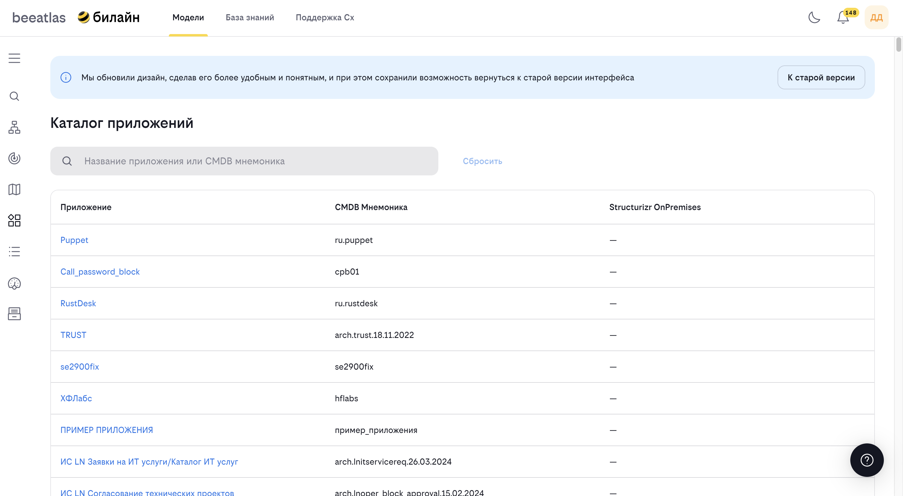

## Основные возможности

- **Просмотр списка всех приложений** в виде таблицы
- **Поиск и фильтрация** приложений
- **Просмотр детальной информации** о приложении:
  - Общая информация
  - Интерфейсы, методы и SLA
  - Фитнес-функции
  - E2E процессы
  - Технические возможности
  - Технологии
  - Паттерны
  - Нефункциональные требования
  - Диаграммы
- **Просмотр архитектуры** приложения
- **Связь с Structurizr** для визуализации архитектуры

## Интерфейс каталога

### Таблица приложений

Список приложений отображается в виде таблицы со следующими колонками:

- **Приложение** — название приложения (ссылка на детальную информацию)
- **CMDB Мнемоника** — идентификатор приложения в системе CMDB
- **Structurizr OnPremises** — ссылка на Structurizr (если настроено)

### Поиск

Поле поиска позволяет найти приложение по:

- Названию приложения
- CMDB мнемонике

Поиск работает в реальном времени при вводе текста.

## Как использовать

### Просмотр списка приложений

1. Перейдите в раздел **"Модели"** → **"Каталог приложений"**
2. Просмотрите список всех приложений
3. Используйте поиск для нахождения нужного приложения
4. Кликните на название приложения для просмотра детальной информации

### Просмотр детальной информации

При открытии приложения доступны следующие вкладки:

#### Вкладка "Общая информация"
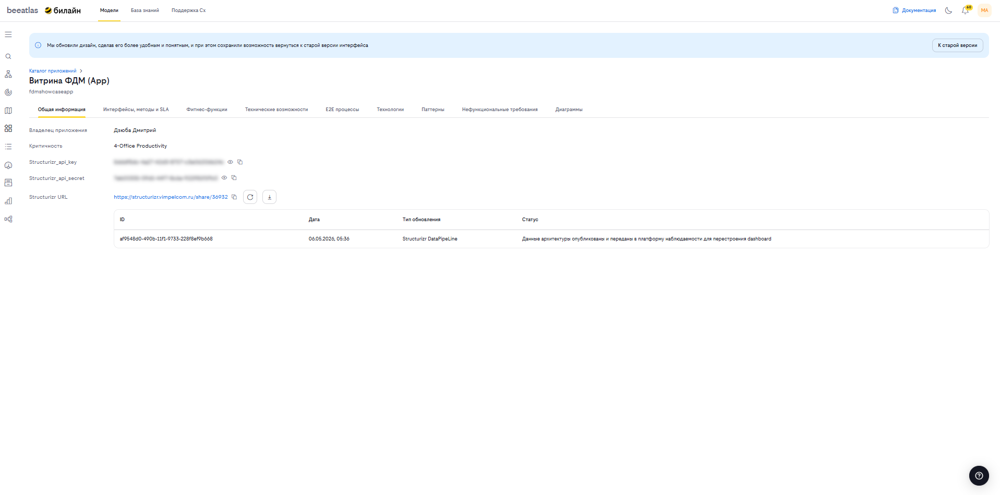
Содержит основные данные о приложении:

- **Владелец приложения** — ответственное лицо
- **Критичность** — уровень критичности приложения
- **Structurizr URL** — ссылка на Structurizr
- **API ключи** — ключи для доступа к Structurizr API (Отображаются только для владельцев)
- **Дополнительная информация** — другие атрибуты приложения

#### Вкладка "Интерфейсы, методы и SLA"
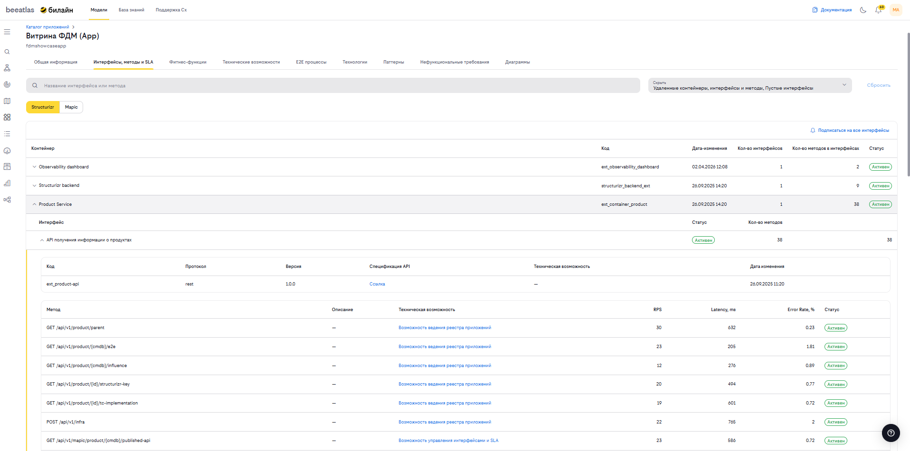
Содержит информацию о опубликованных интерфейсах приложения:

- **Список интерфейсов** — все внешние интерфейсы
- **Методы** — доступные методы каждого интерфейса
- **SLA** — соглашения об уровне обслуживания
- **Интеграции** — связанные системы

Подвкладки:

- **Structurizr** — интерфейсы из Structurizr
- **MAPIC** — интерфейсы из системы MAPIC

#### Вкладка "Фитнес-функции"
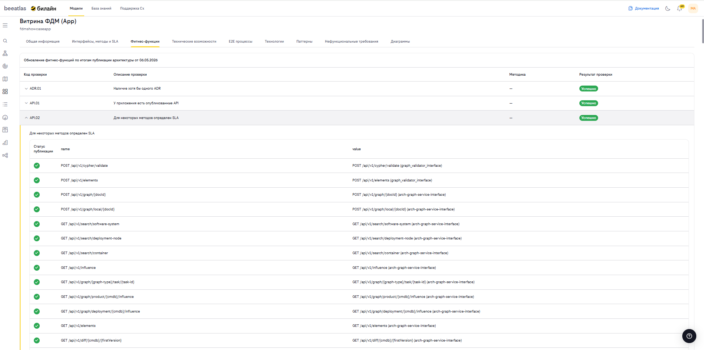
Содержит результаты прохождения фитнес-функций архитектуры приложения. Интерфейс разделен на вкладки «Проверка» и «Триггеры»:

- Вкладка «Проверка» — содержит таблицу с кодами проверок, статусами и результатами прохождения.
- Вкладка «Триггеры» — содержит таблицу с кодами триггеров, описанием и результатами их обнаружения.

В таблице представлены следующие столбцы:
- Код проверки/триггера — уникальный идентификатор.
- Описание проверки/триггера — текстовое пояснение.
- Статус — текущий статус (например, Trial, Adopt).
- Результат проверки/триггера — итог (например, Успешно, Обнаружено, Не обнаружено).
- Дата изменения — время обновления данных.
- Метрика (цель/факт) — показатель достижения цели.

<!--Для того чтобы обновить результат прохождения нужно-->
#### Вкладка "E2E процессы"

Содержит информацию о сквозных бизнес-процессах:

- **Список процессов** — процессы, в которых участвует приложение
- **Роль приложения** — роль в каждом процессе
- **Описание процессов** — детальная информация

#### Вкладка "Технические возможности"
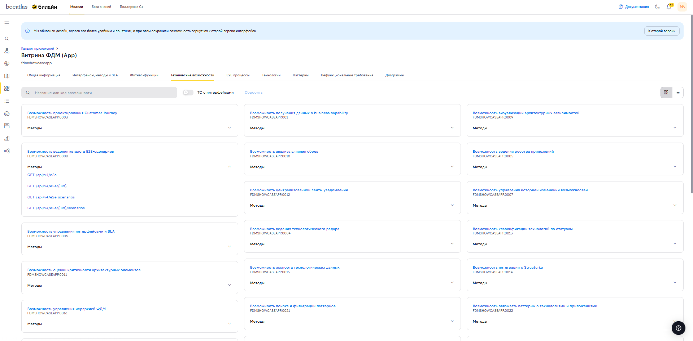
Содержит информацию о технических возможностях и список методов, связанных с технической возможностью. Метод содержит ссылку для перехода и изучения информации по связанному методу:

- **Список возможностей** — технические возможности приложения
- **Связь с ФДМ** — связь с функционально-доменной моделью
- **Описание возможностей** — детальная информация

#### Вкладка "Технологии"
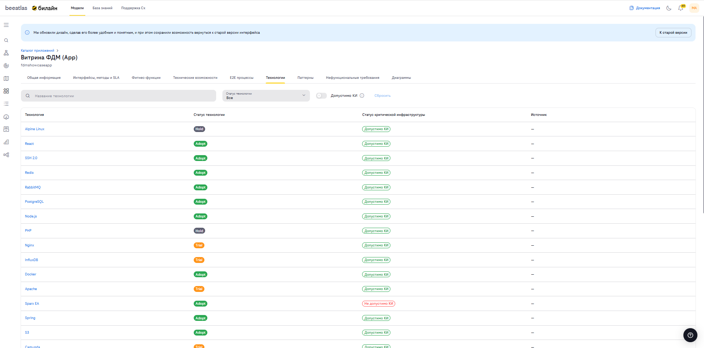
Отображает стек технологий, используемых в приложении, с оценкой их статуса согласно технорадару и требованиям безопасности.

**Инструменты фильтрации:**

**Поиск технологии**: Поле ввода для быстрого нахождения конкретной технологии в списке (например, `Java`, `PostgreSQL`).

**Фильтр "Статус технологии"**: Позволяет отобрать технологии по статусу в технорадаре:

* *Все* (по умолчанию)
* *Adopt* (Рекомендовано)
* *Trial* (Попробовать)
* *Assess* (Оценить)
* *Hold* (Удержать/Отказаться)

**Переключатель "Допустимо КИ"**: Фильтр для отображения только тех технологий, которые разрешены для использования в **Критической Инфраструктуре (КИ)**.

  **Кнопка "Сбросить"**: Очищает все примененные фильтры.

**Таблица технологий содержит колонки:**

1.  **Технология**: Название технологии.
2.  **Статус технологии**: Цветовой индикатор статуса (Adopt, Trial, Hold и т.д.).
3.  **Статус критической инфраструктуры**: Индикатор соответствия требованиям КИ (например, *"Допустимо КИ"*).
4.  **Источник**: Система, из которой получены данные (например, `observability platform`).

**Сценарии использования:**

*   **Аудит безопасности**: Проверка наличия запрещенных технологий в контуре КИ путем отключения фильтра "Допустимо КИ".
*   **Планирование миграции**: Выявление технологий со статусом *Hold* для замены их на рекомендованные аналоги.

#### Вкладка "Паттерны"
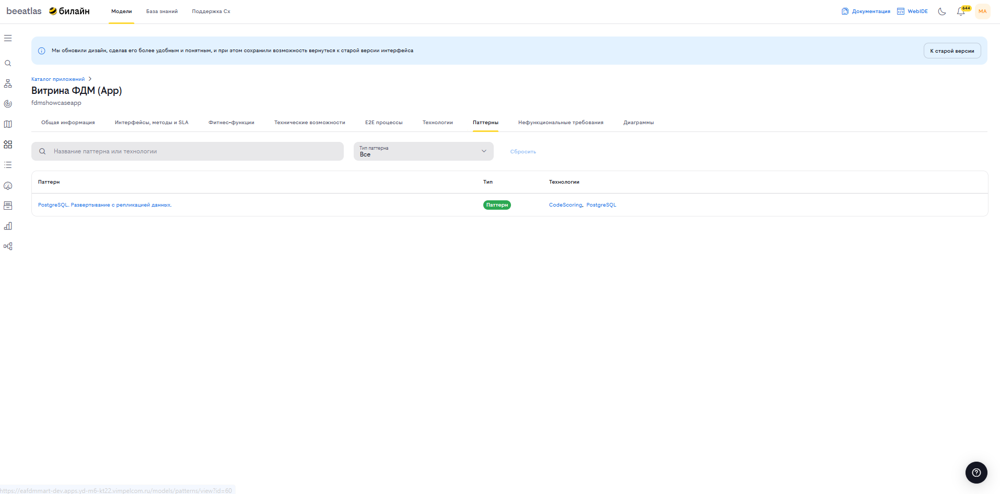
Содержит информацию об архитектурных паттернах и антипаттернах, зафиксированных для данного приложения.

**Инструменты фильтрации:**

*   **Поиск паттерна или технологии**: Умный поиск, который находит паттерны как по названию, так и по связанным технологиям.
*   **Фильтр "Тип паттерна"**: Позволяет разделить список на:
    *   *Все*
    *   *Паттерн*
    *   *Антипаттерн*
*   **Кнопка "Сбросить"**: Возвращает полный список всех зафиксированных записей.

**Таблица паттернов содержит колонки:**

1.  **Паттерн**: Название паттерна или антипаттерна. При переходе по ссылке в названии паттерна, отображется детальная информация из каталога паттернов.
2.  **Тип**: Индикатор типа (Паттерн / Антипаттерн).
3.  **Технологии**: Список технологий, к которым относится данный паттерн.
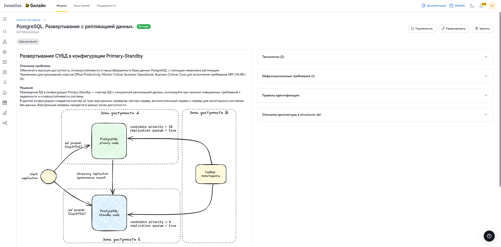
**Сценарии использования:**

*   **Поиск технических долгов**: Фильтрация по типу *"Антипаттерн"* для выявления проблемных мест в архитектуре перед рефакторингом.
*   **Анализ лучших практик**: Просмотр примененных паттернов для понимания архитектурного стиля приложения.

**Состояния вкладки:**

*   Если паттерны не зафиксированы, отображается иллюстрация и сообщение **"Паттернов нет"**.
*   Если фильтры не дают результатов, появляется сообщение **"Нет результатов, подходящих под параметры поиска"**.

#### Вкладка "Нефункциональные требования"

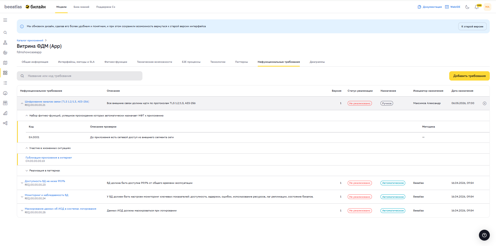

Содержит список нефункциональных требований, назначенных приложению, с возможностью поиска, добавления и снятия требований.

**Инструменты фильтрации:**

*   **Поиск требования**: Поле ввода для быстрого нахождения требования по названию или коду. При вводе текста появляется выпадающий список совпадений, выбор элемента фильтрует таблицу до выбранного требования.
*   **Кнопка "Добавить требования"**: Переход на страницу назначения новых нефункциональных требований приложению.

**Таблица требований содержит колонки:**

1.  **Нефункциональное требование**: Название требования (ссылка на страницу жизненной ситуации) и код требования.
2.  **Описание**: Текстовое описание требования.
3.  **Версия**: Версия требования.
4.  **Статус реализации**: Цветовой индикатор:
    *   *Ручная проверка* (серый) — к требованию не привязаны паттерны
    *   *Реализовано* (зелёный) — хотя бы один паттерн требования реализован в приложении
    *   *Не реализовано* (красный) — привязанные паттерны не реализованы
5.  **Назначение**: Тип назначения — *Автоматическое* (из Beeatlas) или *Ручное*.
6.  **Инициатор назначения**: Источник назначения требования.
7.  **Дата назначения**: Дата и время назначения требования на приложение.
8.  **Действие**: Кнопка снятия требования (доступна только для ручных назначений).

**Раскрывающаяся строка:**

При раскрытии строки требования отображаются дополнительные блоки:

*   **Фитнес-функции** — список фитнес-функций, связанных с требованием
*   **Жизненные ситуации** — главы/ситуации, связанные с требованием
*   **Паттерны** — паттерны реализации требования с индикацией их наличия в приложении

**Снятие требования:**

При нажатии на иконку отмены появляется диалог подтверждения. Автоматически назначенные требования (Beeatlas) не могут быть сняты вручную.

**Назначение требования:**
При нажатии на кнопку, открывается окно добавления ручного добавления требования к приложению.

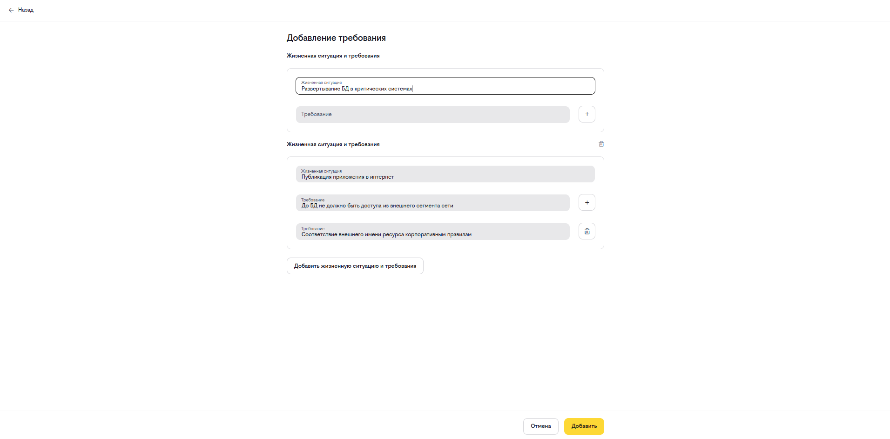

#### Вкладка "Диаграммы"

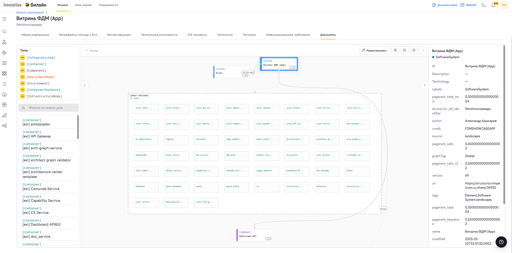

Отображает интерактивную C4-модель архитектуры приложения. Позволяет визуально исследовать структуру системы, переходить между узлами и экспортировать диаграммы.

**Левая панель — фильтрация и навигация:**

*   **Чекбоксы типов узлов**: Управление видимостью узлов на диаграмме по типу C4-модели:
    *   *SoftwareSystem* (синий)
    *   *Container* (бирюзовый)
    *   *Component* (фиолетовый)
    *   *DeploymentNode* (оранжевый)
    *   *Environment* (серо-синий)
    *   *ContainerInstance* (бирюзовый)
    *   *InfrastructureNode* (коричневый)
*   **Поиск по имени узла**: Поле ввода для быстрого нахождения конкретного узла в списке левой панели.
*   **Список узлов**: Кликабельный список узлов диаграммы с цветовым индикатором типа. При клике на узел происходит навигация к его подграфу.

**Центральная область — Canvas-диаграмма:**

Интерактивный граф. Поддерживает:

*   **Зум** — кнопки приближения/отдаления и подгонки по экрану
*   **Панорамирование** — перетаскивание холста
*   **Клик по узлу** — раскрытие подграфа выбранного узла с сохранением истории навигации
*   **Пиннинг узлов** — закрепление узлов для отображения их связей в общем графе
*   **Режим редактирования** — перемещение узлов с сохранением лейаута в localStorage

**Панель инструментов (DiagramToolbar):**

*   **Кнопка "Назад"** — возврат к предыдущему состоянию диаграммы из истории навигации
*   **Кнопка "Редактировать"** — переключение между режимами просмотра и редактирования (перемещение узлов)
*   **Зум** — кнопки Zoom In, Zoom Out, Fit To Screen
*   **Экспорт** — выпадающее меню с форматами: PNG, SVG, JSON, PUML (PlantUML)

**Правая панель — детали выбранного узла:**

Отображает свойства выделенного узла:

*   **ID** — идентификатор узла
*   **Description** — описание
*   **Technology** — технология
*   **Labels** — список лейблов узла
*   **Произвольные свойства** — все дополнительные свойства из Neo4j

**Теги:**

Управление тегами узла — добавление новых тегов через текстовое поле и удаление существующих через иконку закрытия чипа.

### Просмотр архитектуры

Для просмотра архитектурной диаграммы приложения:

1. Откройте детальную информацию о приложении
2. Перейдите на вкладку **"Архитектура"** (если доступна)
3. Изучите визуализацию архитектуры
4. Используйте интерактивные элементы для навигации

### Работа с Structurizr

Если приложение интегрировано с Structurizr:

1. Перейдите на вкладку **"Интерфейсы, методы и SLA"**
2. Выберите подвкладку **"Structurizr"**
3. Просмотрите интерфейсы из Structurizr
4. Используйте ссылку на Structurizr для детального просмотра

### Получение API ключей

Для владельцев приложений доступны API ключи Structurizr:

1. Откройте детальную информацию о приложении
2. Перейдите на вкладку **"Общая информация"**
3. Найдите раздел с API ключами
4. Нажмите кнопку для отображения ключей
5. Скопируйте ключи при необходимости

### Загрузка архитектуры приложения

1. Откройте **Каталог приложений** и выберите нужное приложение
2. Если workspace для вашего приложения не был создан ранее, нажмите "Создать" и выберите ответственного архитектора

2. После создания workpsace, на вкладке **«Общая информация»** нажмите кнопку **«Загрузить версию архитектуры»**
3. Загрузите файл `.json` или `.dsl` с описанием архитектуры приложения
4. Нажмите **"Запустить"** для начала процесса обновления
5. Дождитесь завершения обработки (обычно до 15 секунд)

После загрузки система обработает файл и обновит данные об архитектуре приложения.

**Поддерживаемые форматы:**

- **workspace.dsl** — DSL-описание архитектуры (Structurizr DSL)
- **workspace.json** — JSON-экспорт рабочего пространства Structurizr

**Ограничения:**

- Максимальный размер файла: 5 МБ
- Допустимые расширения: `.dsl`, `.json`

>**Примечания:**
>- Кнопка загрузки доступна только владельцам приложения и администраторам
>- Во время обработки кнопки «Обновить» и «Загрузка версии архитектуры» временно отключены
>- Администраторы видят таблицу с историей процессов обновления (ID, дата, тип, статус)
>- После загрузки данные будут синхронизированы с архитектурным графом системы

## Навигация

- [Вернуться к разделу "Модели"](../models.md)
- [ФДМ (Функционально-Доменная Модель)](./fdm.md)
- [E2E сценарии](./e2e.md)
- [Архитектура компании](./impact.md)
- [Аналитический отчет фитнес-функций](./analytical_report.md)
