# Каталог приложений

**Назначение**: Содержит список приложений и дополнительную информацию о каждом приложении.

## Обзор

Каталог приложений предоставляет централизованный доступ к информации обо всех приложениях компании. Здесь можно найти детальную информацию о каждом приложении, включая его архитектуру, интерфейсы, метрики качества и многое другое.

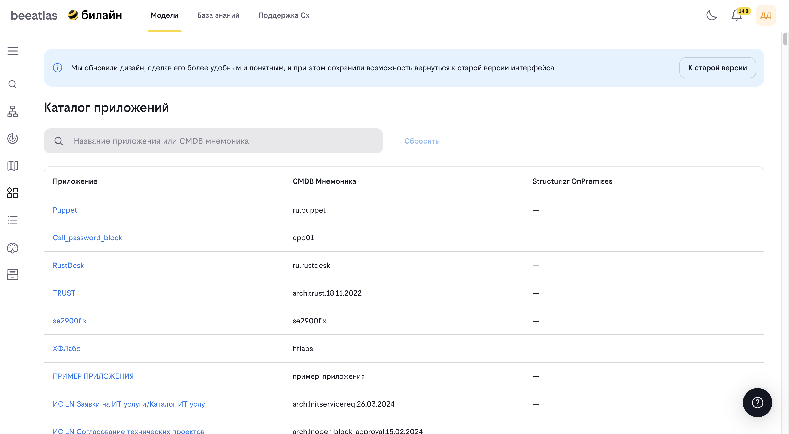

## Основные возможности

- **Просмотр списка всех приложений** в виде таблицы
- **Поиск и фильтрация** приложений
- **Просмотр детальной информации** о приложении:
  - Общая информация
  - Развёртывание
  - Интерфейсы, методы и SLA
  - Фитнес-функции
  - Технические возможности
  - Участие в процессах
  - Технологии
  - Паттерны
  - Нефункциональные требования
  - Диаграммы
- **Просмотр архитектуры** приложения
- **Связь с Structurizr** для визуализации архитектуры

## Интерфейс каталога

### Таблица приложений

Список приложений отображается в виде таблицы со следующими колонками:

- **Приложение** — название приложения (ссылка на детальную информацию)
- **CMDB Мнемоника** — идентификатор приложения в системе CMDB
- **Structurizr OnPremises** — ссылка на Structurizr (если настроено)

### Поиск

Поле поиска позволяет найти приложение по:

- Названию приложения
- CMDB мнемонике

Поиск работает в реальном времени при вводе текста.

## Как использовать

### Просмотр списка приложений

1. Перейдите в раздел **"Модели"** → **"Каталог приложений"**
2. Просмотрите список всех приложений
3. Используйте поиск для нахождения нужного приложения
4. Кликните на название приложения для просмотра детальной информации

### Просмотр детальной информации

При открытии приложения доступны следующие вкладки:

#### Вкладка "Общая информация"
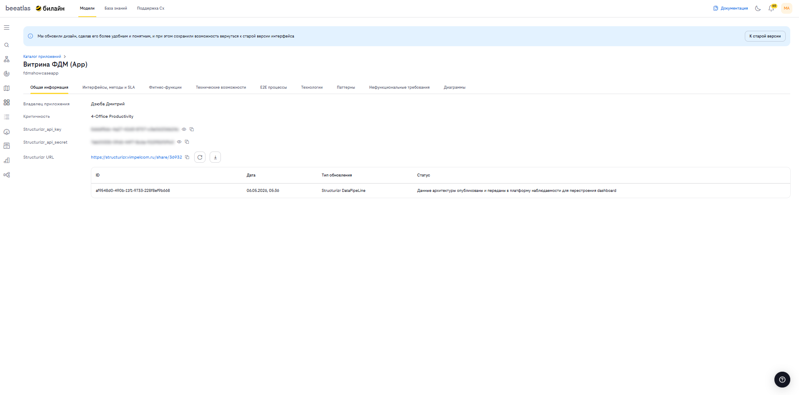
Содержит основные данные о приложении:

- **Владелец приложения** — ответственное лицо
- **Критичность** — уровень критичности приложения
- **Structurizr URL** — ссылка на Structurizr
- **API ключи** — ключи для доступа к Structurizr API (Отображаются только для владельцев)

Существует возможность перезапустить последнюю публикацию архитектуры приложения из Structurizr или загрузить новую архитектуру в формате Structurizr DSL/JSON, нажав соответствующие кнопки рядом с Structurizr URL.

Пока новый процесс публикации не появился, кнопки **«Обновить»** и **«Загрузить»** заблокированы, а в строке процесса вместо идентификатора и даты показываются заглушки. Если запустить обновление не удалось, выводится сообщение **«Не удалось запустить обновление данных»**.

Текущий прогресс публикации и история запуска пайплайнов доступна в закладке "Публикация пайплайн":
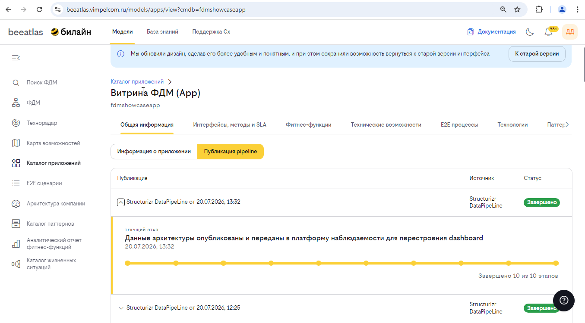

Если публикация завершилась ошибкой, на упавшем шаге отображается её причина — текст сообщения от сервиса публикации.

#### Вкладка "Развёртывание"

Диаграмма развёртывания приложения: из каких узлов и экземпляров контейнеров состоит приложение и как они распределены по контурам. Открывается по адресу `/models/apps/view?tab=DEPLOYMENT&cmdb=<alias>&env=<контур>`.

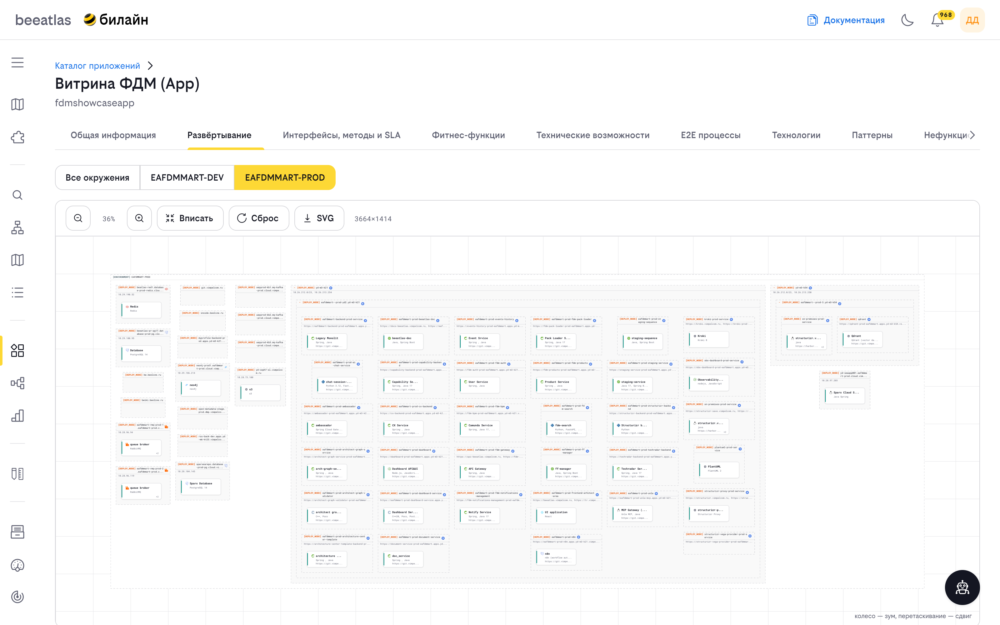

**Выбор контура.** Над диаграммой — переключатель контуров: пункт **«Все окружения»** и далее имена окружений, найденных в графе (по алфавиту). Контур **не влияет на состав запросов**: данные загружаются один раз на приложение, а отбор выполняется на клиенте, поэтому переключение мгновенное.

Узел попадает в контур по своим привязкам к окружениям, а если их нет — по привязкам ближайшего предка. Узел, у которого привязок нет ни у него, ни выше, не входит ни в один контур, но виден в режиме «Все окружения». Поэтому граница контура может проходить внутри дерева, а не только по его корню.

**Элементы диаграммы:**

| Элемент | Что показано |
|---|---|
| Рамка окружения `[ENVIRONMENT]` | Контур целиком; появляется только когда выбран конкретный контур (в режиме «Все окружения» её нет) |
| Рамка узла развёртывания `[DEPLOY_NODE]` | Имя узла (до двух строк, полное — в подсказке), иконка технологии, адрес (до двух адресов через « · », полный список — в подсказке). Слева в заголовке — значок схлопывания поддерева |
| Карточка экземпляра контейнера | Иконка технологии, имя, название технологии, URL и счётчик «×N» — сколько раз этот контейнер развёрнут на диаграмме |

**Связи между элементами линиями не рисуются.** Вместо них у карточки появляется «выемка» слева, если выделенный элемент её вызывает, и «выпуклость» справа, если она вызывает выделенный; при связи в обе стороны — обе фигуры. Остальные элементы при этом приглушаются.

**Управление:**

- **Зум** — кнопки «−»/«+» и колесо мыши (от 35 % до 240 %), значение показано в тулбаре;
- **Панорамирование** — перетаскивание полотна; **«Вписать»** — вписать диаграмму в экран, **«Сброс»** — вернуть масштаб;
- **Экспорт SVG** — файл `deployment-<приложение>-<контур|all>.svg` собирается по текущей раскладке в тех цветах темы, в которой открыта страница;
- **Схлопывание** — значок «−»/«+» в заголовке узла скрывает и показывает поддерево, у схлопнутого узла видна сводка «N узлов · M контейнеров»;
- **Клик по элементу** — выделяет его и копирует адрес в буфер обмена (у карточки — её URL, у рамки — её адрес); если копировать нечего, элемент всё равно выделяется;
- **Escape** или клик по пустому полотну — снять выделение.

Поиска, фильтров по типам и легенды на этой вкладке нет — в отличие от вкладки «Диаграммы».

**Состояния:**

- при загрузке — скелетон;
- **«Развёртывание не загрузилось»** с текстом ошибки — если не удалось получить данные;
- **«Развёртывание не описано»** — если у приложения в графе нет ни одного узла развёртывания.

Вкладка, как и остальные (кроме «Общей информации»), недоступна, если у приложения не заполнен Structurizr URL.

#### Вкладка "Интерфейсы, методы и SLA"
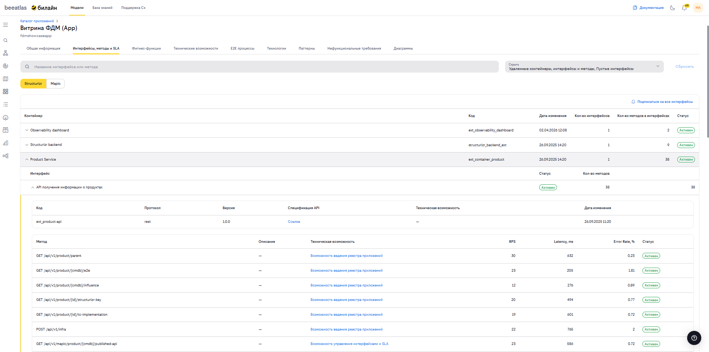
Содержит информацию о опубликованных интерфейсах приложения:

- **Список интерфейсов** — все внешние интерфейсы
- **Методы** — доступные методы каждого интерфейса
- **SLA** — соглашения об уровне обслуживания
- **Интеграции** — связанные системы

Подвкладки:

- **Structurizr** — интерфейсы из Structurizr
- **MAPIC** — интерфейсы из системы MAPIC
- **Puml** — интерфейсы, разобранные из PlantUML-диаграмм

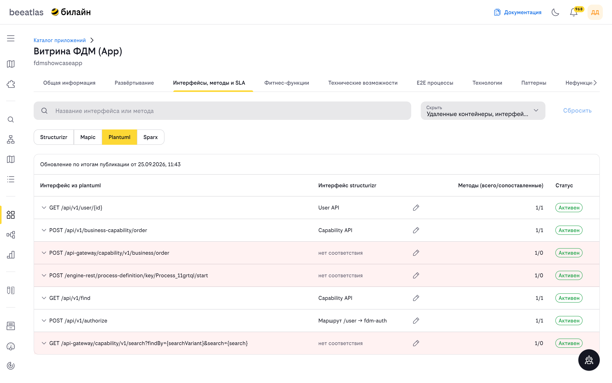
Источник интерфейсов для подвкладки **Puml** — PlantUML-диаграммы, загруженные для приложения. Из них автоматически извлекаются интерфейсы и методы (например, `GET /api/v1/user/{id}`), которые затем отображаются в общем списке вместе с интерфейсами из Structurizr и MAPIC.

#### Вкладка "Фитнес-функции"

Результаты автоматических проверок архитектуры приложения. Вкладка разделена на две части:

- **«Проверка»** — проверки соответствия архитектуры правилам. Результат — «Успешно» или «Ошибка».
- **«Триггеры»** — контекстные оценки, выявляющие свойства приложения, влияющие на применение к нему определённых правил. Результат — «Обнаружено» или «Не обнаружено». Триггер сам по себе не является нарушением.

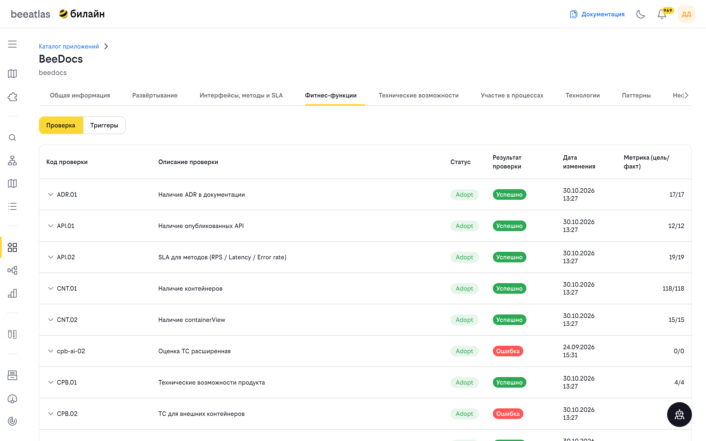

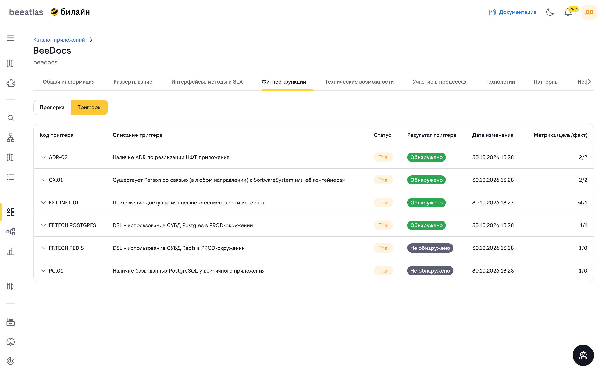

Обе таблицы устроены одинаково:

| Колонка | Описание |
|---------|----------|
| **Код проверки** / **Код триггера** | Уникальный идентификатор функции |
| **Описание проверки** / **Описание триггера** | Текстовое пояснение правила или контекста |
| **Статус** | Текущий статус функции: Test, Trial или Adopt |
| **Результат проверки** / **Результат триггера** | «Успешно» / «Ошибка» для проверок, «Обнаружено» / «Не обнаружено» для триггеров |
| **Дата изменения** | Когда последний раз обновлялся результат |
| **Метрика (цель/факт)** | Показатель достижения цели |

Перечень проверок и триггеров с описанием — в разделе [Описание проверок архитектуры](../../11%20Описание%20проверок%20архитектуры.md), управление функциями — в разделе [Управление фитнес-функциями](../admin/fitness_functions.md).
#### Вкладка "Технические возможности"
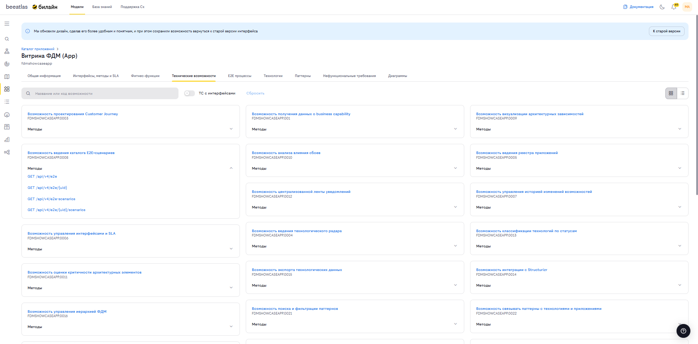
Содержит информацию о технических возможностях и список методов, связанных с технической возможностью. Метод содержит ссылку для перехода и изучения информации по связанному методу:

- **Список возможностей** — технические возможности приложения
- **Связь с ФДМ** — связь с функционально-доменной моделью
- **Описание возможностей** — детальная информация

#### Вкладка "Участие в процессах"

Показывает, в каких сквозных сценариях участвует приложение — по каким его методам проходят шаги E2E-сценариев и Use Case. Вкладка доступна, если у приложения заполнен адрес Structurizr (`structurizrApiUrl`); на демонстрационном стенде она скрыта.

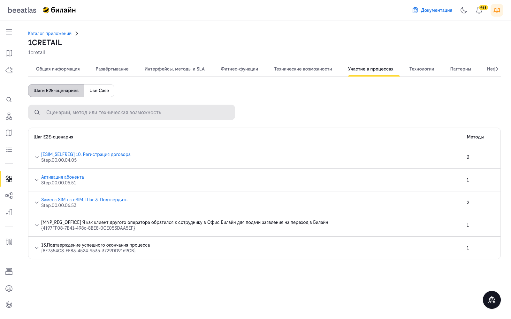

Сверху расположен переключатель вида и строка поиска:

| Элемент | Значение |
|---------|----------|
| **Шаги E2E-сценариев** | Вид по умолчанию — участие приложения в E2E-сценариях |
| **Use Case** | Участие приложения в сценариях Use Case проектов |
| **Поиск** | Для вида «Шаги E2E-сценариев» — подсказка **«Сценарий, метод или техническая возможность»**, для вида «Use Case» — **«Use Case, метод или техническая возможность»** |

Оба вида устроены одинаково: строка верхнего уровня со стрелкой раскрытия, названием и кодом, столбцом **«Методы»** с их количеством, и вложенной таблицей методов, которая раскрывается по стрелке.

**Вид «Шаги E2E-сценариев».** Заголовки таблицы — **«Шаг E2E-сценария»** и **«Методы»**. Название шага — ссылка, открывающая шаг в каталоге E2E-сценариев в режиме CJ (см. [E2E сценарии](./e2e.md)). Вложенная таблица содержит столбцы:

| Столбец | Описание |
|---------|----------|
| **Метод** | Тип и путь метода, например `POST /api/v1/orders` |
| **Техническая возможность** | ТС, к которой отнесён метод |
| **C4 Dynamic** | Признак наличия динамической диаграммы (если данных нет — прочерк) |

**Вид «Use Case».** Заголовки таблицы — **«Use Case»** и **«Методы»**; название Use Case — ссылка на его страницу в проекте. Во вложенной таблице столбцы **«Метод»**, **«Описание»**, **«Техническая возможность»**, **«C4 Dynamic»** и **«Статус метода»**:

| Статус метода | Описание |
|---------------|----------|
| **Реализован** | Метод сопоставлен с операцией ландшафта |
| **Планируется** | Метод относится к планируемой системе |
| **На ревью** | Метод сопоставлен и одновременно помечен как планируемый — требует проверки |
| **Не сопоставлен** | Метод пока не связан с операцией ландшафта |

Если по приложению нет данных, отображается заглушка **«Нет шагов E2E-сценариев»** или **«Нет Use Case»**; пустой результат поиска — **«Ничего не найдено»**.

#### Вкладка "Технологии"
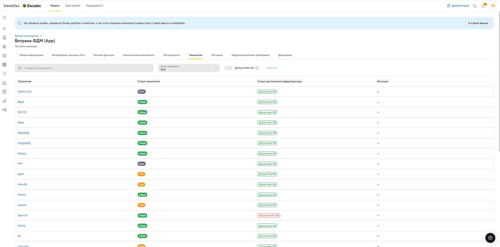
Отображает стек технологий, используемых в приложении, с оценкой их статуса согласно технорадару и требованиям безопасности.

**Инструменты фильтрации:**

**Поиск технологии**: Поле ввода для быстрого нахождения конкретной технологии в списке (например, `Java`, `PostgreSQL`).

**Фильтр "Статус технологии"**: Позволяет отобрать технологии по статусу в технорадаре:

* *Все* (по умолчанию)
* *Adopt* (Рекомендовано)
* *Trial* (Попробовать)
* *Assess* (Оценить)
* *Hold* (Удержать/Отказаться)

**Переключатель "Допустимо КИ"**: Фильтр для отображения только тех технологий, которые разрешены для использования в **Критической Инфраструктуре (КИ)**.

  **Кнопка "Сбросить"**: Очищает все примененные фильтры.

**Таблица технологий содержит колонки:**

1.  **Технология**: Название технологии.
2.  **Статус технологии**: Цветовой индикатор статуса (Adopt, Trial, Hold и т.д.).
3.  **Статус критической инфраструктуры**: Индикатор соответствия требованиям КИ (например, *"Допустимо КИ"*).
4.  **Источник**: Система, из которой получены данные (например, `observability platform`).

**Сценарии использования:**

*   **Аудит безопасности**: Проверка наличия запрещенных технологий в контуре КИ путем отключения фильтра "Допустимо КИ".
*   **Планирование миграции**: Выявление технологий со статусом *Hold* для замены их на рекомендованные аналоги.

#### Вкладка "Паттерны"
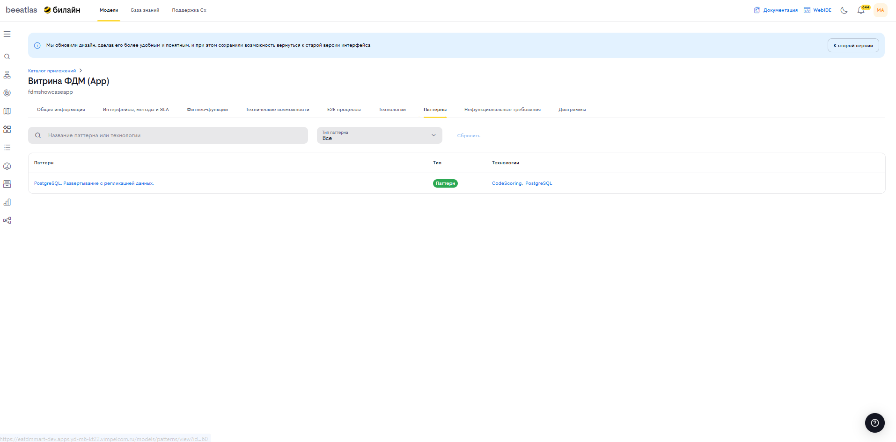
Содержит информацию об архитектурных паттернах и антипаттернах, зафиксированных для данного приложения.

**Инструменты фильтрации:**

*   **Поиск паттерна или технологии**: Умный поиск, который находит паттерны как по названию, так и по связанным технологиям.
*   **Фильтр "Тип паттерна"**: Позволяет разделить список на:
    *   *Все*
    *   *Паттерн*
    *   *Антипаттерн*
*   **Кнопка "Сбросить"**: Возвращает полный список всех зафиксированных записей.

**Таблица паттернов содержит колонки:**

1.  **Паттерн**: Название паттерна или антипаттерна. При переходе по ссылке в названии паттерна, отображется детальная информация из каталога паттернов.
2.  **Тип**: Индикатор типа (Паттерн / Антипаттерн).
3.  **Технологии**: Список технологий, к которым относится данный паттерн.
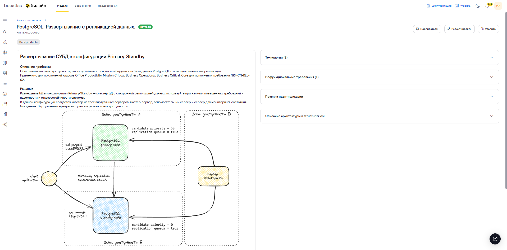
**Сценарии использования:**

*   **Поиск технических долгов**: Фильтрация по типу *"Антипаттерн"* для выявления проблемных мест в архитектуре перед рефакторингом.
*   **Анализ лучших практик**: Просмотр примененных паттернов для понимания архитектурного стиля приложения.

**Состояния вкладки:**

*   Если паттерны не зафиксированы, отображается иллюстрация и сообщение **"Паттернов нет"**.
*   Если фильтры не дают результатов, появляется сообщение **"Нет результатов, подходящих под параметры поиска"**.

#### Вкладка "Нефункциональные требования"

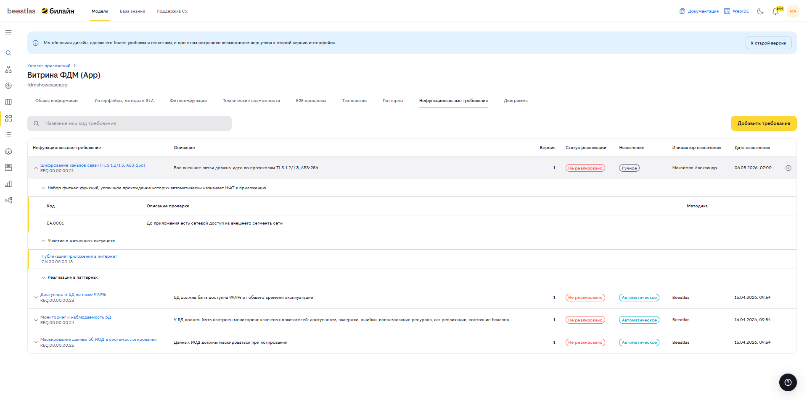

Содержит список нефункциональных требований, назначенных приложению, с возможностью поиска, добавления и снятия требований.

**Инструменты фильтрации:**

*   **Поиск требования**: Поле ввода для быстрого нахождения требования по названию или коду. При вводе текста появляется выпадающий список совпадений, выбор элемента фильтрует таблицу до выбранного требования.
*   **Кнопка "Добавить требования"**: Переход на страницу назначения новых нефункциональных требований приложению.

**Таблица требований содержит колонки:**

1.  **Нефункциональное требование**: Название требования (ссылка на страницу жизненной ситуации) и код требования.
2.  **Описание**: Текстовое описание требования.
3.  **Версия**: Версия требования.
4.  **Статус реализации**: Цветовой индикатор:
    *   *Ручная проверка* (серый) — к требованию не привязаны паттерны
    *   *Реализовано* (зелёный) — хотя бы один паттерн требования реализован в приложении
    *   *Не реализовано* (красный) — привязанные паттерны не реализованы
5.  **Назначение**: Тип назначения — *Автоматическое* (из Beeatlas) или *Ручное*.
6.  **Инициатор назначения**: Источник назначения требования.
7.  **Дата назначения**: Дата и время назначения требования на приложение.
8.  **Действие**: Кнопка снятия требования (доступна только для ручных назначений).

**Раскрывающаяся строка:**

При раскрытии строки требования отображаются дополнительные блоки:

*   **Фитнес-функции** — список фитнес-функций, связанных с требованием
*   **Жизненные ситуации** — главы/ситуации, связанные с требованием
*   **Паттерны** — паттерны реализации требования с индикацией их наличия в приложении

**Снятие требования:**

При нажатии на иконку отмены появляется диалог подтверждения. Автоматически назначенные требования (Beeatlas) не могут быть сняты вручную.

**Назначение требования:**
При нажатии на кнопку, открывается окно добавления ручного добавления требования к приложению.

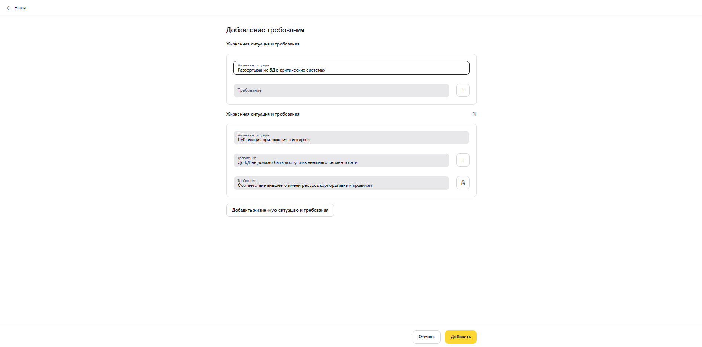

#### Вкладка "Диаграммы"

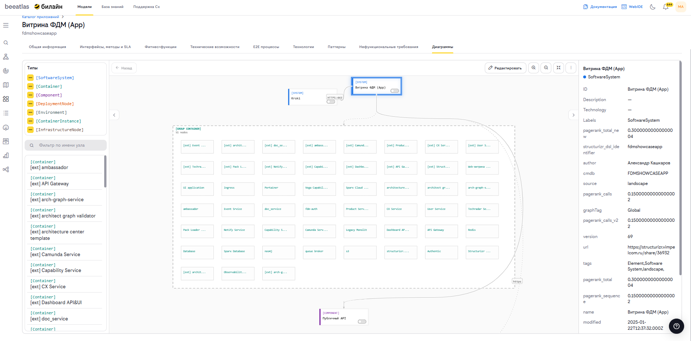

Отображает интерактивную C4-модель архитектуры приложения. Позволяет визуально исследовать структуру системы, переходить между узлами и экспортировать диаграммы.

**Левая панель — фильтрация и навигация:**

*   **Чекбоксы типов узлов**: Управление видимостью узлов на диаграмме по типу C4-модели:
    *   *SoftwareSystem* (синий)
    *   *Container* (бирюзовый)
    *   *Component* (фиолетовый)
    *   *DeploymentNode* (оранжевый)
    *   *Environment* (серо-синий)
    *   *ContainerInstance* (бирюзовый)
    *   *InfrastructureNode* (коричневый)
*   **Поиск по имени узла**: Поле ввода для быстрого нахождения конкретного узла в списке левой панели.
*   **Список узлов**: Кликабельный список узлов диаграммы с цветовым индикатором типа. При клике на узел происходит навигация к его подграфу.

**Центральная область — Canvas-диаграмма:**

Интерактивный граф. Поддерживает:

*   **Зум** — кнопки приближения/отдаления и подгонки по экрану
*   **Панорамирование** — перетаскивание холста
*   **Клик по узлу** — раскрытие подграфа выбранного узла с сохранением истории навигации
*   **Пиннинг узлов** — закрепление узлов для отображения их связей в общем графе
*   **Режим редактирования** — перемещение узлов с сохранением лейаута в localStorage

**Панель инструментов (DiagramToolbar):**

*   **Кнопка "Назад"** — возврат к предыдущему состоянию диаграммы из истории навигации
*   **Кнопка "Редактировать"** — переключение между режимами просмотра и редактирования (перемещение узлов)
*   **Зум** — кнопки Zoom In, Zoom Out, Fit To Screen
*   **Экспорт** — выпадающее меню с форматами: PNG, SVG, JSON, PUML (PlantUML)

**Правая панель — детали выбранного узла:**

Отображает свойства выделенного узла:

*   **ID** — идентификатор узла
*   **Description** — описание
*   **Technology** — технология
*   **Labels** — список лейблов узла
*   **Произвольные свойства** — все дополнительные свойства из Neo4j

**Теги:**

Управление тегами узла — добавление новых тегов через текстовое поле и удаление существующих через иконку закрытия чипа.

### Просмотр архитектуры

Архитектура приложения открывается на отдельной странице `/models/apps/view/architecture`, а не во вкладке карточки. На странице доступны вкладки:

- **Контекстная диаграмма**
- **Контейнерная диаграмма**
- **Диаграмма развертывания**

### Работа с Structurizr

Если приложение интегрировано с Structurizr:

1. Перейдите на вкладку **"Интерфейсы, методы и SLA"**
2. Выберите подвкладку **"Structurizr"**
3. Просмотрите интерфейсы из Structurizr
4. Используйте ссылку на Structurizr для детального просмотра

### Получение API ключей

Для владельцев приложений доступны API ключи Structurizr:

1. Откройте детальную информацию о приложении
2. Перейдите на вкладку **"Общая информация"**
3. Найдите раздел с API ключами
4. Нажмите кнопку для отображения ключей
5. Скопируйте ключи при необходимости

### Создание рабочего пространства Structurizr

Чтобы получить доступ ко всем данным приложения (контейнеры, интерфейсы, операции, диаграммы), у приложения должно быть **рабочее пространство Structurizr**. Пока его нет, карточка показывает только общие сведения, а вместо остальных блоков — заглушку.

Пример — приложение **«Сервис Корпоративного Арх. репозитория»** (`sparxreposrv`), у которого рабочее пространство ещё не создано:

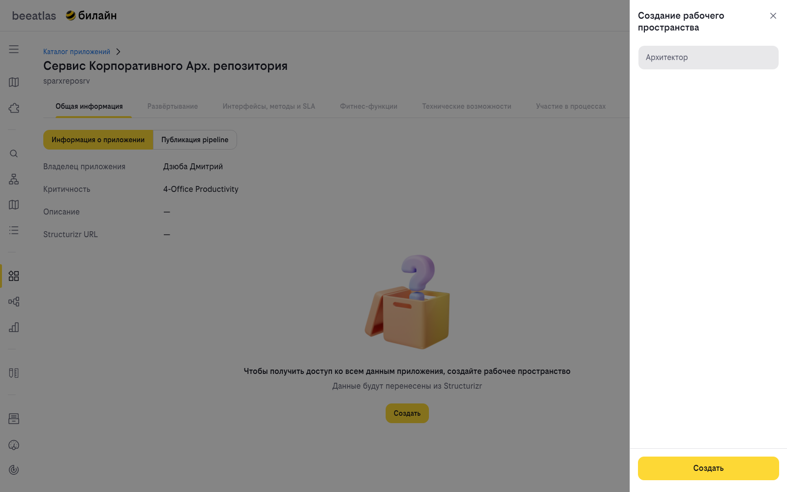

**Как создать рабочее пространство**

1. Откройте **Каталог приложений** и выберите приложение. В карточке откройте вкладку **«Общая информация»**.
2. В блоке «Информация о приложении» проверьте поле **Structurizr URL** — если оно пустое, рабочего пространства нет.
3. Внизу страницы нажмите **«Создать»** в блоке «Чтобы получить доступ ко всем данным приложения, создайте рабочее пространство».
4. В боковой панели **«Создание рабочего пространства»** проверьте поле **«Архитектор»** — в него автоматически подставляется ФИО текущего пользователя; при необходимости укажите другого ответственного архитектора.
5. Нажмите **«Создать»**. После создания появится сообщение «Рабочее пространство создано. Данные перенесены из Structurizr», а поле **Structurizr URL** заполнится ссылкой.

> Кнопка «Создать» доступна владельцу приложения и администраторам. Данные в новое пространство переносятся из Structurizr.

### Загрузка архитектуры приложения

Когда рабочее пространство создано, в него можно загрузить описание архитектуры:

1. Откройте карточку приложения на вкладке **«Общая информация»**.
2. Рядом со ссылкой **Structurizr URL** нажмите иконку загрузки (подсказка **«Загрузка версии архитектуры»**).
3. В боковой панели выберите файл `.dsl` или `.json` (до 5 МБ).
4. Нажмите **«Запустить»** и дождитесь завершения обработки — обычно до 15 секунд.

После обработки обновятся данные об архитектуре приложения.

**Поддерживаемые форматы:**

- **workspace.dsl** — DSL-описание архитектуры (Structurizr DSL)
- **workspace.json** — JSON-экспорт рабочего пространства Structurizr

**Ограничения:**

- Максимальный размер файла: 5 МБ
- Допустимые расширения: `.dsl`, `.json`

>**Примечания:**
>- Кнопки «Обновить» и «Загрузка версии архитектуры» доступны только владельцам приложения и администраторам
>- Во время обработки кнопки «Обновить» и «Загрузка версии архитектуры» временно отключены
>- Администраторы видят таблицу с историей процессов обновления (ID, дата, тип, статус)
>- После загрузки данные синхронизируются с архитектурным графом системы

## Навигация

- [Вернуться к разделу "Модели"](../models.md)
- [ФДМ (Функционально-Доменная Модель)](./fdm.md)
- [E2E сценарии](./e2e.md)
- [Архитектура компании](./impact.md)
- [Аналитический отчет фитнес-функций](./analytical_report.md)
