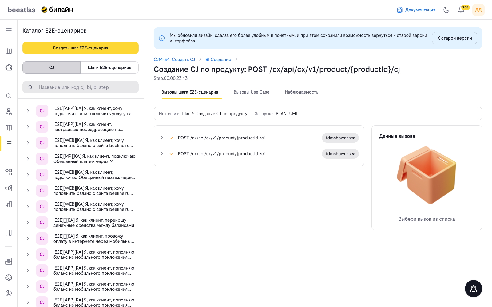
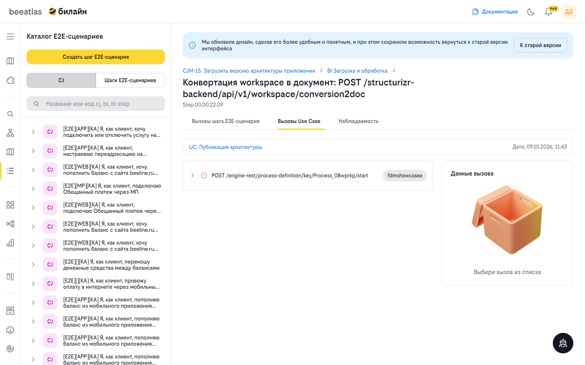
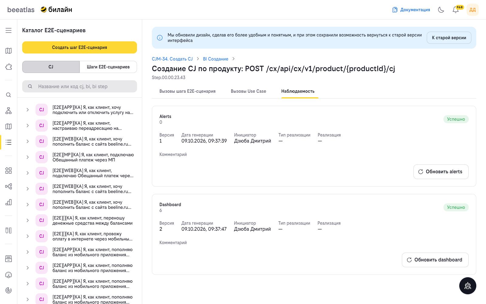
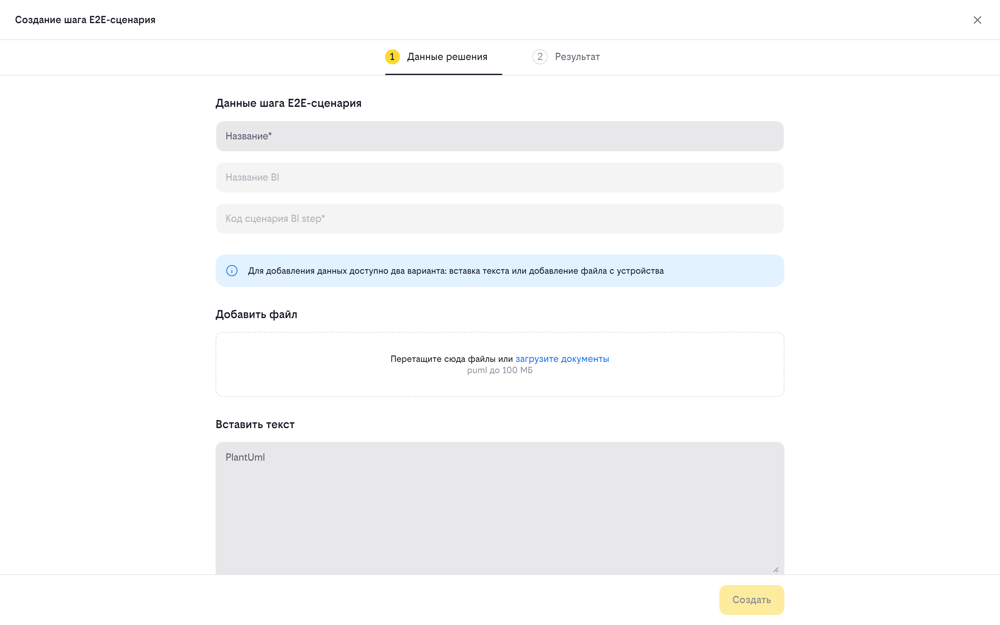

# E2E сценарии

E2E-сценарий описывает полный бизнес-процесс от начала до конца, включая все задействованные системы и приложения. Сценарий имеет трёхуровневую иерархию:

- **CJ (Customer Journey)** — клиентский путь, верхний уровень иерархии. Описывает полный сценарий взаимодействия.
- **BI (Business Interaction)** — бизнес-взаимодействие, промежуточный уровень. Группирует шаги внутри клиентского пути.
- **Шаг процесса (BI Step)** — отдельный шаг бизнес-взаимодействия, нижний уровень. Содержит информацию о вызовах и наблюдаемости.

## Способы загрузки данных

E2E-сценарий может попасть в каталог одним из двух способов: переносом из SparxEA либо импортом PlantUML-файла в интерфейсе BeeAtlas.

### Перенос из SparxEA

Данные по E2E переносятся из SparxEA в контур БД BeeAtlas периодической выгрузкой. Архитектуру нужно оформить в SparxEA в виде диаграммы последовательности в соответствии с требованиями корпоративной архитектуры:

- Для корректной выгрузки и связи с элементами CJ внутри BeeAtlas необходимо добавить в атрибут **Notes** диаграммы связь с шагом BI.
  - Пример: `step_id=Step.00.00.05.06`
  - Уникальный идентификатор шага BI можно найти в интерфейсе BeeAtlas, открыв интересующий вас CJ (Библиотека CJ).
- После добавления связи в атрибут Notes диаграмма появится в списке E2E в течение часа.


### Импорт PlantUML

Сценарий можно также создать или обновить напрямую в интерфейсе, импортировав файл PlantUML (`.puml`). Диаграмма последовательности из файла отображается во вкладке «Последовательность вызовов» сценария, а каждый импорт сохраняется как отдельная версия файла. Подробнее — в разделе [Импорт PlantUML](#импорт-plantuml).

## Интерфейс

Раздел **«Каталог E2E-сценариев»** открывается по пути **«Модели» → «E2E сценарии»**. В шапке страницы расположен переключатель режимов **CJ | Шаги E2E-сценариев**, справа вверху — ссылка **«К старой версии»** на прежний интерфейс раздела. Новый шаг E2E-сценария заводится кнопкой **«Создать шаг E2E-сценария»** в левой панели — она открывает страницу импорта PlantUML.

### Режим CJ

Доступен поиск по названию или коду. Под строкой поиска отображается список клиентских путей (Customer Journey), связанных с E2E-сценариями (элементы отмечены тегами каналов: APP, WEB, MP, USSD и т. п.). При выборе сценария показывается ссылка на его карточку — переход к просмотру деталей в Библиотеке CJ.


### Режим «Шаги E2E-сценариев»

Доступен поиск по названию E2E-сценария. Под строкой поиска отображается список шагов E2E-сценариев. Выбор сценария открывает правую панель сценария.


### Создание шага E2E-сценария

Кнопка **«Создать шаг E2E-сценария»** в левой панели открывает страницу импорта PlantUML (`/models/e2e/import`) — создание шага и загрузка диаграммы выполняются одним потоком: на первом шаге указывается название и привязка к BI, на втором проверяется результат разбора (см. [Импорт PlantUML](#импорт-plantuml)).

Сценарий может появиться в каталоге и без PlantUML — автоматически из выгрузки SparxEA.

### Панель E2E-сценария

При выборе шага в списке открывается правая панель со свойствами:

- заголовок и код шага;
- вкладки **«Последовательность вызовов»** | **«Связанные CJ»**;
- внизу — кнопки «Закрыть» / «Сохранить».

Состав панели зависит от режима, в котором выбран шаг:

- в режиме **«Шаги E2E-сценариев»** панель показывает вкладки **«Последовательность вызовов»** и **«Связанные CJ»**;
- в режиме **CJ** тот же шаг открывается панелью с вкладками **«Вызовы шага E2E-сценария»**, **«Вызовы Use Case»** и **«Наблюдаемость»**.

Для шагов, заведённых из PlantUML, в шапке панели появляются кнопки **«Редактировать шаг E2E-сценария»** и **«Импортировать PlantUML»** — обе ведут на страницу импорта (`/models/e2e/import?code=<код шага>`). Для шагов, пришедших из SparxEA, этих кнопок нет.

Вкладка **«Последовательность вызовов»** показывает дерево вызовов шага (вызовы, их порядок и вложенность). Отрисованная диаграмма последовательности доступна в старой версии интерфейса — см. [Старая версия интерфейса](#старая-версия-интерфейса).

### Панель шага в режиме CJ

В режиме **CJ** панель выбранного шага (BI Step) раскрывает три вкладки:

| Вкладка | Содержание |
|---------|------------|
| **«Вызовы шага E2E-сценария»** | Вызовы, закреплённые за шагом в E2E-сценарии |
| **«Вызовы Use Case»** | Вызовы Use Case, привязанного к этому же шагу E2E-сценария |
| **«Наблюдаемость»** | Создание и обновление алертов и дашборда по шагу |

В шапке панели отображается навигационная цепочка **CJ → BI → шаг**, название шага и его код. Если у шага больше одной реализации, название вкладки получает счётчик в скобках — например, **«Вызовы шага E2E-сценария (2)»**.

Адрес страницы хранит выбранный шаг и вкладку, поэтому ссылку на конкретный шаг можно передать другому пользователю:

```
/models/e2e?tab=CJ&type=BI_STEP&id=<код шага>&tab-bi-step=<вкладка>&tab-id=<реализация>
```

| Параметр | Значение |
|----------|----------|
| `type=BI_STEP`, `id` | Код шага E2E-сценария (например, `Step.00.00.23.43`) — открывает шаг в режиме CJ |
| `tab-bi-step` | `e2e` — «Вызовы шага E2E-сценария», `use-case` — «Вызовы Use Case», `observability` — «Наблюдаемость» |
| `tab-id` | Идентификатор выбранной реализации внутри вкладки (необязательный) |

Такие ссылки формируются автоматически, например в таблице «Участие в процессах» карточки приложения (см. [Каталог приложений](./apps.md)).

#### Вкладка «Вызовы шага E2E-сценария»

Показывает дерево вызовов, закреплённых за шагом в E2E-сценарии: метод (например, `POST /cx/api/cx/v1/product/{productId}/cj`), вызывающую и вызываемую системы. Часть вызовов помечается предупреждающим значком — это методы, не найденные в архитектуре. Выбор вызова в дереве открывает справа блок **«Данные вызова»**; пока вызов не выбран, отображается подсказка **«Выбери вызов из списка»**.

Если шаг реализован несколькими E2E-сценариями или Use Case, над деревом появляется строка **«Реализация»** с переключателем по чипам — активный чип определяет, чьи вызовы показаны.



#### Вкладка «Вызовы Use Case»

Вкладка связывает E2E-сценарий с проектными Use Case: один и тот же шаг E2E-сценария может быть указан при импорте Use Case в проекте (см. [Проекты](../projects.md#use-case)). Для каждого связанного Use Case показываются название, дата изменения, дерево вызовов и блок **«Данные вызова»**; если у шага несколько Use Case, между ними переключаются чипами **«Реализация»**.



Если шаг BI не реализован ни в одном Use Case, вкладка показывает заглушку **«Нет Use Case»** с пояснением **«Шаг BI не реализован ни в одном Use Case»**.

#### Вкладка «Наблюдаемость»

Вкладка отвечает за построение и обновление данных наблюдаемости по шагу BI. Данные строятся из вызовов шага E2E-сценария или из вызовов связанного Use Case, и показываются двумя карточками:

| Карточка | Содержание |
|----------|------------|
| **Alerts** | Результат построения алертов по шагу |
| **Dashboard** | Результат построения дашборда Grafana по шагу |



Карточка с уже построенными данными содержит:

- идентификатор версии;
- бейдж статуса: **«Успешно»** (зелёный) или **«Ошибка»** (красный);
- поля **«Версия»**, **«Дата генерации»** (формат `ДД.ММ.ГГГГ, ЧЧ:ММ:СС`), **«Инициатор»**, **«Тип реализации»**, **«Реализация»**;
- поле **«Ссылка»** со ссылкой **«Открыть»** — она есть только у дашборда и ведёт в Grafana;
- комментарий, если он был указан при обновлении;
- кнопку с иконкой обновления: **«Обновить alerts»** или **«Обновить dashboard»** (для ещё не созданных данных — **«Создать alerts»** / **«Создать dashboard»**).

Для шага, по которому данные ещё не строились, карточка показывает подсказки **«Для этого шага алерты еще не создавались»** или **«Для этого шага дашборд еще не создавался»**.

Кнопка обновления открывает боковую панель **«Обновление alerts»** или **«Обновление dashboard»** (для новых данных — **«Создание …»**):

| Поле | Описание |
|------|----------|
| **Тип реализации** | Источник данных: **«Шаг E2E-сценария»** или **«Use Case»**. Вариант, по которому нет реализаций, недоступен |
| **Реализация** | Конкретный E2E-сценарий или Use Case, по вызовам которого строятся данные |
| **Комментарий** | Произвольный комментарий; он же показывается в карточке после сохранения |

Кнопки футера — **«Отмена»** и **«Обновить»** (для новых данных — **«Создать»**). После сохранения появляется уведомление **«Alerts обновлен»** / **«Dashboard создан»**.

Особые случаи:

- если у шага BI нет ни вызовов E2E-сценария, ни Use Case, вместо карточек выводится заглушка **«Нет реализаций»** с пояснением **«Алерты строятся по вызовам шага E2E-сценария или Use Case, а у шага BI их нет»**;
- если для выбранного E2E-сценария часть методов не найдена в архитектуре, в панели появляется предупреждение **«Методы не найдены в архитектуре — цепочка вызовов будет построена до первого некорректного вызова:»** (для alerts) или **«Методы не найдены в архитектуре и не попадут в дашборд:»** (для dashboard) со списком таких методов;
- при выборе типа реализации **«Use Case»** выводится информационный баннер **«Алерты по Use Case пока не строятся: сервис дашбордов дорабатывается»** либо **«Dashboard по Use Case пока не строится: сервис дашбордов дорабатывается»**, а кнопка сохранения становится недоступной.

!!! note "Вкладка «История загрузок»"
    В панели есть скрытая вкладка истории загрузок — сейчас она не отображается в интерфейсе. История импортов Use Case доступна на отдельной странице в карточке проекта (см. [История импорта](../projects.md#история-импорта)).

### Импорт PlantUML

Импорт выполняется на отдельной полноэкранной странице (`/models/e2e/import`) и состоит из двух шагов: **«Данные решения»** → **«Результат»**.



**Шаг 1. Данные решения.** Для нового шага указываются **название**, **BI** и **код сценария BI step**; при импорте в существующий шаг эти поля уже заполнены. Диаграмму можно передать двумя взаимоисключающими способами:

- **файлом** — `.puml`, до 100 МБ (проверяется расширение и размер);
- **текстом** — вставкой в поле «PlantUml».

Кнопка **«Создать»** отправляет диаграмму на разбор и открывает экран **«Обработка PlantUML»** («Пожалуйста, не закрывайте страницу до завершения обработки»).

**Шаг 2. Результат.** Когда разбор закончен, показывается карточка шага и две таблицы:

- **«Системы-участники»** — Alias, название, тип и статус (**«Распознана»** / **«Не распознана»**);
- **«Методы»** — номер связи, связь (`откуда → куда`), вызов и сопоставленный метод (либо «Метод не распознан» / «Метод не сопоставлен»).

Здесь же — кнопки **«Отменить»** и **«Сохранить»**: сохранение применяет результат разбора к шагу.

Если разбор упал, открывается экран **«Не удалось обработать PlantUML»** с таблицей **«Причина падения по стадиям»** (стадия и текст ошибки) и кнопкой возврата к форме. Если по этому же шагу уже идёт разбор, вместо запуска нового предлагается открыть текущий («Посмотреть»).

Каждый импорт сохраняет текст диаграммы как отдельную версию в хранилище `E2E_PLANTUML`; повторная загрузка идентичного текста переиспользует уже сохранённую версию.

### Правила оформления PlantUML

BeeAtlas разбирает загруженный файл по строгим правилам — от них зависит, распознаются ли участники и вызовы. Правила ниже описывают разбор и сопоставление PlantUML в staging-service (стадии валидации и сборки графа вызовов).

#### Формат диаграммы

- Файл должен быть **Sequence-диаграммой** PlantUML: начинаться строкой `@startuml` и заканчиваться `@enduml`. Другие типы диаграмм (`rectangle`, `database`, компонентные и т. п.) не поддерживаются.
- Комментарии допускаются построчные (`'` в начале строки) и блочные (`/' … '/`); на разбор они не влияют.
- Пустой блок `@startuml` … `@enduml` считается ошибкой: «В диаграмме нет ни одного участника». Отсутствие сообщений — не ошибка, а предупреждение: версия сохранится, но вызовов в графе не будет.
- Обрабатывается **только первый блок** `@startuml`…`@enduml` в файле — остальные игнорируются.
- При синтаксической ошибке разбор останавливается и в отчёте указывается номер строки с ошибкой.
- Ограничения: не более **300 участников** в диаграмме (иначе разбор прерывается с ошибкой); файл `.puml` — до **100 МБ**, текст диаграммы, попадающий в пайплайн разбора, — до **512 КБ**.

#### Участники

В сопоставлении участвуют только участники, объявленные через **`participant`**. Участники, объявленные как `actor`, а также `boundary`, `control`, `entity`, `database`, `collections`, `queue`, при разборе игнорируются полностью: они не попадают ни в распознанные, ни в нераспознанные, а вызовы, адресованные им, в граф не включаются.

Мнемоника ищется только по **отображаемому имени** — тексту перед `as`. Для `participant "api_gateway" as GW` это `api_gateway`. Проверяются три варианта написания имени (все — без учёта регистра):

1. имя целиком;
2. часть **до первой точки** — если имя содержит точку не в начале (`ext_Example.SomeDetail` → `ext_Example`);
3. часть **после последней точки** — того же имени (`ext_Example.SomeDetail` → `SomeDetail`).

Сопоставление идёт только с **alias продуктов** (каталог fdm-products). Псевдоним после `as` и коды контейнеров CMDB при распознавании участников **не используются**: участник не распознается по короткому псевдониму, даже если он совпадает с кодом контейнера.

> **Главное правило:** имя перед `as` должно точно совпадать (без учёта регистра) с alias продукта в BeeAtlas. Короткий псевдоним после `as` — произвольная метка только для диаграммы.

Нераспознанный участник даёт ошибку с номером строки, а вызовы с ним в качестве получателя в граф не попадают.

```
' Плохо: имя участника не совпадает с мнемоникой продукта
participant "Система оплаты" as PAY

' Хорошо: имя совпадает с alias продукта в каталоге
participant "b2c-digital-payments-bnpl" as BNPL
```

#### Вызовы (сообщения)

В тексте сообщения ищется первое совпадение шаблона **`МЕТОД /путь`**:

- поддерживаемые методы: `GET`, `POST`, `PUT`, `PATCH`, `DELETE`, `HEAD`, `OPTIONS` — в любом регистре, отделены пробелом от пути; путь — первый токен без пробелов после метода;
- вызов проверяется **у получателя** сообщения (участник после стрелки): метод и путь должны найтись в архитектуре продукта, которым распознан этот участник;
- **ответные сообщения** (пунктирная стрелка, `-->`) не проверяются и в граф не попадают — это ответ, а не вызов.

Сопоставление с каталогом операций идёт по правилу `ILIKE`, в котором **шаблоном выступает путь из диаграммы**, а значением — имя операции в каталоге:

- регистр не важен, строка сравнивается целиком;
- `%` в пути означает любую последовательность символов, `_` — ровно один символ (SQL-джокеры). Из-за этого подчёркивания в пути дают неожиданные совпадения: вызов `/api/v1/dp_channel_provider/get_tp` сопоставится с операцией `/api/v1/dpXchannelXprovider/getXtp`;
- **имена path-параметров значимы**: `/api/v1/product/{code}` не сопоставится с `/api/v1/product/{cmdb}`;
- конкретное значение не сопоставляется с шаблоном каталога и наоборот: `/api/v1/product/123` ≠ `/api/v1/product/{code}`;
- число сегментов и хвостовой слэш значимы: `/api/v1/product/` ≠ `/api/v1/product`;
- строка запроса не отбрасывается: `?…` попадёт в путь и сломает сопоставление — указывайте в диаграмме путь без query-параметров;
- тип операции в каталоге должен совпадать с методом (регистр не важен). Если тип не заполнен или равен `UNKNOWN`, операция не сопоставится;
- учитываются только **архитектурные операции ветки `main`** (discovered-операции не участвуют) с неудалёнными продуктом, контейнером, интерфейсом и операцией; внутри продукта контейнер значения не имеет.

Сообщения без REST-вызова (просто текст, например «200 OK», «Результат оплаты») не считаются вызовами и попадают в «Не распознано» — это нормально, если они не являются вызовами.

#### Пример корректной диаграммы

```
@startuml
title Оплата: создание заявки
actor Клиент as Client
participant "b2c-digital-payments-bnpl" as BNPL
participant antispam as Antispam
participant "ai-tool" as AITool

Client -> BNPL: POST /command/createApplication
BNPL -> Antispam: GET /api/v1/calls/
BNPL -> AITool: POST /chat/completions
BNPL --> Client: Результат оплаты
@enduml
```

Здесь `BNPL`, `Antispam`, `AITool` — короткие псевдонимы для диаграммы, а распознаются участники по именам перед `as`, совпадающим с alias продуктов в каталоге. `Клиент` объявлен как `actor` и в сопоставлении не участвует, а пунктирная стрелка `BNPL --> Client` — ответ, поэтому вызовом не считается.

#### Что не попадает в граф вызовов

- **Ответные сообщения** (пунктирные стрелки) — исключаются всегда.
- Вызовы, у которых **получатель не распознан** (имя не совпало с alias продукта или участник объявлен не как `participant`).
- Вызовы, вложенные в уже исключённый вызов, — исключаются вместе с родителем.

Сообщения **без REST-вызова** и вызовы, для которых **не нашлось операции** в каталоге, из графа не выбрасываются:

- без REST-вызова создаётся операция с типом `UNKNOWN` (в отчёте валидатора такое сообщение числится нераспознанным);
- без совпадения в каталоге операция остаётся в графе, но без связи с операцией ландшафта — в отчёт попадает предупреждение «операция не найдена в ландшафте».

Self-call (`A -> A`) при разборе PlantUML **не отбрасывается** — такой вызов попадает в граф как вызов системы самой себе.

Порядок вызовов определяется по вызывающему: вложенные вызовы нумеруются в порядке появления внутри родителя. Родителем считается последняя операция, в которую пришёл вызов на этой линии жизни, — так строится вложенность.

### Результат импорта (страница «Результат валидации PlantUml»)

Отдельная страница результата импорта (**«Результат валидации PlantUml»**, адрес вида `/models/e2e/import/version?docId=…&code=…`) показывает, как BeeAtlas распознал загруженную диаграмму в ландшафте:

- Если часть участников или вызовов не распознана, сверху отображается баннер: **«Есть замечания: часть участников или вызовов не распознана в ландшафте BeeAtlas. Версию всё равно можно сохранить»**.
- Карточки метрик: **«Распознанных участников X из N»** и **«Распознанных вызовов X из N»**.
- Секции **«Участники»** и **«Вызовы»** со сводкой **«Распознано (k)»** / **«Не распознано (m)»**: распознанные элементы отмечены, для нераспознанных указаны тип и строка в `.puml` (у участников — колонки «Название / Тип элемента / Строка», у вызовов — «Источник / Назначение / Вызов»).
- Секция **«Замечания»** со списком предупреждений по строкам диаграммы.

Отчёт помогает понять, какие системы и вызовы BeeAtlas не сопоставил с ландшафтом, поправить диаграмму и переимпортировать файл. Стрелка «назад» в левом верхнем углу возвращает к сценарию.


### Связанные CJ

Вкладка **«Связанные CJ»** показывает клиентские пути, связанные со сценарием, с переходом к их карточкам в Библиотеке CJ.

### Старая версия интерфейса

По ссылке **«К старой версии»** доступен прежний интерфейс раздела, в котором E2E-сценарии просматриваются как дерево **CJ → BI → шаг процесса**. Для шага процесса доступны вкладки **«Вызовы»** (дерево последовательности вызовов с метриками) и **«Наблюдаемость»** (создание и обновление алертов).

## Как использовать

### Создать E2E-сценарий импортом PlantUML

1. Перейдите в раздел **«Модели» → «E2E сценарии»** и выберите режим **«Шаги E2E-сценариев»**.
2. Нажмите **«Создать шаг E2E-сценария»** и укажите название сценария.
3. В открывшейся панели сценария нажмите иконку **импорта PlantUML** и загрузите `.puml`-файл.
4. Убедитесь, что диаграмма отобразилась во вкладке **«Последовательность вызовов»**, и нажмите **«Сохранить»**.

### Обновить сценарий новой версией `.puml`

1. Выберите нужный E2E-сценарий в списке.
2. Нажмите иконку **импорта PlantUML** и загрузите новый файл.
3. Дождитесь сообщения об успешном импорте — новая версия сохранится отдельно от предыдущей.

### Посмотреть отчёт импорта

1. Откройте сценарий и скопируйте код шага из его панели.
2. Перейдите на страницу результата по прямой ссылке `/models/e2e/import/version?docId=<идентификатор версии>&code=<код шага>` — откроется **«Результат валидации PlantUml»** с метриками распознавания и замечаниями.

### Найти E2E-сценарий

1. В режиме **«Шаги E2E-сценариев»** введите название сценария в строке поиска.
2. Выберите сценарий из списка и откройте его панель.

## Навигация

- [Вернуться к разделу "Модели"](../models.md)
- [Каталог приложений](./apps.md)
- [ФДМ (Функционально-Доменная Модель)](./fdm.md)
- [Архитектура компании](./impact.md)
