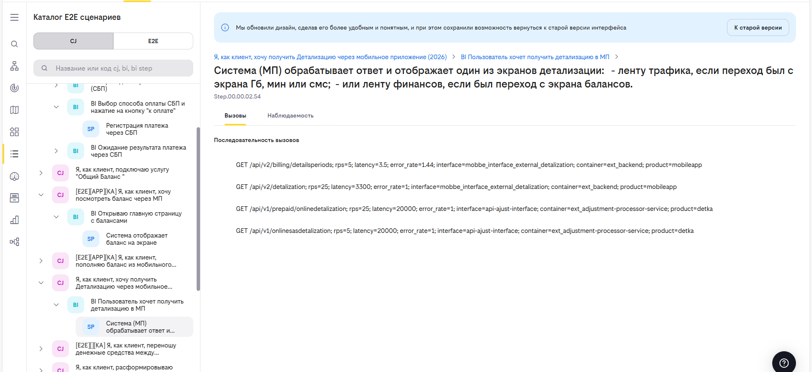
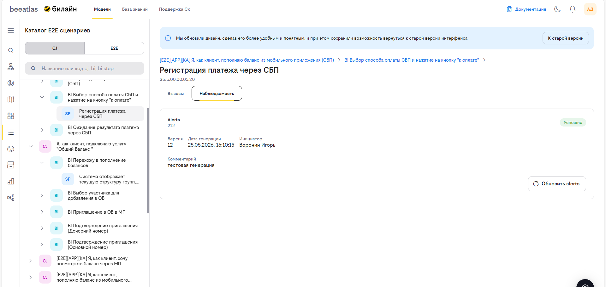
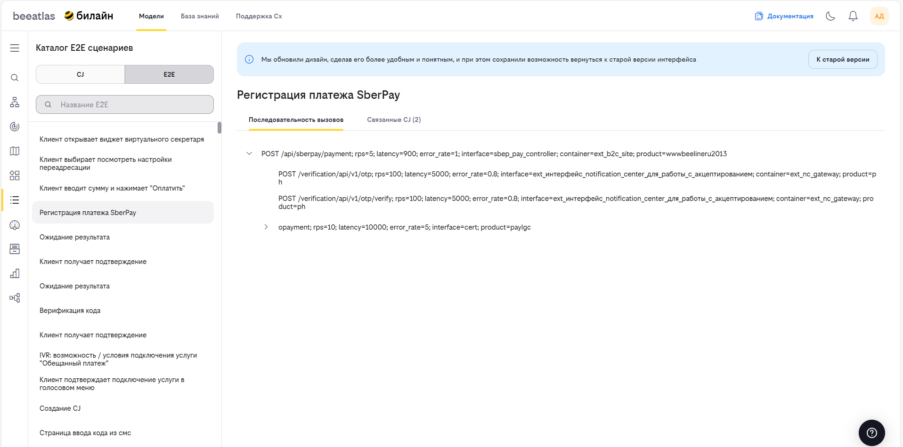

# E2E сценарии

Описание полного бизнес-процесса от начала до конца, включая все задействованные системы и приложения. Сценарий имеет трёхуровневую иерархию:

- **CJ (Customer Journey)** — клиентский путь, верхний уровень иерархии. Описывает полный сценарий взаимодействия.
- **BI (Business Interaction)** — бизнес-взаимодействие, промежуточный уровень. Группирует шаги внутри клиентского пути.
- **Шаг процесса (BI Step)** — отдельный шаг бизнес-взаимодействия, нижний уровень. Содержит информацию о вызовах и наблюдаемости.

> Описанный функционал для связи Е2Е с библиотекой CJ использует миграцию данных из SparxEA. Для отображения вашего сценария, должны быть проставлены связи в SparxEA (пример указан ниже)

## Основные возможности

- **Просмотр дерева сценариев** — иерархия CJ → BI → Шаг процесса
- **Поиск** по названию или коду сценария
- **Детальная информация** о каждом уровне сценарии
- **Последовательность вызовов** — дерево вызовов для каждого шага процесса
- **Наблюдаемость** — создание и обновление алертов для шагов процесса
- **Переключение режимов просмотра** — табы для переключения между категориями CJ (Customer Journey) и E2E

## Загрузка данных

- **Перенос данных** — Данные по Е2Е переносятся из SparxEA в контур БД BeeAtlas периодической выгрузкой.
- **Правила оформления** — Архитектуру нужно оформить диаграмму последовательности в SparxEA в соответствии с требованиями корпоративной архитектуры.
  - Для корректной выгрузки и связи с элементами CJ внутри BeeAtlas, необходимо добавить в атрибут Notes диаграммы связь с шагом BI.
    - Пример: `step_id=Step.00.00.05.06`
  - Уникальный идентификатор шага BI можно найти в интерфейсе BeeAtlas, открыв интересующий вас CJ 
- **Замечание** - После добавления связи в атрибут Notes, ваша диаграмма появится в списке Е2Е в течении часа.

## Интерфейс

Страница имеет шапку с названием "Каталог E2E сценариев" и переключатели (табы) для выбора режима отображения: **CJ** и **E2E**.

### Режим отображения CJ

При выборе режима "CJ" доступен поиск по названию или коду CJ, BI и шага BI. Под строкой поиска отображается иерархическое дерево сценариев:

- CJ — элементы с маджентовым аватаром и буквами «CJ»
- BI — элементы с бирюзовым аватаром и буквами «BI»
- Шаг процесса — элементы с синим аватаром и буквами «SP»

### Информация о CJ

При выборе элемента CJ отображается:

- Название сценария (заголовок)
- Код сценария
- Ссылка на страницу редактирования CJ

#### Информация о BI

При выборе элемента BI отображается:

- Хлебные крошки с переходом к родительскому CJ
- Название бизнес-взаимодействия (заголовок)
- Код бизнес-взаимодействия
- Ссылка на страницу просмотра BI

#### Информация о шаге процесса

При выборе шага процесса отображается:

- Хлебные крошки с переходом к CJ и BI
- Название шага (заголовок)
- Код шага
- Две вкладки: **«Вызовы»** и **«Наблюдаемость»**

##### Вкладка «Вызовы»

Отображает дерево последовательности вызовов для выбранного шага. Каждый узел дерева содержит:

- Название операции
- Метрики: RPS (запросов в секунду), задержка (latency), уровень ошибок (error_rate)
- Атрибуты: код интерфейса, код контейнера, код продукта

Узлы с дочерними вызовами можно раскрывать и сворачивать. Если данных о вызовах нет, отображается сообщение «Нет данных».

##### Вкладка «Наблюдаемость»

Отображает информацию об алертах для выбранного шага:

- **Заголовок** — «Alerts» с идентификатором
- **Статус** — бейдж «Успешно» (зелёный) или «Ошибка» (красный)
- **Метаданные** — версия, дата генерации, инициатор
- **Комментарий** — текстовый комментарий к алерту
- **Кнопка действия** — «Создать alerts» (если алерта нет) или «Обновить alerts» (если алерт существует)

Если алерты ещё не создавались, отображается сообщение «Для этого процесса алерты еще не создавались».

### Режим отображения E2E

При выборе режима "E2E" доступен поиск по названию E2E сценария. Под строкой поиска отображается список E2E сценариев. При выборе сценария в основной области отображается:

- Название сценария
- Последовательность вызовов на вкладке "Вызовы"
- Связанные CJ на вкладке "Связанные CJ"

### Как использовать

#### Просмотр списка сценариев

1. Перейдите в раздел **«Модели»** → **«E2E сценарии»**
2. В левой панели просмотрите дерево доступных сценариев
3. Раскройте нужный CJ, чтобы увидеть список бизнес-взаимодействий (BI)
4. Раскройте нужный BI, чтобы увидеть шаги процесса

#### Просмотр детальной информации

1. Выберите элемент в дереве слева
2. В правой панели ознакомьтесь с информацией о выбранной сущности
3. Используйте хлебные крошки для навигации между уровнями иерархии
4. Перейдите по ссылкам для открытия страниц CJ или BI в других разделах системы

#### Просмотр E2E сценариев

1. Перейдите в раздел **«Модели»** → **«E2E сценарии»**
2. Выберите режим отображения **«E2E»** с помощью табов в шапке страницы
3. В строке поиска введите название интересующего E2E сценария
4. Выберите нужный сценарий из списка
5. В правой панели перейдите на вкладку **«Вызовы»** для просмотра последовательности вызовов
6. Перейдите на вкладку **«Связанные CJ»** для просмотра и перехода к связанным CJ

#### Создание алерта наблюдаемости

1. Выберите шаг процесса в дереве
2. Перейдите на вкладку **«Наблюдаемость»**
3. Нажмите кнопку **«Создать alerts»**
4. В открывшейся боковой панели введите комментарий
5. Нажмите **«Создать»**

#### Обновление алерта наблюдаемости

1. Выберите шаг процесса в дереве
2. Перейдите на вкладку **«Наблюдаемость»**
3. Ознакомьтесь с текущим статусом и метаданными алерта
4. Нажмите кнопку **«Обновить alerts»**
5. В открывшейся боковой панели отредактируйте комментарий
6. Нажмите **«Обновить»**

## Навигация

- [Вернуться к разделу "Модели"](../models.md)
- [Каталог приложений](./apps.md)
- [ФДМ (Функционально-Доменная Модель)](./fdm.md)
- [Архитектура компании](./impact.md)

