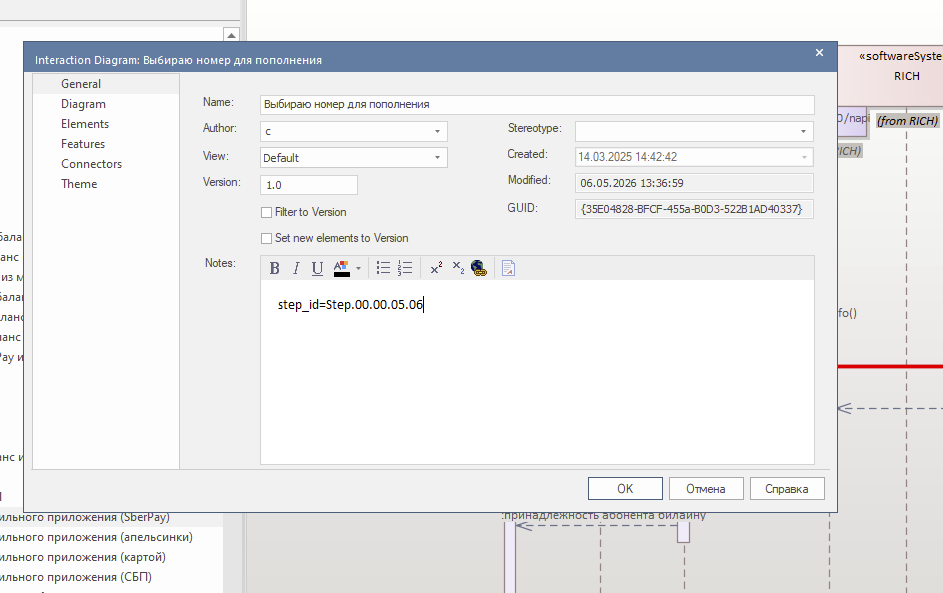
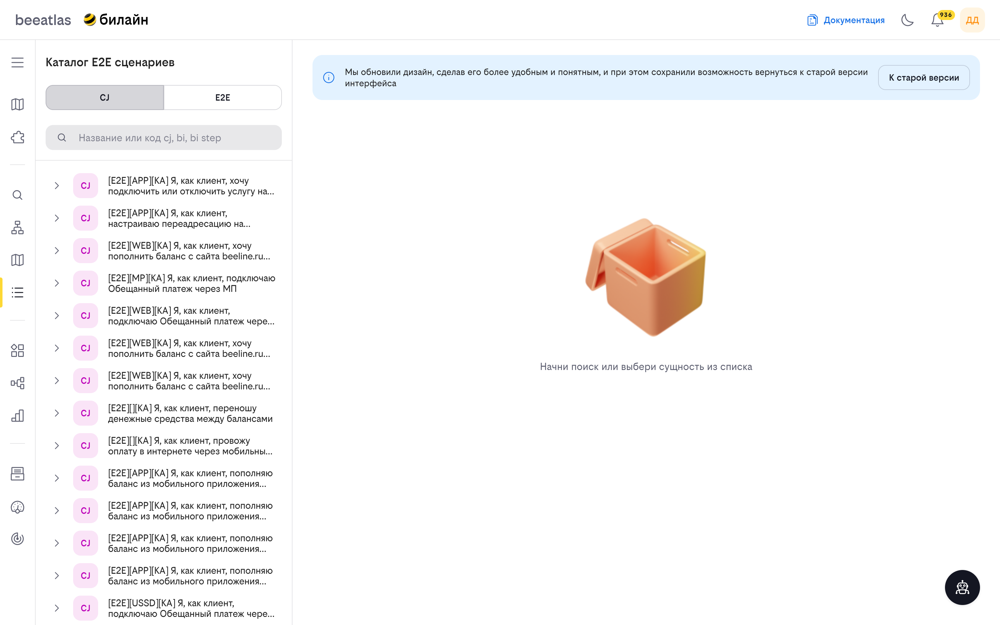
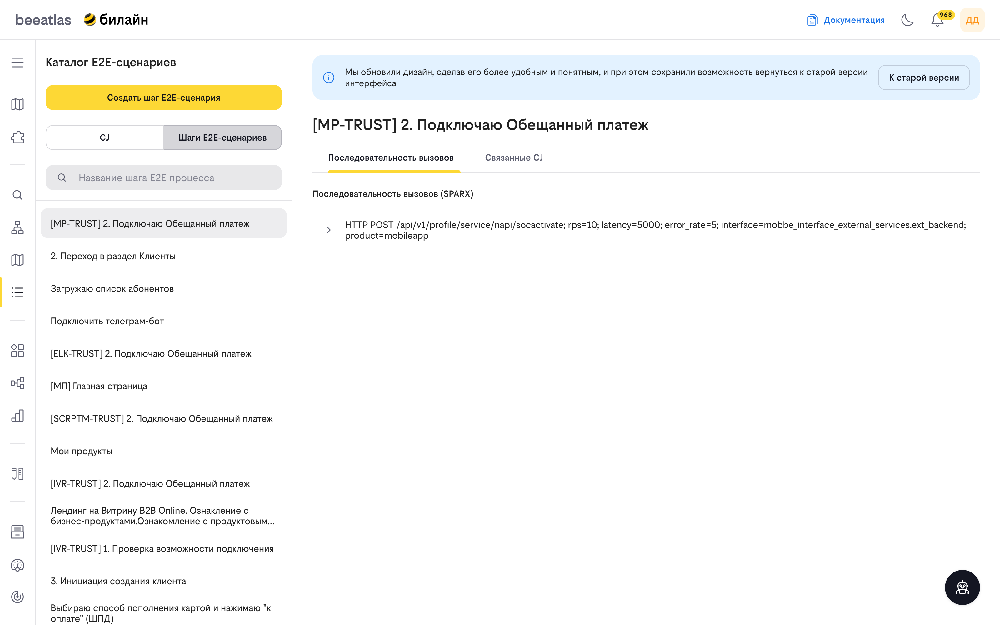
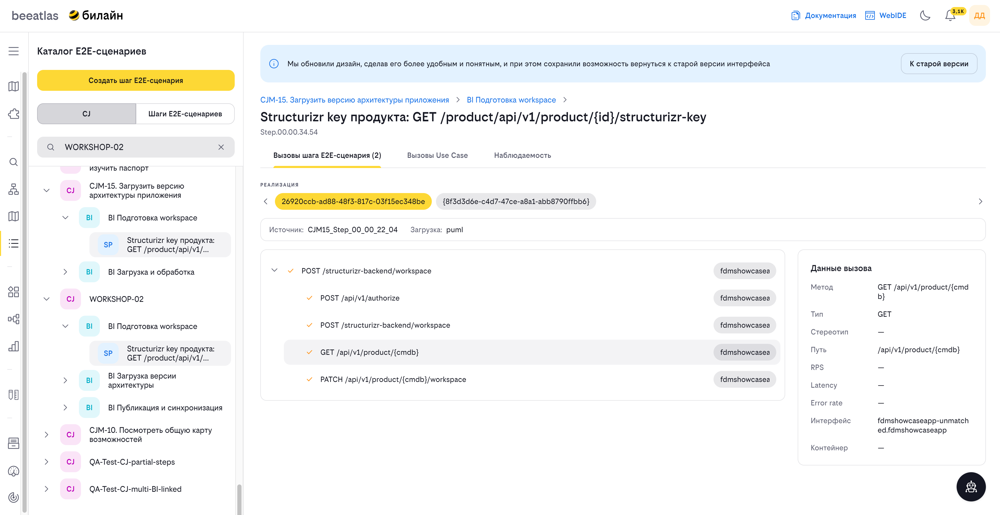
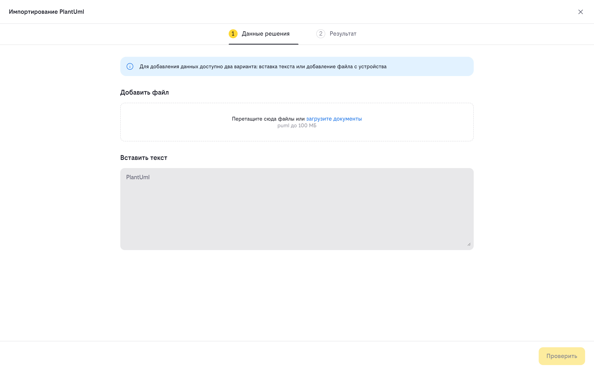
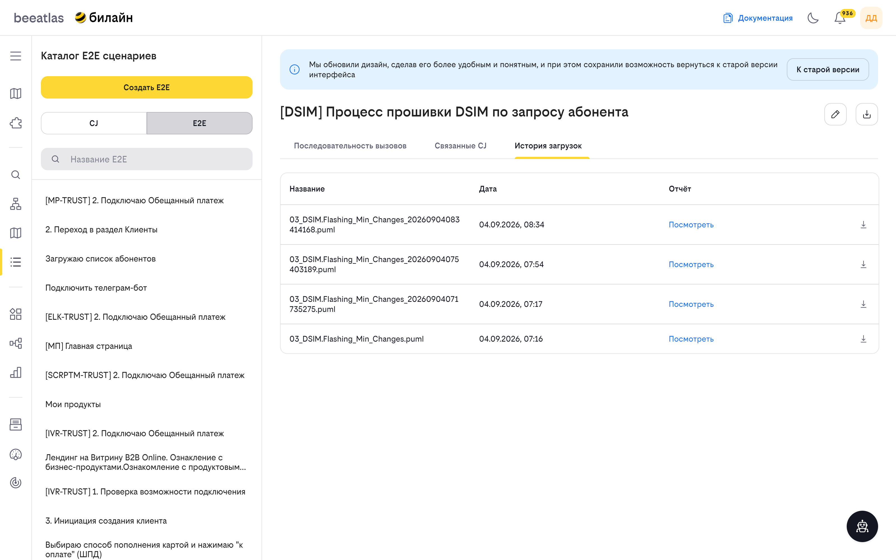
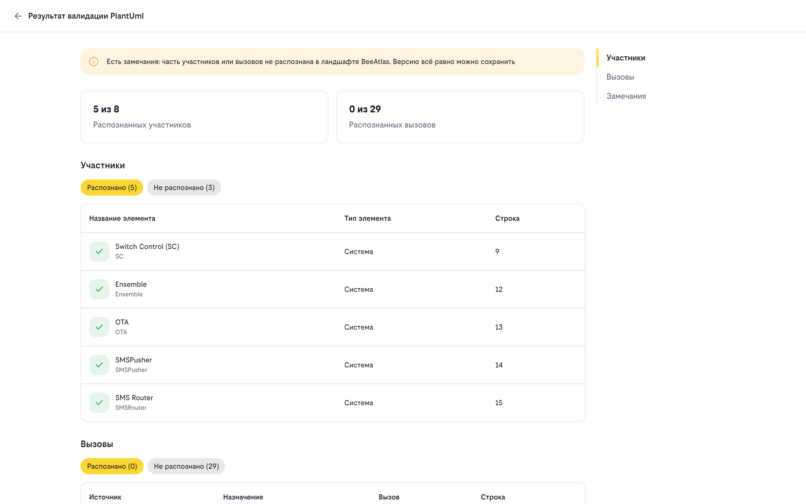

# E2E сценарии

E2E-сценарий описывает полный бизнес-процесс от начала до конца, включая все задействованные системы и приложения. Сценарий имеет трёхуровневую иерархию:

- **CJ (Customer Journey)** — клиентский путь, верхний уровень иерархии. Описывает полный сценарий взаимодействия.
- **BI (Business Interaction)** — бизнес-взаимодействие, промежуточный уровень. Группирует шаги внутри клиентского пути.
- **Шаг процесса (BI Step)** — отдельный шаг бизнес-взаимодействия, нижний уровень. Содержит информацию о вызовах и наблюдаемости.

## Способы загрузки данных

E2E-сценарий может попасть в каталог одним из двух способов: переносом из SparxEA либо импортом PlantUML-файла в интерфейсе BeeAtlas.

### Перенос из SparxEA

Данные по E2E переносятся из SparxEA в контур БД BeeAtlas периодической выгрузкой. Архитектуру нужно оформить в SparxEA в виде диаграммы последовательности в соответствии с требованиями корпоративной архитектуры:

- Для корректной выгрузки и связи с элементами CJ внутри BeeAtlas необходимо добавить в атрибут **Notes** диаграммы связь с шагом BI.
  - Пример: `step_id=Step.00.00.05.06`
  - Уникальный идентификатор шага BI можно найти в интерфейсе BeeAtlas, открыв интересующий вас CJ (Библиотека CJ).
- После добавления связи в атрибут Notes диаграмма появится в списке E2E в течение часа.

### Импорт PlantUML

Сценарий можно также создать или обновить напрямую в интерфейсе, импортировав файл PlantUML (`.puml`). Диаграмма последовательности из файла отображается во вкладке «Последовательность вызовов» сценария, а каждый импорт сохраняется как отдельная версия файла. Подробнее — в разделе [Импорт PlantUML](#импорт-plantuml).

## Интерфейс

Раздел **«Каталог E2E сценариев»** открывается по пути **«Модели» → «E2E сценарии»**. В шапке страницы расположены кнопка **«Создать E2E»** и переключатель режимов **CJ | E2E**, справа вверху — ссылка **«К старой версии»** на прежний интерфейс раздела.

### Режим CJ

Доступен поиск по названию или коду. Под строкой поиска отображается список клиентских путей (Customer Journey), связанных с E2E-сценариями (элементы отмечены тегами каналов: APP, WEB, MP, USSD и т. п.). При выборе сценария показывается ссылка на его карточку — переход к просмотру деталей в Библиотеке CJ.

### Режим E2E

Доступен поиск по названию E2E-сценария. Под строкой поиска отображается список E2E-сценариев. Выбор сценария открывает правую панель сценария.

### Создание E2E

Кнопка **«Создать E2E»** (доступна в режиме E2E) открывает форму **«Создание E2E»** — указывается название сценария и связанные параметры, внизу кнопки «Закрыть» / «Создать».

После создания сценария в него необходимо загрузить PlantUML-диаграмму (см. «Импорт PlantUML»), либо сценарий появится автоматически из выгрузки SparxEA.

### Панель E2E-сценария

При выборе сценария в списке открывается правая панель со свойствами сценария:

- заголовок и код сценария; в шапке панели — иконки действий **Редактировать** и **Импорт PlantUML**;
- вкладки: **«Последовательность вызовов»** | **«Связанные CJ»** | **«История загрузок»**;
- внизу — кнопки «Закрыть» / «Сохранить».

Вкладка **«Последовательность вызовов»** показывает последовательность вызовов процесса. Для E2E, загруженных из PlantUML, здесь отображается отрисованная диаграмма последовательности (на примере ниже — сценарий прошивки DSIM по запросу абонента).

### Импорт PlantUML

Основной способ завести новый или обновить существующий E2E-сценарий по диаграмме:

1. Откройте сценарий в списке E2E (или создайте новый через «Создать E2E»).
2. Нажмите иконку **импорта PlantUML** в шапке панели сценария.
3. В окне **«Импортирование PlantUml»** перетащите `.puml`-файл в область загрузки («Перетащите сюда файлы или загрузите документы») либо нажмите **«Добавить файл»**.

4. После успешной загрузки появляется сообщение **«PlantUML импортирован. Отчёт можно посмотреть в истории загрузок»**, а диаграмма отображается во вкладке «Последовательность вызовов».

Каждый импорт сохраняется как отдельная версия файла в хранилище `E2E_PLANTUML/<имя>_<время>.puml`.

### История загрузок

Вкладка **«История загрузок»** показывает все загруженные версии PlantUML-файлов для сценария — таблицу **Название | Дата | Отчёт**. Для каждой версии в колонке «Отчёт» доступна ссылка **«Посмотреть»**, а рядом — иконка скачивания файла.

### Результат импорта (страница «Посмотреть»)

Нажатие **«Посмотреть»** у версии открывает отдельную страницу результата импорта — **«Результат валидации PlantUml»** (адрес вида `/models/e2e/import/version?docId=…&code=…`, доступен и по прямой ссылке). Страница показывает, как BeeAtlas распознал загруженную диаграмму в ландшафте:

- Если часть участников или вызовов не распознана, сверху отображается баннер: **«Есть замечания: часть участников или вызовов не распознана в ландшафте BeeAtlas. Версию всё равно можно сохранить»**.
- Карточки метрик: **«Распознанных участников X из N»** и **«Распознанных вызовов X из N»**.
- Секции **«Участники»** и **«Вызовы»** со сводкой **«Распознано (k)»** / **«Не распознано (m)»**: распознанные элементы отмечены, для нераспознанных указаны тип и строка в `.puml` (у участников — колонки «Название / Тип элемента / Строка», у вызовов — «Источник / Назначение / Вызов»).
- Секция **«Замечания»** со списком предупреждений по строкам диаграммы.

Отчёт помогает понять, какие системы и вызовы BeeAtlas не сопоставил с ландшафтом, поправить диаграмму и переимпортировать файл. Стрелка «назад» в левом верхнем углу возвращает к сценарию.

### Связанные CJ

Вкладка **«Связанные CJ»** показывает клиентские пути, связанные со сценарием, с переходом к их карточкам в Библиотеке CJ.

### Старая версия интерфейса

По ссылке **«К старой версии»** доступен прежний интерфейс раздела, в котором E2E-сценарии просматриваются как дерево **CJ → BI → шаг процесса**. Для шага процесса доступны вкладки **«Вызовы»** (дерево последовательности вызовов с метриками) и **«Наблюдаемость»** (создание и обновление алертов).

## Как использовать

### Создать E2E-сценарий импортом PlantUML

1. Перейдите в раздел **«Модели» → «E2E сценарии»** и выберите режим **E2E**.
2. Нажмите **«Создать E2E»** и укажите название сценария.
3. В открывшейся панели сценария нажмите иконку **импорта PlantUML** и загрузите `.puml`-файл.
4. Убедитесь, что диаграмма отобразилась во вкладке **«Последовательность вызовов»**, и нажмите **«Сохранить»**.

### Обновить сценарий новой версией `.puml`

1. Выберите нужный E2E-сценарий в списке.
2. Нажмите иконку **импорта PlantUML** и загрузите новый файл.
3. Дождитесь сообщения об успешном импорте — новая версия появится во вкладке **«История загрузок»**.

### Посмотреть отчёт импорта

1. Откройте сценарий → вкладка **«История загрузок»**.
2. У нужной версии файла нажмите **«Посмотреть»** — откроется страница **«Результат валидации PlantUml»** с метриками распознавания и замечаниями.

### Найти E2E-сценарий

1. В режиме **E2E** введите название сценария в строке поиска.
2. Выберите сценарий из списка и откройте его панель.

## Навигация

- [Вернуться к разделу "Модели"](../models.md)
- [Каталог приложений](./apps.md)
- [ФДМ (Функционально-Доменная Модель)](./fdm.md)
- [Архитектура компании](./impact.md)
