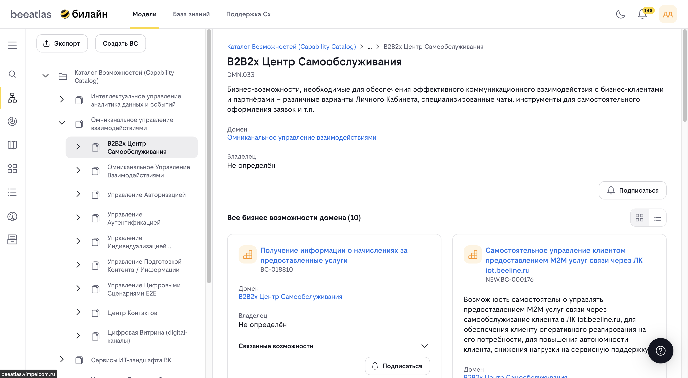

# ФДМ (Функционально-Доменная Модель)

**Назначение**: Функционально-Доменная Модель — это модель бизнес-возможностей ИТ-ландшафта ВК, разработанная для обеспечения простой и удобной навигации в пространстве возможностей по функциональному признаку.

## Обзор

ФДМ объединяет как общие возможности, так и возможности, создаваемые в рамках отдельных продуктовых вертикалей и представляющие особую специфику. ФДМ является артефактом архитектуры бизнес-возможностей и предназначена для организации представления всего многообразия бизнес-возможностей (Business Capability, BC) компании, наряду с теми технологическими возможностями (Technology Capability, TC), которые созданы и представлены различными подразделениями компании.

## Основные возможности

- **Просмотр иерархической структуры** бизнес-возможностей
- **Навигация по дереву** возможностей
- **Просмотр детальной информации** о возможностях
- **Просмотр истории изменения** возможности и сравнение версий
- **Подписка на уведомления** об изменениях возможностей
- **Подача заявки на создание или изменение бизнес-возможности**
- **Удаление TC и BC** (для администраторов, только из дерева ФДМ)

## Структура ФДМ

### Иерархия возможностей

ФДМ организована в виде дерева, где:

- **Корневые элементы (Groups)** — основные домены бизнес-возможностей
- **Домены (Domains)** — крупные функциональные области
- **Дочерние элементы** — более детализированные возможности
- Каждая возможность может иметь связанные технические возможности

### Типы возможностей

1. **Бизнес-возможности (Business Capabilities, BC)**
   
   - Представляют бизнес-функции компании
   - Организованы в иерархическую структуру
   - Могут быть доменами или обычными возможностями

2. **Технические возможности (Technology Capabilities, TC)**
   
   - Представляют технические функции
   - Связаны с бизнес-возможностями
   - Реализуют автоматизацию бизнес-процессов

## Интерфейс ФДМ

### Левая панель навигации

Содержит дерево возможностей:

- Развертывание/сворачивание узлов дерева
- Выбор возможности для просмотра
- Отображение иерархии

### Правая панель информации

Отображает детальную информацию о выбранной возможности:

- Название, код и описание
- Домен и владельца
- Связанные технические возможности
- Историю изменения (для ТС и бизнес-возможностей, не являющихся доменами)

Над панелью доступны кнопки **«Подписаться»**/**«Отписаться»**, редактирования (для бизнес-возможностей, не являющихся доменами) и удаления (для администраторов).

### Хлебные крошки

Показывают путь от корня до текущей возможности:

- Клик по элементу хлебных крошек переходит к соответствующей возможности
- Удобная навигация по иерархии

## Как использовать

### Навигация по ФДМ

1. Перейдите в раздел **"Модели"** → **"ФДМ"**
2. Используйте дерево навигации слева для выбора интересующей возможности
3. В правой части экрана отображается детальная информация о выбранной возможности
4. Используйте хлебные крошки для навигации по иерархии

### Просмотр детальной информации

Для технических возможностей и бизнес-возможностей, не являющихся доменами, доступны две вкладки: **«Общая информация»** и **«История изменения»**. У групп и доменов вкладок нет.

#### Вкладка "Общая информация"

- Описание возможности
- Ссылка на домен (если указан)
- Блок **«ТС Реализована в приложении»** с чипом приложения (для ТС)
- **Владелец**
- Переключатель метрик **API**/**CJ** (для ТС)
- Дочерние элементы или связанные технические возможности

#### Блок связанных технических возможностей

Для бизнес-возможности под основной информацией отображается блок **«Связанные технические возможности (N)»**. Переключатель справа позволяет показать элементы сеткой или списком; клик по карточке открывает техническую возможность.

Для домена аналогичный блок называется **«Все дочерние элементы домена»** или **«Все бизнес возможности домена»**.

#### Вкладка "История изменения"

- Таблица версий с колонками **Версия**, **Дата** и **Автор**
- Текущая версия отмечена как **«Текущая (№N)»**, остальные открываются по ссылке
- Флажки у двух версий и кнопка **«Сравнить версии»** для перехода к сравнению

### Работа с техническими возможностями

1. Выберите бизнес-возможность в дереве ФДМ
2. На вкладке **«Общая информация»** найдите блок **«Связанные технические возможности (N)»**
3. При необходимости переключите вид сетка/список
4. Кликните на техническую возможность для просмотра деталей

### Подписка на уведомления

Для получения уведомлений об изменениях возможности:

1. Откройте детальную информацию о возможности
2. Нажмите кнопку **«Подписаться»** в заголовке
3. Для отказа от уведомлений нажмите **«Отписаться»** и подтвердите действие

### История изменения возможности

Для просмотра истории изменения возможности:

1. Перейдите в раздел **"Модели"** → **"ФДМ"**
2. Выберите техническую возможность или бизнес-возможность, не являющуюся доменом
3. Перейдите на вкладку **"История изменения"**
4. Просмотрите версии с указанием номера, даты и автора

### Сравнение версий

1. На вкладке **"История изменения"** отметьте флажками две версии
2. Нажмите **"Сравнить версии"**
3. Откроется страница **«Сравнение версий»** (`/models/fdm/history`) с выделением изменённых полей

## Параметры URL

ФДМ поддерживает параметры URL для прямого перехода к возможности:

- `?id=<id>` — переход к возможности по ID
- `?type=<BUSINESS|TECH>` — тип возможности
- `?v=<version_id>` — просмотр конкретной версии возможности
- `?v=<old>,<new>` — сравнение двух версий на странице `/models/fdm/history`

## Удаление возможностей (только для администраторов)

Удаление TC и BC выполняется **из дерева ФДМ**:

1. Перейдите в раздел **"Модели"** → **"ФДМ"**
2. Выберите возможность в дереве
3. Нажмите кнопку удаления
4. Подтвердите удаление в диалоговом окне

**Ограничения:**
- Удалять могут только пользователи с ролью **администратор**
- **BC** можно удалить только если у него нет дочерних BC или TC
- **TC** удаляются из дерева при выборе соответствующей технической возможности

---

## Создание бизнес-возможности (заявка)

Создание BC выполняется через заявку, которую рассматривает корпоративный архитектор:

1. Перейдите в раздел **"Модели"** → **"ФДМ"**
2. Нажмите **"Создать BC"** в панели слева — откроется форма «Создание бизнес-возможности»
3. Заполните поля:
   
   - **Название*** — формулировка возможности
   - **Определение*** — описание возможности
   - **Родительская возможность** — домен или бизнес-возможность
   - **Владелец возможности** — можно заполнить вручную или нажать **"Назначить себя"**
   - **Комментарий к заявке**
   
4. При необходимости нажмите **"Сгенерировать определение"** — описание сформируется по названию
5. Нажмите **"Отправить заявку"**

Заявка уходит корпоративному архитектору; после отправки отображается сообщение о том, что изменения и статус заявки доступны в разделе «Мои заявки».

При редактировании существующей BC форма открывается с заполненными полями и заголовком «Редактирование бизнес-возможности».

## Навигация

- [Вернуться к разделу "Модели"](../models.md)
- [Поиск возможностей в ФДМ](./search.md)
- [Карта возможностей](./map.md)
- [Каталог приложений](./apps.md)

