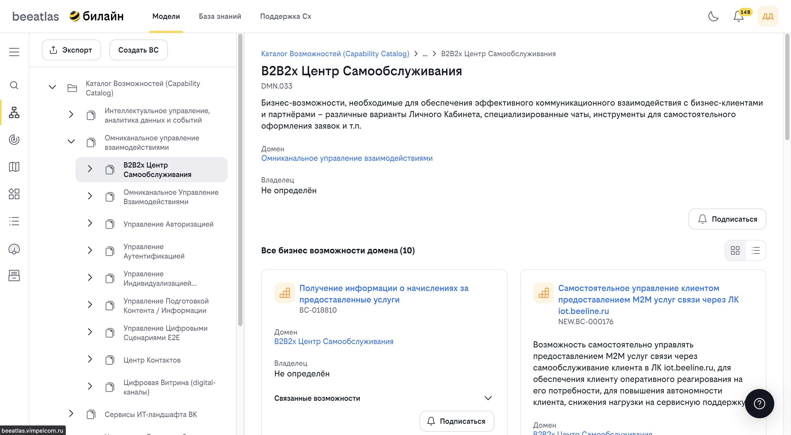

# ФДМ (Функционально-Доменная Модель)

**Назначение**: Функционально-Доменная Модель — это модель бизнес-возможностей ИТ-ландшафта ВК, разработанная для обеспечения простой и удобной навигации в пространстве возможностей по функциональному признаку.

## Обзор

ФДМ объединяет как общие возможности, так и возможности, создаваемые в рамках отдельных продуктовых вертикалей и представляющие особую специфику. ФДМ является артефактом архитектуры бизнес-возможностей и предназначена для организации представления всего многообразия бизнес-возможностей (Business Capability, BC) компании, наряду с теми технологическими возможностями (Technology Capability, TC), которые созданы и представлены различными подразделениями компании.

## Основные возможности

- **Просмотр иерархической структуры** бизнес-возможностей
- **Навигация по дереву** возможностей
- **Просмотр детальной информации** о возможностях
- **Просмотр истории изменений** ФДМ
- **Подписка на уведомления** об изменениях возможностей
- **Добавление новых бизнес-возможностей** (для администраторов)
- **Удаление TC и BC** (для администраторов, только из дерева ФДМ)

## Структура ФДМ

### Иерархия возможностей

ФДМ организована в виде дерева, где:

- **Корневые элементы (Groups)** — основные домены бизнес-возможностей
- **Домены (Domains)** — крупные функциональные области
- **Дочерние элементы** — более детализированные возможности
- Каждая возможность может иметь связанные технические возможности

### Типы возможностей

1. **Бизнес-возможности (Business Capabilities, BC)**
   
   - Представляют бизнес-функции компании
   - Организованы в иерархическую структуру
   - Могут быть доменами или обычными возможностями

2. **Технические возможности (Technology Capabilities, TC)**
   
   - Представляют технические функции
   - Связаны с бизнес-возможностями
   - Реализуют автоматизацию бизнес-процессов

## Интерфейс ФДМ

### Левая панель навигации

Содержит дерево возможностей:

- Развертывание/сворачивание узлов дерева
- Выбор возможности для просмотра
- Отображение иерархии

### Правая панель информации

Отображает детальную информацию о выбранной возможности:

- Общая информация
- Связанные возможности
- Продукты, использующие возможность
- История изменений

### Хлебные крошки

Показывают путь от корня до текущей возможности:

- Клик по элементу хлебных крошек переходит к соответствующей возможности
- Удобная навигация по иерархии

## Как использовать

### Навигация по ФДМ

1. Перейдите в раздел **"Модели"** → **"ФДМ"**
2. Используйте дерево навигации слева для выбора интересующей возможности
3. В правой части экрана отображается детальная информация о выбранной возможности
4. Используйте хлебные крошки для навигации по иерархии

### Просмотр детальной информации

При выборе возможности отображается следующая информация:

#### Вкладка "Общая информация"

- Название и описание
- Тип возможности (Group, Domain, Capability)
- Код возможности
- Классификация
- Версия
- Связанные возможности

#### Вкладка "Продукты"

- Список продуктов, использующих данную возможность
- Информация о продуктах
- Ссылки на детальную информацию о продуктах

#### Вкладка "История"

- История изменений возможности
- Дата и автор изменений
- Описание изменений

### Работа с техническими возможностями

1. Выберите бизнес-возможность
2. Перейдите на вкладку "Технические возможности"
3. Просмотрите список связанных технических возможностей
4. Кликните на техническую возможность для просмотра деталей

### Подписка на уведомления

Для получения уведомлений об изменениях возможности:

1. Откройте детальную информацию о возможности
2. Нажмите кнопку подписки на уведомления
3. Вы будете получать уведомления при изменении этой возможности

### История изменений ФДМ

Для просмотра истории изменений ФДМ:
1. Перейдите в раздел **"Модели"** → **"ФДМ"** → **"История"**
2. Просмотрите список изменений с указанием:
   
   - Дата изменения
   - Автор изменения
   - Тип изменения
   - Описание изменения

### Фильтрация истории

В истории доступны фильтры:

- По дате
- По автору
- По типу изменения
- По возможности

## Параметры URL

ФДМ поддерживает параметры URL для прямого перехода к возможности:

- `?id=<id>` — переход к возможности по ID
- `?v=<version_id>` — просмотр конкретной версии возможности

## Удаление возможностей (только для администраторов)

Удаление TC и BC выполняется **из дерева ФДМ**:

1. Перейдите в раздел **"Модели"** → **"ФДМ"**
2. Выберите возможность в дереве
3. Нажмите кнопку удаления
4. Подтвердите удаление в диалоговом окне

**Ограничения:**
- Удалять могут только пользователи с ролью **администратор**
- **BC** можно удалить только если у него нет дочерних BC или TC
- **TC** удаляются из дерева при выборе соответствующей технической возможности

---

## Добавление новой возможности (только для администраторов)

1. Перейдите в раздел **"Модели"** → **"ФДМ"**
2. Выберите родительскую возможность (если необходимо)
3. Нажмите кнопку добавления новой возможности
4. Заполните форму:
   
   - Название
   - Описание
   - Тип возможности
   - Родительская возможность
   - Дополнительные атрибуты
  
5. Сохраните изменения

## Навигация

- [Вернуться к разделу "Модели"](../models.md)
- [Поиск возможностей в ФДМ](./search.md)
- [Карта возможностей](./map.md)
- [Каталог приложений](./apps.md)

