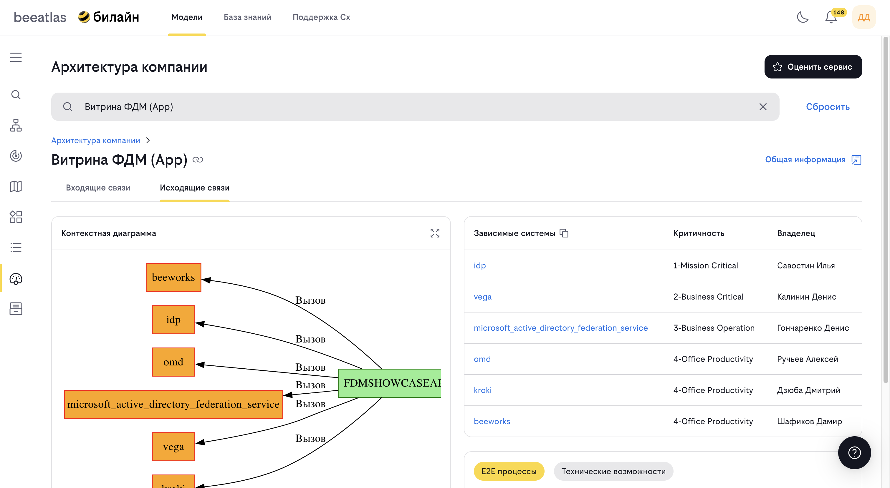

# Архитектура компании

**Назначение**: Инструмент для оценки влияния сбойных элементов (приложений, экземпляров, сервисов, серверов, эндпоинтов) на работу системы.

## Обзор

Раздел "Архитектура компании" предоставляет инструменты для анализа влияния сбоев в архитектуре компании. Он помогает понять, какие элементы критически важны, какие зависимости существуют между элементами, и какое влияние окажет сбой того или иного элемента.

## Основные возможности

- **Визуализация архитектуры** компании
- **Анализ влияния сбоев** на систему
- **Оценка критичности** элементов
- **Поиск зависимостей** между элементами
- **Контекстные диаграммы** — визуализация связей
- **Диаграммы развертывания** — визуализация инфраструктуры
- **Оценка сервисов** — возможность оценить важность сервисов

## Типы элементов

Система анализирует следующие типы элементов:

- **Приложения** — программные приложения
- **Экземпляры** — экземпляры приложений
- **Сервисы** — сервисы и микросервисы
- **Серверы** — серверное оборудование
- **Эндпоинты** — API эндпоинты

## Интерфейс

### Поиск элементов

В начале работы доступен поиск элементов. Поле поиска поддерживает следующие критерии:

- **Имя приложения** — название программной системы
- **Мнемоника приложения CMDB** — идентификатор приложения в CMDB
- **Мнемоника экземпляра CMDB** — идентификатор экземпляра развёртывания
- **Имя сервиса** — название микросервиса или компонента
- **HTTP endpoint** — URL или путь API-эндпоинта (например, `/api/v1/users` или полный URL)
- **Серверы** — IP-адрес, hostname или имя сервера

Поиск работает в реальном времени при вводе текста. Результаты группируются по категориям:

- **Приложение** — приложения (контекстная диаграмма)
- **Сервер** — серверы из графа развёртывания и CMDB

После ввода запроса нажмите Enter или выберите элемент из выпадающего списка для перехода к анализу.

### Вкладки анализа

После выбора элемента доступны следующие вкладки:

#### Вкладка "Входящие зависимости" (IN)

Показывает элементы, которые зависят от выбранного элемента:

- Какие приложения используют этот элемент
- Какие сервисы зависят от него
- Какие процессы будут затронуты при сбое

#### Вкладка "Исходящие зависимости" (OUT)

Показывает элементы, от которых зависит выбранный элемент:

- Какие приложения использует этот элемент
- Какие сервисы ему необходимы
- От каких компонентов он зависит

#### Вкладка "Контекстная диаграмма"

Визуализация связей элемента:

- Граф зависимостей
- Интерактивная диаграмма
- Навигация по связям

#### Вкладка "Диаграмма развертывания"

Визуализация инфраструктуры:

- Расположение элементов на серверах
- Топология развертывания
- Инфраструктурные зависимости

#### Вкладка "E2E процессы"

Сквозные процессы, в которых участвует элемент:

- Список процессов
- Роль элемента в процессе
- Критичность участия

## Как использовать

### Поиск элемента

1. Перейдите в раздел **"Модели"** → **"Архитектура компании"**
2. Введите запрос в поле поиска. Можно искать по:
   - Названию приложения или CMDB мнемонике
   - Имени сервиса
   - **HTTP endpoint** — пути или URL API (например, `/api/orders`, `https://service.example.com/health`)
   - IP-адресу или hostname сервера
3. Результаты отобразятся в выпадающем списке. Выберите категорию (Приложение или Сервер) при необходимости
4. Кликните на нужный элемент или нажмите Enter для перехода к анализу
5. Для просмотра всех результатов нажмите **"Посмотреть все результаты"**

### Анализ входящих зависимостей

1. Выберите элемент для анализа
2. Перейдите на вкладку **"Входящие зависимости"**
3. Изучите список элементов, зависящих от выбранного:

   - Приложения, использующие элемент
   - Сервисы, зависящие от элемента
   - Процессы, которые будут затронуты

4. Используйте таблицы для детального просмотра

### Анализ исходящих зависимостей

1. Выберите элемент для анализа
2. Перейдите на вкладку **"Исходящие зависимости"**
3. Изучите список элементов, от которых зависит выбранный:

   - Приложения, которые использует элемент
   - Сервисы, необходимые элементу
   - Компоненты, от которых зависит элемент

4. Оцените критичность зависимостей

### Просмотр контекстной диаграммы

1. Выберите элемент
2. Перейдите на вкладку **"Контекстная диаграмма"**
3. Изучите визуализацию связей:

   - Центральный элемент — выбранный элемент
   - Связанные элементы вокруг
   - Типы связей

4. Используйте интерактивные элементы для навигации:

   - Клик по элементу для перехода к нему
   - Масштабирование диаграммы
   - Фильтрация типов связей

### Просмотр диаграммы развертывания

1. Выберите элемент
2. Перейдите на вкладку **"Диаграмма развертывания"**
3. Изучите инфраструктурную визуализацию:

   - Расположение на серверах
   - Топология сети
   - Инфраструктурные зависимости

4. Проанализируйте точки отказа

### Оценка сервисов

Для оценки важности сервисов:
1. Выберите сервис для анализа
2. Нажмите кнопку **"Оценить сервис"**
3. Заполните форму оценки:
   
   - Критичность
   - Важность для бизнеса
   - Дополнительные комментарии

4. Сохраните оценку

### Навигация по связям

Из любого элемента можно перейти к связанным:

1. Кликните на связанный элемент в таблице или диаграмме
2. Откроется информация о выбранном элементе
3. Используйте хлебные крошки для навигации назад

## Параметры URL

Раздел поддерживает параметры URL для прямого перехода:

- `?cmdb=<cmdb_mnemonic>` — открытие элемента по CMDB
- `?name=<element_name>` — открытие элемента по названию
- `?id=<element_id>` — открытие элемента по ID
- `?search=<search_query>` — выполнение поиска
- `?searchVariant=<variant>` — тип поиска

## Анализ влияния сбоев

### Оценка критичности

При анализе элемента важно оценить:

- **Количество зависимых элементов** — сколько элементов пострадает
- **Типы зависимостей** — какие типы элементов затронуты
- **Критичность зависимых элементов** — насколько важны затронутые элементы
- **Бизнес-процессы** — какие процессы будут нарушены

### Планирование изменений

Инструмент помогает при планировании:

- **Миграции** — понимание зависимостей перед миграцией
- **Модернизации** — оценка влияния изменений
- **Вывода из эксплуатации** — понимание последствий

### Управление рисками

Анализ помогает в управлении рисками:

- **Выявление критических точек** — элементы с большим количеством зависимостей
- **Планирование резервирования** — понимание необходимости резервирования
- **Оценка последствий** — понимание масштаба влияния сбоев

## Рекомендации по использованию

1. **Начинайте с поиска**: Используйте поиск для быстрого нахождения элементов. Поиск по HTTP endpoint удобен для анализа влияния сбоев конкретного API
2. **Изучайте обе стороны**: Анализируйте как входящие, так и исходящие зависимости
3. **Используйте диаграммы**: Визуализация помогает лучше понять связи
4. **Оценивайте критичность**: Регулярно оценивайте важность элементов
5. **Документируйте изменения**: Отслеживайте изменения в зависимостях

## Примеры использования

### Анализ перед миграцией

Перед миграцией приложения:

1. Найдите приложение в системе
2. Изучите все зависимости
3. Оцените влияние на другие системы
4. Спланируйте миграцию с учетом зависимостей

### Поиск критических точек

Для выявления критических элементов:

1. Используйте поиск для нахождения элементов с большим количеством зависимостей
2. Анализируйте контекстные диаграммы
3. Оцените критичность элементов
4. Примите меры по повышению надежности

## Навигация

- [Вернуться к разделу "Модели"](../models.md)
- [Каталог приложений](./apps.md)
- [E2E сценарии](./e2e.md)
- [ФДМ (Функционально-Доменная Модель)](./fdm.md)

