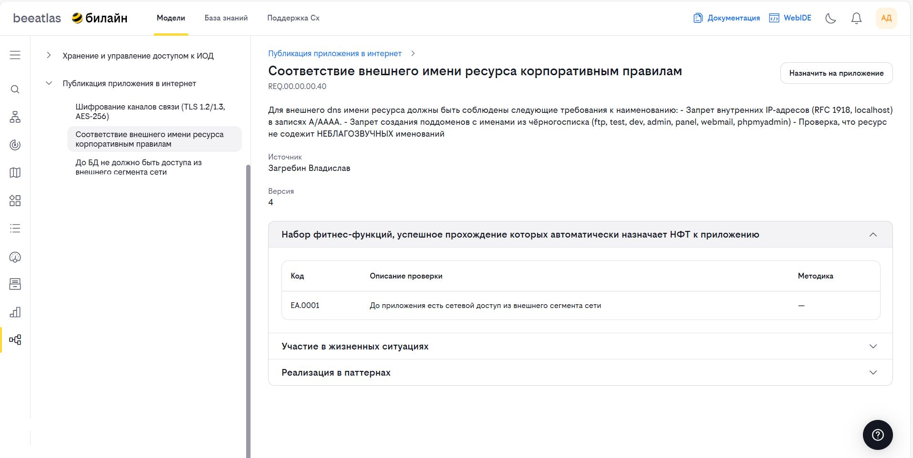

# Жизненные ситуации

**Назначение**: Просмотр, создание и управление жизненными ситуациями и связанными с ними нефункциональными требованиями (НФТ).

## Обзор

Раздел **«Жизненные ситуации»** — это каталог жизненных ситуаций и нефункциональных требований. Модуль позволяет навигировать по жизненным ситуациям, изучать связанные НФТ, фитнес-функции и паттерны, а также назначать НФТ на приложения.

## Основные возможности

- **Просмотр каталога жизненных ситуаций** — навигация по главам с вложенными НФТ
- **Поиск по названию или коду** — быстрый поиск жизненных ситуаций и НФТ
- **Просмотр детальной информации** о жизненной ситуации: описание, связанные НФТ и паттерны
- **Просмотр детальной информации** о НФТ: атрибуты, фитнес-функции, участие в ЖС, реализация в паттернах
- **Переключение вида отображения** — таблица или сетка для НФТ и паттернов
- **Назначение НФТ на приложение** — привязка требования к конкретному приложению
- **Создание и редактирование ЖС** (для администраторов)
- **Создание НФТ и новых версий НФТ** (для администраторов)

## Ключевые понятия

### Жизненная ситуация

Жизненная ситуация — это группирующая сущность, которая объединяет связанные нефункциональные требования по определённой теме или контексту. Каждая глава содержит:

- **Название** — наименование жизненной ситуации
- **Код** — уникальный идентификатор главы
- **Описание** — подробное описание жизненной ситуации
- **Ссылка на документацию** — внешний документ по теме главы
- **Связанные НФТ** — список нефункциональных требований, входящих в главу
- **Связанные паттерны** — паттерны, относящиеся к данной жизненной ситуации

### Нефункциональное требование (НФТ)

Нефункциональное требование — это требование к качеству, производительности, безопасности или другим характеристикам системы. Каждое НФТ содержит:

- **Название** — наименование требования
- **Код** — уникальный идентификатор НФТ
- **Версия** — номер версии требования
- **Описание** — подробное описание требования
- **Правило** — формулировка правила, которое должно выполняться
- **Источник** — откуда произошло требование
- **Назначение источника** — цель, с которой было введено требование
- **Дата создания** — дата создания текущей версии

Каждое НФТ может быть связано с:

- **Фитнес-функциями** — автоматическими проверками соблюдения требования
- **Жизненными ситуациями** — главами, в которые входит НФТ
- **Паттернами** — архитектурными решениями для реализации требования

## Интерфейс раздела

Интерфейс раздела состоит из двух основных областей: **боковое меню** слева и **основная область контента** справа.

### Боковое меню

Боковое меню содержит:

1. **Поле поиска** — позволяет найти жизненную ситуацию или НФТ по названию или коду. Результаты поиска выпадают под полем ввода в виде списка, разделённого на ЖС и НФТ.

2. **Список жизненных ситуаций** — иерархический список, где каждая ЖС может быть раскрыта для отображения вложенных НФТ.

3. **Кнопки создания** (только для администраторов):
   - **Создать ЖС** — создание новой жизненной ситуации
   - **Создать НФТ** — создание нового нефункционального требования

### Просмотр жизненной ситуации

При выборе главы в боковом меню основная область отображает информацию о жизненной ситуации:

- **Название и код** главы
- **Описание** жизненной ситуации
- **Ссылка на документацию** — переход к внешнему документу
- **Переключатель контента** — выбор между связанными НФТ и паттернами
- **Переключатель вида** — отображение в виде таблицы или сетки
- **Кнопка редактирования** (только для администраторов)

### Просмотр нефункционального требования

При выборе НФТ (вложенного элемента в боковом меню или через поиск) основная область отображает:

- **Хлебные крошки** — навигация: глава → НФТ. Клик по названию главы возвращает к просмотру жизненной ситуации.
- **Основные атрибуты НФТ**: название, код, описание, источник, версию
- **Кнопка «Создать версию»** (только для администраторов) — создание новой версии требования
- **Кнопка «Назначить на приложение»** — привязка НФТ к приложению

#### Раскрывающиеся панели

Под основными атрибутами НФТ расположены раскрывающиеся панели:

| Панель | Содержание |
|--------|-----------|
| **Фитнес-функции** | Автоматические проверки соблюдения данного НФТ |
| **Участие в жизненных ситуациях** | Список глав, в которые входит данное НФТ |
| **Реализация в паттернах** | Паттерны, реализующие данное требование |

## Как использовать

### Навигация и поиск

1. Перейдите в раздел **«Модели»** → **«Жизненные ситуации»**
2. В боковом меню просмотрите список доступных глав
3. Для быстрого поиска введите название или код в поле поиска
4. В выпадающем списке результатов кликните на нужный элемент:
   - При выборе ЖС — откроется информация о главе
   - При выборе НФТ — откроется информация о требовании

### Просмотр жизненной ситуации

1. Кликните на название главы в боковом меню
2. В основной области отобразится информация о главе: название, код, описание, ссылка на документацию
3. Для просмотра связанных НФТ убедитесь, что переключатель контента установлен в положение **«НФТ»**
4. Для просмотра связанных паттернов переключите контент на **«Паттерны»**
5. Переключайте вид отображения между **таблицей** и **сеткой** с помощью переключателя вида

### Просмотр нефункционального требования

1. Раскройте нужную главу в боковом меню, кликнув по стрелке рядом с названием
2. Кликните на название НФТ в раскрывшемся списке
3. В основной области отобразится информация о требовании
4. Используйте хлебные крошки для возврата к родительской главе
5. Раскройте панели **«Фитнес-функции»**, **«Участие в жизненных ситуациях»** или **«Реализация в паттернах»** для получения дополнительной информации

### Назначение НФТ на приложение

1. Откройте НФТ для просмотра
2. Нажмите кнопку **«Назначить на приложение»**
3. В открывшемся боковом окне выберите приложение из списка доступных
4. Подтвердите назначение

## Примеры использования и типовые сценарии

### Сценарий: Проверка соответствия приложения требованиям

**Задача**: Пользователь хочет убедиться, что приложение соответствует нефункциональным требованиям из определённой жизненной ситуации.

1. Откройте нужную жизненную ситуацию
2. Переключитесь на просмотр связанных **НФТ**
3. Изучите список требований и их правила
4. Для каждого требования раскройте панель **«Фитнес-функции»**, чтобы узнать, какие проверки выполняются автоматически
5. При необходимости назначьте НФТ на ваше приложение с помощью кнопки **«Назначить на приложение»**

### Сценарий: Поиск паттернов для решения архитектурной задачи

**Задача**: Пользователь ищет проверенные архитектурные решения для конкретной жизненной ситуации.

1. Откройте нужную жизненную ситуацию
2. Переключитесь на просмотр связанных **паттернов**
3. Изучите доступные паттерны в виде таблицы или сетки
4. Кликните на паттерн для перехода к детальной информации в каталоге паттернов

## Навигация

- [Вернуться к разделу «Модели»](../models.md)
- [Каталог паттернов](./patterns.md)
- [Каталог приложений](./apps.md)