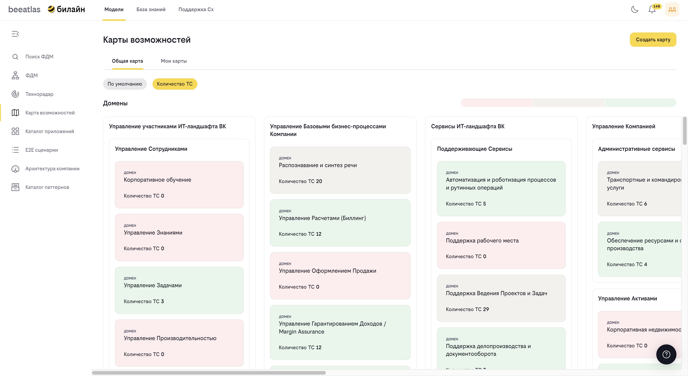

# Карта возможностей

**Назначение**: Инструмент, который позволяет анализировать и контролировать состояние возможностей в рамках функционально-доменной модели.

## Обзор

Карта возможностей предоставляет визуальное представление состояния возможностей в ФДМ. Она помогает анализировать зрелость, использование и другие характеристики возможностей, что делает её полезным инструментом для планирования и управления архитектурой.

## Основные возможности

- **Визуализация возможностей** на карте с цветовой индикацией по выбранному критерию
- **Анализ состояния возможностей** по различным критериям
- **Просмотр иерархии** возможностей
- **Создание персональных карт**
- **Библиотека карт** с возможностью открыть, отредактировать, скопировать ссылку или удалить карту

## Типы карт

### Карта по умолчанию

Стандартная карта, отображающая все возможности ФДМ без цветовой индикации.

### Мои карты

Настраиваемые карты, созданные пользователями:

- Тип карты определяет, какие объекты доступны для размещения: бизнес-возможности или технические возможности
- Состав карты формируется в конструкторе
- Сохранение и повторное использование
- Редактирование, копирование ссылки и удаление из библиотеки

## Интерфейс карты

### Вкладки

1. **Общая карта**
   - Стандартная карта возможностей
   - Все возможности ФДМ

2. **Мои карты**
   - Библиотека созданных карт
   - Управление персональными картами

### Заголовок и хлебные крошки

При переходе вглубь над картой отображаются хлебные крошки с путем до текущего элемента. Заголовок показывает название карты или выбранной возможности; для персональной карты доступна кнопка копирования ссылки.

Кнопка **«Создать карту»** отображается в заголовке на обеих вкладках, пока не открыта конкретная возможность.

### Описание

Описание возможности отображается под заголовком. Если текст длинный, доступна кнопка **«Показать полностью»**, повторное нажатие сворачивает описание.

### Критерии и легенда

Под описанием расположены чипы критериев: **«По умолчанию»** и критерии, доступные для текущего типа карты.

- При выборе критерия карточки окрашиваются по его шкале
- Под чипами появляется динамическая легенда — цветовой градиент, построенный по выбранному критерию, с подписями минимального и максимального значений
- В режиме **«По умолчанию»** цветовая индикация и легенда не отображаются

### Карточки возможностей

Возможности представлены сеткой карточек:

- Карточка содержит тип элемента (домен, бизнес-возможность или техническая возможность), название, значение выбранного критерия и комментарий
- Клик по карточке открывает дочерние элементы или детальную информацию
- Домены могут отображаться группами с вложенными карточками

## Как использовать

### Просмотр общей карты

1. Перейдите в раздел **"Модели"** → **"Карта возможностей"**
2. Откройте вкладку **"Общая карта"**
3. При необходимости выберите критерий оценки в чипах под описанием
4. Кликните на карточку возможности для перехода к дочерним элементам
5. Используйте хлебные крошки для возврата к родительским элементам

### Навигация по карте

- **Выбор возможности**: Кликните на карточку возможности
- **Переход к дочерним**: Кликните на карточку домена или бизнес-возможности
- **Хлебные крошки**: Для возврата к родительским элементам
- **Критерии**: Для изменения цветовой индикации карточек и легенды

### Понимание цветовой индикации

В режиме **«По умолчанию»** карточки не окрашиваются. После выбора критерия цвет карточки определяется значением критерия для возможности, а легенда показывает минимальное и максимальное значения шкалы. Цветовая шкала задаётся выбранным критерием, поэтому фиксированных значений «зелёный/жёлтый/красный» нет.

### Создание карты

1. Перейдите в раздел **"Модели"** → **"Карта возможностей"**
2. Нажмите кнопку **"Создать карту"** в заголовке
3. В боковой панели выберите тип карты радиокнопками
4. Укажите **«Название карты*»**
5. При необходимости заполните **«Описание»**
6. Нажмите **"Создать"** — откроется конструктор `/models/map/add?id=<id>`

Критерии оценки и цветовая схема в форме создания не настраиваются — критерий выбирается уже на карте.

### Наполнение карты в конструкторе

1. Найдите возможность в панели слева — по названию или коду
2. Перетащите возможность на рабочую область
3. При необходимости нажмите **"Добавить группу"** и перетащите возможности в группу
4. Нажмите **"Сохранить"** — карта появится в библиотеке **«Мои карты»**

### Редактирование персональной карты

1. Найдите нужную карту в библиотеке
2. Откройте меню карты и выберите **"Редактировать"**
3. Внесите необходимые изменения в конструкторе и нажмите **"Сохранить"**

### Удаление персональной карты

1. Найдите нужную карту в библиотеке
2. Откройте меню карты
3. Выберите **"Удалить"**
4. Подтвердите удаление

### Просмотр персональной карты

1. Перейдите на вкладку **"Мои карты"**
2. Выберите нужную карту из списка
3. Карта откроется с сохранённым составом возможностей

### Публикация карты

Для предоставления доступа к карте другим пользователям:

1. Откройте карту
2. Скопируйте ссылку на карту
3. Поделитесь ссылкой с другими пользователями

## Критерии оценки

Набор критериев зависит от типа карты и загружается из API. Выбранный критерий определяет цвет карточек и легенду; значение критерия и комментарий отображаются на карточке возможности.

## Работа с карточками возможностей

### Просмотр карточки

Каждая возможность представлена карточкой, содержащей:

- Тип элемента
- Название возможности
- Значение выбранного критерия и комментарий к нему

### Детальная информация

При клике на карточку открываются дочерние возможности или детальная информация о выбранной возможности. Для перехода к полному описанию в ФДМ используйте ссылку **«в древе ФДМ»** под описанием.

## Навигация

- [Вернуться к разделу "Модели"](../models.md)
- [ФДМ (Функционально-Доменная Модель)](./fdm.md)
- [Поиск возможностей в ФДМ](./search.md)
