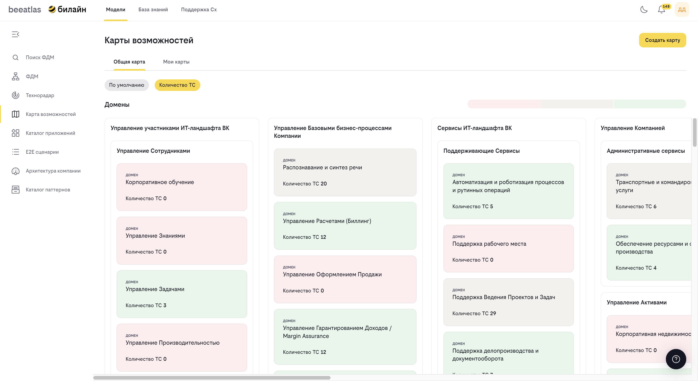

# Карта возможностей

**Назначение**: Инструмент, который позволяет анализировать и контролировать состояние возможностей в рамках функционально-доменной модели.

## Обзор

Карта возможностей предоставляет визуальное представление состояния возможностей в ФДМ. Она помогает анализировать зрелость, использование и другие характеристики возможностей, что делает её полезным инструментом для планирования и управления архитектурой.

## Основные возможности

- **Визуализация возможностей** на карте с цветовой индикацией
- **Анализ состояния возможностей** по различным критериям
- **Фильтрация и поиск** возможностей
- **Создание персональных карт** с настраиваемыми критериями
- **Просмотр иерархии** возможностей
- **Экспорт данных** карты

## Типы карт

### Карта по умолчанию

Стандартная карта, отображающая все возможности ФДМ с базовыми критериями оценки.

### Персональные карты

Настраиваемые карты, созданные пользователями:
- Выбор критериев оценки
- Настройка цветовой схемы
- Фильтрация отображаемых возможностей
- Сохранение и повторное использование

## Интерфейс карты

### Вкладки

1. **Общая карта**
   - Стандартная карта возможностей
   - Все возможности ФДМ
   - Базовые критерии оценки

2. **Персональные карты**
   - Библиотека созданных карт
   - Управление персональными картами
   - Создание новых карт

### Левая панель навигации

Содержит дерево возможностей:
- Иерархическая структура
- Выбор возможности для просмотра
- Навигация по уровням

### Центральная область

Отображает карту возможностей:
- Визуальное представление возможностей
- Цветовая индикация состояния
- Интерактивные элементы

### Правая панель

Отображает детальную информацию:
- Информация о выбранной возможности
- Критерии оценки
- Связанные возможности

### Легенда

Объясняет цветовую схему:
- Значение каждого цвета
- Критерии оценки
- Диапазоны значений

## Как использовать

### Просмотр общей карты

1. Перейдите в раздел **"Модели"** → **"Карта возможностей"**
2. Изучите визуализацию возможностей
3. Используйте дерево навигации для выбора интересующей возможности
4. Изучите цветовую индикацию состояния

### Навигация по карте

- **Выбор возможности**: Кликните на карточку возможности
- **Переход к дочерним**: Используйте дерево навигации
- **Хлебные крошки**: Для возврата к родительским элементам
- **Фильтры**: Для уточнения отображаемых данных

### Понимание цветовой индикации

Цвета на карте указывают на состояние возможности:
- **Зеленый**: Хорошее состояние, зрелая возможность
- **Желтый**: Среднее состояние, требует внимания
- **Красный**: Плохое состояние, требует действий
- **Серый**: Нет данных или не применимо

### Создание персональной карты

1. Перейдите на вкладку **"Персональные карты"**
2. Нажмите кнопку **"Создать карту"**
3. Заполните форму:
   - Название карты
   - Описание
   - Выбор критериев оценки
   - Настройка цветовой схемы
   - Выбор отображаемых возможностей
4. Сохраните карту

### Редактирование персональной карты

1. Найдите нужную карту в библиотеке
2. Нажмите кнопку **"Редактировать"**
3. Внесите необходимые изменения
4. Сохраните изменения

### Удаление персональной карты

1. Найдите нужную карту в библиотеке
2. Откройте меню карты
3. Выберите **"Удалить"**
4. Подтвердите удаление

### Просмотр персональной карты

1. Перейдите на вкладку **"Персональные карты"**
2. Выберите нужную карту из списка
3. Карта откроется с примененными настройками

### Публикация карты

Для предоставления доступа к карте другим пользователям:
1. Откройте карту
2. Скопируйте ссылку на карту
3. Поделитесь ссылкой с другими пользователями

## Критерии оценки

Карта может отображать различные критерии оценки возможностей:

### Зрелость
- Уровень развития возможности
- Готовность к использованию
- Стабильность реализации

### Использование
- Частота использования
- Количество пользователей
- Популярность

### Критичность
- Важность для бизнеса
- Влияние на процессы
- Зависимости

### Состояние
- Текущий статус
- Активность разработки
- Планы на будущее

## Работа с карточками возможностей

### Просмотр карточки

Каждая возможность представлена карточкой, содержащей:
- Название возможности
- Цветовую индикацию состояния
- Краткую информацию
- Ссылку на детальную информацию

### Детальная информация

При клике на карточку отображается:
- Полная информация о возможности
- Значения критериев оценки
- Связанные возможности
- История изменений

## Фильтрация и поиск

### Фильтры

Доступны следующие фильтры:
- По типу возможности (бизнес/техническая)
- По статусу
- По критериям оценки
- По иерархии

### Поиск

1. Используйте поле поиска
2. Введите название или часть названия
3. Результаты фильтруются в реальном времени

## Экспорт данных

Для экспорта данных карты:
1. Нажмите кнопку "Экспорт"
2. Выберите формат экспорта
3. Скачайте файл с данными

## Навигация

- [Вернуться к разделу "Модели"](../models.md)
- [ФДМ (Функционально-Доменная Модель)](./fdm.md)
- [Поиск возможностей в ФДМ](./search.md)

