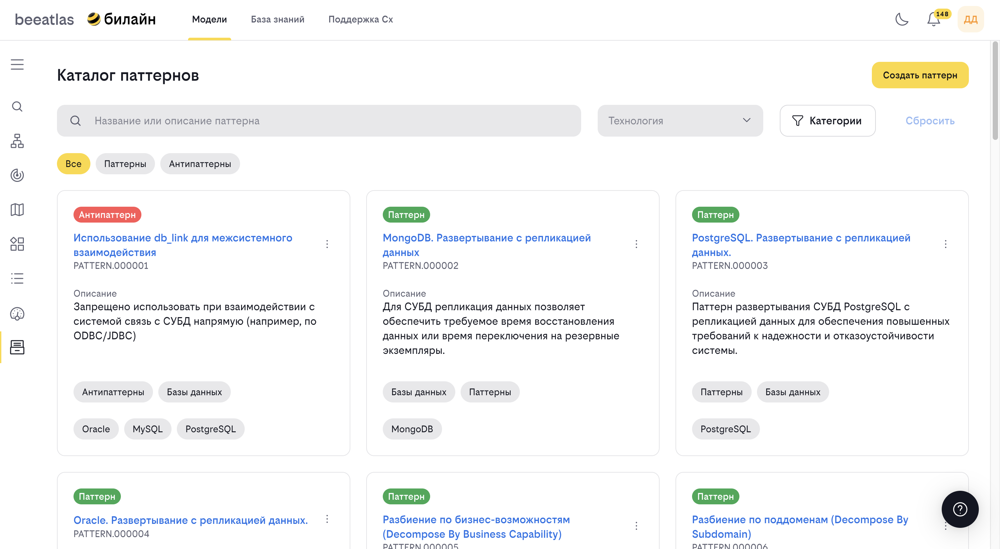
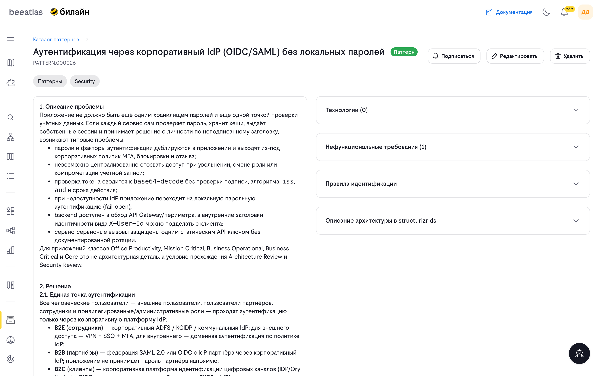

# Каталог паттернов

**Назначение**: Паттерны содержат эффективные решения типовых задач разработки, а раздел антипаттернов помогает избежать типичных ошибок при создании качественных продуктов.

## Обзор

Каталог паттернов — это коллекция проверенных решений типовых задач разработки и типичных ошибок, которых следует избегать. Паттерны помогают разработчикам принимать правильные архитектурные решения, а антипаттерны предупреждают о распространенных ошибках.

## Основные возможности

- **Просмотр каталога паттернов и антипаттернов**
- **Поиск и фильтрация** паттернов
- **Просмотр детальной информации** о паттерне
- **Фильтрация по технологиям** — паттерны для конкретных технологий
- **Фильтрация по группам** — паттерны по категориям
- **Добавление новых паттернов** (для администраторов)
- **Удаление паттернов** (для администраторов)

## Типы паттернов

### Паттерны

Паттерны — это проверенные решения типовых задач разработки:

- **Архитектурные паттерны** — решения на уровне архитектуры
- **Паттерны проектирования** — решения на уровне проектирования
- **Паттерны реализации** — решения на уровне кода
- **Паттерны интеграции** — решения для интеграций

### Антипаттерны

Антипаттерны — это типичные ошибки, которых следует избегать:

- **Архитектурные антипаттерны** — ошибки в архитектуре
- **Антипаттерны проектирования** — ошибки в проектировании
- **Антипаттерны реализации** — ошибки в коде
- **Антипаттерны процессов** — ошибки в процессах разработки

## Интерфейс каталога

### Фильтры

Доступны следующие фильтры:

- **Все** — показать все паттерны
- **Паттерны** — только паттерны
- **Антипаттерны** — только антипаттерны
- **По технологиям** — фильтрация по связанным технологиям
- **По группам** — фильтрация по категориям

### Поиск

Поле поиска с плейсхолдером **«Название или описание паттерна»** позволяет найти паттерн по:

- Названию
- Описанию

Ключевые слова и связанные технологии в поиске не участвуют — для отбора по технологии используйте фильтр **«Технология»**.

### Карточки паттернов

Каждый паттерн представлен карточкой, содержащей:

- Название паттерна
- Тип (паттерн/антипаттерн)
- Краткое описание
- Связанные технологии
- Ссылку на детальную информацию

## Как использовать

### Просмотр каталога

1. Перейдите в раздел **"Модели"** → **"Каталог паттернов"**
2. Просмотрите список всех паттернов
3. Используйте фильтры для уточнения списка
4. Используйте поиск для нахождения конкретного паттерна

### Фильтрация паттернов

#### Фильтрация по типу

1. Выберите фильтр в верхней части страницы:
   
   - **Все** — показать все паттерны
   - **Паттерны** — только паттерны
   - **Антипаттерны** — только антипаттерны

#### Фильтрация по технологиям

1. Выберите технологии в фильтре **«Технология»** в верхней части страницы
2. Список паттернов обновится автоматически
3. Паттерны будут отфильтрованы по выбранным технологиям

#### Фильтрация по группам

1. Нажмите кнопку **«Категории»**
2. Выберите интересующие группы (категории) в боковой панели
3. Список паттернов обновится
4. Паттерны будут отфильтрованы по выбранным группам

### Поиск паттернов

1. Введите поисковый запрос в поле поиска
2. Результаты фильтруются в реальном времени
3. Кликните на паттерн для просмотра деталей

### Просмотр детальной информации

При открытии паттерна отображается:

- **Название, тип и код** — название, метка «Паттерн» или «Антипаттерн» и уникальный код
- **Категории** — чипы групп, к которым относится паттерн
- **Документация** — загруженный Markdown-файл с описанием решения, проблемой, примерами и рекомендациями (если файл не загружен, выводится «Паттерн/антипаттерн еще не описан»)
- **Раскрывающиеся блоки справа**:
    - **Технологии (N)** — связанные технологии из Технорадара с указанием кольца и допустимости КИ
    - **Нефункциональные требования (N)** — НФТ, которые реализует паттерн; ссылка ведёт в каталог жизненных ситуаций
    - **Правила идентификации** (для администраторов) — Cypher-запрос для автоматической проверки паттерна на архитектуре приложения
    - **Описание архитектуры в structurizr dsl** — DSL-описание архитектурного решения
- **Кнопки** — «Подписаться»/«Отписаться», «Редактировать» и «Удалить» (для администраторов)

### Сброс фильтров

Для сброса всех фильтров:

1. Нажмите кнопку **"Сбросить"** в панели фильтров
2. Поиск, тип, технологии и категории будут сброшены

## Добавление паттерна (только для администраторов)

1. Перейдите в раздел **"Модели"** → **"Каталог паттернов"**
2. Нажмите кнопку **"Создать паттерн"**
3. Заполните форму:
   
   - **Название** — название паттерна
   - **Тип** — паттерн или антипаттерн
   - **Описание** — полное описание
   - **Проблема** — описание проблемы
   - **Решение** — описание решения
   - **Примеры** — примеры использования
   - **Технологии** — связанные технологии
   - **Группы** — категории паттерна
  
4. Сохраните паттерн

### Редактирование паттерна

1. Откройте детальную информацию о паттерне
2. Нажмите кнопку **"Редактировать"** (если доступна)
3. Внесите необходимые изменения
4. Сохраните изменения

### Удаление паттерна

1. Откройте детальную информацию о паттерне
2. Нажмите кнопку **"Удалить"** (если доступна)
3. Подтвердите удаление

## Рекомендации по использованию

1. **Изучайте паттерны перед проектированием**: Знание паттернов поможет принять правильные решения
2. **Избегайте антипаттернов**: Изучение антипаттернов поможет избежать типичных ошибок
3. **Используйте фильтры**: Фильтры помогут найти паттерны для конкретных технологий
4. **Читайте примеры**: Примеры использования помогают понять применение паттерна
5. **Следите за обновлениями**: Каталог регулярно пополняется новыми паттернами

## Примеры использования

### Поиск паттерна для конкретной технологии

1. Откройте каталог паттернов
2. Используйте фильтр по технологиям
3. Выберите интересующую технологию
4. Просмотрите список паттернов для этой технологии

### Изучение антипаттернов

1. Откройте каталог паттернов
2. Выберите фильтр **"Антипаттерны"**
3. Просмотрите список антипаттернов
4. Изучите описания, чтобы понять, каких ошибок следует избегать

### Применение паттерна

1. Найдите подходящий паттерн в каталоге
2. Изучите описание и примеры
3. Адаптируйте паттерн под вашу задачу
4. Примените паттерн в проекте

## Пример паттерна: PATTERN.000026

Откроем реальный паттерн из каталога — **PATTERN.000026**.

| Поле | Значение в примере |
|---|---|
| **Код** | PATTERN.000026 |
| **Название** | Аутентификация через корпоративный IdP (OIDC/SAML) без локальных паролей |
| **Тип** | Паттерн (не антипаттерн) |
| **Категории** | «Паттерны», «Security» |
| **Технологии** | Не указаны |
| **Нефункциональные требования** | 1 — REQ.00.00.00.11 «Единая аутентификация пользователей через корпоративный IdP» |

**Какое решение описывает паттерн:**

- все человеческие пользователи — сотрудники, пользователи партнёров и администраторы — проходят аутентификацию через корпоративный IdP по OIDC или SAML 2.0; приложение не хранит пароли и не принимает учётные данные напрямую;
- привилегированные роли проходят обязательную MFA, токены короткоживущие (в DSL-примере — до 15 минут) с refresh-механизмом, состояние сессий вынесено во внешнее хранилище;
- сервис-сервисное взаимодействие — mTLS или сервисные токены с документированной ротацией;
- при недоступности IdP применяется отказ в доступе (fail closed), без перехода на локальную парольную аутентификацию.

**Служебные блоки страницы** (видны администраторам):

- **Правила идентификации** — Cypher-запрос к архитектурному графу. Он находит приложение по подстановке `{cmdb}` и проверяет, что у приложения или его дочернего узла (до трёх уровней) есть связь с системой семейства IdP: IdP, Keycloak, ADFS, EAUTH или их дочерним узлом. Если связь найдена, запрос возвращает строку — паттерн считается реализованным; если нет — не реализован.
- **Описание архитектуры в structurizr dsl** — workspace «Корпоративная аутентификация через IdP»: внешние системы IdP и EAUTH, контейнеры API Gateway, Auth Adapter, Backend и Session Store, а также контекстная и контейнерная диаграммы.
- **Нефункциональные требования (1)** — ссылка на [НФТ REQ.00.00.00.11](./life-situations.md#сквозной-пример-нфт-единая-аутентификация-через-корпоративный-idp), для которого этот паттерн является реализацией.

Этот паттерн связан с примером в разделе [«Жизненные ситуации»](./life-situations.md): требование REQ.00.00.00.11 не имеет собственных фитнес-функций, и его выполнение проверяется именно правилом идентификации паттерна PATTERN.000026.

## Навигация

- [Вернуться к разделу "Модели"](../models.md)
- [Технорадар](./tech-radar.md)
- [Каталог приложений](./apps.md)
- [ФДМ (Функционально-Доменная Модель)](./fdm.md)

