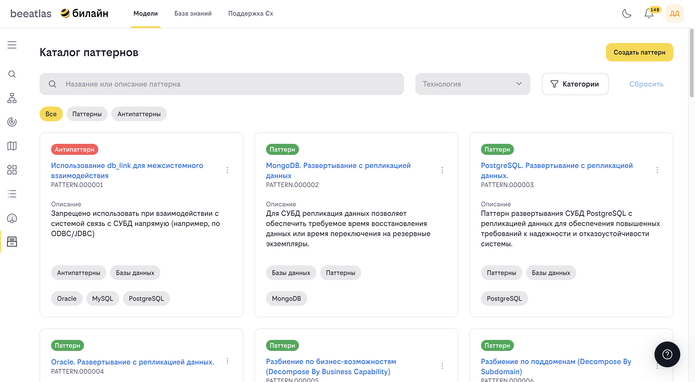

# Каталог паттернов

**Назначение**: Паттерны содержат эффективные решения типовых задач разработки, а раздел антипаттернов помогает избежать типичных ошибок при создании качественных продуктов.

## Обзор

Каталог паттернов — это коллекция проверенных решений типовых задач разработки и типичных ошибок, которых следует избегать. Паттерны помогают разработчикам принимать правильные архитектурные решения, а антипаттерны предупреждают о распространенных ошибках.

## Основные возможности

- **Просмотр каталога паттернов и антипаттернов**
- **Поиск и фильтрация** паттернов
- **Просмотр детальной информации** о паттерне
- **Фильтрация по технологиям** — паттерны для конкретных технологий
- **Фильтрация по группам** — паттерны по категориям
- **Добавление новых паттернов** (для администраторов)
- **Удаление паттернов** (для администраторов)

## Типы паттернов

### Паттерны

Паттерны — это проверенные решения типовых задач разработки:

- **Архитектурные паттерны** — решения на уровне архитектуры
- **Паттерны проектирования** — решения на уровне проектирования
- **Паттерны реализации** — решения на уровне кода
- **Паттерны интеграции** — решения для интеграций

### Антипаттерны

Антипаттерны — это типичные ошибки, которых следует избегать:

- **Архитектурные антипаттерны** — ошибки в архитектуре
- **Антипаттерны проектирования** — ошибки в проектировании
- **Антипаттерны реализации** — ошибки в коде
- **Антипаттерны процессов** — ошибки в процессах разработки

## Интерфейс каталога

### Фильтры

Доступны следующие фильтры:

- **Все** — показать все паттерны
- **Паттерны** — только паттерны
- **Антипаттерны** — только антипаттерны
- **По технологиям** — фильтрация по связанным технологиям
- **По группам** — фильтрация по категориям

### Поиск

Поле поиска позволяет найти паттерн по:

- Названию
- Описанию
- Ключевым словам

### Карточки паттернов

Каждый паттерн представлен карточкой, содержащей:

- Название паттерна
- Тип (паттерн/антипаттерн)
- Краткое описание
- Связанные технологии
- Ссылку на детальную информацию

## Как использовать

### Просмотр каталога

1. Перейдите в раздел **"Модели"** → **"Каталог паттернов"**
2. Просмотрите список всех паттернов
3. Используйте фильтры для уточнения списка
4. Используйте поиск для нахождения конкретного паттерна

### Фильтрация паттернов

#### Фильтрация по типу

1. Выберите фильтр в верхней части страницы:
   
   - **Все** — показать все паттерны
   - **Паттерны** — только паттерны
   - **Антипаттерны** — только антипаттерны

#### Фильтрация по технологиям

1. Откройте панель фильтров
2. Выберите интересующие технологии
3. Список паттернов обновится автоматически
4. Паттерны будут отфильтрованы по выбранным технологиям

#### Фильтрация по группам

1. Откройте панель фильтров
2. Выберите интересующие группы (категории)
3. Список паттернов обновится
4. Паттерны будут отфильтрованы по выбранным группам

### Поиск паттернов

1. Введите поисковый запрос в поле поиска
2. Результаты фильтруются в реальном времени
3. Кликните на паттерн для просмотра деталей

### Просмотр детальной информации

При открытии паттерна отображается:

- **Название и тип** — название паттерна и его тип
- **Описание** — полное описание паттерна
- **Проблема** — какую проблему решает паттерн (для паттернов) или какую проблему создает (для антипаттернов)
- **Решение** — описание решения (для паттернов) или правильного подхода (для антипаттернов)
- **Примеры использования** — примеры применения паттерна
- **Связанные технологии** — технологии, для которых применим паттерн
- **Рекомендации** — рекомендации по использованию

### Сброс фильтров

Для сброса всех фильтров:

1. Откройте панель фильтров
2. Нажмите кнопку **"Сбросить фильтры"**
3. Все фильтры будут сброшены

## Добавление паттерна (только для администраторов)

1. Перейдите в раздел **"Модели"** → **"Каталог паттернов"**
2. Нажмите кнопку **"Создать паттерн"**
3. Заполните форму:
   
   - **Название** — название паттерна
   - **Тип** — паттерн или антипаттерн
   - **Описание** — полное описание
   - **Проблема** — описание проблемы
   - **Решение** — описание решения
   - **Примеры** — примеры использования
   - **Технологии** — связанные технологии
   - **Группы** — категории паттерна
  
4. Сохраните паттерн

### Редактирование паттерна

1. Откройте детальную информацию о паттерне
2. Нажмите кнопку **"Редактировать"** (если доступна)
3. Внесите необходимые изменения
4. Сохраните изменения

### Удаление паттерна

1. Откройте детальную информацию о паттерне
2. Нажмите кнопку **"Удалить"** (если доступна)
3. Подтвердите удаление

## Рекомендации по использованию

1. **Изучайте паттерны перед проектированием**: Знание паттернов поможет принять правильные решения
2. **Избегайте антипаттернов**: Изучение антипаттернов поможет избежать типичных ошибок
3. **Используйте фильтры**: Фильтры помогут найти паттерны для конкретных технологий
4. **Читайте примеры**: Примеры использования помогают понять применение паттерна
5. **Следите за обновлениями**: Каталог регулярно пополняется новыми паттернами

## Примеры использования

### Поиск паттерна для конкретной технологии

1. Откройте каталог паттернов
2. Используйте фильтр по технологиям
3. Выберите интересующую технологию
4. Просмотрите список паттернов для этой технологии

### Изучение антипаттернов

1. Откройте каталог паттернов
2. Выберите фильтр **"Антипаттерны"**
3. Просмотрите список антипаттернов
4. Изучите описания, чтобы понять, каких ошибок следует избегать

### Применение паттерна

1. Найдите подходящий паттерн в каталоге
2. Изучите описание и примеры
3. Адаптируйте паттерн под вашу задачу
4. Примените паттерн в проекте

## Навигация

- [Вернуться к разделу "Модели"](../models.md)
- [Технорадар](./tech-radar.md)
- [Каталог приложений](./apps.md)
- [ФДМ (Функционально-Доменная Модель)](./fdm.md)

