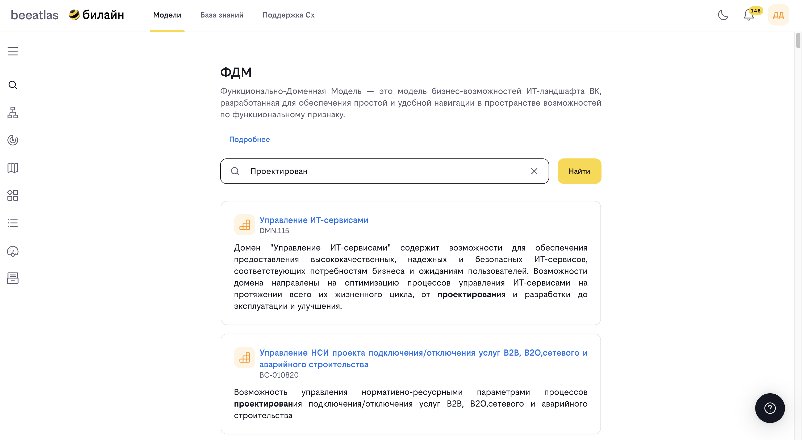

# Поиск возможностей в ФДМ

**Назначение**: Полнотекстовый поиск бизнес и технических возможностей на ландшафте компании.

## Обзор

Раздел "Поиск возможностей в ФДМ" позволяет быстро находить нужные возможности в функционально-доменной модели компании. Поиск работает по названию и описанию возможностей, что делает его удобным инструментом для навигации по большому объему данных.

## Основные возможности

- **Полнотекстовый поиск** по названию и описанию возможностей
- **Фильтрация результатов** для уточнения поиска
- **Просмотр детальной информации** о найденных возможностях
- **Навигация к связанным сущностям** из результатов поиска
- **Сохранение истории поиска** для быстрого доступа к предыдущим запросам

## Как использовать

### Базовый поиск

1. Перейдите в раздел **"Модели"** → **"Поиск возможностей в ФДМ"**
2. Введите поисковый запрос в поле поиска
3. Нажмите кнопку **"Найти"** или клавишу Enter
4. Просмотрите результаты поиска

### Рекомендации по поиску

- Используйте ключевые слова, связанные с искомой возможностью
- Поиск не чувствителен к регистру
- Можно искать как по названию, так и по описанию
- Максимальная длина запроса — 400 символов

### Просмотр результатов

Результаты поиска отображаются в виде карточек, каждая из которых содержит:

- Название возможности
- Тип возможности (бизнес или техническая)
- Описание (с подсветкой найденных слов)
- Связанные сущности

### Детальная информация

Для просмотра детальной информации о возможности:
1. Кликните на карточку результата
2. Откроется страница с полной информацией о возможности
3. Вы сможете увидеть:

   - Полное описание
   - Иерархию в ФДМ
   - Связанные возможности
   - Дополнительные атрибуты

### Обработка больших результатов

Если поиск вернул более 200 результатов:

- Система предложит уточнить запрос
- Используйте более специфичные ключевые слова
- Добавьте дополнительные термины для фильтрации

### Сохранение истории поиска

- Ваши последние поисковые запросы сохраняются
- При повторном открытии страницы последний запрос автоматически восстанавливается
- Запрос также сохраняется в URL для возможности поделиться ссылкой

## Примеры использования

### Поиск бизнес-возможности

**Запрос**: "платежи"  
**Результат**: Все возможности, связанные с платежами (обработка платежей, управление платежами и т.д.)

### Поиск технической возможности

**Запрос**: "API интеграция"  
**Результат**: Технические возможности, связанные с интеграцией через API

### Комбинированный поиск

**Запрос**: "авторизация пользователей"  
**Результат**: Возможности, связанные как с авторизацией, так и с управлением пользователями

## Навигация

- [Вернуться к разделу "Модели"](../models.md)
- [ФДМ (Функционально-Доменная Модель)](./fdm.md)
- [Карта возможностей](./map.md)

