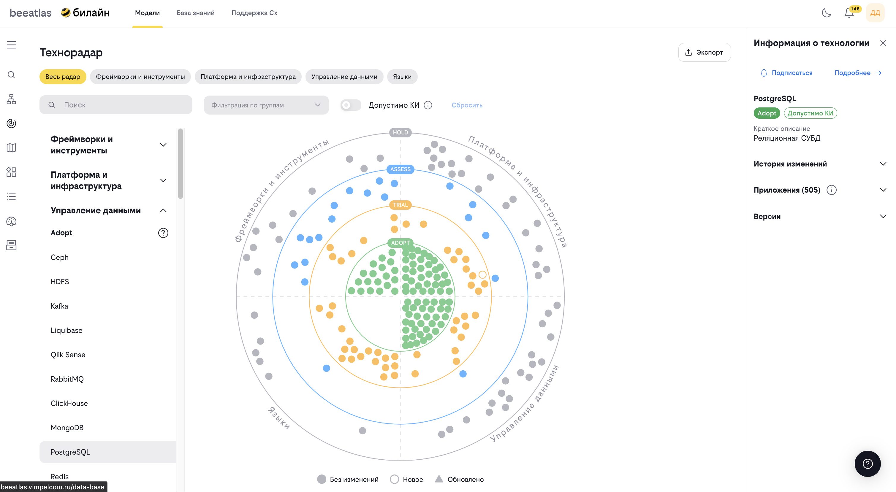

# Технорадар

**Назначение**: Диаграмма, на которой можно увидеть технологии и инструменты, которые используются в компании.

## Обзор

Технорадар — это визуальный инструмент для представления технологий компании. Он помогает понять, какие технологии рекомендуется использовать, какие стоит попробовать, какие нужно оценить, и от каких стоит отказаться.

## Основные возможности

- **Визуализация технологий** на радиальной диаграмме
- **Фильтрация по категориям** технологий
- **Поиск технологий** по названию
- **Просмотр детальной информации** о технологиях
- **Понимание статуса технологий** (Adopt, Trial, Assess, Hold)
- **Экспорт данных** технорадара

## Структура технорадара

### Кольца технорадара

Технорадар разделен на четыре кольца, каждое из которых представляет определенный статус технологии:

1. **Adopt** (Внедрить)
   
   * Технологии, которые рекомендуется использовать
   * Проверенные и стабильные решения, которые имеют поддержку внутри компании
   * Подходят для использования в продакшене 

2. **Trial** (Попробовать)
   
   - Технологии, которые стоит попробовать
   - Могут быть полезны, но требуют дополнительной оценки
   - Подходят для пилотных проектов
   - Использование в продакшене допустимо, только при организации поддержки технологии силами продуктовой команды

3. **Assess** (Оценить)
   
   - Технологии, которые стоит оценить
   - Требуют изучения и анализа
   - Потенциально перспективные решения

4. **Hold** (Удержать/Отказаться)
   
   - Технологии, от которых стоит отказаться
   - Устаревшие или не рекомендуемые решения
   - Следует избегать в новых проектах

### Квадранты

Технорадар также разделен на квадранты по категориям:

- **Языки и фреймворки**
- **Платформы**
- **Инструменты**
- **Техники и практики**

## Интерфейс технорадара

### Радиальная диаграмма

Центральный элемент интерфейса — интерактивная радиальная диаграмма:

- Каждая технология представлена точкой на диаграмме
- Позиция точки определяет кольцо и квадрант
- При наведении курсора отображается информация о технологии

### Левое меню

Содержит список всех технологий:

- Группировка по категориям
- Поиск по названию
- Фильтрация по статусу
- Переход к детальной информации

### Правая панель

Отображает детальную информацию о выбранной технологии:

- Название и описание
- Статус (кольцо)
- Категория (квадрант)
- Версии технологии
- Дополнительная информация

### Фильтры

Доступны следующие фильтры:

- По категории (квадранту)
- По статусу (кольцу)
- По критичности
- Поиск по названию

## Как использовать

### Просмотр технорадара

1. Перейдите в раздел **"Модели"** → **"Технорадар"**
2. Изучите расположение технологий на диаграмме
3. Используйте фильтры для поиска конкретных технологий
4. Кликните на технологию для просмотра детальной информации

### Навигация по диаграмме

- **Приближение**: Кликните на квадрант для увеличения
- **Отдаление**: Используйте кнопку "Сбросить масштаб"
- **Выбор технологии**: Кликните на точку технологии
- **Наведение**: Наведите курсор для быстрого просмотра информации

### Поиск технологии

1. Используйте поле поиска в левом меню
2. Введите название или часть названия технологии
3. Результаты фильтруются в реальном времени
4. Кликните на результат для просмотра деталей

### Фильтрация

1. Выберите категорию в фильтре квадрантов
2. Выберите статус в фильтре колец
3. Включите фильтр критичности при необходимости
4. Результаты обновляются автоматически

### Просмотр детальной информации

При выборе технологии отображается:

- **Общая информация**:

  - Название
  - Описание
  - Статус (кольцо)
  - Категория (квадрант)

- **Версии технологии**:

  - Список версий
  - Информация о каждой версии
  - Рекомендуемые версии

- **Связанные технологии**:

  - Альтернативы
  - Зависимости
  - Совместимые технологии

### Экспорт данных

Для экспорта данных технорадара:

1. Нажмите кнопку "Экспорт"
2. Выберите формат экспорта
3. Скачайте файл с данными

## Параметры URL

Технорадар поддерживает параметры URL для прямого перехода к технологии:
- `?id=<technology_id>` — переход к технологии по ID

## Рекомендации по использованию

1. **Изучайте статусы**: Понимание статуса технологии поможет принять правильное решение
2. **Проверяйте версии**: Убедитесь, что используете актуальные версии технологий
3. **Следите за изменениями**: Технорадар регулярно обновляется
4. **Используйте фильтры**: Фильтры помогут быстро найти нужные технологии
5. **Читайте описания**: Детальная информация поможет понять назначение технологии

## Интерпретация статусов

### Когда использовать Adopt

- Для новых проектов
- Когда нужна стабильность
- Для критически важных систем

### Когда использовать Trial

- Для пилотных проектов
- Когда нужно протестировать новую технологию
- Для некритичных компонентов

### Когда использовать Assess

- При изучении новых технологий
- Для оценки перед внедрением
- При планировании миграции

### Когда избегать Hold

- В новых проектах
- При выборе технологий для долгосрочных решений
- Для критически важных систем

## Навигация

- [Вернуться к разделу "Модели"](../models.md)
- [Каталог приложений](./apps.md)
- [ФДМ (Функционально-Доменная Модель)](./fdm.md)

