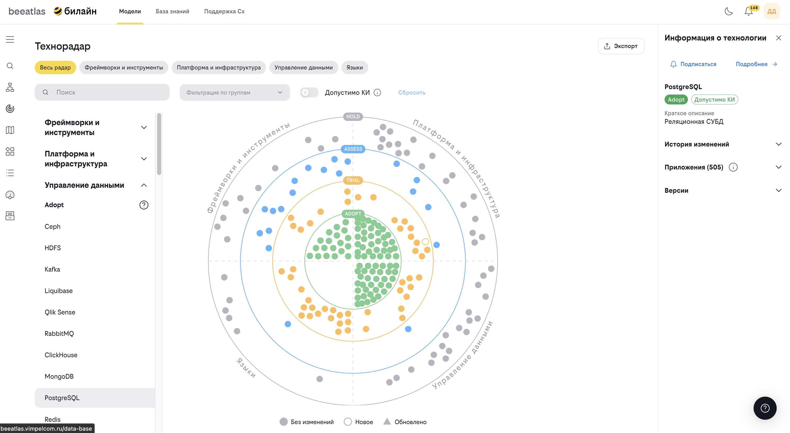

# Технорадар

**Назначение**: Диаграмма, на которой можно увидеть технологии и инструменты, которые используются в компании.

## Обзор

Технорадар — это визуальный инструмент для представления технологий компании. Он помогает понять, какие технологии рекомендуется использовать, какие стоит попробовать, какие нужно оценить, и от каких стоит отказаться.

## Основные возможности

- **Визуализация технологий** на радиальной диаграмме
- **Фильтрация по категориям** технологий
- **Поиск технологий** по названию
- **Просмотр детальной информации** о технологиях
- **Понимание статуса технологий** (Adopt, Trial, Assess, Hold)
- **Экспорт данных** технорадара

## Структура технорадара

### Кольца технорадара

Технорадар разделен на четыре кольца, каждое из которых представляет определенный статус технологии:

1. **Adopt** (Внедрить)
   
   * Технологии, которые рекомендуется использовать
   * Проверенные и стабильные решения, которые имеют поддержку внутри компании
   * Подходят для использования в продакшене 

2. **Trial** (Попробовать)
   
   - Технологии, которые стоит попробовать
   - Могут быть полезны, но требуют дополнительной оценки
   - Подходят для пилотных проектов
   - Использование в продакшене допустимо, только при организации поддержки технологии силами продуктовой команды

3. **Assess** (Оценить)
   
   - Технологии, которые стоит оценить
   - Требуют изучения и анализа
   - Потенциально перспективные решения

4. **Hold** (Удержать/Отказаться)
   
   - Технологии, от которых стоит отказаться
   - Устаревшие или не рекомендуемые решения
   - Следует избегать в новых проектах

### Квадранты

Технорадар также разделен на квадранты по категориям:

- **Фреймворки и инструменты**
- **Платформа и инфраструктура**
- **Управление данными**
- **Языки**

## Интерфейс технорадара

### Радиальная диаграмма

Центральный элемент интерфейса — интерактивная радиальная диаграмма:

- Каждая технология представлена точкой на диаграмме
- Позиция точки определяет кольцо и квадрант
- При наведении курсора отображается информация о технологии

### Левое меню

Содержит список технологий, сгруппированный по квадрантам и кольцам:

- Раскрывающиеся группы **Adopt**, **Trial**, **Assess** и **Hold**
- Подсказки с описанием каждого кольца
- Клик по технологии открывает боковую панель с информацией о ней

### Фильтры и поиск

Над диаграммой расположены:

- **Поиск** — после ввода трёх и более символов появляется список совпадений
- **Фильтрация по группам** — выпадающий список категорий технологий
- **Допустимо КИ** — переключатель технологий, допустимых для критической инфраструктуры
- **Сбросить** — очищает поиск и фильтры

Для фильтрации по кольцу нажмите на название кольца на диаграмме — над диаграммой появится подменю с чипами **Adopt**, **Trial**, **Assess** и **Hold**.

### Боковая панель «Информация о технологии»

При выборе технологии открывается боковая панель:

- Название, статус (кольцо) и признак допустимости КИ
- Краткое описание
- Кнопки **«Подписаться»**/**«Отписаться»** и **«Подробнее»**
- Раскрывающийся блок **«История изменений»**
- Раскрывающийся блок **«Приложения (N)»**
- Раскрывающийся блок **«Версии»**

Кнопка **«Подробнее»** открывает страницу технологии `/models/tech-radar/view?id=…`.

## Как использовать

### Просмотр технорадара

1. Перейдите в раздел **"Модели"** → **"Технорадар"**
2. Изучите расположение технологий на диаграмме
3. Используйте фильтры для поиска конкретных технологий
4. Кликните на технологию для просмотра детальной информации

### Навигация по диаграмме

- **Приближение квадранта**: Выберите квадрант в чипах над диаграммой
- **Возврат ко всему радару**: Выберите чип **«Весь радар»**
- **Фильтрация по кольцу**: Нажмите на название кольца на диаграмме, затем выберите чип **Adopt**, **Trial**, **Assess** или **Hold**
- **Выбор технологии**: Кликните на точку технологии или на её название в левом меню
- **Наведение**: Наведите курсор для быстрого просмотра информации

### Поиск технологии

1. Используйте поле **«Поиск»** над диаграммой
2. Введите не менее трёх символов названия технологии
3. Выберите технологию из выпадающего списка
4. Откроется боковая панель с информацией о технологии

### Фильтрация

1. Выберите категорию в списке **«Фильтрация по группам»**
2. При необходимости включите переключатель **«Допустимо КИ»**
3. Для фильтрации по статусу нажмите на название кольца на диаграмме и выберите чип кольца
4. Для сброса нажмите **«Сбросить»**

### Просмотр детальной информации

При выборе технологии в боковой панели отображается:

- **Общая информация**:

  - Название
  - Статус (кольцо)
  - Допустимость использования в критической инфраструктуре
  - Краткое описание

- **История изменений**:

  - Дата и статус, в который переведена технология

- **Приложения (N)**:

  - Список приложений, использующих технологию

- **Версии**:

  - Список версий технологии

Для полной информации нажмите **«Подробнее»** — откроется страница технологии.

### Экспорт данных

Для экспорта данных технорадара:

1. Нажмите кнопку **«Экспорт»**
2. Выберите **«Реестр КИИ»** или **«Список технологий»**
3. Дождитесь уведомления о готовности файла или скачайте его

## Параметры URL

Технорадар поддерживает параметры URL для прямого перехода к технологии:
- `?id=<technology_id>` — переход к технологии по ID

## Рекомендации по использованию

1. **Изучайте статусы**: Понимание статуса технологии поможет принять правильное решение
2. **Проверяйте версии**: Убедитесь, что используете актуальные версии технологий
3. **Следите за изменениями**: Технорадар регулярно обновляется
4. **Используйте фильтры**: Фильтры помогут быстро найти нужные технологии
5. **Читайте описания**: Детальная информация поможет понять назначение технологии

## Интерпретация статусов

### Когда использовать Adopt

- Для новых проектов
- Когда нужна стабильность
- Для критически важных систем

### Когда использовать Trial

- Для пилотных проектов
- Когда нужно протестировать новую технологию
- Для некритичных компонентов

### Когда использовать Assess

- При изучении новых технологий
- Для оценки перед внедрением
- При планировании миграции

### Когда избегать Hold

- В новых проектах
- При выборе технологий для долгосрочных решений
- Для критически важных систем

## Навигация

- [Вернуться к разделу "Модели"](../models.md)
- [Каталог приложений](./apps.md)
- [ФДМ (Функционально-Доменная Модель)](./fdm.md)

