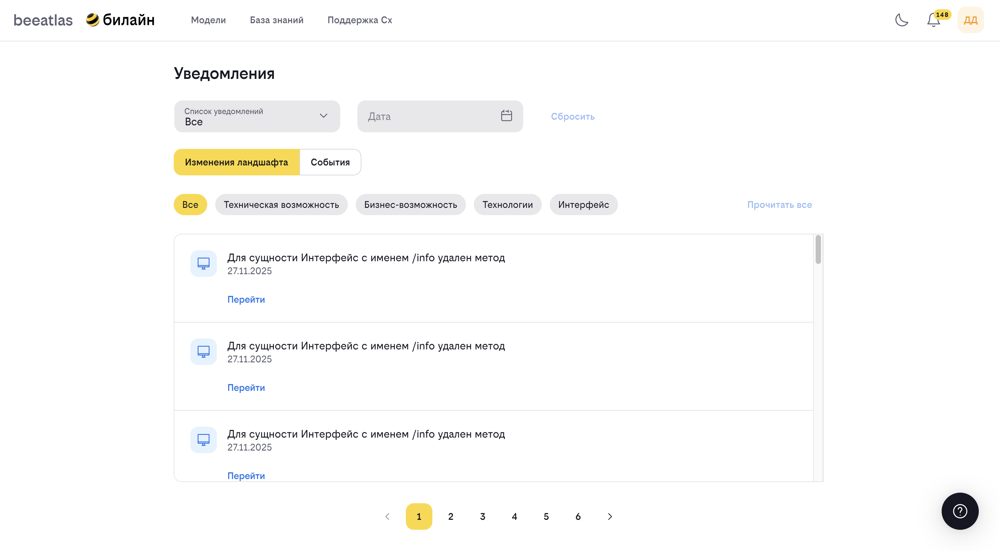

# Раздел "Уведомления"

## Содержание

- [Обзор](#обзор)
- [Просмотр уведомлений](#просмотр-уведомлений)
- [Типы уведомлений](#типы-уведомлений)
- [Управление подписками](#управление-подписками)

---

## Обзор

**Назначение**: Централизованное место для просмотра всех уведомлений об изменениях в системе.

### Что такое уведомления

Уведомления информируют вас об изменениях в сущностях системы, на которые вы подписаны. Это позволяет быть в курсе всех важных изменений без необходимости постоянно проверять различные разделы системы.

### Возможности

- Просмотр всех уведомлений
- Фильтрация уведомлений
- Отметка уведомлений как прочитанных
- Переход к связанным сущностям
- Управление подписками

---

## Просмотр уведомлений

### Как открыть раздел уведомлений

1. Перейдите в раздел "Уведомления" через главное меню
2. Или используйте иконку уведомлений в шапке сайта (если доступна)

### Интерфейс раздела

Раздел уведомлений содержит:

- Список всех уведомлений
- Фильтры для поиска нужных уведомлений
- Индикаторы непрочитанных уведомлений
- Кнопки для управления уведомлениями

### Работа с уведомлениями

#### Просмотр уведомления

1. Найдите интересующее уведомление в списке
2. Кликните на уведомление для просмотра деталей
3. При необходимости перейдите к связанной сущности

#### Отметка как прочитанного

- Уведомления автоматически отмечаются как прочитанные при просмотре
- Или используйте кнопку "Отметить как прочитанное" для массовой отметки

#### Переход к сущности

Большинство уведомлений содержат ссылку на измененную сущность:

1. Кликните на ссылку в уведомлении
2. Вы будете перенаправлены на страницу детального просмотра сущности

---

## Типы уведомлений

Система отправляет уведомления о различных типах изменений:

### Уведомления о приложениях

- Создание нового приложения
- Изменение информации о приложении
- Изменение статуса приложения
- Изменение архитектуры приложения

### Уведомления о технологиях

- Добавление новой технологии
- Изменение информации о технологии
- Добавление новой версии технологии
- Изменение статуса технологии в технорадаре

### Уведомления о возможностях

- Создание новой возможности
- Изменение информации о возможности
- Изменение иерархии возможностей
- Изменение статуса возможности

### Уведомления о паттернах

- Добавление нового паттерна
- Изменение информации о паттерне
- Изменение статуса паттерна

### Уведомления о заявках

- Изменение статуса вашей заявки
- Назначение исполнителя на заявку
- Комментарии к заявке
- Решение по заявке

### Уведомления о CJ и BI

- Создание нового CJ или BI
- Изменение информации о CJ или BI
- Публикация CJ или BI

---

## Управление подписками

Для получения уведомлений необходимо подписаться на соответствующие сущности.

### Подписка на уведомления

Подписка обычно доступна на страницах детального просмотра сущностей:

1. Откройте страницу интересующей сущности
2. Найдите кнопку подписки на уведомления
3. Нажмите кнопку для подписки

### Отписка от уведомлений

Управление подписками доступно в разделе "Профиль" → "Подписки":

1. Перейдите в раздел "Профиль" → "Подписки"
2. Найдите нужную подписку
3. Нажмите кнопку отписки
4. Подтвердите отписку

Подробнее об управлении подписками см. в [документации раздела "Профиль"](./profile.md#подписки).

---

## Настройки уведомлений

### Частота проверки

Система автоматически проверяет наличие новых уведомлений и отображает их в интерфейсе.

### Индикаторы

- **Непрочитанные уведомления** отображаются с индикатором
- **Количество непрочитанных** может отображаться в иконке уведомлений в шапке сайта

