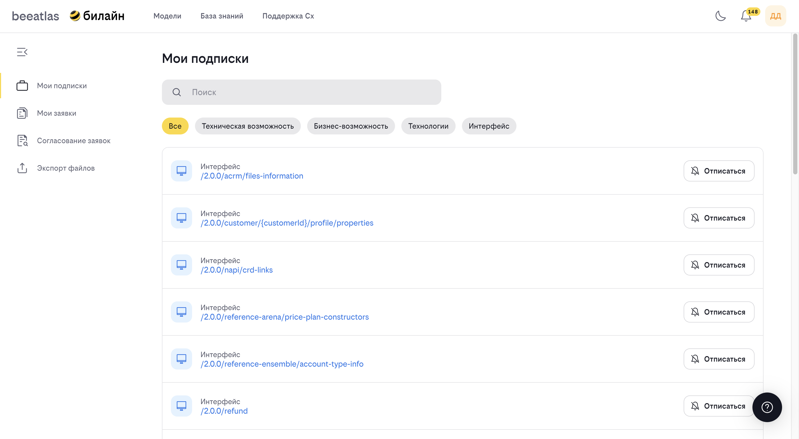

# Раздел "Профиль"

Раздел "Профиль" предназначен для управления личными настройками, заявками, подписками и экспортом данных. Здесь вы можете отслеживать статус своих заявок, управлять подписками на уведомления и экспортировать данные.

## Содержание

- [Мои заявки](#мои-заявки)
- [Рецензирование](#рецензирование)
- [Подписки](#подписки)
- [Экспорт](#экспорт)

---

## Мои заявки

**Назначение**: Управление заявками на создание или изменение сущностей в системе.

### Что такое заявка

Заявка — это запрос на создание или изменение какой-либо сущности в системе (приложение, технология, возможность и т.д.). Обработка заявки происходит в два этапа:

1. Назначение исполнителя (до 3 рабочих дней)
2. Принятие решения по заявке (до 2 рабочих дней после принятия в работу)

### Возможности

- Просмотр всех ваших заявок
- Фильтрация заявок по статусу
- Поиск заявок по названию или номеру
- Просмотр детальной информации о заявке
- Редактирование заявки (если она еще не обработана)
- Сортировка заявок по дате создания

### Статусы заявок

Заявки могут находиться в следующих статусах:

- **Активные** — заявки, которые находятся в процессе обработки
- **Решенные** — заявки, по которым принято решение

### Как использовать

#### Просмотр заявок

1. Перейдите в раздел "Профиль" → "Мои заявки"
2. Используйте вкладки для переключения между активными и решенными заявками
3. Используйте поиск для нахождения конкретной заявки
4. Используйте сортировку для изменения порядка отображения

#### Просмотр детальной информации

1. Кликните на интересующую заявку
2. Изучите детальную информацию:
   
   - Номер заявки
   - Название
   - Описание
   - Статус
   - Дата создания
   - Исполнитель (если назначен)
   - Комментарии

#### Редактирование заявки

1. Откройте детальную информацию о заявке
2. Нажмите кнопку "Редактировать" (доступно только для активных заявок)
3. Внесите необходимые изменения
4. Сохраните изменения

#### Создание новой заявки

Заявки создаются в соответствующих разделах системы:

- Заявки на создание приложений — в разделе "Модели" → "Каталог приложений"
- Заявки на создание технологий — в разделе "Админка" → "Технологии" (для администраторов)
- И т.д.

---

## Рецензирование

**Назначение**: Раздел для рецензирования заявок других пользователей (доступно для пользователей с соответствующими правами).

### Возможности

- Просмотр заявок, требующих рецензирования
- Просмотр детальной информации о заявке
- Редактирование заявки в процессе рецензирования
- Принятие решения по заявке

### Как использовать

1. Перейдите в раздел "Профиль" → "Рецензирование"
2. Просмотрите список заявок, требующих вашего внимания
3. Откройте заявку для просмотра деталей
4. При необходимости отредактируйте заявку
5. Примите решение по заявке

---

## Подписки

**Назначение**: Управление подписками на уведомления об изменениях сущностей в системе.

### Что такое подписка

Подписка позволяет получать уведомления об изменениях конкретных сущностей в системе (приложения, технологии, возможности и т.д.).

### Возможности

- Просмотр всех ваших подписок
- Фильтрация подписок по типу сущности
- Поиск подписок
- Отписка от уведомлений
- Просмотр информации о подписанных сущностях

### Типы подписок

Вы можете подписаться на уведомления о следующих типах сущностей:

- Приложения
- Технологии
- Возможности (бизнес и технические)
- Паттерны
- И другие сущности системы

### Как использовать

#### Просмотр подписок

1. Перейдите в раздел "Профиль" → "Подписки"
2. Используйте фильтры для просмотра подписок определенного типа
3. Используйте поиск для нахождения конкретной подписки

#### Отписка от уведомлений

1. Найдите нужную подписку в списке
2. Нажмите кнопку отписки
3. Подтвердите отписку в диалоговом окне

#### Подписка на уведомления

Подписка на уведомления обычно доступна на страницах детального просмотра сущностей:
1. Откройте страницу интересующей сущности
2. Найдите кнопку подписки на уведомления
3. Нажмите кнопку для подписки

---

## Экспорт

**Назначение**: Экспорт данных из системы в различных форматах.

### Возможности

- Экспорт данных в различных форматах
- Выбор данных для экспорта
- Настройка параметров экспорта

### Форматы экспорта

Система поддерживает экспорт данных в следующих форматах:

- Excel (.xlsx)
- JSON
- CSV
- И другие форматы (в зависимости от типа данных)

### Как использовать

1. Перейдите в раздел "Профиль" → "Экспорт"
2. Выберите тип данных для экспорта
3. Настройте параметры экспорта (если доступно)
4. Нажмите кнопку "Экспорт"
5. Дождитесь завершения экспорта и скачайте файл

### Типы данных для экспорта

Доступны следующие типы данных:

- Список приложений
- Список технологий
- ФДМ (Функционально-Доменная Модель)
- Подписки
- И другие данные

