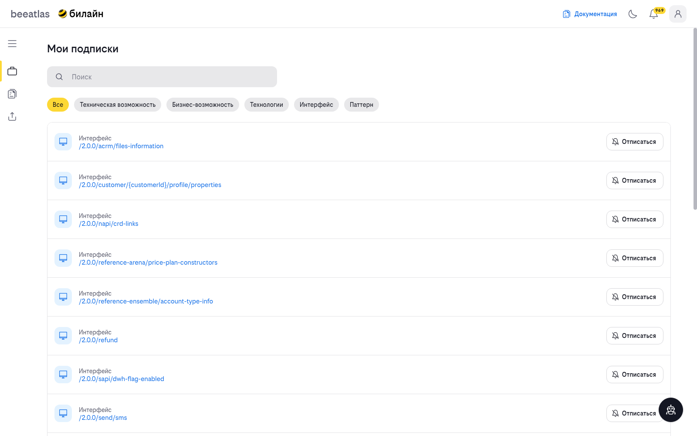

# Раздел "Профиль"

Раздел "Профиль" предназначен для управления личными настройками, заявками, подписками и экспортом данных. Здесь вы можете отслеживать статус своих заявок, управлять подписками на уведомления и экспортировать данные.

## Содержание

- [Мои заявки](#мои-заявки)
- [Согласование заявок](#согласование-заявок)
- [Мои подписки](#мои-подписки)
- [Экспорт файлов](#экспорт-файлов)

---

## Мои заявки

**Назначение**: Управление заявками на создание или изменение сущностей в системе.

### Что такое заявка

Заявка — это запрос на создание или изменение какой-либо сущности в системе (приложение, технология, возможность и т.д.). Обработка заявки происходит в два этапа:

1. Назначение исполнителя (до 3 рабочих дней)
2. Принятие решения по заявке (до 2 рабочих дней после принятия в работу)

### Возможности

- Просмотр всех ваших заявок
- Фильтрация заявок по статусу
- Поиск заявок по названию или номеру
- Просмотр детальной информации о заявке
- Редактирование заявки (если она еще не обработана)
- Сортировка заявок по дате создания

### Статусы заявок

Заявки могут находиться в следующих статусах:

Вкладки списка:

- **Активные** — заявки, которые находятся в процессе обработки
- **Завершенные** — заявки, по которым принято решение

Список выводится по 15 заявок на страницу.

### Как использовать

#### Просмотр заявок

1. Перейдите в раздел "Профиль" → "Мои заявки"
2. Используйте вкладки **«Активные»** и **«Завершенные»** для переключения между заявками
3. Используйте поиск для нахождения конкретной заявки
4. Используйте сортировку для изменения порядка отображения

#### Просмотр детальной информации

1. Кликните на интересующую заявку
2. Изучите детальную информацию:
   
   - Номер заявки
   - Название
   - Описание
   - Статус
   - Дата создания
   - Исполнитель (если назначен)
   - Комментарии

#### Редактирование заявки

1. Откройте детальную информацию о заявке
2. Нажмите кнопку "Редактировать" (доступно только для активных заявок)
3. Внесите необходимые изменения
4. Сохраните изменения

#### Создание новой заявки

Заявки создаются в соответствующих разделах системы:

- Заявки на создание приложений — в разделе "Модели" → "Каталог приложений"
- Заявки на создание технологий — в разделе "Админка" → "Технологии" (для администраторов)
- И т.д.

---

## Согласование заявок

**Назначение**: Раздел для рецензирования заявок других пользователей (доступно для пользователей с правами администратора — в меню профиля пункт появляется только у них).

### Возможности

- Вкладки **«Ожидают исполнителя»**, **«Ожидают решения»** и **«История решений»**
- Просмотр детальной информации о заявке
- Редактирование заявки в процессе рецензирования
- Принятие решения по заявке

### Как использовать

1. Перейдите в раздел "Профиль" → "Согласование заявок"
2. Выберите вкладку: **«Ожидают исполнителя»** — заявки без назначенного исполнителя, **«Ожидают решения»** — заявки на рассмотрении, **«История решений»** — обработанные заявки
3. Откройте заявку для просмотра деталей
4. При необходимости отредактируйте заявку
5. Примите решение по заявке

---

## Мои подписки

**Назначение**: Управление подписками на уведомления об изменениях сущностей в системе.

### Что такое подписка

Подписка позволяет получать уведомления об изменениях конкретных сущностей в системе (возможности, технологии, интерфейсы, паттерны).

### Возможности

- Просмотр всех ваших подписок
- Фильтрация подписок по типу сущности
- Поиск подписок
- Отписка от уведомлений
- Просмотр информации о подписанных сущностях

### Типы подписок

Вы можете подписаться на уведомления о следующих типах сущностей:

- Бизнес-возможности
- Технические возможности
- Технологии
- Интерфейсы
- Паттерны

### Как использовать

#### Просмотр подписок

1. Перейдите в раздел "Профиль" → "Мои подписки"
2. Используйте фильтры для просмотра подписок определенного типа
3. Используйте поиск для нахождения конкретной подписки

#### Отписка от уведомлений

1. Найдите нужную подписку в списке
2. Нажмите кнопку отписки
3. Подтвердите отписку в диалоговом окне

#### Подписка на уведомления

Подписка на уведомления обычно доступна на страницах детального просмотра сущностей:
1. Откройте страницу интересующей сущности
2. Найдите кнопку подписки на уведомления
3. Нажмите кнопку для подписки

---

## Экспорт файлов

**Назначение**: Выгрузка возможностей и технологий в файл.

### Возможности

- Экспорт бизнес-возможностей
- Экспорт технических возможностей
- Экспорт технологий
- Просмотр списка выгруженных файлов, их формата, даты и статуса
- Скачивание готового файла

### Как использовать

1. Перейдите в раздел "Профиль" → "Экспорт файлов"
2. Нажмите кнопку "Экспорт" и выберите, что выгружать: "Бизнес-возможностей", "Технических возможностей" или "Технологий"
3. Файл формируется в фоне — появится уведомление, что файл находится в процессе обработки, а в таблице добавится строка со статусом «В обработке»
4. Дождитесь статуса «Готово» и скачайте файл кнопкой «Скачать» в строке таблицы

Пока файл формируется, кнопка "Экспорт" недоступна — так исключается повторный запуск той же выгрузки.

### Таблица файлов

Список выгруженных файлов содержит столбцы:

- **Название** — имя файла; пока файл формируется, показывается «Документ» с индикатором загрузки;
- **Формат** — расширение файла;
- **Дата** — дата создания выгрузки;
- **Статус** — «В обработке» или «Готово»;
- **Скачать** — иконка скачивания, доступна только для готового файла.

