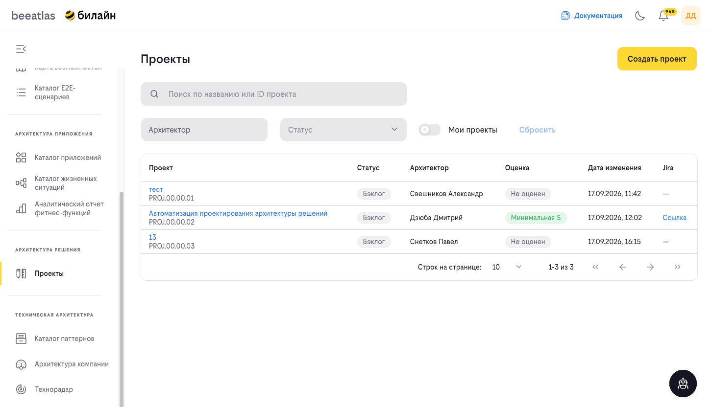
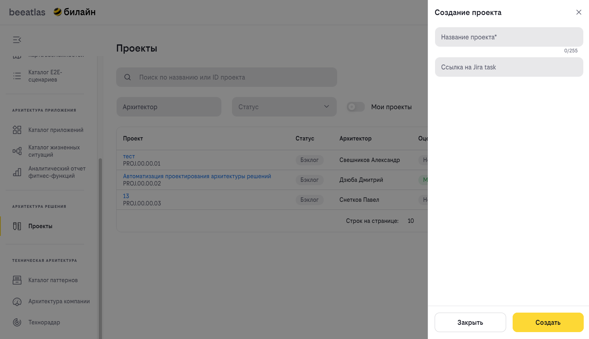
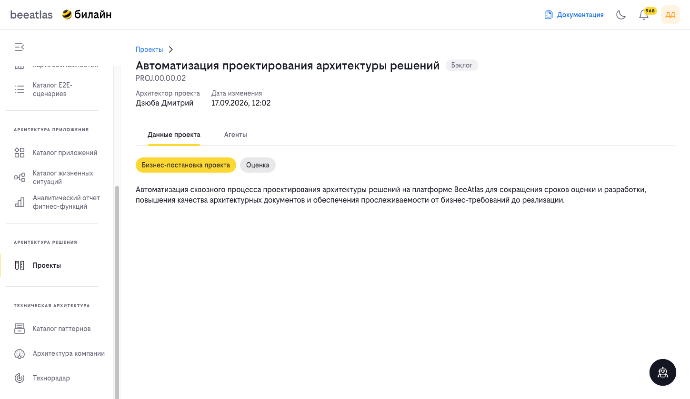
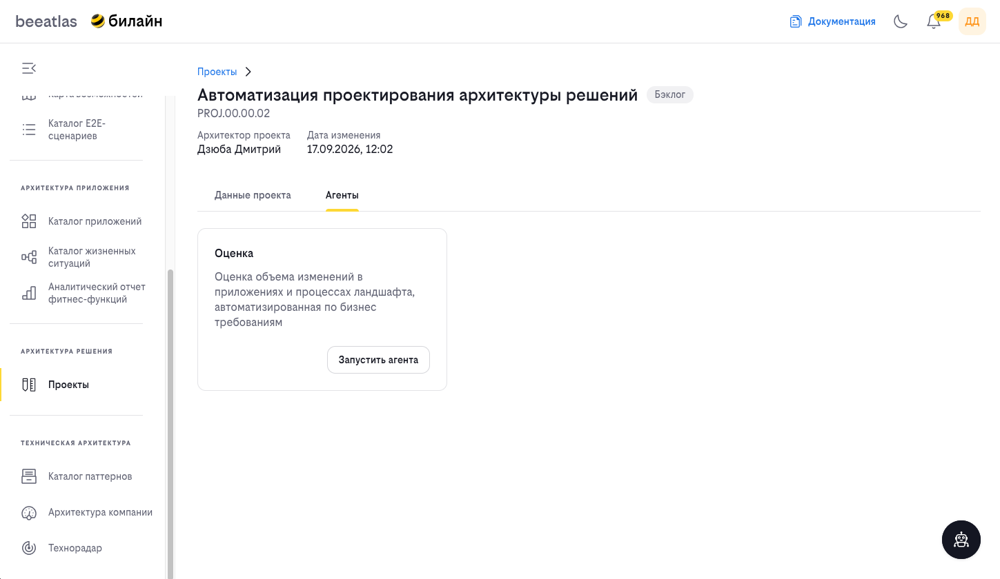
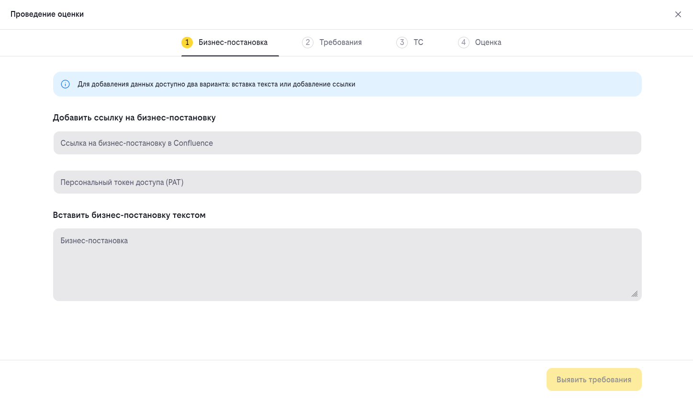
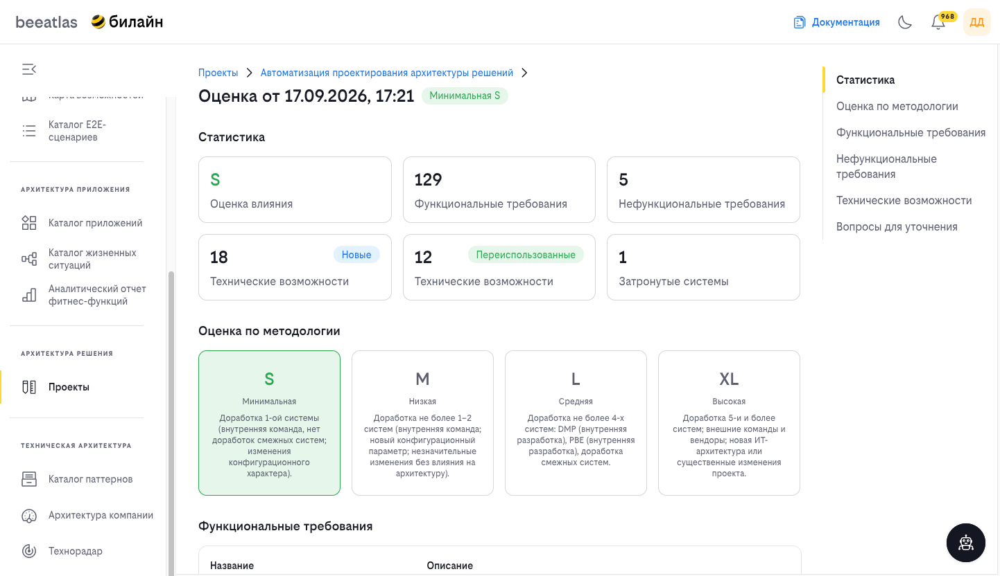

# Раздел «Проекты»

Раздел «Проекты» — это рабочее место для работы над проектами архитектуры решений: оценка проекта, подготовка и валидация HLD, обеспечение связности Use Case и диаграмм последовательностей на ландшафте.

В рамках проекта аналитик загружает бизнес-постановку, а ИИ-агент **«Оценка»** разбирает её на требования, подбирает технические возможности и рассчитывает уровень влияния изменений на ландшафт.

## Содержание

- [Обзор](#обзор)
- [Библиотека проектов](#библиотека-проектов)
- [Создание проекта](#создание-проекта)
- [Карточка проекта](#карточка-проекта)
- [Агент «Оценка»](#агент-оценка)
- [Мастер «Проведение оценки»](#мастер-проведение-оценки)
- [Уровень влияния](#уровень-влияния)
- [Страница оценки](#страница-оценки)
- [HLD-отчёт](#hld-отчёт)
- [Как использовать](#как-использовать)

---

## Обзор

**Проект** — это контейнер для одной или нескольких оценок влияния. Проект хранит бизнес-постановку, историю проведённых оценок и связанные артефакты.

Каждый проект имеет:

- **название** — например, «Автоматизация проектирования архитектуры решений»;
- **идентификатор** — формируется автоматически в формате `PROJ.00.00.01`;
- **статус** — одно из значений: **Бэклог**, **В работе**, **Завершён**;
- **архитектора проекта** — автора, создавшего проект;
- **оценку** — уровень влияния, рассчитанный агентом, либо **«Не оценен»**;
- **дату изменения** — время последнего изменения проекта;
- **ссылку на Jira** — при наличии.

### Статусы проекта

| Статус | Описание |
|--------|----------|
| **Бэклог** | Проект создан и ожидает начала работ |
| **В работе** | По проекту ведутся работы |
| **Завершён** | Работы по проекту завершены |

---

## Библиотека проектов

Библиотека проектов — основной экран раздела. Здесь отображаются все доступные вам проекты.

### Элементы управления

| Элемент | Описание |
|---------|----------|
| **Кнопка «Создать проект»** | Открывает форму создания нового проекта |
| **Поле «Поиск по названию или ID проекта»** | Поиск по названию, идентификатору или номеру проекта |
| **Фильтр «Архитектор»** | Автокомплит по сотрудникам: фильтрация проектов по архитектору |
| **Фильтр «Статус»** | Фильтрация по статусу: Бэклог, В работе, Завершён |
| **Переключатель «Мои проекты»** | Показывает только ваши проекты |
| **Кнопка «Сбросить»** | Сбрасывает установленные фильтры |

### Столбцы таблицы

| Столбец | Описание |
|---------|----------|
| **Проект** | Название проекта (ссылка на карточку) и его идентификатор, например `PROJ.00.00.02` |
| **Статус** | Текущий статус проекта |
| **Архитектор** | Архитектор проекта |
| **Оценка** | Уровень влияния по последней оценке, например «Минимальная S», либо **«Не оценен»** |
| **Дата изменения** | Дата и время последнего изменения проекта в формате `ДД.ММ.ГГГГ, ЧЧ:ММ` |
| **Jira** | Ссылка на задачу в Jira, если она указана; иначе отображается «—» |

Внизу таблицы доступна постраничная навигация со счётчиком записей (например, «1–3 из 3») и выбор количества строк на странице: 10, 25, 50 или 100.

Если ничего не найдено, отображается сообщение **«Проекты не найдены»** и подсказка **«Попробуйте изменить параметры поиска»**.

---

## Создание проекта

Для создания проекта нажмите кнопку **«Создать проект»** — справа откроется панель **«Создание проекта»**.

### Поля формы

| Поле | Обязательное | Описание |
|------|--------------|----------|
| **Название проекта** | Да | Наименование проекта, не более 255 символов. Если поле не заполнено, отображается ошибка «Укажите название проекта» |
| **Ссылка на Jira task** | Нет | Ссылка на задачу в Jira по проекту |

Для завершения создания нажмите **«Создать»**, для отказа — **«Закрыть»**.

После создания проект получает статус **Бэклог** и автоматически сформированный идентификатор вида `PROJ.00.00.02`, после чего открывается его карточка. Если проект с таким названием уже существует, создание не выполняется.

---

## Карточка проекта

Карточка проекта открывается из библиотеки проектов. В шапке отображаются навигационная цепочка **«Проекты»** с названием проекта, его идентификатор `PROJ.…` и бейдж текущего статуса, а также поля **«Архитектор проекта»** и **«Дата изменения»**.

Карточка содержит две вкладки:

| Вкладка | Назначение |
|---------|------------|
| **Данные проекта** | Бизнес-постановка проекта и результаты оценки |
| **Агенты** | Список доступных агентов и запуск оценки |

### Вкладка «Данные проекта»

Содержимое проекта представлено переключаемыми блоками:

| Блок | Описание |
|------|----------|
| **Бизнес-постановка проекта** | Текст бизнес-постановки, загруженной при проведении оценки |
| **Оценка** | Результаты проведённой оценки. Блок отображается только при наличии хотя бы одной оценки |

Пока оценка не проведена, вместо содержимого отображается подсказка: **«Бизнес-постановка отображается после загрузки и прохождения оценки в одном из агентов»**.

Если проект не найден, отображается сообщение **«Проект не найден»**, подсказка **«Проверьте адрес или вернитесь в библиотеку проектов»** и кнопка **«К списку проектов»**.

### Вкладка «Агенты»

На вкладке «Агенты» перечислены агенты, доступные для проекта. Для каждого агента отображается название, назначение и кнопка **«Запустить агента»**.

Доступный агент:

| Агент | Назначение |
|-------|------------|
| **Оценка** | Оценка объёма изменений в приложениях и процессах ландшафта, автоматизированная по бизнес-требованиям |

Нажатие кнопки **«Запустить агента»** открывает мастер **«Проведение оценки»** для этого проекта.

---

## Агент «Оценка»

**Агент «Оценка»** — это ИИ-ассистент аналитика. Он разбирает текст требований, выявляет технические возможности, находит готовые возможности на ИТ-ландшафте, оценивает влияние на системы и готовит HLD-отчёт с возможностью публикации в Confluence.

Технически агент реализован отдельным сервисом **HLD Agent** — он принимает бизнес-постановку, обращается к языковой модели и к каталогу BeeAtlas, а результат отдаёт в портал. Сервис не хранит данные: длительные операции (обращение к модели, анализ каталога) выполняются в фоне по схеме «запуск → прогресс → результат», а задачи живут в памяти сервиса в течение 24 часов.

!!! note "Агент не заменяет аналитика"
    Агент предлагает варианты, а решения принимает человек: на шаге выбора технических возможностей именно аналитик подтверждает, исключает или заменяет каждую предложенную возможность.

### Этапы работы агента

| Этап | Что делает |
|------|------------|
| **Постановка** (Intake) | Импорт требований из текста или Confluence и разбиение их на FR, NFR и OQ |
| **Технические возможности** (TC) | Выявление ТС по требованиям и поиск готовых возможностей в каталоге BeeAtlas; по каждой возможности принимается решение «переиспользовать», «создать новую» или «исключить» |
| **Оценка влияния** (Impact) | Определение уровня влияния S/M/L/XL по числу затронутых систем |
| **Публикация** (Publish) | Формирование HLD-отчёта в Markdown и публикация страницы в Confluence |

При разборе больших постановок текст обрабатывается частями — по 3000 символов с перекрытием, — а затем результаты объединяются и дедуплицируются.

Интерфейс опрашивает состояние задачи примерно каждые 2 секунды и показывает прогресс обработки до её завершения.

---

## Мастер «Проведение оценки»

Мастер **«Проведение оценки»** открывается на весь экран и состоит из четырёх шагов, отображаемых в виде пошаговой навигации:

| № | Шаг | Назначение |
|---|-----|------------|
| 1 | **Бизнес-постановка** | Загрузка исходного текста постановки |
| 2 | **Требования** | Структурирование требований |
| 3 | **ТС** | Подбор технических возможностей |
| 4 | **Оценка** | Расчёт уровня влияния и публикация результата |

### Шаг 1. Бизнес-постановка

Для добавления данных доступно два варианта: **вставка текста** или **добавление ссылки** на страницу Confluence.

| Вариант | Поля | Описание |
|---------|------|----------|
| **Добавить ссылку на бизнес-постановку** | «Ссылка на бизнес-постановку в Confluence», «Персональный токен доступа (PAT)» | Загрузка постановки со страницы Confluence. Токен вводится как пароль |
| **Вставить бизнес-постановку текстом** | «Бизнес-постановка» | Ручная вставка текста постановки |

Кнопка **«Выявить требования»** запускает обработку. Она недоступна, пока не заполнен ни один из вариантов.

### Шаг 2. Требования

Агент разбирает постановку на отдельные требования и распределяет их по трём разделам:

- **Функциональные требования** (FR);
- **Нефункциональные требования** (NFR);
- **Вопросы для уточнения** (OQ).

Во время обработки отображается прогресс. Доступные действия:

| Кнопка | Назначение |
|--------|------------|
| **«Назад»** | Возврат к шагу «Бизнес-постановка» |
| **«Перезапустить требования»** | Повторный запуск структурирования |
| **«Экспорт требований»** | Выгрузка требований в Markdown-файл `requirements.md` |
| **«Выявить TC»** | Переход к подбору технических возможностей. Недоступна, если не выявлено ни одного функционального требования |

Если обработка была прервана, отображается сообщение **«Обработка остановлена. Повторите запрос или вернитесь к предыдущему шагу.»**

### Шаг 3. ТС

Агент подбирает технические возможности (ТС), релевантные задаче, и сопоставляет их с каталогом возможностей и системами ИТ-ландшафта. Экран содержит блок **«Кандидаты TC на основании требований»**.

Для каждого кандидата каталог выдаёт подходящие бизнес-возможности и входящие в них ТС. По каждой предложенной возможности аналитик принимает решение:

| Решение | Описание |
|---------|----------|
| **Не обработана** | Решение ещё не принято |
| **Переиспользование** | Возможность уже существует на ландшафте и будет переиспользована |
| **Новая** | Возможность отсутствует на ландшафте и должна быть создана |
| **Исключена** | Возможность не относится к задаче и исключается из оценки |

Кнопки управления кандидатом: **«Исключить»**, **«Отметить TC как новую»**, **«Отменить»**, **«Вернуть»**. Кнопка **«Добавить недостающую TC»** позволяет добавить возможность вручную.

В шапке отображаются метрики **«Переиспользовано»**, **«Новые»**, **«Исключено»** и счётчик разбора кандидатов. Исключённые возможности не учитываются при расчёте уровня влияния.

Кнопка **«Провести оценку»** недоступна, пока не разобраны все кандидаты — при наведении отображается подсказка **«Проанализируйте всех кандидатов»**. Рядом доступны **«Назад»**, **«Перезапустить TC»** и **«Экспорт TC»** (Markdown-файл `technical-capabilities.md`).

### Шаг 4. Оценка

На этом шаге формируется итоговая оценка влияния. 

Доступные действия:

| Кнопка | Назначение |
|--------|------------|
| **«Назад»** | Возврат к шагу «ТС» |
| **«Экспорт»** | Выгрузка HLD-отчёта в Markdown-файл `hld-report-<ID проекта>.md` |
| **«Публикация в Confluence»** | Публикация отчёта как дочерней страницы Confluence |

Для публикации заполните поля **«Название страницы»**, **«URL родительской страницы»** и **«Персональный токен доступа (PAT)»**; поле **«Автор проведения оценки»** заполняется автоматически. После публикации отображается уведомление **«Оценка опубликована»** и ссылка **«Открыть опубликованный отчёт»**.

После завершения оценка сохраняется в проекте: появляется уведомление о том, что оценка завершена и сохранена и её можно опубликовать или скачать.

### Сохранение черновика

Черновик незавершённого мастера сохраняется в браузере, поэтому заполнение можно прервать и продолжить позже. Если браузерное хранилище недоступно или переполнено, отображается сообщение **«Не удалось сохранить черновик в браузере. Хранилище недоступно или переполнено.»** Если предыдущая обработка была прервана, при возврате отображается **«Предыдущая обработка была прервана. Запустите её повторно.»**

---

## Уровень влияния

Уровень влияния рассчитывается по количеству **уникальных систем**, затронутых подтверждёнными техническими возможностями.

| Уровень | Подпись в интерфейсе | Количество затронутых систем |
|---------|----------------------|------------------------------|
| **S** | Минимальная S | 1 система |
| **M** | Низкая M | 2 системы |
| **L** | Средняя L | 3–4 системы |
| **XL** | Высокая XL | 5 и более систем |

В оценку попадают как переиспользуемые, так и новые технические возможности; исключённые кандидаты не учитываются.

### Методология уровней

| Уровень | Описание |
|---------|----------|
| **Минимальная** | Доработка 1-ой системы (внутренняя команда, нет доработок смежных систем; изменения конфигурационного характера) |
| **Низкая** | Доработка не более 1–2 систем (внутренняя команда; новый конфигурационный параметр; незначительные изменения без влияния на архитектуру) |
| **Средняя** | Доработка не более 4-х систем: DMP (внутренняя разработка), PBE (внутренняя разработка), доработка смежных систем |
| **Высокая** | Доработка 5-и и более систем; внешние команды и вендоры; новая ИТ-архитектура или существенные изменения проекта |

Пока оценка не проводилась, в библиотеке проектов в столбце «Оценка» отображается значение **«Не оценен»**.

---

## Страница оценки

Результат оценки доступен из карточки проекта. В блоке с оценкой отображаются:

- заголовок **«Оценка от ДД.ММ.ГГГГ, ЧЧ:ММ»** (ссылка на страницу оценки);
- бейдж уровня влияния, а для актуальной оценки — дополнительный бейдж **«Последняя оценка»**;
- сводные метрики: **FR**, **NFR**, **TC**, **Системы**, **Вопросы**;
- поля **«Автор»** и **«Дата проведения»**.

Страница оценки содержит боковую навигацию по разделам:

| Раздел | Содержание |
|--------|------------|
| **Статистика** | Уровень влияния, количество FR, NFR и ТС (с разделением на новые и переиспользованные), число затронутых систем |
| **Оценка по методологии** | Карточки уровней S, M, L, XL с описанием методологии |
| **Функциональные требования** | Таблица выявленных FR (название и описание) |
| **Нефункциональные требования** | Таблица выявленных NFR |
| **Технические возможности** | Карточки ТС с бейджами «Новая» / «Переиспользование», процентом релевантности и связанными требованиями |
| **Вопросы для уточнения** | Список открытых вопросов |

Если раздел пуст, отображается соответствующее сообщение, например «Функциональные требования не выявлены», «Системы не выявлены», «Вопросы не выявлены».

Если страница оценки недоступна, отображается **«Оценка не найдена»**, подсказка **«Проверьте адрес или вернитесь в библиотеку проектов»** и кнопка **«К списку проектов»**.

### Несколько оценок в одном проекте

Агента можно запускать по проекту повторно. Каждый запуск создаёт **новую** оценку, а не перезаписывает предыдущую. В карточке проекта оценки разделены на **«Актуальная оценка»** (последняя по времени) и **«Прошлые оценки»**.

---

## HLD-отчёт

Результат оценки выгружается кнопкой **«Экспорт»** на шаге «Оценка» в виде Markdown-файла `hld-report-<ID проекта>.md`. Тот же отчёт публикуется в Confluence кнопкой **«Публикация в Confluence»**.

Отчёт имеет следующую структуру:

| Раздел | Содержание |
|--------|------------|
| **Шапка** | Название отчёта, источник постановки, ссылка на источник и дата создания. Содержит дисклеймер о том, что отчёт сгенерирован автоматически с использованием ИИ-агента |
| **1. Описание задачи** | Краткое описание задачи, сформированное агентом по бизнес-постановке |
| **2. Сводка (Summary)** | Сводная таблица: количество FR, NFR и открытых вопросов, число переиспользуемых и новых технических возможностей, количество задействованных систем ландшафта |
| **3. Детальные списки** | Функциональные требования (3.1), нефункциональные требования (3.2), открытые вопросы (3.3), технические возможности (3.4) и затронутые системы (3.5) |
| **4. Оценка влияния** | Методология оценки (4.1) и результат — уровень влияния с указанием количества затронутых систем (4.2) |

В разделе технических возможностей для каждой ТС указываются код, тип (**Reuse** — переиспользование или **New** — новая), название, родительская бизнес-возможность, описание, система и применяемые функциональные требования. Раздел «Затронутые системы» сгруппирован по системам и показывает, какие ТС затрагивают каждую из них.

---

## Как использовать

### Создание проекта

1. Перейдите в раздел **«Проекты»**.
2. Нажмите **«Создать проект»**.
3. В панели «Создание проекта» заполните поле **«Название проекта»**.
4. При необходимости укажите **«Ссылка на Jira task»**.
5. Нажмите **«Создать»** — откроется карточка созданного проекта.

### Поиск и фильтрация проектов

1. Перейдите в раздел **«Проекты»**.
2. Используйте поле **«Поиск по названию или ID проекта»** для поиска конкретного проекта.
3. Ограничьте выборку фильтрами **«Архитектор»** и **«Статус»** либо включите переключатель **«Мои проекты»**.
4. Для сброса условий нажмите **«Сбросить»**.

### Проведение оценки

1. Откройте нужный проект из библиотеки проектов.
2. Перейдите на вкладку **«Агенты»**.
3. В карточке агента **«Оценка»** нажмите **«Запустить агента»**.
4. На шаге **«Бизнес-постановка»** вставьте текст постановки либо укажите ссылку на страницу Confluence и персональный токен доступа.
5. Нажмите **«Выявить требования»** и дождитесь завершения структурирования.
6. На шаге **«Требования»** проверьте выявленные FR, NFR и вопросы для уточнения. При необходимости нажмите **«Перезапустить требования»** или выгрузите требования кнопкой **«Экспорт требований»**.
7. Нажмите **«Выявить TC»**.
8. На шаге **«ТС»** примите решение по каждой предложенной технической возможности: переиспользование, новая или исключена. При необходимости добавьте недостающую ТС вручную.
9. Нажмите **«Провести оценку»** — она станет доступна, когда все кандидаты разобраны.
10. На шаге **«Оценка»** ознакомьтесь с рассчитанным уровнем влияния и опубликуйте результат в Confluence либо экспортируйте его в Markdown.
11. Вернитесь в карточку проекта — оценка отобразится в блоке **«Оценка»** на вкладке «Данные проекта», а её уровень — в библиотеке проектов.

### Просмотр истории оценок

1. Откройте карточку проекта и перейдите на вкладку **«Данные проекта»**.
2. Блок **«Оценка»** показывает актуальную оценку; ранее проведённые оценки доступны в блоке **«Прошлые оценки»**.

---

## Навигация

- [Вернуться к разделу «О системе»](./README.md)
- [Описание моделей BeeAtlas](./models.md)
- [Инструкция по созданию критериев карты возможностей](./instruction/calc_criterion.md)
