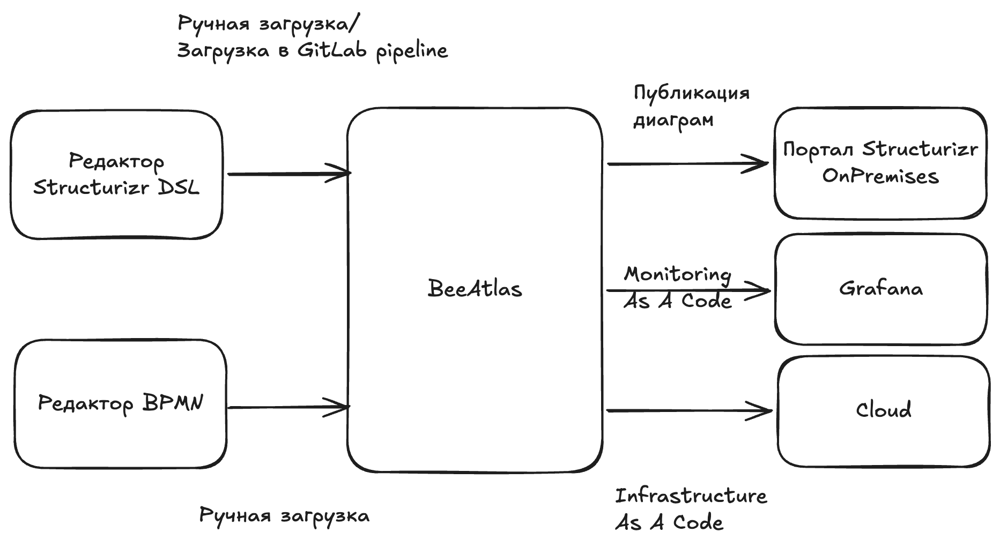

# Описание

Проектирование Технического Решения (ПТР) - это набор задач, которые выполняются на всем жизненном цикле приложения и имеют целью создание технического проекта.

## Цели методики

* Накапливать и распространять знания о ландшафте
* Преодолевать разрыв между предметной областью и технической командой
* Предоставлять методики и практики проектирования решений
* Выстраивать матрицу ответственности за сервисы и технические возможности
* Обеспечивать предсказуемость и повторяемость результатов в последующих проектах
* Обеспечивать автономность продуктовых команд

## Введение в Architecture As Code и Structurizr DSL

Традиционный подход к документированию архитектуры, основанный на "рисовании" диаграмм в графических редакторах, часто приводит к проблемам: схемы быстро устаревают, теряется связь с реальным кодом, а их поддержка превращается в отдельную трудоемкую задачу.

Подход **Architecture As Code (ArchAsCode)** предлагает кардинально иное решение: мы описываем архитектуру программными моделями, а не набором картинок. Используя текстовые форматы (DSL), мы получаем все преимущества работы с кодом — контроль версий (Git), возможность проведения код-ревью, автоматическую генерацию актуальной документации и интеграцию в CI/CD pipelines.

Ключевым инструментом для реализации этого подхода является **Structurizr DSL** и его тесная связь с моделью **C4**.




## Почему именно Structurizr DSL?

Structurizr DSL был создан Саймоном Брауном (автором модели C4) специально для визуализации архитектуры. В отличие от инструментов типа PlantUML или Mermaid, которые фокусируются на рисовании диаграмм (один файл — одна диаграмма), Structurizr DSL следует философии "модель как код".

**Основная идея:** Вы создаете единую модель системы, где описываете элементы (люди, программные системы, контейнеры, компоненты) и связи между ними. А уже на основе этой модели вы определяете различные **представления (views)** — системный контекст, контейнеры, компоненты и т.д. Это гарантирует, что все ваши диаграммы непротиворечивы и всегда отражают одно и то же состояние системы.

## Связь с моделью C4

Structurizr DSL идеально адаптирован для моделирования на всех уровнях C4:

1.  **Уровень 1: Контекст (Context).** Диаграмма показывает систему, её пользователей и внешние зависимости. В DSL это описывается с помощью элементов `person` и `softwareSystem`.
2.  **Уровень 2: Контейнеры (Containers).** Здесь мы показываем, из каких приложений и баз данных состоит наша система (API, база данных, веб-фронтенд). Внутри `softwareSystem` мы используем блок `container`.
3.  **Уровень 3: Компоненты (Components).** Детализируем отдельные контейнеры, показывая их внутренние модули (контроллеры, сервисы, репозитории). Используется блок `component`.
4.  **Уровень 4: Код (Code).** На этом уровне можно сгенерировать диаграммы классов, но автор нотации не рекомендует держать их в долговременной документации из-за высокой скорости изменений.

Structurizr DSL позволяет описывать всю эту иерархию в текстовых файлах. Например, простое описание может выглядеть так:

```java
workspace "Название" "Описание" {
    properties {
        workspace_cmdb my_system_code
    }
    model {
        u = person "Пользователь"
        ss = softwareSystem "Наша система" {
            properties {
                cmdb my_system_code
            }
            wa = container "Веб-приложение" {
                technology "Spring Boot"
            }
            db = container "База данных" {
                technology "PostgreSQL"
                tags "Database"
            }
        }
        u -> ss.wa "Использует"
        ss.wa -> ss.db "Читает/Пишет"
    }

    views {
        systemContext ss "Контекст" {
            include *
            autolayout lr
        }
        container ss "Контейнеры" {
            include *
            autolayout lr
        }
        styles {
            element "Database" {
                shape Cylinder
            }
        }
    }
}
```

## Преимущества для вашей команды

*   **Единый источник правды:** Модель одна, диаграмм много.
*   **Контроль версий:** Вы всегда видите, кто и зачем изменил архитектуру.
*   **Автоматизация:** Генерация диаграмм, проверка правил архитектуры (как тесты) и публикация документации (например, в Structurizr Lite) могут быть автоматизированы.
*   **Масштабирование:** Описание архитектуры всего ландшафта компании может храниться в одном репозитории и дробиться на множество файлов для удобной поддержки.

## Полезные ссылки

*   **Модель C4:** Официальный сайт с концепцией, гайдами и примерами.
    *   [https://c4model.com/](https://c4model.com/)
*   **Structurizr DSL:** Точная документация по языку, туториалы и примеры использования.
    *   Официальный сайт: [https://structurizr.com/](https://structurizr.com/)
    *   Туториал (начало работы): [https://docs.structurizr.com/dsl/tutorial](https://docs.structurizr.com/dsl/tutorial)
    *   Справочник по языку (шпаргалка): [https://docs.structurizr.com/dsl/language](https://docs.structurizr.com/dsl/language)
    *   Structurizr Lite (локальный просмотр): [https://docs.structurizr.com/lite/workflow](https://docs.structurizr.com/lite/workflow)