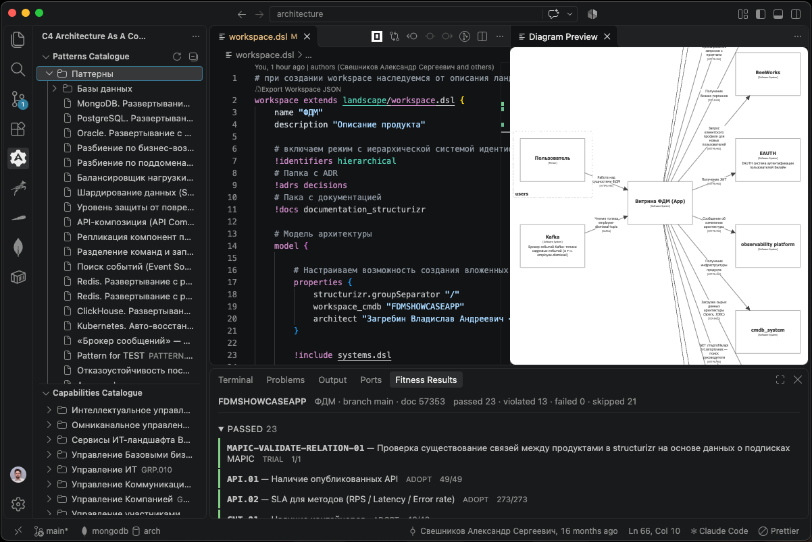

### Настройка корпоративного plugin к Visual Studio Code

Плагин **C4 Architecture As A Code** (`vimpelcom.c4-varp`) — расширение Visual Studio Code для моделирования архитектуры в формате Structurizr DSL. Актуальная версия — **2.1.2** (ноябрь 2026).

#### Требования

* Visual Studio Code версии **1.101** или выше
* Отсутствие других расширений для файлов `.dsl` — иначе подсветка, переходы и предпросмотр работают некорректно
* Доступ к серверу ArchOPS — для каталога паттернов, каталога бизнес-возможностей и фитнес-проверок
* **Java не требуется.** В версии 2.x language server реализован на Langium/TypeScript и работает как обычное расширение VS Code. Отдельная установка JDK/JRE и настройка `JAVA_HOME` больше не нужны.

Плагин одинаково работает в настольном VS Code и в браузере (`vscode.dev`) — в браузерной версии доступны редактирование, подсветка, подсказки и предпросмотр диаграмм.

#### Порядок установки плагина

**Установка из Marketplace:**

* Запустите Visual Studio Code.
* Откройте панель расширений: **Extensions** (`Ctrl+Shift+X` / `Cmd+Shift+X`).
* Введите в поиске `C4 Architecture As A Code` или откройте [страницу расширения](https://marketplace.visualstudio.com/items?itemName=vimpelcom.c4-varp).
* Нажмите **Install**.

**Установка из командной строки:**

```bash
code --install-extension vimpelcom.c4-varp
```

**Установка из файла `.vsix`:**

* Откройте панель **Extensions**.
* Нажмите меню **⋮** → **Install from VSIX...** и выберите файл.

#### Порядок конфигурирования плагина

* Откройте панель **Extensions**.
* Найдите плагин **C4 Architecture As A Code**.
* Нажмите на шестеренку и выберите **Extension Settings** (или **Settings** → раздел **VARP / ArchOps**).

| Настройка | Значение по умолчанию | Назначение |
|-----------|----------------------|------------|
| **Интеграция с ArchOps** | | |
| `archops.api.url` | — | URL сервера ArchOPS в вашем контуре, например `https://archops.example.com` |
| `archops.api.key` | — | API-ключ вашего продукта [BeeAtlas](beeatlas-docs/models/apps.md) |
| `archops.api.secret` | — | API-секрет вашего продукта [BeeAtlas](beeatlas-docs/models/apps.md) |
| **Предпросмотр диаграмм** | | |
| `varp.diagram.autoRefresh` | `onChange` | Когда перерисовывать диаграмму: `onChange` — при каждом изменении документа, `onSave` — только при сохранении |
| **MCP-сервер** | | |
| `varp.mcp.autoStart` | `false` | Автоматически запускать встроенный MCP-сервер при активации расширения (только настольная версия) |

API-ключ и секрет берутся в карточке приложения BeeAtlas на вкладке **«Общая информация»** — см. [Приложения](beeatlas-docs/models/apps.md).

Пока не заданы все три настройки `archops.*`, плагин работает как DSL-редактор: подсветка, подсказки, переходы и предпросмотр доступны, а каталог паттернов, каталог бизнес-возможностей и панель фитнес-проверок скрыты.

#### Проверка работоспособности плагина

Расширение активируется автоматически при открытии файла с расширением `.dsl` — таким файлам назначается язык **C4**.

Создайте файл **workspace.dsl** и откройте его в Visual Studio Code:

```dsl
workspace {
    name "Пример"
    model {
        myUser      =  person "Пользователь"
        mySystem    =  softwareSystem "Моя система"
        otherSystem =  softwareSystem "Чужая система"
        myUser   -> mySystem "Работает в системе"
        mySystem -> otherSystem "Запрашивает полезные данные" "HTTPS"
    }
    views {
         systemContext  mySystem {
            include *
            autoLayout
         }
    }
}
```

Над блоком представления появится кодлинк **«Show As Structurizr Diagram»** — нажмите его, чтобы открыть диаграмму на вкладке **Diagram Preview**. Над блоком `workspace` доступен кодлинк **«Export Workspace JSON»** — выгрузка workspace в `.json`.



Диаграмма отрисовывается локально, без внешних сервисов. Если она не появилась или в модели есть ошибки, они отображаются в панели **Problems**.

#### Возможности плагина

##### Языковая поддержка Structurizr DSL

Language server реализован на Langium и повторяет поверхность эталонного Structurizr DSL: модель C4, модель развёртывания, определения представлений и директивы.

* Подсветка синтаксиса и семантические токены (макросы, классы, свойства)
* Inlay hints — подписи `name:`, `description:`, `technology:` прямо в коде
* Подсказки при вводе и переход к определению, включая иерархические идентификаторы
* Ссылки на файлы: `Ctrl+Click` по пути в `!include` и по `extendsUri`
* CodeLens над представлениями и над `workspace`

##### Предпросмотр диаграмм

* Интерактивная диаграмма для любого представления: System Landscape, System Context, Container, Component, Deployment, Dynamic, Filtered, Custom
* Автообновление при изменении файла или при сохранении — настройка `varp.diagram.autoRefresh`
* Темы Structurizr; если тему не удалось загрузить, используется локальный вариант оформления
* Поддержка выражений `include`/`exclude` (`element.tag==`, `element.type==`, `relationship==`), директив `!elements` и `!relationships`, автоматических раскладок

##### Экспорт диаграмм и раскладки

Из панели предпросмотра доступны команды:

* **Export to SVG (.svg)** — выгрузить текущую диаграмму в SVG;
* **Export to DrawIO (.drawio)** — выгрузить диаграмму в формате draw.io;
* **Import layout from DrawIO (.drawio)** — импортировать ручную раскладку из ранее выгруженного файла `.drawio` обратно в представление;


##### Каталог архитектурных паттернов

Представление **Patterns Catalogue** в боковой панели показывает корпоративные паттерны, сгруппированные по разделам каталога (например, «Базы данных», «Развёртывание», «Отказоустойчивость»).

* **Copy pattern C4 DSL** — скопировать DSL-фрагмент паттерна в буфер обмена;
* **Show pattern description** — открыть описание паттерна (по клику на паттерн);
* **Refresh patterns catalogue** — обновить каталог с сервера ArchOPS (иконка в заголовке панели).

##### Каталог бизнес-возможностей

Представление **Capabilities Catalogue** показывает дерево бизнес-возможностей из BeeAtlas. Действие **Copy capability code** копирует код возможности — его можно использовать в `properties` элементов модели.

##### Фитнес-функции

Панель **Fitness Results** отображает результат корпоративных проверок архитектуры для открытого workspace. В заголовке панели — мнемоника продукта, его название, ветка, идентификатор документа и сводка `passed / violated / failed / skipped`; ниже проверки сгруппированы по результату, у каждой указаны код, название, статус (**ADOPT** / **TRIAL**) и счётчики.

Проверки запускаются, если в модели задана мнемоника продукта в свойстве workspace:

```dsl
workspace {
    model {
        properties {
            workspace_cmdb "FDMSHOWCASEAPP"
        }
        // ...
    }
}
```

Запрос уходит в `/ff/api/v1/run-all-workspace` для ветки `main`; время ожидания — до 5 минут. Результаты не сохраняются в `product_ff`: это «сухой» расчёт по workspace из редактора.

##### MCP-сервер для AI-ассистентов

При включённой настройке `varp.mcp.autoStart` расширение поднимает встроенный **MCP-сервер** (Model Context Protocol) и публикует разрешённую модель по адресу `http://127.0.0.1:47474/mcp` (порт фиксированный, только локальный интерфейс и только настольная версия VS Code).

Доступные инструменты: `list-projects`, `list-views`, `read-project-summary`, `search-element` и др. После включения настройки перезагрузите MCP-клиент — сервер появится под именем `c4-varp`.

Пример подключения в `opencode.json`:

```json
{
  "$schema": "https://opencode.ai/config.json",
  "mcp": {
    "c4-varp": {
      "type": "remote",
      "url": "http://127.0.0.1:47474/mcp",
      "enabled": true
    }
  }
}
```