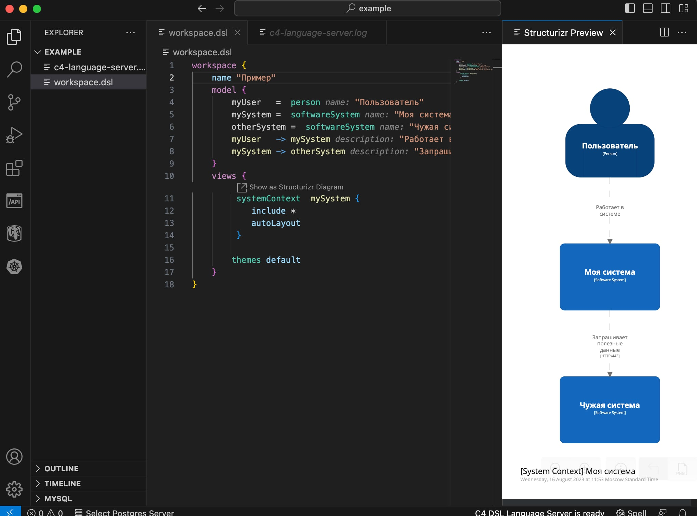
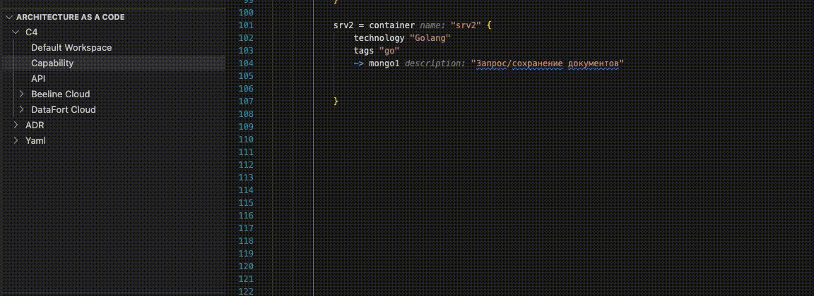
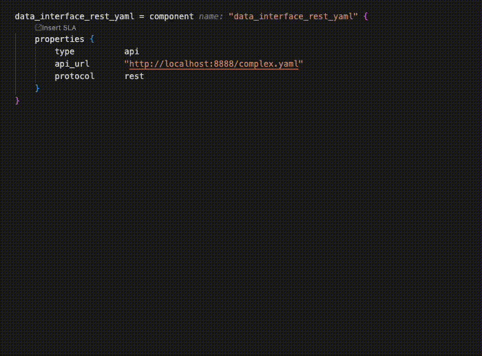
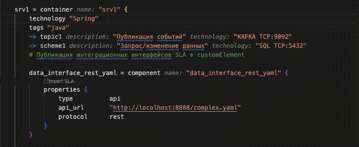
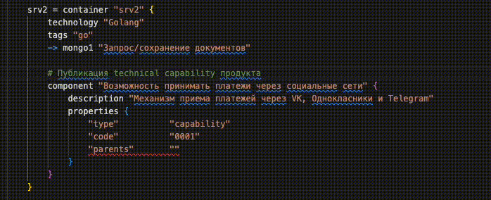
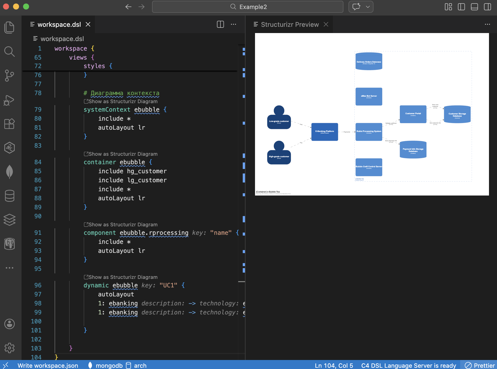

### Настройка корпоративного plugin к Visual Studio Code

#### Требования

* Поддерживаются операционные системы Windows, MacOS, Linux Ubuntu 20+
* Установленная среда разработки Visual Studio Code
* Отсутствие других плагинов для файлов DSL установленных в Visual Studio Code
* Установленная Java версии 17 и выше ([скачать](https://java.com/en/download/))

#### Настройка Java 17

**Для Windows:**

1. **Установка Java 17:**
   - Скачайте и установите Oracle JDK 17 или OpenJDK 17
   - Рекомендуется использовать Oracle JDK 17 для стабильной работы

2. **Настройка переменных среды:**
   - Откройте "Панель управления" → "Система" → "Дополнительные параметры системы"
   - Нажмите "Переменные среды"
   - В разделе "Переменные пользователя" нажмите "Создать"
   - Добавьте переменную:
     - **Имя:** `JAVA_HOME`
     - **Значение:** `C:\Program Files\Java\jdk-17` (путь к вашей установке JDK 17)
   - В переменной `Path` добавьте: `%JAVA_HOME%\bin`

3. **Проверка установки:**
   ```cmd
   java -version
   javac -version
   echo %JAVA_HOME%
   ```

**Для macOS:**

1. **Установка Java 17:**
   - Через Homebrew: `brew install openjdk@17`
   - Или скачайте с официального сайта Oracle

2. **Настройка переменных среды:**
   - Откройте терминал и добавьте в файл `~/.zshrc` (или `~/.bash_profile`):
   ```bash
   export JAVA_HOME=$(/usr/libexec/java_home -v 17)
   export PATH=$JAVA_HOME/bin:$PATH
   ```
   - Перезагрузите терминал: `source ~/.zshrc`

3. **Проверка установки:**
   ```bash
   java -version
   javac -version
   echo $JAVA_HOME
   ```

**Для Linux Ubuntu 20+:**

1. **Установка Java 17:**
   ```bash
   sudo apt update
   sudo apt install openjdk-17-jdk
   ```

2. **Настройка переменных среды:**
   - Добавьте в файл `~/.bashrc`:
   ```bash
   export JAVA_HOME=/usr/lib/jvm/java-17-openjdk-amd64
   export PATH=$JAVA_HOME/bin:$PATH
   ```
   - Перезагрузите терминал: `source ~/.bashrc`

3. **Проверка установки:**
   ```bash
   java -version
   javac -version
   echo $JAVA_HOME
   ```

**Важно:** Если на системе установлено несколько версий Java, убедитесь, что Java 17 выбрана по умолчанию. В настройках плагина можно указать конкретный путь к Java 17 в параметре `c4.languageserver.java.path`.

**Как найти путь к Java 17 для настройки плагина:**

- **Windows:** `C:\Program Files\Java\jdk-17\bin\java.exe`
- **macOS:** `/usr/libexec/java_home -v 17` (выполните команду в терминале)
- **Linux:** `/usr/lib/jvm/java-17-openjdk-amd64/bin/java`

Если плагин не может найти Java 17 автоматически, укажите полный путь к исполняемому файлу Java в настройке `c4.languageserver.java.path`.

#### Порядок установки плагина

**Установка из Marketplace VS Code:**

* Запустите Visual Studio Code
* На главной панели слева выберите закладку "Extensions" (или нажмите Ctrl+Shift+X)
* В поле поиска введите: `C4 Architecture As A Code` или перейдите по ссылке в [магазин](https://marketplace.visualstudio.com/items?itemName=vimpelcom.c4-varp)
* Найдите расширение от VimpelCom PJSC и нажмите "Install"
* Дождаться установки расширения

**Альтернативный способ установки через командную строку:**
* Откройте VS Code
* Нажмите Ctrl+P для открытия Quick Open
* Введите команду: `ext install vimpelcom.c4-varp`
* Нажмите Enter


#### Порядок конфигурирования плагина

* На главной панели слева выберите закладку "Extensions"
* Найдите плагин "C4 Architecture As A Code"
* Нажмите на шестеренку
* Выберите пункт "Extension Settings"

| Настройка | Значение по умолчанию                   | Назначение |
|-----------|-----------------------------------------|------------|
| **Основные настройки** |
| c4.diagram.structurizr.autolayout.url | embeded                                 | URL сервера отрисовки диаграмм (Cloud или On-Premises) |
| c4.editor.autoformat.indent | 4                                       | Количество пробелов для отступа |
| c4.languageserver.logs.enabled | false                                   | Включение логирования language server в c4-language-server.log |
| c4.languageserver.java.path |                                         | Путь к Java 17 (если установлено несколько версий Java) |
| c4.decorations.enabled | onChange                                | Время отображения текстовых декораций |
| c4.SSL\TLS.disabled | false                                   | Отключение проверки SSL/TLS |
| c4.diagram.render | embeded                                 | Способ отрисовки диаграм - по умолчанию, диаграммы отрисовываются локально|
| **Интеграция с ArchOps** |
| c4.beeline.api.url | [См.инструкцию по интеграции fdm-gateway](beeatlas-docs%2Finstruction%2Fintegration%2Fapi_gateway.md) | URL сервера ArchOPS |
| c4.beeline.api.key |                                         | API ключ вашего продукта [BeeAtlas](beeatlas-docs/models/apps.md)|
| c4.beeline.api.secret |                                         | API секрет вашего продукта [BeeAtlas](beeatlas-docs/models/apps.md)|
| **Интеграция с Beeline Cloud** |
| c4.beeline.cloud.token |                                         | Токен безопасности Beeline Cloud |
| c4.beeline.cloud.url |                | URL API Beeline Cloud |
| **Глоссарии** |
| c4.beeline.glossaries | Product,Service,Customer                | Словари данных для интеграции с моделью (через запятую) |

#### Проверка работоспособности плагина

Расширение запускается автоматически, при первом открытии в редакторе DSL файла. В процессе запуска, расширению требуется некоторое время для получения необходимых данных из Bee Atlas. Индикатор готовности работы расширения находится в правом нижнем углу


Проверяем работу расширения, для этого делаем простой файл **workspace.dsl** и открываем его в Visual Studio Code
```dsl
workspace {
    name "Пример"
    model {
        myUser   =  person "Пользователь"
        mySystem =  softwareSystem "Моя система" 
        otherSystem =  softwareSystem "Чужая система" 
        myUser   -> mySystem "Работает в системе"
        mySystem -> otherSystem "Запрашивает полезные данные" "HTTP\443"
    }
    views {
         systemContext  mySystem {
            include *
            autoLayout 
         }
    }
}
```
После установки плагина preview диаграм будет доступно по ссылке "Show as structurizr diagram"


Для того чтобы плагин мог показывать Preview нужно чтобы на машине была Java 17 или выше. Чтобы узнать версию java наберите в командной строке:

```sh
java -version
```

Если у вас версия java меньше 17, тогда обновите версию Java через соответствующую заявку.

#### Возможности плагина

##### Добавление готовых блоков в код

Плагин предоставляет быстрый доступ к часто используемым блокам кода для ускорения моделирования архитектуры через Explorer.



##### Интеграция с ArchOps Server

**Парсинг API спецификаций:**
- Создание компонентов, соответствующих описаниям API с импортом спецификаций методов из:
  - Swagger
  - WSDL  
  - Protocol Buffers



##### Интеграция с Tech Radar

Загрузка списков технологий из корпоративного техрадара при указании технологий контейнеров или взаимодействий.



##### Интеграция с Capability

Создание компонентов с поддержкой возможностей с описаниями, загружаемыми из корпоративной карты возможностей.



##### Синтаксическая подсветка

Поля значений, такие как имя и технология, подсвечиваются, когда диаграмма не содержит ошибок.

##### Предварительный просмотр диаграмм

Диаграммы без ошибок можно предварительно просмотреть, нажав на иконку диаграммы рядом с соответствующим представлением.

