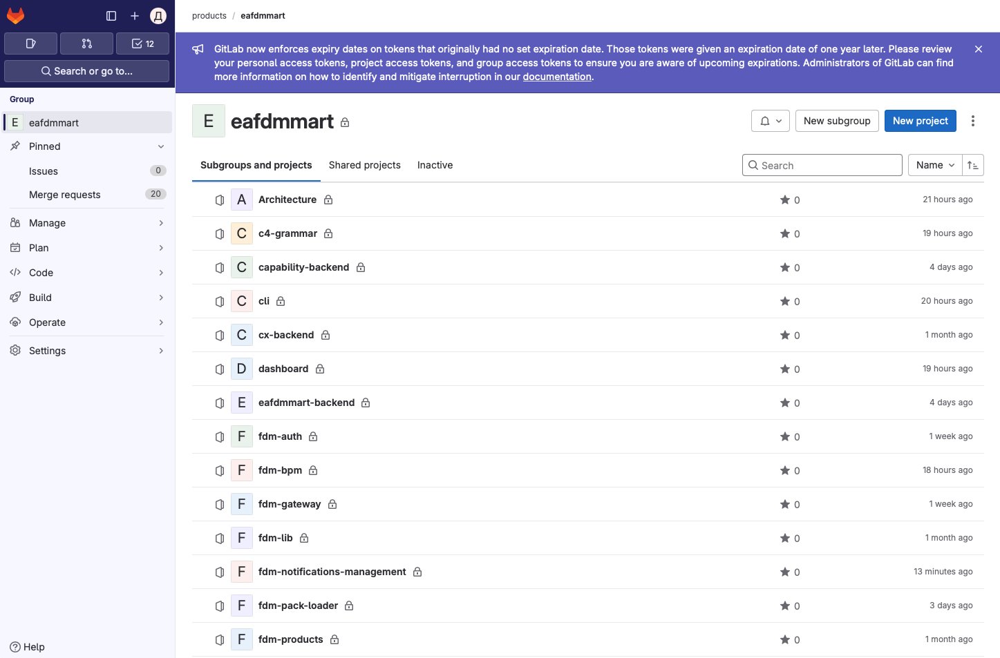
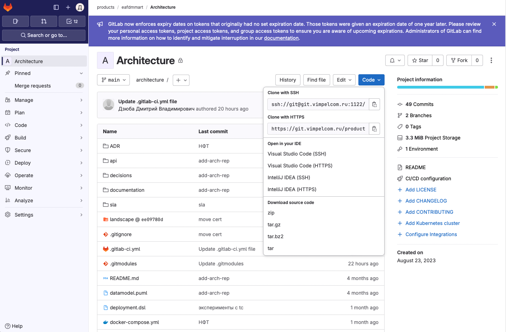
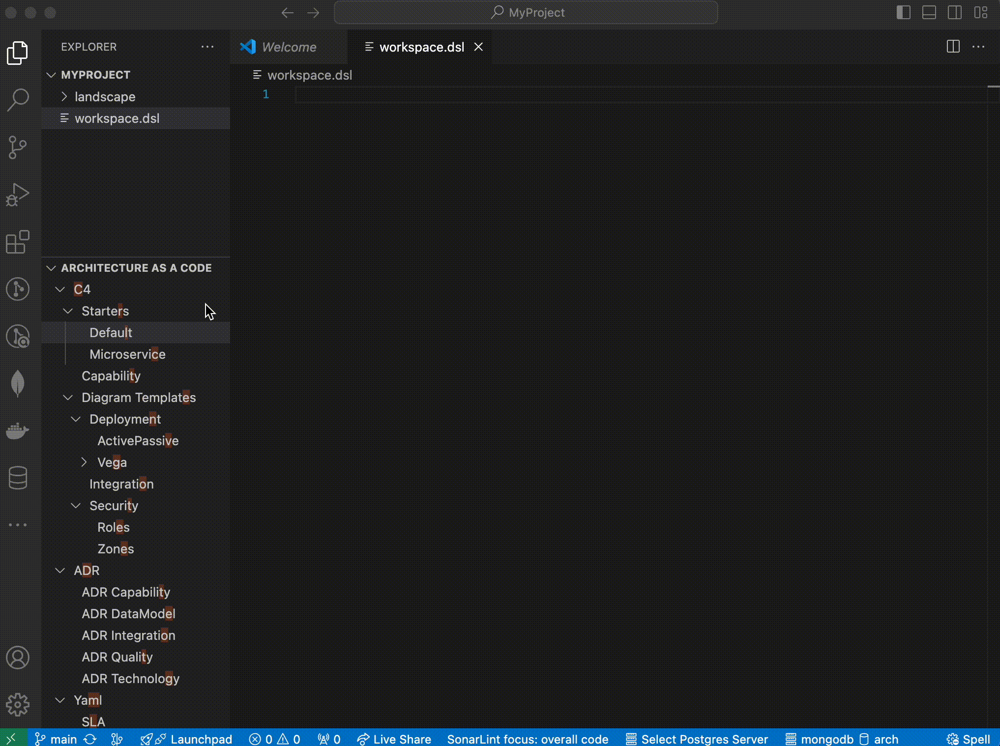

### Простой проект с использованием Structurizr

#### Создание проекта для ведения архитектуры в корпоративном gitlab

* Откройте GitLab
* Перейдите в директорию своего продукта
* Нажмите кнопку "New project"
 


* С помощью wizard создайте новый проект
* В созданном проекте нажмите кнопку "Clone" и скопируйте строчку "Clone with HTTPS" - url_вашего_проекта



#### Клонирование проекта на локальную машину

* Запустите командную строку (shell / PowerShell)
* Если вы раньше не работали с git - нужно один раз "познакомить" его с корпоративной политикой управления сертификатами

```sh
git config --bool --global --add http.https://git.example.ru.sslverify false
```

* Войдите в директорию в которой вы будете вести файлы и выполните в ней команду

```sh
git clone url_вашего_проекта
```

#### Создание тестового проекта с помощью plugin

* Откройте директорию вашего проекта в visual Studio Code
* Создайте в корневой директории проекта файл

``` sh
workspace.dsl
```

* Откройте в навигационном окне блок "Architecture As A Code"
* Выберете шаблон "Default"
* Заполните Имя приложения, Описание приложения, cmdb_mnemonic приложения и Имя архитектора
* Проверьте что контекстная диаграмма создается
  

