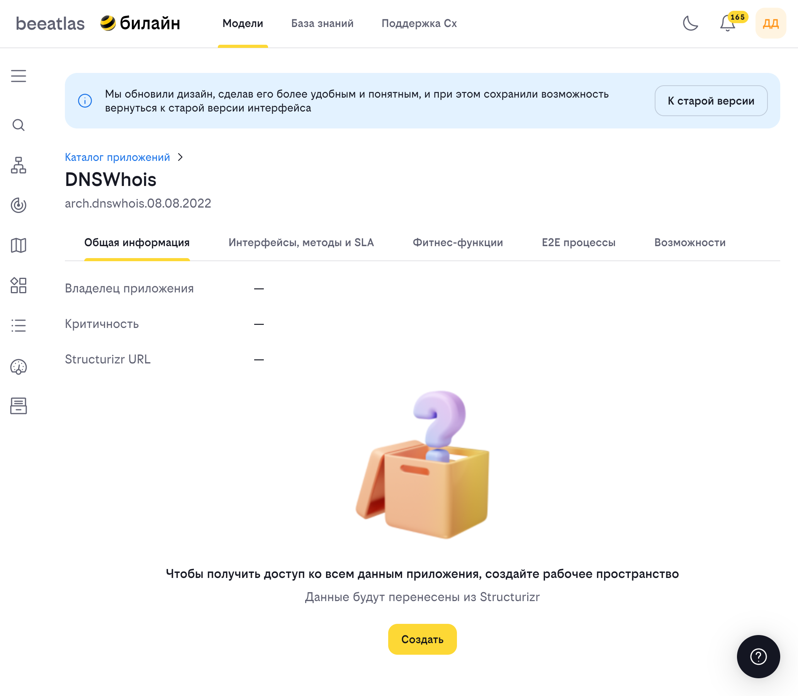
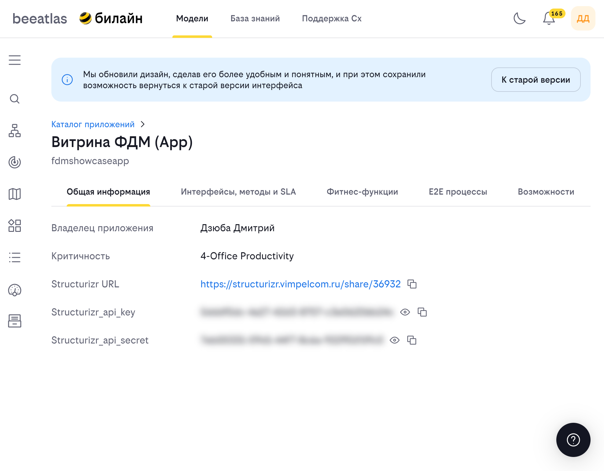

### Настройка публикации архитектуры в центральный репозиторий

#### Создание Workspace под приложение

Если под ваше приложение еще не сделано рабочее пространство в центральном репозитории, то его нужно создать на карточке приложения в [BeeAtlas](beeatlas-docs/models/apps.md):




Реквизиты для публикации, можно так же найти на форме приложения (для членов команды согласно BeeWorks):

```yaml
Workspace ID: 5
API key: 1a62386d-daf1-4408-9a64-1305ba909f10
API secret: 1a62386d-daf1-4408-9a64-1305ba909f10
```




Для публикации необходимо что бы в workspace.dsl была указан CMDB мнемоника приложения, которое вы публикуете в двух местах:

- на уровен всей модели (property workspace_cmdb)
- на уровне вышей системы (property cmdb)

```java
workspace {
    model {
        # указываем что это описание архитектуры приложения my_cmdb_code
        properties { 
            workspace_cmdb "my_cmdb_code"
        }

        my_system = softwareSystem "system name"{
            # указываем что это само приложение my_cmdb_code
            property {
                cmdb "my_cmdb_code"
            }
        }
    }
    views {
    }
}
```